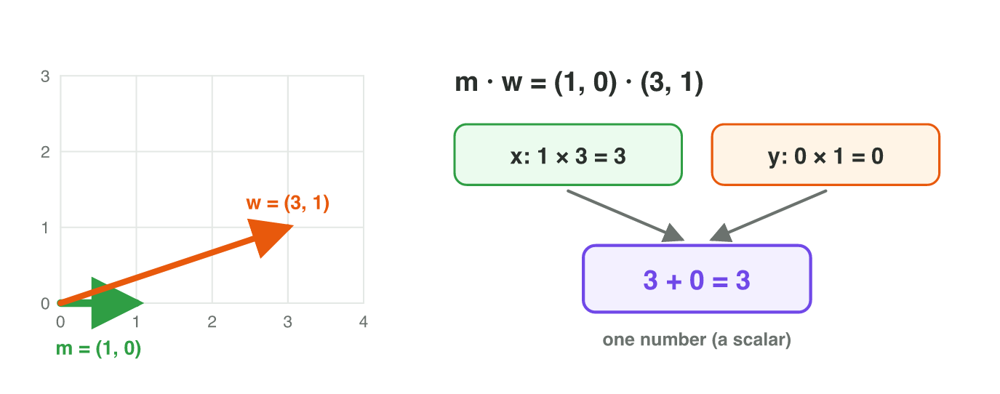
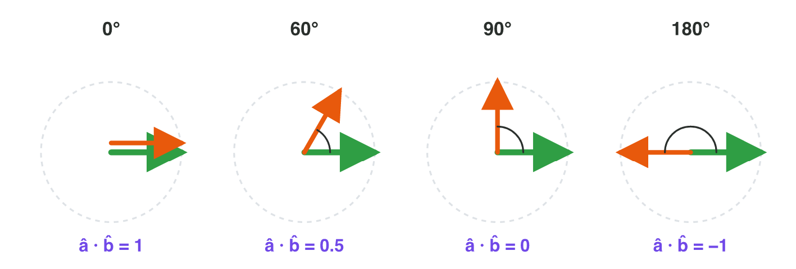
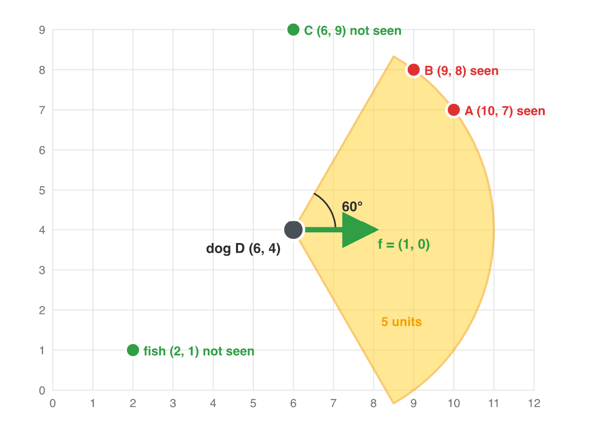

## Keywords



## 3.1 The dot product

:::: {.columns}
::: {.column width="50%"}
- The dot product turns two vectors into one number.
- Multiply the x-parts, multiply the y-parts, and add the results.
- In 3D, the game adds the product of the z-parts too.
- **Do it:** In GeoGebra, type u = Vector((2, 3)), v = Vector((4, −1)) and u * v. What is the result?
:::
::: {.column width="50%"}

:::
::::

## Example · Does the wind help?

A boat moves in the direction (1, 0). The wind is (3, 1).
**What is the dot product, and does the wind help?**

::: {.reveal}
1. The x-parts give 1 × 3 = 3.
2. The y-parts give 0 × 1 = 0.
3. The dot product is 3 + 0 = **3**. It is positive, so the wind helps.
:::

## Try it 1 · Compute it

a) What is (2, 3) · (4, −1)?
b) What is (1, 2, 3) · (4, 0, −1)?
c) Is the result of a dot product a vector or a number?

::: {.answer}
a) 5
b) 1
c) one number
:::

## 3.2 In front or behind?

:::: {.columns}
::: {.column width="50%"}
- The forward vector f shows where a guard looks.
- The vector from the guard to the cat is d = C − D.
- A positive dot product of f and d means in front, and a negative one means behind.
- Zero means exactly to the side: the vectors are perpendicular.
- **Do it:** In Dot Lab, make the dot product zero. Where does the orange arrow point?
:::
::: {.column width="50%"}

:::
::::

## Example · In front or behind?

A dog at D = (2, 2) faces f = (1, 0).
**Is a cat at (5, 3) in front of the dog, and is a cat at (0, 4)?**

::: {.reveal}
1. Cat at (5, 3): d = (3, 1), so f · d = 3. It is **in front**.
2. Cat at (0, 4): d = (−2, 2), so f · d = −2. It is **behind**.
3. A cat at (2, 6) gives 0: it is exactly to the side.
:::

## Example · Warmer or colder?

The player is at (1, 1), the treasure at (4, 5), and the player moves with (−1, 2).
**Is the player moving towards the treasure?**

::: {.reveal}
1. The vector to the treasure is (4, 5) − (1, 1) = (3, 4).
2. The dot product is (−1, 2) · (3, 4) = −3 + 8 = 5.
3. It is positive, so the player moves **towards** the treasure.
:::

## Example · A right angle

A character faces (3, 4) and side-steps along (−4, 3).
**Is the side-step at a right angle to the facing direction?**

::: {.reveal}
1. The dot product is (3, 4) · (−4, 3) = −12 + 12 = 0.
2. A dot product of 0 means exactly 90°.
3. So the two vectors are **perpendicular**.
:::

## Live demo · Dot Lab



## Try it 2 · In front or behind?

The facts: a guard dog at D = (2, 2) faces f = (1, 0).

a) A cat is at (2, 6). Where is it?
b) The dot product of two vectors is negative. Is the angle more or less than 90°?
c) A player at (1, 1) moves (−1, 2) to the treasure at (4, 5). Is the player moving towards it?

::: {.answer}
a) exactly to the side
b) more than 90°
c) Yes: the dot product is 5.
:::

## 3.3 How big is the angle?

:::: {.columns}
::: {.column width="50%"}
- First normalize both vectors.
- For unit vectors, the dot product is a number between −1 and 1.
- The table gives the angle: 1 is 0°, 0.5 is 60°, 0 is 90° and −1 is 180°.
- **Do it:** In Dot Lab, show unit vectors and make 60°. What is the dot product?
:::
::: {.column width="50%"}

:::
::::

## Example · Between two values

A guard faces (1, 0). The cat is in the direction (3, 4).
**About how big is the angle?**

::: {.reveal}
1. The unit vector to the cat is (3, 4) ÷ 5 = (0.6, 0.8).
2. The dot product with (1, 0) is 0.6.
3. 0.6 is between 0.5 (60°) and 0.71 (45°): **between 45° and 60°**.
:::

## Try it 4 · The angle

a) Two unit vectors have the dot product 0.5. What is the angle between them?
b) What is the angle between (2, 0) and (0, 7)?
c) The dot product of two unit vectors is −1. What is the angle?

::: {.answer}
a) 60°
b) 90°
c) 180°
:::

## 3.4 The vision cone

:::: {.columns}
::: {.column width="50%"}
- A guard sees a cone, for example 60° to each side and 5 units deep.
- The dog sees the cat when the dot product of the unit vectors is at least 0.5 and the cat is at most 5 units away.
- The game must check the distance as well as the angle.
- **Do it:** A guard at (4, 4) faces (1, 0). Does it see the point (8, 7)?
:::
::: {.column width="50%"}

:::
::::

## Example · Does the guard see the thief?

A guard at G = (1, 1) faces f = (1, 0). It sees 60° to each side and 5 units deep.
**Does it see a thief at (1, 6)?**

::: {.reveal}
1. The vector to the thief is d = (0, 5), and |d| = 5. It is near enough.
2. The unit vector to the thief is (0, 1), and its dot product with f is 0.
3. 0 is less than 0.5, so the thief is **not seen**: it is exactly to the side.
:::

## Try it 5 · Seen or not?

The facts: a guard at (1, 1) faces (1, 0). It sees 60° to each side and 5 units deep.

a) A thief is at (5, 4). The dot product of the unit vectors is 0.8. Is it seen?
b) A thief is at (−3, −2). The dot product of the unit vectors is −0.8. Is it seen?
c) A thief is at (11, 1), straight ahead. Why is it not seen?

::: {.answer}
a) Yes, it is seen.
b) No: it is behind the guard.
c) It is 10 units away, too far.
:::

## Game challenge · Shadow Cat



## Try it 5 · The dog looks right

The facts: the dog is at (6, 4) and looks right, f = (1, 0). Bush A is at (10, 7) and bush C at (6, 9).

a) What is the vector from the dog to bush A?
b) The dot product of the unit vectors for bush C is 0. Is bush C safe for the cat?

::: {.answer}
a) (4, 3)
b) Yes: 0 is less than 0.5, so the dog cannot see it.
:::

## Try it 6 · The dog turns (harder)

The facts: the dog is at (6, 4). Bush A is at (10, 7), bush B at (9, 8) and bush C at (6, 9).

a) The dog looks right, f = (1, 0). Which bush is safe?
b) The dog turns and looks up, f = (0, 1). What is the dot product of the unit vectors for bush C?
c) Is any bush safe after the turn?

::: {.answer}
a) C: its dot product is 0.
b) 1
c) No: all three are seen.
:::

## Summary

- The dot product multiplies matching components and adds them into one number.
- A positive result means in front, zero means to the side, and negative means behind.
- Perpendicular vectors have the dot product 0.
- For unit vectors, the dot product gives the angle from a table.
- A guard sees a target when the dot product of the unit vectors is at least 0.5 and the target is near.
