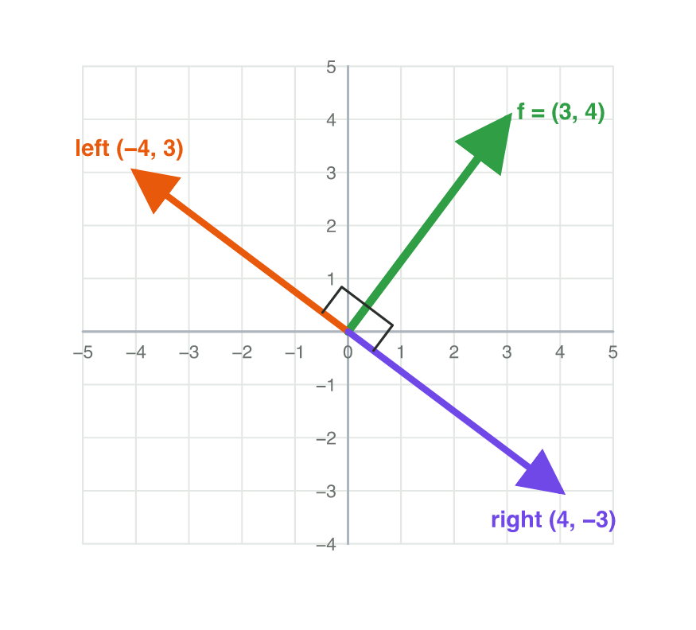

::: {.lead}
In a stealth game, a guard dog watches a garden, and a cat must sneak past
it. In every frame the game asks the same question: *can the dog see the
cat?* To answer it, the game must know if the cat is in front of the dog or
behind it, and how far to the side it is. One small calculation answers
these questions: the **dot product**. It turns two vectors into one number.
In this lesson you learn to compute it and to read its sign. You also use it
to find a vector at a right angle, to find the angle between two directions,
and to build the vision cone of a guard. Every section ends with a short
task.
:::

## Key terms



## 4.1 One number from two vectors: the dot product

A sailing boat moves in the direction $\mathbf{m} = (1, 0)$. The wind blows
with $\mathbf{w} = (3, 1)$. Does the wind help the boat, or does it slow the
boat down? The game needs one number that says how much the two vectors go
the same way.

::: {.callout-important title="Definition 4.1 — Dot product"}
The **dot product** of two vectors is a number (a scalar). Multiply the
matching components and add the results:
$$\mathbf{a} \cdot \mathbf{b} = a_x b_x + a_y b_y.$$
In 3D: $\mathbf{a} \cdot \mathbf{b} = a_x b_x + a_y b_y + a_z b_z$.
:::

{#fig-dotsteps width=84%}

::: {.callout-note title="Example 4.1 — Does the wind help?"}
The boat moves in the direction $\mathbf{m} = (1, 0)$, and the wind is
$\mathbf{w} = (3, 1)$ (@fig-dotsteps).

1. x-parts: $1 \times 3 = 3$.
2. y-parts: $0 \times 1 = 0$.
3. $\mathbf{m} \cdot \mathbf{w} = 3 + 0 = 3$. The result is positive: the
   wind pushes the boat forward.
:::

::: {.callout-note title="Example 4.2 — Two more dot products"}
1. $(2, 3) \cdot (4, -1) = 2 \times 4 + 3 \times (-1) = 8 - 3 = 5$.
2. In 3D: $(1, 2, 3) \cdot (4, 0, -1) = 4 + 0 - 3 = 1$.
3. The order does not matter: $(4, -1) \cdot (2, 3) = 8 - 3 = 5$ too.
:::

::: {.callout-warning title="Common mistake"}
Writing the result as a vector, such as $(3, 0)$. The products of the
components are only a middle step. The dot product adds them into **one
number**: 3.
:::

::: {.callout-caution title="In game code"}
```csharp
Vector2 move = new Vector2(1f, 0f);
Vector2 wind = new Vector2(3f, 1f);
float help = Vector2.Dot(move, wind);   // 3
```
:::

::: {.callout-note title="Do it · The dot product in GeoGebra"}
Open geogebra.org/calculator.

1. Type `u = Vector((2, 3))` and `v = Vector((4, -1))`.
2. Type `u * v`. For two vectors, GeoGebra gives the dot product.
3. Calculate $(2, 3) \cdot (4, -1)$ by hand and compare.

*Your result:* GeoGebra's number, your calculation, and the dot product of
two vectors of your choice.
:::

## 4.2 In front or behind? The sign of the dot product

A guard dog faces right. Its **forward vector** is $\mathbf{f} = (1, 0)$: the
direction it is looking. A cat is somewhere in the garden. Is the cat in
front of the dog or behind it?

Take the vector from the dog to the cat, $\mathbf{d} = C - D$. Then look at
the sign of $\mathbf{f} \cdot \mathbf{d}$ (@fig-sign):

| $\mathbf{f} \cdot \mathbf{d}$ | Angle between the arrows | Meaning for the guard |
|---|---|---|
| positive (> 0) | less than 90° | the cat is in front |
| zero (= 0) | exactly 90° | the cat is exactly to the side |
| negative (< 0) | more than 90° | the cat is behind |

: What the sign of the dot product tells. {#tbl-sign}

{#fig-sign width=88%}

::: {.callout-note title="Example 4.3 — In front or behind?"}
The dog is at $D = (2, 2)$ and faces $\mathbf{f} = (1, 0)$.

1. Cat at $(5, 3)$: $\mathbf{d} = (3, 1)$, and $\mathbf{f} \cdot \mathbf{d} = 3$.
   Positive: **in front**.
2. Cat at $(0, 4)$: $\mathbf{d} = (-2, 2)$, and $\mathbf{f} \cdot \mathbf{d} = -2$.
   Negative: **behind**.
3. Cat at $(2, 6)$: $\mathbf{d} = (0, 4)$, and $\mathbf{f} \cdot \mathbf{d} = 0$.
   **Exactly to the side**.
:::

The same test works for movement. If the velocity of a player and the vector
to the goal give a positive dot product, the player is moving *towards* the
goal. If it is negative, the player is moving *away* from it.

::: {.callout-note title="Example 4.4 — Warmer or colder?"}
A treasure-hunt game says "warmer" when the player moves towards the
treasure. The player is at $(1, 1)$, the treasure at $(4, 5)$, and the player
moves with $\mathbf{v} = (-1, 2)$.

1. Vector to the treasure: $(4, 5) - (1, 1) = (3, 4)$.
2. $\mathbf{v} \cdot (3, 4) = -3 + 8 = 5$. Positive.
3. The game says "warmer", even though the player also moves a little to
   the left.
:::

::: {.callout-warning title="Common mistake"}
Using the wrong vector. The test needs the vector *from the guard to the
cat*, $C - D$, not the position of the cat. The cat at $(5, 3)$ is in front
of a dog at $(2, 2)$, but behind a dog at $(8, 3)$ that also faces right.
:::



::: {.callout-note title="Do it · Dot Lab"}
Open the **Dot Lab** simulator above (or scan its QR code). The green arrow
is the guard's forward vector, and the orange arrow points to the cat.

1. Drag the orange arrow until the dot product is positive, then zero, then
   negative.
2. Each time, write the two vectors and the dot product.

*Your result:* three rows, and one sentence: where is the orange arrow when
the dot product is zero?
:::

## 4.3 At a right angle: perpendicular vectors

A player in a shooter game holds the side-step button. The character must
move to the left, at a right angle to the way it faces. The game needs a
vector that is **perpendicular** to the forward vector.

::: {.callout-important title="Definition 4.2 — Perpendicular vectors"}
Two vectors (not the zero vector) are **perpendicular** when the angle
between them is 90°. This happens exactly when their dot product is 0:
$$\mathbf{a} \cdot \mathbf{b} = 0.$$
:::

There is an easy way to turn a 2D vector by 90°: swap the two components and
change one sign (@fig-perp).

- $(x, y) \to (-y, x)$ turns the vector to the **left** (anticlockwise).
- $(x, y) \to (y, -x)$ turns it to the **right** (clockwise).

{#fig-perp width=64%}

::: {.callout-note title="Example 4.5 — The side-step"}
A character faces $\mathbf{f} = (3, 4)$.

1. To the left: $(-4, 3)$. To the right: $(4, -3)$.
2. Check the left one: $(3, 4) \cdot (-4, 3) = -12 + 12 = 0$. Perpendicular.
3. Check the right one: $(3, 4) \cdot (4, -3) = 12 - 12 = 0$. Perpendicular.
4. Both have the length 5, like $\mathbf{f}$.
:::

::: {.callout-note title="Example 4.6 — Is the road at a right angle?"}
A level designer draws a road with direction $(2, 1)$ and a bridge with
direction $(-1, 3)$. Do they meet at a right angle?

1. $(2, 1) \cdot (-1, 3) = -2 + 3 = 1$.
2. The result is not 0, so they do not meet at exactly 90°.
3. A bridge with direction $(-1, 2)$ would: $(2, 1) \cdot (-1, 2) = -2 + 2 = 0$.
:::

::: {.callout-warning title="Common mistake"}
Only swapping the components: $(3, 4) \to (4, 3)$. Check:
$(3, 4) \cdot (4, 3) = 24$, not 0. You must also change one sign.
:::

::: {.callout-note title="Do it · Right angles on paper"}
On squared paper:

1. Draw the vector $(2, 5)$ from a point.
2. From the same point, draw $(-5, 2)$ and $(5, -2)$.
3. Check with the dot product that both are perpendicular to $(2, 5)$. Check
   the corner with the corner of a sheet of paper.

*Your result:* the drawing and the two dot products.
:::

## 4.4 How big is the angle?

The sign says "in front" or "behind". But a guard does not see everything in
front of it. It sees only a little to each side. So the game needs the size
of the **angle between two vectors**.

The dot product grows with the lengths of the vectors. So first make both
vectors unit vectors (lecture 3). Then the dot product is always a number
from −1 to 1, and it depends only on the angle.

::: {.callout-important title="Definition 4.3 — The angle from the dot product"}
For two unit vectors, $\hat{\mathbf{a}} \cdot \hat{\mathbf{b}}$ is a number
from −1 to 1 that depends only on the angle between them. For any two
vectors, divide by the two magnitudes:
$$\frac{\mathbf{a} \cdot \mathbf{b}}{|\mathbf{a}|\,|\mathbf{b}|}.$$
@tbl-angles gives the angle for common values.
:::

| $\hat{\mathbf{a}} \cdot \hat{\mathbf{b}}$ | 1 | 0.87 | 0.71 | 0.5 | 0 | −0.5 | −0.71 | −1 |
|---|---|---|---|---|---|---|---|---|
| angle | 0° | 30° | 45° | 60° | 90° | 120° | 135° | 180° |

: The dot product of two unit vectors and the angle between them. {#tbl-angles}

This number is called the **cosine** of the angle. You will meet it again in
lecture 7. For now, the table is enough (@fig-angles).

{#fig-angles width=86%}

::: {.callout-note title="Example 4.7 — A turret aims"}
A turret faces $\mathbf{a} = (1, 0)$. A drone flies in the direction
$\mathbf{b} = (1, 1)$. How far must the turret turn? Use
$\sqrt{2} \approx 1.41$.

1. $\mathbf{a} \cdot \mathbf{b} = 1 + 0 = 1$.
2. Magnitudes: $|\mathbf{a}| = 1$ and $|\mathbf{b}| = 1.41$.
3. $1 \div (1 \times 1.41) \approx 0.71$. In @tbl-angles, that is **45°**.
:::

::: {.callout-note title="Example 4.8 — Between two values"}
A guard faces $\mathbf{f} = (1, 0)$. The cat is in the direction
$\mathbf{d} = (3, 4)$.

1. $\hat{\mathbf{d}} = (3, 4) \div 5 = (0.6, 0.8)$.
2. $\hat{\mathbf{f}} \cdot \hat{\mathbf{d}} = 0.6$.
3. 0.6 is between 0.5 (60°) and 0.71 (45°). So the angle is between 45° and
   60°. That is enough for most game decisions.
:::

::: {.callout-warning title="Common mistake"}
Reading the table with vectors that are not unit vectors.
$(3, 0) \cdot (2, 0) = 6$, but the angle is 0°, not "6". Divide by the
magnitudes first: $6 \div (3 \times 2) = 1$, so 0°.
:::

::: {.callout-note title="Do it · Find the angle in Dot Lab"}
In **Dot Lab**, switch on **Unit vectors**.

1. Make the angle 0°, 60°, 90° and 180°.
2. Each time, write the value of $\hat{\mathbf{a}} \cdot \hat{\mathbf{b}}$.

*Your result:* a table with four rows. Compare it with @tbl-angles.
:::

## 4.5 Can the guard see me? The vision cone

A guard does not see behind itself, and it does not see far to the sides.
Its **field of view** is a cone in front of it: for example 60° to each side
of the forward vector, and 5 units deep (@fig-cone). The game checks this
cone for every guard in every frame.

{#fig-cone width=84%}

For 60° to each side, @tbl-angles gives the value 0.5. A smaller angle gives
a bigger value. So the target is inside the cone when two things are true:

1. $\hat{\mathbf{f}} \cdot \hat{\mathbf{d}} \ge 0.5$ (not too far to the
   side), and
2. $|\mathbf{d}| \le 5$ (not too far away).

::: {.callout-note title="Example 4.9 — Does the dog see the cat?"}
The dog is at $D = (6, 4)$ and faces $\mathbf{f} = (1, 0)$. It sees 60° to
each side and 5 units deep.

1. Cat at $(10, 7)$: $\mathbf{d} = (4, 3)$, $|\mathbf{d}| = 5$,
   $\hat{\mathbf{d}} = (0.8, 0.6)$, and $\hat{\mathbf{f}} \cdot \hat{\mathbf{d}} = 0.8$.
   $0.8 \ge 0.5$ and $5 \le 5$: **seen**.
2. Cat at $(6, 9)$: $\mathbf{d} = (0, 5)$, and $\hat{\mathbf{f}} \cdot \hat{\mathbf{d}} = 0$.
   $0 < 0.5$: **not seen**. The cat is exactly to the side.
3. Cat at $(2, 1)$: $\mathbf{d} = (-4, -3)$, and $\hat{\mathbf{f}} \cdot \hat{\mathbf{d}} = -0.8$.
   Behind: **not seen**.
:::

::: {.callout-warning title="Common mistake"}
Forgetting the distance. A cat 50 units in front of the dog gives
$\hat{\mathbf{f}} \cdot \hat{\mathbf{d}} = 1$, but it is far outside the cone.
The game must check both conditions.
:::

::: {.callout-caution title="In game code"}
```csharp
Vector2 toCat = cat - dog;
bool inFront = Vector2.Dot(forward, toCat.normalized) >= 0.5f;
bool near = toCat.magnitude <= 5f;
bool seen = inFront && near;
```
:::

::: {.callout-note title="Do it · Draw a vision cone"}
On squared paper:

1. Mark a guard at $(4, 4)$ that faces $(1, 0)$.
2. Mark the points $(8, 7)$, $(7, 8)$, $(4, 9)$ and $(1, 0)$.
3. For each point, find $\mathbf{d}$, $|\mathbf{d}|$ and
   $\hat{\mathbf{f}} \cdot \hat{\mathbf{d}}$. Is it seen (60° to each side,
   5 units deep)?

*Your result:* a table with four rows and a sketch of the cone.
:::

## Case study: Shadow Cat

*Shadow Cat* is a made-up stealth game. A cat must sneak through a garden
past a guard dog. The dog is at $D = (6, 4)$ and looks right: its forward
vector is $\mathbf{f} = (1, 0)$. It sees a point when the point is at most
60° to the side ($\hat{\mathbf{f}} \cdot \hat{\mathbf{d}} \ge 0.5$) and at
most 5 units away. There are three bushes: A at $(10, 7)$, B at $(9, 8)$ and
C at $(6, 9)$. The fish that the cat wants is at $(2, 1)$. The cat can hide
only in a bush that the dog cannot see. Later the dog turns and looks up:
$\mathbf{f} = (0, 1)$. The Game challenge of the interactive lesson uses
these numbers. In the mini-game below you choose the safe bush in each round.



## Further reading

Dunn and Parberry, *3D Math Primer for Graphics and Game Development*,
2nd ed., Chapter 2 ("Vectors"): the dot product, its geometric
interpretation, and the angle between two vectors.

## Exercises

1. Compute: (a) $(3, 2) \cdot (1, 4)$; (b) $(-2, 5) \cdot (3, 1)$;
   (c) $(2, 0, 1) \cdot (1, 3, -2)$.
2. A boat moves in the direction $(0, 1)$. The wind is $(2, -3)$. Does the
   wind help the boat? Why?
3. A guard at $(3, 3)$ faces $(0, 1)$. Is a player at $(5, 7)$ in front of it
   or behind it? And a player at $(1, 1)$?
4. A player at $(2, 2)$ moves with $(1, -1)$. The goal is at $(6, 5)$. Is the
   player moving towards the goal?
5. Write the two vectors at a right angle to $(5, 2)$. Check one with the dot
   product.
6. Are $(4, 6)$ and $(-3, 2)$ perpendicular?
7. Why is $(4, 3)$ not perpendicular to $(3, 4)$?
8. Two unit vectors have the dot product 0.5. What is the angle between
   them? And for −1?
9. Find the angle between $(2, 0)$ and $(0, 7)$ with the dot product.
10. A turret faces $(0, 1)$. A target is in the direction $(1, 1)$. Find the
    angle. (Use $\sqrt{2} \approx 1.41$.)
11. A guard faces $(1, 0)$ and sees 60° to each side, 5 units deep. The
    vector to a cat is $(3, -4)$. Is the cat seen?
12. Why does a vision-cone check need the distance as well as the dot
    product?
13. *Shadow Cat*: the dog at $(6, 4)$ looks right. Which bushes can it see:
    A $(10, 7)$, B $(9, 8)$, C $(6, 9)$?
14. *Shadow Cat*: the dog turns and looks up, $\mathbf{f} = (0, 1)$. Is the
    fish at $(2, 1)$ seen? Is bush C seen?

## Answers to the exercises

::: {.answers}
1. (a) 3 + 8 = 11; (b) −6 + 5 = −1; (c) 2 + 0 − 2 = 0.
2. (0, 1) · (2, −3) = −3. Negative: the wind blows against the boat and slows it down.
3. (5, 7): d = (2, 4), f · d = 4 > 0, in front. (1, 1): d = (−2, −2), f · d = −2 < 0, behind.
4. Vector to the goal (4, 3); (1, −1) · (4, 3) = 4 − 3 = 1 > 0. Yes, towards the goal (only a little).
5. (−2, 5) and (2, −5). Check: (5, 2) · (−2, 5) = −10 + 10 = 0.
6. (4, 6) · (−3, 2) = −12 + 12 = 0. Yes.
7. (4, 3) · (3, 4) = 12 + 12 = 24, not 0. Swapping the components is not enough: one sign must change.
8. 60°; 180°.
9. Dot product 0, so 90°.
10. (0, 1) · (1, 1) = 1; 1 ÷ (1 × 1.41) ≈ 0.71, so 45°.
11. |d| = 5, d̂ = (0.6, −0.8), f̂ · d̂ = 0.6 ≥ 0.5 and 5 ≤ 5: seen.
12. The dot product only gives the direction. A target straight ahead but very far away has f̂ · d̂ = 1 and is still not seen.
13. A: d = (4, 3), 0.8, seen. B: d = (3, 4), 0.6, seen. C: d = (0, 5), 0, not seen. Only C is safe.
14. Fish: d = (−4, −3), f̂ · d̂ = −0.6, behind: not seen. C: d̂ = (0, 1), f̂ · d̂ = 1, distance 5: seen.
:::
