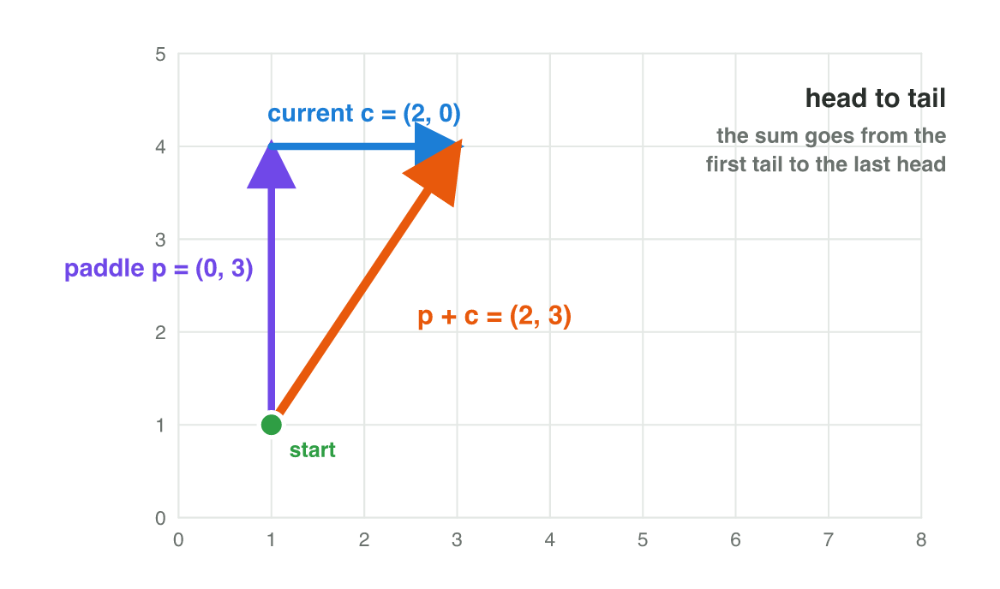

## Recall · Lecture 2

a) What is (1, 3) + (3, 1)?
b) What is the magnitude of (6, 8)?
c) Two unit vectors have the dot product 0. What is the angle between them?

::: {.answer}
a) (4, 4)
b) 10
c) 90°
:::

## Activity 1 · Two crossings · 25 min

:::: {.columns}
::: {.column width="50%"}
- The current pushes the raft (3, 0) per frame, and the paddle has a magnitude of at most 5.
- The jetty is at (4, 0), dock 1 at (4, 8) and dock 2 at (10, 8), and the raft has 2 frames.
- **Do it:** Find the paddle vector for each dock and its magnitude. Which paddle vector gives full speed 5 in the direction (0.6, 0.8)?
- Your product is two paddle vectors with their magnitudes.
:::
::: {.column width="50%"}

:::
::::

## Live demo · Raft Rush



## Check 1 · Two crossings

Which paddle vectors take the raft to the two docks?

::: {.reveal}
1. Paddling (0, 4) gives the real move (3, 4), with the speed 5.
2. Dock 1 needs (0, 4) per frame, so the paddle is (0, 4) − (3, 0) = (−3, 4), with the magnitude 5.
3. Dock 2 needs (3, 4) per frame, so the paddle is (0, 4), with the magnitude 4.
4. Full speed in the direction (0.6, 0.8) is 5 × (0.6, 0.8) = (3, 4).
:::

## Activity 2 · Seen or not? · 25 min

:::: {.columns}
::: {.column width="50%"}
- A guard at (4, 4) faces f = (1, 0), and it sees 60° to each side and 5 units deep.
- Four visitors stand at (8, 7), (7, 8), (4, 9) and (1, 0).
- **Do it:** For each visitor, find the vector d, its magnitude and the dot product of the unit vectors. Is the visitor seen?
- Your product is a table with four rows.
:::
::: {.column width="50%"}

:::
::::

## Live demo · Dot Lab



## Check 2 · Seen or not?

Which visitors does the guard see?

::: {.reveal}
1. (8, 7): d = (4, 3), its magnitude is 5, and f̂ · d̂ = 0.8, so the visitor is seen.
2. (7, 8): d = (3, 4), its magnitude is 5, and f̂ · d̂ = 0.6, so the visitor is seen.
3. (4, 9): f̂ · d̂ = 0, so the visitor is exactly to the side and not seen.
4. (1, 0): f̂ · d̂ = −0.6, so the visitor is behind and not seen.
:::

## Wrap-up

- You can plan a move with addition, subtraction, scaling and the magnitude.
- You can turn a direction into a velocity with a unit vector and a speed.
- You can decide with the dot product and the angle what a guard sees.
