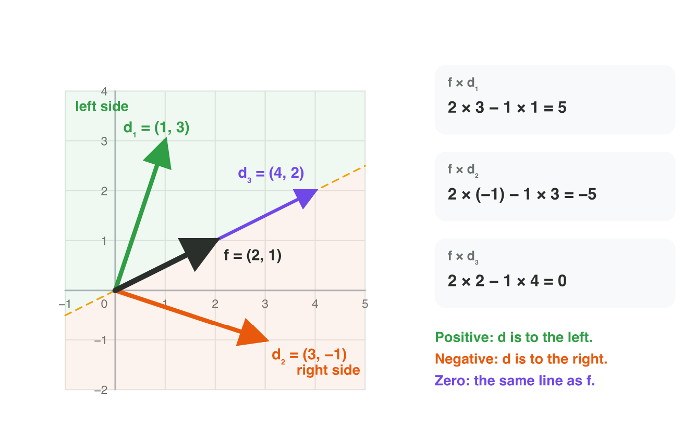
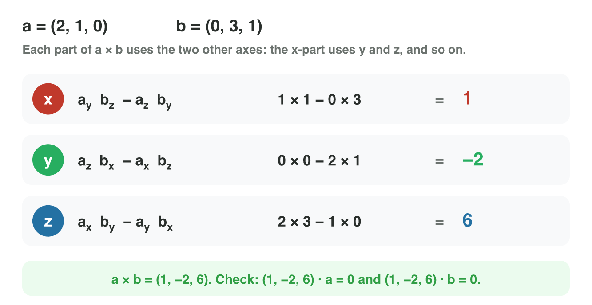
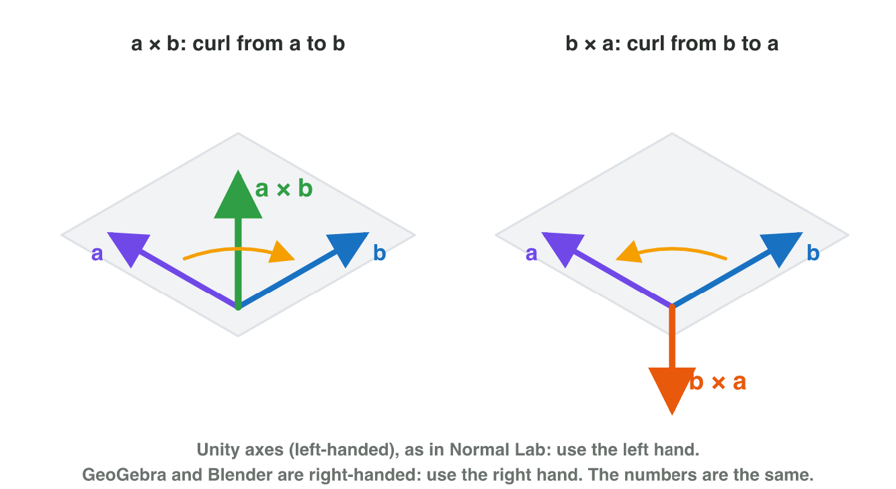
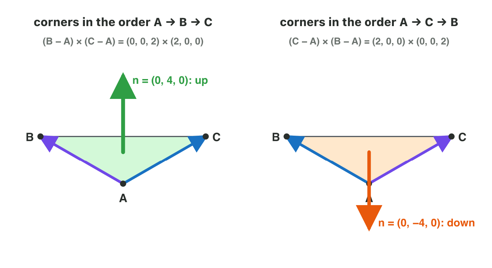
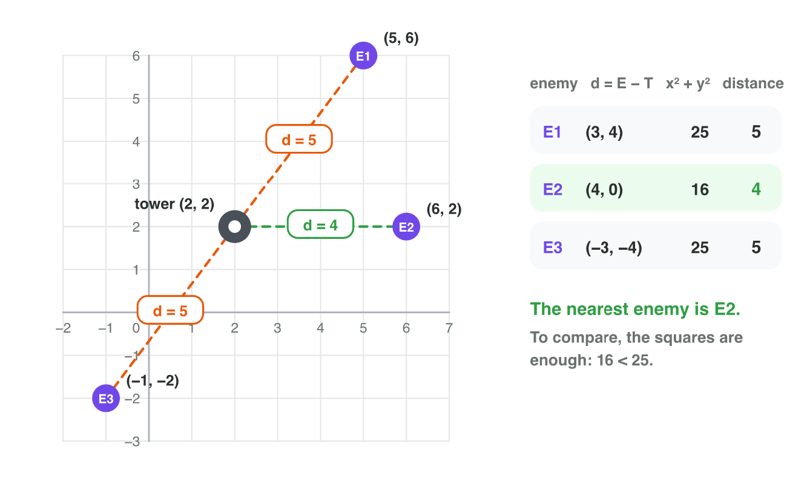
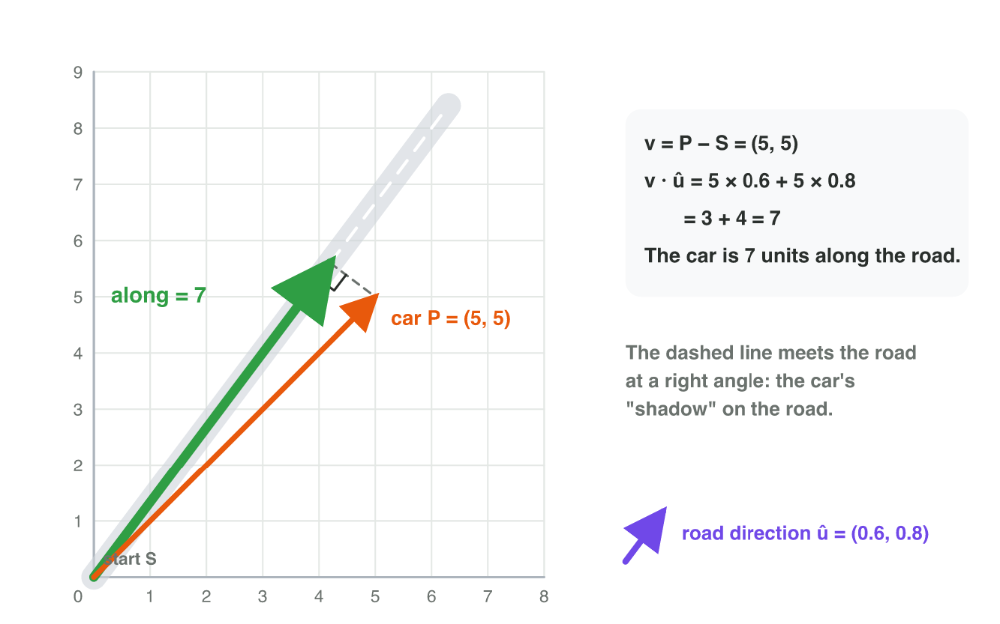
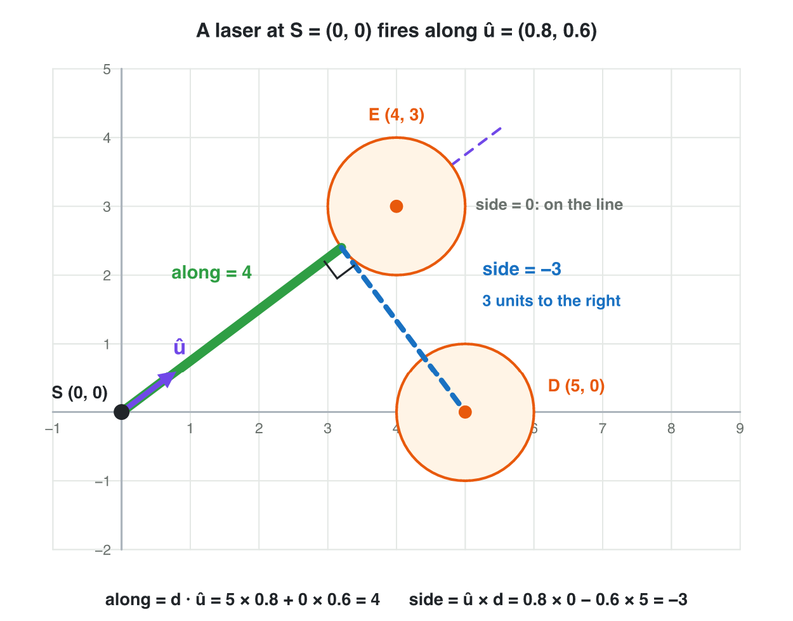

::: {.lead}
In a tower-defence game, a tower looks to the right. A drone appears above
it. The tower must turn towards the drone, and it must take the short way:
to the left or to the right? The dot product (Lecture 2) tells *in front* or
*behind*, but it cannot tell left from right. A second product of two
vectors answers this question: the **cross product**. In 3D it gives a new
vector at a right angle to two others: the **normal** of a surface. In the
second part of the lesson you put the length of a vector and the dot product
together to answer questions that games ask all the time: *which target is
nearest*, *how far along a road* an object is, and *how far to the side of a
line* it is. Every section ends with
a short task. Seminar 3 uses all of it to solve aiming and movement problems.
:::

## Key terms



## 3.1 Left or right? The cross product in 2D

A defence tower stands at $T = (2, 1)$ and looks along its forward vector
$\mathbf{f} = (1, 0)$. A drone flies in at $(4, 5)$. The vector from the
tower to the drone is $\mathbf{d} = (2, 4)$. The dot product
$\mathbf{f} \cdot \mathbf{d} = 2$ is positive, so the drone is in front. But
the tower must also know which way to turn.

::: {.callout-important title="Definition 3.1 — The cross product in 2D"}
For two 2D vectors, the **cross product** is one number:
$$\mathbf{f} \times \mathbf{d} = f_x d_y - f_y d_x.$$
If it is **positive**, $\mathbf{d}$ is to the **left** of $\mathbf{f}$
(turn anticlockwise). If it is **negative**, $\mathbf{d}$ is to the
**right** (turn clockwise). If it is **zero**, $\mathbf{d}$ lies on the same
line as $\mathbf{f}$: straight ahead or straight behind.
:::

This rule holds when the $y$-axis points up, as in the worlds of this
course. @fig-sign shows the three cases for $\mathbf{f} = (2, 1)$.

{#fig-sign width=94%}

::: {.callout-note title="Example 3.1 — Which way does the tower turn?"}
The tower at $T = (2, 1)$ faces $\mathbf{f} = (1, 0)$.

1. A drone at $(4, 5)$: $\mathbf{d} = (2, 4)$, and
   $\mathbf{f} \times \mathbf{d} = 1 \times 4 - 0 \times 2 = 4$. Positive:
   **turn left**.
2. A drone at $(5, -1)$: $\mathbf{d} = (3, -2)$, and
   $\mathbf{f} \times \mathbf{d} = 1 \times (-2) - 0 \times 3 = -2$.
   Negative: **turn right**.
3. A drone at $(7, 1)$: $\mathbf{d} = (5, 0)$, and
   $\mathbf{f} \times \mathbf{d} = 0$. On the same line. The dot product is 5,
   so the drone is straight ahead: **fire**.
:::

::: {.callout-warning title="Common mistake"}
Swapping the two vectors. $\mathbf{d} \times \mathbf{f}$ has the opposite
sign: $(1, 0) \times (2, 4) = 4$, but $(2, 4) \times (1, 0) = -4$. Always
put the forward vector first. And a zero does not always mean "fire": a drone straight *behind* the
tower also gives zero. Use the dot product to tell the two cases apart.
:::

::: {.callout-caution title="In game code"}
```csharp
Vector2 toDrone = drone - tower;
float side = forward.x * toDrone.y - forward.y * toDrone.x;
if (side > 0f) TurnLeft(); else if (side < 0f) TurnRight();
```
:::

::: {.callout-note title="Do it · Left or right on paper"}
On squared paper, draw $\mathbf{f} = (2, 1)$ from a point. From the same
point, draw $(1, 3)$, $(3, -1)$ and $(-1, 2)$.

1. Compute $\mathbf{f} \times \mathbf{d}$ for each of the three vectors.
2. Mark each one "left" or "right". Check with your drawing.

*Your result:* three cross products, three words, and the drawing.

::: {.check}
$(2, 1) \times (1, 3) = 6 - 1 = 5$: left. $(2, 1) \times (3, -1) = -2 - 3 = -5$:
right. $(2, 1) \times (-1, 2) = 4 + 1 = 5$: left. In the drawing, the two
"left" arrows are anticlockwise from $\mathbf{f}$.
:::
:::

## 3.2 A vector at a right angle to two vectors

A 3D racing game knows two directions on a flat road: along the road and
across it. The game needs a third direction, at a right angle to both: the
direction that points straight out of the road. The cross product of two 3D
vectors gives exactly this vector.

::: {.callout-important title="Definition 3.2 — The cross product in 3D"}
For two 3D vectors, the **cross product** is a vector:
$$\mathbf{a} \times \mathbf{b} = (a_y b_z - a_z b_y,\ a_z b_x - a_x b_z,\ a_x b_y - a_y b_x).$$
The result is perpendicular to $\mathbf{a}$ and to $\mathbf{b}$.
:::

Each part uses the two *other* axes. The $x$-part uses $y$ and $z$, the
$y$-part uses $z$ and $x$, and the $z$-part uses $x$ and $y$
(@fig-steps). The $z$-part is the 2D cross product of section 3.1.

{#fig-steps width=92%}

::: {.callout-note title="Example 3.2 — The three axes"}
Compute $(1, 0, 0) \times (0, 1, 0)$.

1. $x$-part: $0 \times 0 - 0 \times 1 = 0$.
2. $y$-part: $0 \times 0 - 1 \times 0 = 0$.
3. $z$-part: $1 \times 1 - 0 \times 0 = 1$.
4. The result is $(0, 0, 1)$: the $x$-axis "times" the $y$-axis gives the
   $z$-axis.
:::

::: {.callout-note title="Example 3.3 — Check with the dot product"}
Compute $\mathbf{a} \times \mathbf{b}$ for $\mathbf{a} = (2, 1, 0)$ and
$\mathbf{b} = (0, 3, 1)$ (@fig-steps).

1. $x$: $1 \times 1 - 0 \times 3 = 1$. $y$: $0 \times 0 - 2 \times 1 = -2$.
   $z$: $2 \times 3 - 1 \times 0 = 6$.
2. $\mathbf{a} \times \mathbf{b} = (1, -2, 6)$.
3. Check: $(1, -2, 6) \cdot (2, 1, 0) = 2 - 2 + 0 = 0$, and
   $(1, -2, 6) \cdot (0, 3, 1) = 0 - 6 + 6 = 0$. Both are 0, so the result is
   perpendicular to both vectors.
:::

::: {.callout-warning title="Common mistake"}
Multiplying the matching parts, as in the dot product: $a_x b_x$, $a_y b_y$,
$a_z b_z$. The cross product always mixes two *different* axes. After every
cross product, check the result with the dot product: both dot products must
be 0.
:::

::: {.callout-caution title="In game code"}
```csharp
Vector3 a = new Vector3(2f, 1f, 0f);
Vector3 b = new Vector3(0f, 3f, 1f);
Vector3 n = Vector3.Cross(a, b);     // (1, -2, 6)
```
:::

::: {.callout-note title="Do it · The cross product in GeoGebra 3D"}
Open geogebra.org/3d.

1. Type `u = Vector((2, 1, 0))` and `v = Vector((0, 3, 1))`.
2. Type `w = Cross(u, v)`. Turn the view: is `w` at a right angle to both
   arrows?
3. Type `w * u` and `w * v` (the dot products).

*Your result:* the vector `w`, the two dot products, and one sentence about
what you see.

::: {.check}
`w` $= (1, -2, 6)$, and both dot products are 0: `w` stands at a right angle
to `u` and to `v`, from every view.
:::
:::

## 3.3 Which way does it point? The order and the hand rule

Two vectors on a flat floor have two directions at a right angle to both:
straight up and straight down. Which one does the cross product give? The
answer depends on the **order** of the two vectors:
$$\mathbf{b} \times \mathbf{a} = -(\mathbf{a} \times \mathbf{b}).$$
Swapping the vectors turns the result around (@fig-curl).

To see the direction, use the hand rule of Lecture 1 as a **curl rule**:
point the fingers along $\mathbf{a}$, curl them towards $\mathbf{b}$, and
your thumb shows $\mathbf{a} \times \mathbf{b}$. Use the hand of the tool:
the **left** hand in Unity (left-handed), the **right** hand in GeoGebra and
Blender (right-handed). The numbers of the formula are the same in every
tool. Only the picture on the screen is mirrored.

{#fig-curl width=92%}

::: {.callout-note title="Example 3.4 — The up direction of a spaceship"}
A spaceship flies forward along $\mathbf{f} = (0, 0, 1)$. Its right wing
points along $\mathbf{r} = (1, 0, 0)$. The game needs the ship's "up".

1. $\mathbf{f} \times \mathbf{r}$: $x$: $0 \times 0 - 1 \times 0 = 0$;
   $y$: $1 \times 1 - 0 \times 0 = 1$; $z$: $0 \times 0 - 0 \times 1 = 0$.
2. $\mathbf{f} \times \mathbf{r} = (0, 1, 0)$: **up**.
3. In the other order, $\mathbf{r} \times \mathbf{f} = (0, -1, 0)$: down.
   The wrong order would put the ship's roof under its floor.
:::

::: {.callout-note title="Example 3.5 — Two vectors on one line"}
Compute $(1, 2, 0) \times (2, 4, 0)$.

1. $x$: $2 \times 0 - 0 \times 4 = 0$. $y$: $0 \times 2 - 1 \times 0 = 0$.
   $z$: $1 \times 4 - 2 \times 2 = 0$.
2. The result is the zero vector. The two vectors lie on one line
   ($(2, 4, 0) = 2 \times (1, 2, 0)$), so there is no single direction at a
   right angle to both.
:::

::: {.callout-warning title="Common mistake"}
Using the right hand in Unity. The formula still gives the right numbers,
but your picture of the result points the wrong way. In Unity, curl the
fingers of the left hand.
:::



::: {.callout-note title="Do it · The curl rule in Normal Lab"}
Open the **Normal Lab** simulator above (or scan its QR code). It uses
Unity's axes. The purple edge is $(0, 0, 2)$ and the blue edge is
$(2, 0, 0)$.

1. Curl the fingers of your left hand from the purple edge to the blue edge.
   Where does your thumb point?
2. Compare with the green arrow and with the card "normal n".
3. Press **Swap B and C** and do it again.

*Your result:* the two normals from the cards, and "up" or "down" for each.

::: {.check}
Before the swap: $(0, 4, 0)$, up (the left thumb points up). After **Swap B
and C**: $(0, -4, 0)$, down: swapping the order turns the normal around.
:::
:::

## 3.4 Which way does a surface face? The normal of a triangle

A 3D model in a game is a **triangle mesh**: many small, flat triangles that
share their corners. To draw a triangle well, the game must know which way it
faces. This direction is its **normal**.

::: {.callout-important title="Definition 3.3 — Surface normal"}
The **normal** of a surface is a unit vector at a right angle to the
surface. It points out of its front side. For a triangle with the corners
$A$, $B$ and $C$:
$$\mathbf{n} = (B - A) \times (C - A), \quad \text{then normalize it.}$$
:::

The order in which the corners are listed is the **winding order**. It
decides the front side: listing the corners as $A, C, B$ instead of
$A, B, C$ turns the normal around (@fig-normal). Modelling tools and game
engines keep the winding order of every triangle for this reason.

{#fig-normal width=92%}

::: {.callout-note title="Example 3.6 — A floor triangle"}
A floor triangle has the corners $A = (0, 0, 0)$, $B = (0, 0, 2)$ and
$C = (2, 0, 0)$.

1. Edges: $B - A = (0, 0, 2)$ and $C - A = (2, 0, 0)$.
2. $x$: $0 \times 0 - 2 \times 0 = 0$; $y$: $2 \times 2 - 0 \times 0 = 4$;
   $z$: $0 \times 0 - 0 \times 2 = 0$. So $\mathbf{n} = (0, 4, 0)$.
3. Normalize: $(0, 4, 0) \div 4 = (0, 1, 0)$. The floor faces **up**.
4. With the order $A, C, B$: $(2, 0, 0) \times (0, 0, 2) = (0, -4, 0)$. It
   faces down.
:::

::: {.callout-warning title="Common mistake"}
Using the corners themselves instead of the edges: $B \times C$. The normal
needs two edge vectors that start at the same corner: $B - A$ and $C - A$.
:::

::: {.callout-note title="Do it · Lift the corner"}
In **Normal Lab**, move the slider **height of C** to 1 and then to 2.

1. Each time, write the second edge $C - A$ and the normal $\mathbf{n}$ from
   the cards.
2. Check one normal with the formula on paper.

*Your result:* two rows (edge and normal) and your check.

::: {.check}
Height 1: $C - A = (2, 1, 0)$, $\mathbf{n} = (0, 0, 2) \times (2, 1, 0) =
(0 - 2,\ 4 - 0,\ 0 - 0) = (-2, 4, 0)$. Height 2: $C - A = (2, 2, 0)$,
$\mathbf{n} = (-4, 4, 0)$. The higher the corner, the more the normal leans
to the side.
:::
:::

## 3.5 Which target is nearest?

A tower with auto-aim stands at $T = (2, 2)$. Three enemies come near:
E1 at $(5, 6)$, E2 at $(6, 2)$ and E3 at $(-1, -2)$. The tower shoots at the
nearest one. The game must find the **distance** to each enemy and compare.

::: {.callout-important title="Definition 3.4 — Distance"}
The **distance** between two points $A$ and $B$ is the magnitude of the
vector from one to the other:
$$\text{distance}(A, B) = |B - A|.$$
In 2D: $\sqrt{(B_x - A_x)^2 + (B_y - A_y)^2}$. In 3D, add the $z$-part.
:::

{#fig-nearest width=94%}

The game does not need the exact distances to find the nearest enemy. A
bigger distance always has a bigger square. So the game compares
$x^2 + y^2$ and skips the square roots.

::: {.callout-note title="Example 3.7 — The nearest enemy"}
The tower is at $T = (2, 2)$ (@fig-nearest).

1. E1: $\mathbf{d} = (3, 4)$, $3^2 + 4^2 = 25$, distance 5.
2. E2: $\mathbf{d} = (4, 0)$, $4^2 + 0^2 = 16$, distance 4.
3. E3: $\mathbf{d} = (-3, -4)$, $9 + 16 = 25$, distance 5.
4. The smallest square is 16: the tower aims at **E2**. E1 and E3 are
   equally far, in opposite directions.
:::

::: {.callout-warning title="Common mistake"}
Comparing only one coordinate. E2 at $(6, 2)$ has a bigger $x$ than E1 at
$(5, 6)$, but it is nearer to the tower. Distance uses *all* the parts of the
vector, and it starts at the tower, not at the origin.
:::

::: {.callout-note title="Do it · Distances in GeoGebra"}
Open geogebra.org/calculator.

1. Type `T = (2, 2)`, `E1 = (5, 6)`, `E2 = (6, 2)` and `E3 = (-1, -2)`.
2. Type `Distance(T, E1)`, and the same for E2 and E3.
3. Which enemy is nearest? Check one distance by hand.

*Your result:* three distances, the nearest enemy, and your check.

::: {.check}
Distances 5, 4 and 5: E2 is nearest. Check E2 by hand: $(6, 2) - (2, 2) =
(4, 0)$, length $\sqrt{16} = 4$.
:::
:::

## 3.6 How far along the road?

A racing game shows the progress of each car: "7 m along the road". The road
starts at $S$ and goes straight in the direction of the unit vector
$\hat{\mathbf{u}}$. A car is never exactly on the centre line. So the game
asks: how far *along the road* is the car? The answer is the length of the
car's "shadow" on the road (@fig-proj).

::: {.callout-important title="Definition 3.5 — Projection on a direction"}
The **projection** of a vector $\mathbf{v}$ on a direction $\hat{\mathbf{u}}$
(a unit vector) is the part of $\mathbf{v}$ that goes along
$\hat{\mathbf{u}}$. Its length with a sign is
$$\text{along} = \mathbf{v} \cdot \hat{\mathbf{u}}.$$
It is negative when $\mathbf{v}$ points backwards.
:::

{#fig-proj width=94%}

::: {.callout-note title="Example 3.8 — Progress on a straight road"}
The road starts at $S = (0, 0)$ and goes along $\hat{\mathbf{u}} = (1, 0)$.

1. A car at $(7, 2)$: $\mathbf{v} = (7, 2)$, and
   $\mathbf{v} \cdot \hat{\mathbf{u}} = 7$. It is 7 units along the road.
   The 2 units to the side do not count.
2. A car at $(-3, 1)$: $\mathbf{v} \cdot \hat{\mathbf{u}} = -3$. It is 3
   units *behind* the start.
:::

::: {.callout-note title="Example 3.9 — A diagonal road"}
The road starts at $S = (0, 0)$ and goes along
$\hat{\mathbf{u}} = (0.6, 0.8)$. A car is at $P = (5, 5)$.

1. $\mathbf{v} = P - S = (5, 5)$.
2. $\mathbf{v} \cdot \hat{\mathbf{u}} = 5 \times 0.6 + 5 \times 0.8 = 3 + 4 = 7$.
3. The car is 7 units along the road. It is also a little to the side,
   but that part does not count as progress.
:::

::: {.callout-warning title="Common mistake"}
Using a direction that is not a unit vector. With $(3, 4)$ instead of
$(0.6, 0.8)$, the car at $(5, 5)$ gives $15 + 20 = 35$: five times too much.
Normalize the direction first.
:::

::: {.callout-caution title="In game code"}
```csharp
Vector2 toCar = car - roadStart;
float along = Vector2.Dot(toCar, roadDir.normalized);   // 7
```
:::



::: {.callout-note title="Do it · Along the road in Projection Lab"}
Open the **Projection Lab** simulator above (or scan its QR code).

1. Choose $\hat{\mathbf{u}} = (0.6, 0.8)$. Drag the tip of $\mathbf{v}$ to
   $(5, 5)$, $(3, 4)$ and $(-3, -4)$.
2. Each time, write the value "along".

*Your result:* three rows, and one sentence: when is "along" negative?

::: {.check}
$(5, 5)$: 7. $(3, 4)$: $1.8 + 3.2 = 5$. $(-3, -4)$: $-5$. "Along" is negative
when $\mathbf{v}$ points backwards, behind the start of the road.
:::
:::

## 3.7 How far to the side?

A space shooter has a laser on its ship. The laser fires from $S$ along the
unit vector $\hat{\mathbf{u}}$. Round drones fly near the line of the laser.
Section 3.6 tells how far *forward* a drone is. To know if the laser hits
it, the game must also know how far the drone is *to the side* of the line.
The 2D cross product of section 3.1 gives this number (@fig-side).

::: {.callout-important title="Definition 3.6 — How far to the side"}
For a unit vector $\hat{\mathbf{u}}$ and the vector $\mathbf{d}$ from $S$ to a
point:
$$\text{side} = \hat{\mathbf{u}} \times \mathbf{d} = \hat{u}_x d_y - \hat{u}_y d_x.$$
Its **sign** tells the side: positive left, negative right, zero on the
line. Its **size** is the distance of the point from the line, in units.
:::

The rule needs a unit vector, like "along" in section 3.6. Together the two
numbers tell where the drone is, seen from the laser: how far forward and
how far to the side. A round drone with the radius 1 is hit when it is in
front and its side is between $-1$ and $1$.

{#fig-side width=92%}

::: {.callout-note title="Example 3.10 — Does the laser hit the drone?"}
The laser fires from $S = (0, 0)$ along $\hat{\mathbf{u}} = (0.8, 0.6)$. The
drones have the radius 1 (@fig-side).

1. Drone D at $(5, 0)$: $\mathbf{d} = (5, 0)$. Along:
   $5 \times 0.8 + 0 \times 0.6 = 4$, so D is in front.
2. Side: $0.8 \times 0 - 0.6 \times 5 = -3$. D is 3 units to the right. 3 is
   more than the radius 1: the laser **misses** D.
3. Drone E at $(4, 3)$: along $3.2 + 1.8 = 5$, and side
   $0.8 \times 3 - 0.6 \times 4 = 2.4 - 2.4 = 0$. E is on the line: the laser
   **hits** E.
:::

::: {.callout-note title="Example 3.11 — A laser along the x-axis"}
The laser fires from $S = (0, 0)$ along $\hat{\mathbf{u}} = (1, 0)$. A drone
is at $(6, -2)$.

1. Side: $1 \times (-2) - 0 \times 6 = -2$. The drone is 2 units to the
   right.
2. Along: $6 \times 1 + (-2) \times 0 = 6$. With $(1, 0)$, "along" is simply
   the $x$ of $\mathbf{d}$, and the side is its $y$: the drone is 6 units
   forward and 2 units to the right, as the grid shows.
:::

::: {.callout-warning title="Common mistake"}
Swapping the order: $\mathbf{d} \times \hat{\mathbf{u}}$ has the opposite
sign, so left and right swap. Put $\hat{\mathbf{u}}$ first, like the forward
vector in section 3.1. And use a unit vector: with $(8, 6)$ instead of
$(0.8, 0.6)$, drone D gives $-30$, ten times too much.
:::

::: {.callout-caution title="In game code"}
```csharp
Vector2 toDrone = drone - laserStart;
float side = dir.x * toDrone.y - dir.y * toDrone.x;  // + left, - right
bool closeEnough = side >= -radius && side <= radius;
```
:::

::: {.callout-note title="Do it · How far to the side in Projection Lab"}
In **Projection Lab** (section 3.6), choose $\hat{\mathbf{u}} = (0.8, 0.6)$.

1. Drag the tip of $\mathbf{v}$ to $(5, 0)$, then to $(2, 4)$ and to
   $(4, 3)$.
2. Each time, write the value "side" and "left", "right" or "on the line".
3. A drone with the radius 1 is at each point. Which one does the laser hit?

*Your result:* three rows (side, which side, hit or miss).

::: {.check}
$(5, 0)$: $-3$, right, miss. $(2, 4)$: $3.2 - 1.2 = 2$, left, miss.
$(4, 3)$: $2.4 - 2.4 = 0$, on the line: the laser hits this drone (its
"along" is 5, so it is in front).
:::
:::

## Case study: Turret Turn

*Turret Turn* is a made-up tower-defence game. The tower stands at
$T = (4, 4)$ and looks along $\mathbf{f} = (1, 0)$. Four drones fly in:
A at $(7, 6)$, B at $(6, 1)$, C at $(1, 4)$ and D at $(9, 4)$. For each
drone the tower must choose: turn left, turn right, fire straight ahead, or
turn around. It uses the sign of $\mathbf{f} \times \mathbf{d}$, and the
dot product $\mathbf{f} \cdot \mathbf{d}$ when the cross product is zero.
Later the tower looks up: $\mathbf{f} = (0, 1)$. The Game challenge of the
interactive lesson uses these numbers. In the mini-game below you choose for
each drone in four rounds.



## Further reading

Dunn and Parberry, *3D Math Primer for Graphics and Game Development*,
2nd ed., Chapter 2 ("Vectors"): the cross product and its geometric
interpretation, the distance formula, and the projection of one vector onto
another.

## Exercises

1. A tower faces $(1, 0)$. Is a drone in the direction $(2, 5)$ to the left or to the right? And in the direction $(4, -1)$?
2. A tower faces $(1, 0)$. Two drones give $\mathbf{f} \times \mathbf{d} = 0$: one in the direction $(5, 0)$, one in the direction $(-3, 0)$. What must the tower do for each?
3. Compute $(0, 1, 0) \times (0, 0, 1)$.
4. Compute $(1, 2, 0) \times (0, 1, 3)$. Check your answer with two dot products.
5. $\mathbf{a} \times \mathbf{b} = (2, -1, 4)$. What is $\mathbf{b} \times \mathbf{a}$?
6. In Unity, which hand do you use for the curl rule? And in Blender?
7. Find the normal of the triangle $A = (0, 0, 0)$, $B = (0, 0, 3)$, $C = (3, 0, 0)$. Does it face up or down?
8. The same triangle is listed as $A, C, B$. What is its normal now?
9. Find the distance between $(1, 2)$ and $(4, 6)$.
10. A tower at $(0, 0)$. Enemies at $(6, 8)$, $(-5, 5)$ and $(0, -9)$. Which one is nearest? Compare the squares.
11. A road starts at $(0, 0)$ and goes along $(0, 1)$. How far along the road is a car at $(2, 9)$? And a car at $(1, -4)$?
12. A road goes along $(0.8, 0.6)$ from $(0, 0)$. How far along is a car at $(5, 5)$?
13. A laser at $(0, 0)$ fires along $(0, 1)$. How far to the side is a drone at $(2, 7)$? On which side?
14. A laser at $(0, 0)$ fires along $(0.6, 0.8)$. A drone is at $(0, 5)$. How far along is it, and how far to the side?
15. The same laser. A drone with the radius 1 is at $(1, 2)$. Does the laser hit it?
16. *Turret Turn*: the tower at $(4, 4)$ faces $(1, 0)$. What must it do for drone B at $(6, 1)$ and for drone C at $(1, 4)$?

## Answers to the exercises

::: {.answers}
1. (1, 0) × (2, 5) = 1 × 5 − 0 × 2 = 5 > 0: left. (1, 0) × (4, −1) = −1 < 0: right.
2. (5, 0): f · d = 5 > 0, straight ahead: fire. (−3, 0): f · d = −3 < 0, behind: turn around.
3. (1 × 1 − 0 × 0, 0 × 0 − 0 × 1, 0 × 0 − 1 × 0) = (1, 0, 0).
4. (2 × 3 − 0 × 1, 0 × 0 − 1 × 3, 1 × 1 − 2 × 0) = (6, −3, 1). Check: (6, −3, 1) · (1, 2, 0) = 6 − 6 + 0 = 0; (6, −3, 1) · (0, 1, 3) = 0 − 3 + 3 = 0.
5. (−2, 1, −4): swapping the order turns the result around.
6. Unity: the left hand. Blender: the right hand.
7. (B − A) × (C − A) = (0, 0, 3) × (3, 0, 0) = (0, 9, 0); normalized (0, 1, 0): up.
8. (3, 0, 0) × (0, 0, 3) = (0, −9, 0); it faces down.
9. d = (3, 4); √(9 + 16) = 5.
10. Squares: 100, 50, 81. The smallest square is 50: (−5, 5) is nearest.
11. (2, 9): 9 units along. (1, −4): −4, so 4 units behind the start.
12. 5 × 0.8 + 5 × 0.6 = 4 + 3 = 7.
13. (0, 1) × (2, 7) = 0 × 7 − 1 × 2 = −2: 2 units to the right.
14. Along: 0 × 0.6 + 5 × 0.8 = 4. Side: 0.6 × 5 − 0.8 × 0 = 3: 3 units to the left.
15. Along: 1 × 0.6 + 2 × 0.8 = 2.2, so it is in front. Side: 0.6 × 2 − 0.8 × 1 = 0.4, between −1 and 1: yes, the laser hits it.
16. B: d = (2, −3), f × d = −3: turn right. C: d = (−3, 0), f × d = 0 and f · d = −3: turn around.
:::
