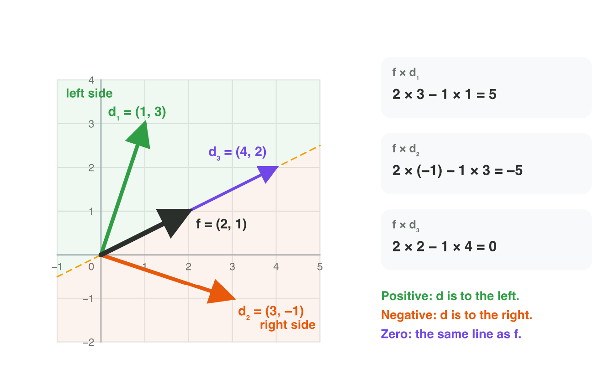
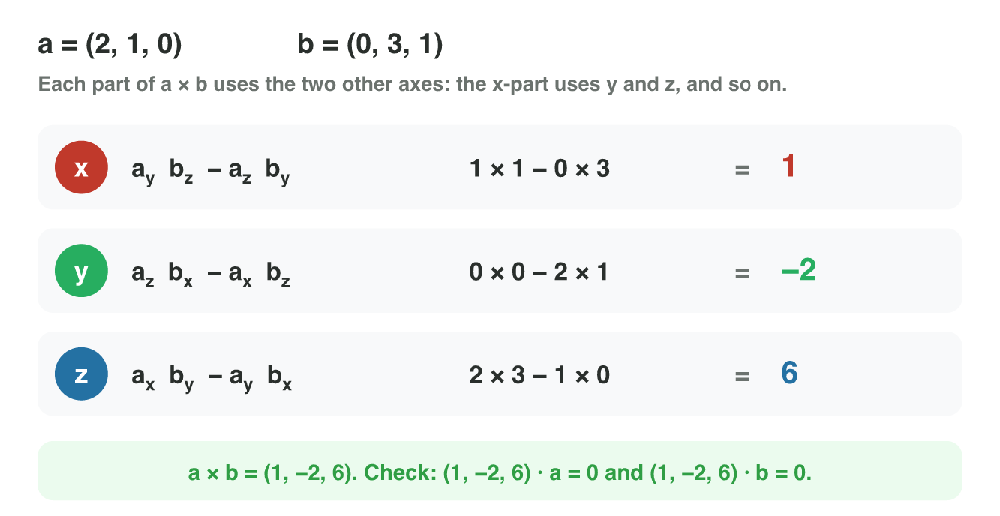
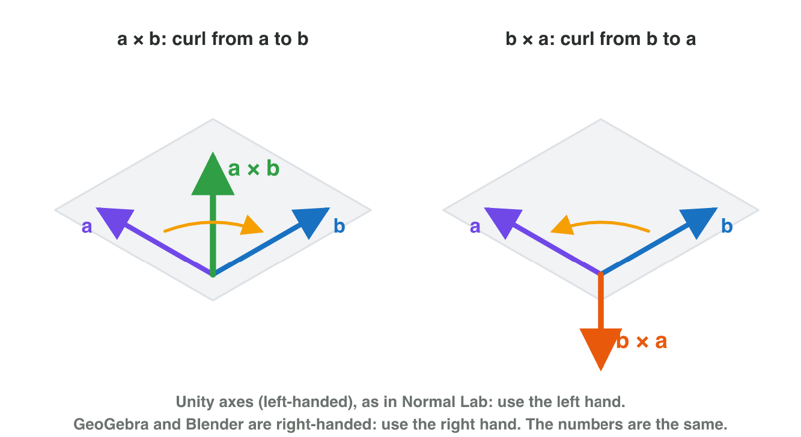
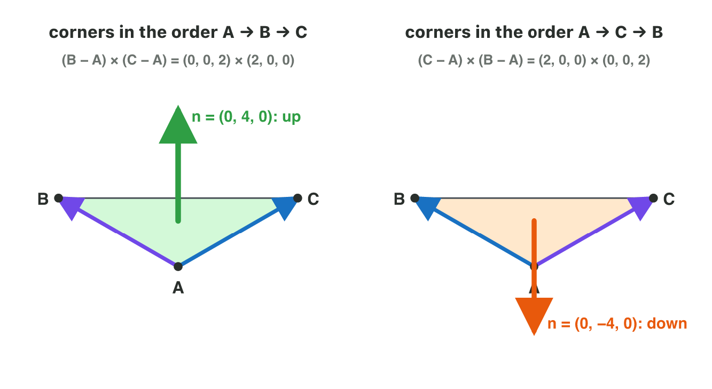
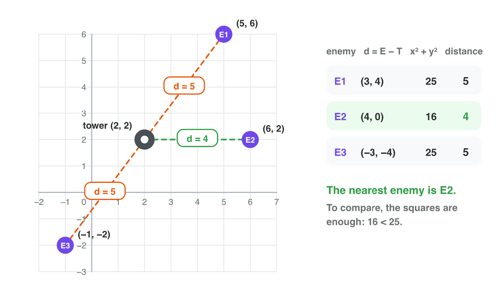
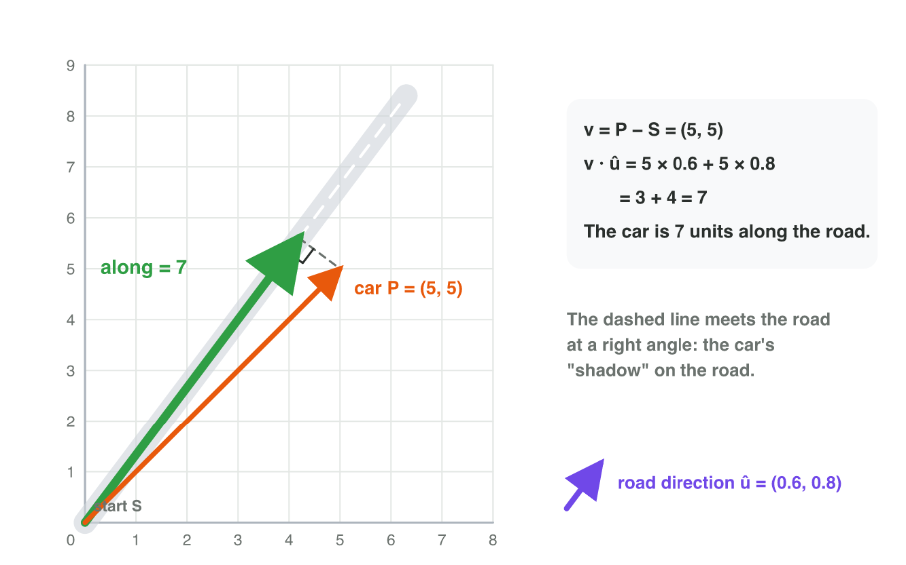
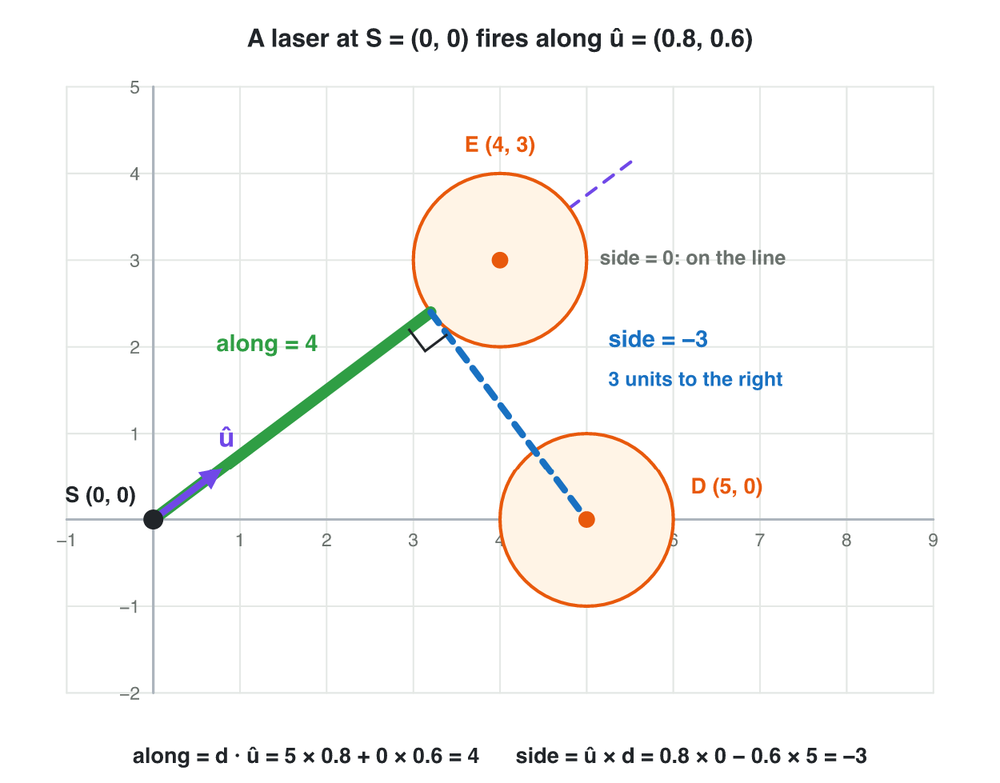

## Keywords



## 3.1 Left or right?

:::: {.columns}
::: {.column width="50%"}
- The 2D cross product is one number: f × d = f~x~ d~y~ − f~y~ d~x~.
- A positive result means that d is to the left of f.
- A negative result means right, and zero means on the same line.
- **Do it:** Draw f = (2, 1) and d = (3, −1). Is d to the left or to the right?

::: {.reveal}
- **Result:** f × d = 2 × (−1) − 1 × 3 = −5, negative, so d is to the right.
:::
:::
::: {.column width="50%"}

:::
::::

## Example · Which way does the tower turn?

A tower at T = (2, 1) faces f = (1, 0).
**Must it turn left or right to a drone at (4, 5) and to a drone at (5, −1)?**

::: {.reveal}
1. The first drone gives d = (2, 4), so f × d = 1 × 4 − 0 × 2 = 4. It turns **left**.
2. The second drone gives d = (3, −2), so f × d = 1 × (−2) − 0 × 3 = −2. It turns **right**.
3. A drone at (7, 1) gives 0, and f · d = 5 is positive, so the tower fires.
:::

## Try it 1 · Left or right?

a) A kart faces (3, 4). The checkpoint is in the direction (4, 3). What is f × d?
b) Which way must the kart steer?
c) A tower faces (1, 0), and a drone is in the direction (−3, 0). What must the tower do?

::: {.answer}
a) 3 × 3 − 4 × 4 = −7
b) to the right
c) Turn around: f × d = 0 and f · d = −3.
:::

## 3.2 A vector at a right angle to two vectors

:::: {.columns}
::: {.column width="50%"}
- In 3D, the cross product of two vectors is a new vector.
- Each part of the result uses the two other axes.
- The result is perpendicular to both vectors.
- **Do it:** In GeoGebra 3D, type w = Cross(u, v) for u = (2, 1, 0) and v = (0, 3, 1). What is w?

::: {.reveal}
- **Result:** w = (1, −2, 6), and w · u = 0 and w · v = 0: it is at a right angle to both.
:::
:::
::: {.column width="50%"}

:::
::::

## Example · Check with the dot product

The vectors are a = (2, 1, 0) and b = (0, 3, 1).
**What is a × b, and is it perpendicular to both?**

::: {.reveal}
1. The x-part is 1 × 1 − 0 × 3 = 1, and the y-part is 0 × 0 − 2 × 1 = −2.
2. The z-part is 2 × 3 − 1 × 0 = 6, so a × b = **(1, −2, 6)**.
3. The dot products with a and with b are both 0, so the result is perpendicular to both.
:::

## Try it 2 · Compute it

a) What is (1, 0, 0) × (0, 1, 0)?
b) What is (0, 1, 0) × (0, 0, 1)?
c) Is the result of the 3D cross product a number or a vector?

::: {.answer}
a) (0, 0, 1)
b) (1, 0, 0)
c) a vector
:::

## 3.3 The order and the hand rule

:::: {.columns}
::: {.column width="50%"}
- Swapping the two vectors turns the result around: b × a = −(a × b).
- Curl the fingers from a towards b, and the thumb shows a × b.
- Use the left hand in Unity and the right hand in GeoGebra and Blender.
- **Do it:** In Normal Lab, curl your left hand from the purple edge to the blue edge. Where does your thumb point?

::: {.reveal}
- **Result:** The thumb points up, like the green arrow: n = (0, 4, 0).
:::
:::
::: {.column width="50%"}

:::
::::

## Live demo · Normal Lab



## Try it 3 · Order and hand

a) The result a × b is (2, −1, 4). What is b × a?
b) Which hand do you use for the curl rule in Unity?
c) Why is (1, 2, 0) × (2, 4, 0) the zero vector?

::: {.answer}
a) (−2, 1, −4)
b) the left hand
c) The two vectors lie on one line.
:::

## 3.4 The normal of a triangle

:::: {.columns}
::: {.column width="50%"}
- A 3D model is a mesh of many small, flat triangles.
- The normal of a triangle is n = (B − A) × (C − A), normalized.
- The winding order of the corners decides the front side.
- **Do it:** In Normal Lab, set the height of C to 2. What is the normal n?

::: {.reveal}
- **Result:** C − A = (2, 2, 0), so n = (−4, 4, 0): the normal leans to the side.
:::
:::
::: {.column width="50%"}

:::
::::

## Example · A floor triangle

The corners are A = (0, 0, 0), B = (0, 0, 2) and C = (2, 0, 0).
**Which way does the floor face?**

::: {.reveal}
1. The edges are B − A = (0, 0, 2) and C − A = (2, 0, 0).
2. Their cross product is n = (0, 4, 0), and the unit normal is (0, 1, 0).
3. The floor faces **up**. With the order A, C, B, it would face down.
:::

## Try it 4 · Normals

a) A triangle has A = (0, 0, 0), B = (0, 0, 3) and C = (3, 0, 0). Which way does it face?
b) The same triangle is listed as A, C, B. What is its normal now?
c) Which two vectors does the game use to compute a normal?

::: {.answer}
a) up: n = (0, 9, 0)
b) (0, −9, 0)
c) the edges B − A and C − A
:::

## 3.5 Which target is nearest?

:::: {.columns}
::: {.column width="50%"}
- The distance between two points is the magnitude of the vector between them.
- To find the nearest target, the game compares the squares x² + y².
- A bigger distance always has a bigger square, so no square root is needed.
- **Do it:** In GeoGebra, type Distance(T, E1) for T = (2, 2) and E1 = (5, 6). What is the distance?

::: {.reveal}
- **Result:** E1 − T = (3, 4), so the distance is 5.
:::
:::
::: {.column width="50%"}

:::
::::

## Example · The nearest enemy

A tower stands at T = (2, 2). The enemies are E1 at (5, 6), E2 at (6, 2) and E3 at (−1, −2).
**Which enemy does the tower aim at?**

::: {.reveal}
1. E1 gives d = (3, 4), and the square is 9 + 16 = 25.
2. E2 gives d = (4, 0), and the square is 16.
3. E3 gives d = (−3, −4), and the square is 25.
4. The smallest square is 16, so the tower aims at **E2**.
:::

## Try it 5 · Nearest

a) What is the distance between (1, 2) and (4, 6)?
b) What is the distance between (1, 2, 1) and (3, 3, 3)?
c) Why can the game compare the squares instead of the distances?

::: {.answer}
a) 5
b) 3
c) A bigger distance always has a bigger square.
:::

## 3.6 How far along the road?

:::: {.columns}
::: {.column width="50%"}
- A road goes from S in the direction of the unit vector û.
- The dot product of v and û tells how far along the road a car is.
- It is the length of the car's shadow on the road, and it is negative behind the start.
- **Do it:** In Projection Lab, choose û = (0.6, 0.8) and drag v to (5, 5). What does "along" say?

::: {.reveal}
- **Result:** 5 × 0.6 + 5 × 0.8 = 3 + 4 = 7.
:::
:::
::: {.column width="50%"}

:::
::::

## Live demo · Projection Lab



## Try it 6 · Along the road

a) A road goes along (1, 0) from (0, 0). How far along is a car at (7, 2)?
b) The same road. What does "along" say for a car at (−3, 1)?
c) Why must the direction of the road be a unit vector?

::: {.answer}
a) 7
b) −3: the car is behind the start.
c) Otherwise the result is too big.
:::

## 3.7 How far to the side?

:::: {.columns}
::: {.column width="50%"}
- The cross product with a unit vector û tells how far a point is from the line.
- A positive side means left, and a negative side means right.
- A round drone with the radius 1 is hit when its side is between −1 and 1.
- **Do it:** In Projection Lab, choose û = (0.8, 0.6) and drag v to (2, 4). What does "side" say?

::: {.reveal}
- **Result:** 0.8 × 4 − 0.6 × 2 = 3.2 − 1.2 = 2, so the point is 2 units to the left.
:::
:::
::: {.column width="50%"}

:::
::::

## Example · Does the laser hit the drone?

A laser at (0, 0) fires along û = (0.8, 0.6). A drone with the radius 1 is at D = (5, 0).
**Does the laser hit the drone?**

::: {.reveal}
1. The vector to the drone is d = (5, 0), and along is 5 × 0.8 + 0 × 0.6 = 4, so D is in front.
2. The side is 0.8 × 0 − 0.6 × 5 = −3, so D is 3 units to the right.
3. 3 is more than the radius 1, so the laser **misses** D.
:::

## Try it 7 · How far to the side?

a) A laser fires along (1, 0) from (0, 0). How far to the side is a drone at (6, −2)?
b) A laser fires along (0, 1) from (0, 0). On which side is a drone at (−3, 5)?
c) A drone with the radius 1 is in front, and its side is −0.5. Is it hit?

::: {.answer}
a) 2 units to the right: the side is −2.
b) on the left: the side is 3.
c) Yes: −0.5 is between −1 and 1.
:::

## Game challenge · Turret Turn



## Try it 8 · The tower turns (harder)

The facts: the tower stands at (4, 4). Drone A is at (7, 6), drone C at (1, 4) and drone E at (2, 7).

a) The tower faces (1, 0). What must it do for drone C?
b) The tower now faces (0, 1). What is f × d for drone A, with d = (3, 2)?
c) The tower faces (0, 1). Which way must it turn to drone E, with d = (−2, 3)?

::: {.answer}
a) Turn around: f × d = 0 and f · d = −3.
b) 0 × 2 − 1 × 3 = −3, so it turns right.
c) to the left: f × d = 2
:::

## Summary

- The 2D cross product tells left (positive) from right (negative).
- The 3D cross product gives a vector at a right angle to two vectors, and its order matters.
- The normal of a triangle is (B − A) × (C − A), and the winding order decides the front.
- The distance is the magnitude of B − A, and the squares are enough to compare.
- The dot product with a unit vector tells how far along a direction a point is.
- The cross product with a unit vector tells how far to the side a point is, and on which side.
