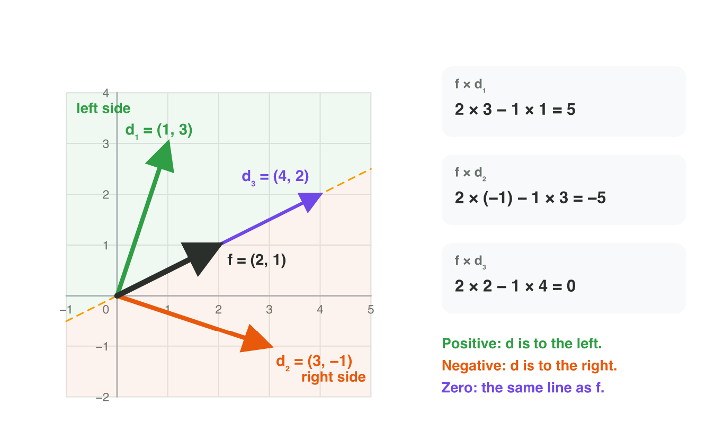
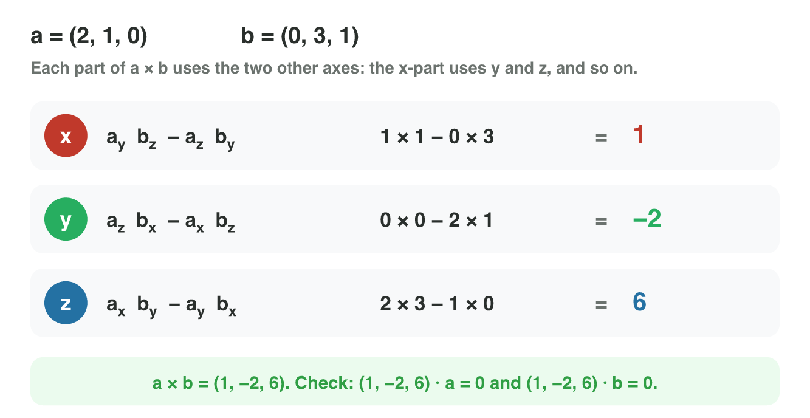
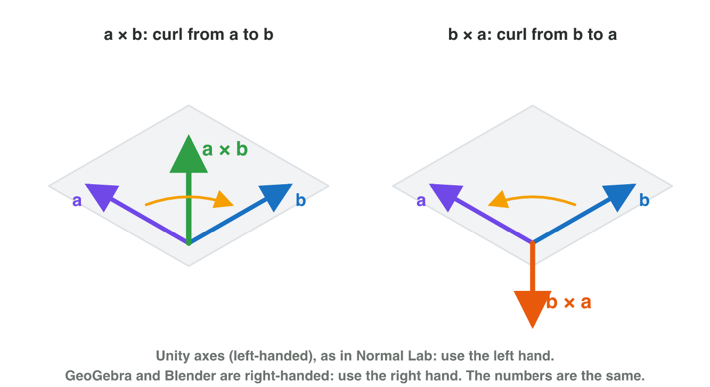
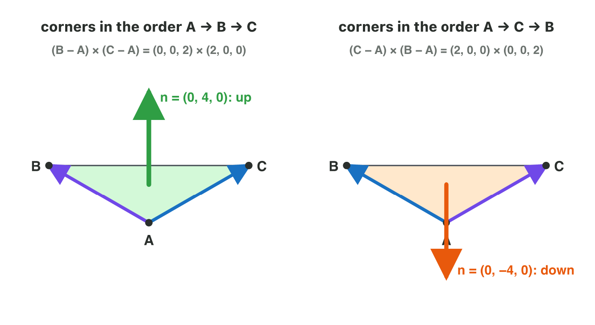
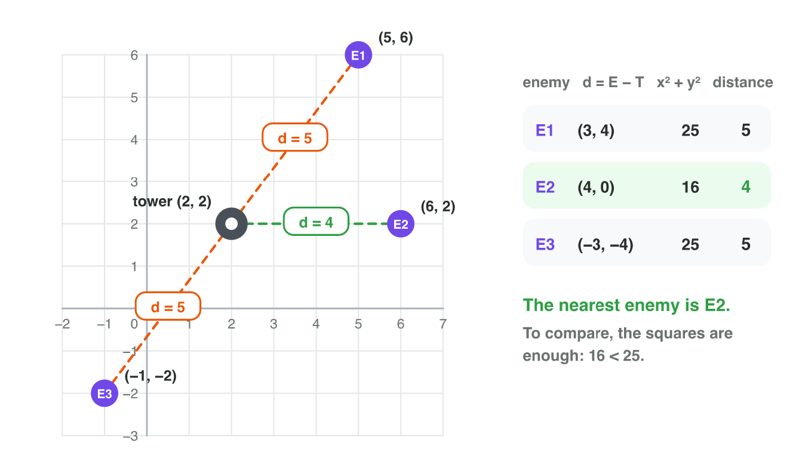
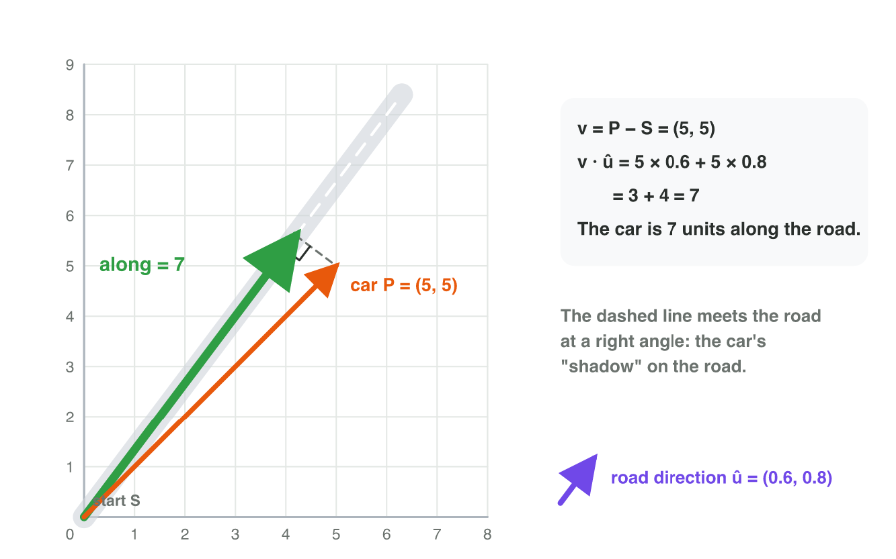
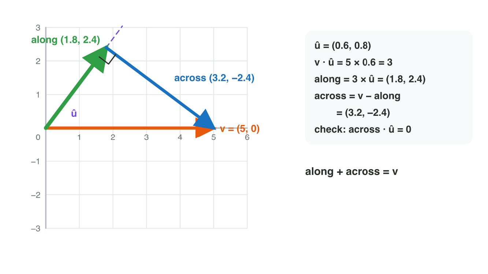
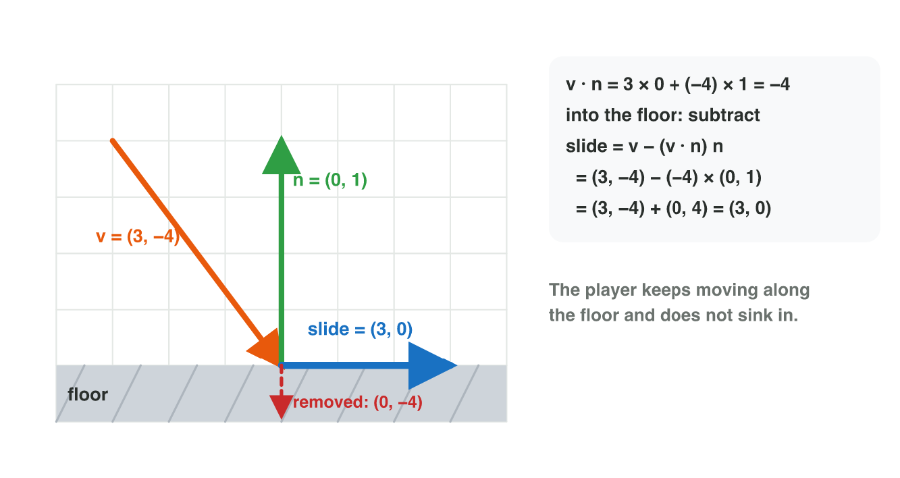

Each section: a problem in a game, the idea, a **Do it** task and a short
**Try it**. The page checks every answer at once and tells you why. More
examples and exercises are in the lesson notes (PDF).

## Key terms



## 3.1 Left or right? The cross product in 2D

- A tower must turn to a drone. The dot product says *in front* or
  *behind*, but not *left* or *right*.
- The **cross product** of two 2D vectors is one number:
  f × d = f~x~ d~y~ − f~y~ d~x~.
- **Positive:** d is to the left (turn anticlockwise).
- **Negative:** d is to the right (turn clockwise).
- **Zero:** d is on the same line: straight ahead or straight behind. The dot
  product tells which.
- This works when the y-axis points up.

{width=90%}

::: {.callout-warning title="Watch out!"}
The order matters: d × f has the opposite sign. Always put the forward
vector first.
:::

::: {.callout-note title="Do it · Left or right on paper"}
f = (2, 1). Compute f × d for d = (1, 3), (3, −1), (−1, 2) and (4, 2).

::: {.sort}
Where is each vector d, seen along f = (2, 1)? Sort them.

To the left
:   d = (1, 3)

    Why: 2 × 3 − 1 × 1 = 5: positive, so left.

:   d = (−1, 2)

    Why: 2 × 2 − 1 × (−1) = 4 + 1 = 5: positive, so left.

To the right
:   d = (3, −1)

    Why: 2 × (−1) − 1 × 3 = −5: negative, so right.

On the same line
:   d = (4, 2)

    Why: 2 × 2 − 1 × 4 = 0: d is 2 × f, straight ahead.
:::
:::

::: {.callout-tip title="Try it 1 · Left or right?"}
Choose the right answer.

::: {.match extra="behind|7"}
A tower faces (1, 0). The drone is in the direction (3, 2). Which way?
:   left

    Why: f × d = 1 × 2 − 0 × 3 = 2: positive, so left.

A kart faces (3, 4). The checkpoint is in the direction (4, 3). What is f × d?
:   −7

    Why: 3 × 3 − 4 × 4 = 9 − 16 = −7: the kart must steer right.

f × d = 0 and f · d = 5. What must the tower do?
:   fire straight ahead

    Why: on the same line and in front: straight ahead.
:::
:::

## 3.2 A vector at a right angle to two vectors

- In 3D, the cross product of two vectors is a **vector**:
  a × b = (a~y~ b~z~ − a~z~ b~y~, a~z~ b~x~ − a~x~ b~z~, a~x~ b~y~ − a~y~ b~x~).
- Each part uses the two **other** axes.
- The result is **perpendicular** to a and to b.
- Check every result: its dot product with a and with b must be 0.
- Example: (1, 0, 0) × (0, 1, 0) = (0, 0, 1).

{width=88%}

::: {.callout-warning title="Watch out!"}
Do not multiply matching parts (a~x~ b~x~ …): that is the dot product. The
cross product always mixes two different axes.
:::

::: {.callout-note title="Do it · Compute a cross product"}
Compute w = u × v for u = (2, 1, 0) and v = (0, 3, 1), part by part.

::: {.choice}
What is w = u × v?

- [x] (1, −2, 6)

  Why: (1 × 1 − 0 × 3, 0 × 0 − 2 × 1, 2 × 3 − 1 × 0) = (1, −2, 6).

- [ ] (0, 3, 0)

  Why: That multiplies the matching parts, like a dot product; a cross product mixes two other axes.

- [ ] (−1, 2, −6)

  Why: That is v × u: the other order turns the vector around.
:::
:::

::: {.callout-tip title="Try it 2 · Compute it"}
Choose the right answer.

::: {.match extra="(2, 3, 0)|(0, 0, −1)|a number"}
(1, 0, 0) × (0, 1, 0)
:   (0, 0, 1)

    Why: the x-axis × the y-axis gives the z-axis.

(1, −2, 6) · (2, 1, 0) = 0. What does this check show?
:   the result is perpendicular to (2, 1, 0)

    Why: a dot product of 0 means a right angle.
:::
:::

## 3.3 Which way does it point? The order and the hand rule

- Two vectors on a floor have two directions at a right angle: up and down.
- The **order** decides: b × a = −(a × b).
- **Curl rule:** fingers along a, curl them towards b, the thumb shows
  a × b.
- Use the hand of the tool: the **left** hand in Unity, the **right** hand
  in GeoGebra and Blender. The numbers are the same.
- Two vectors on one line give the zero vector.

{width=88%}



::: {.callout-note title="Do it · The curl rule in Normal Lab"}
In **Normal Lab** (Unity axes), curl the fingers of your left hand from the
purple edge (0, 0, 2) to the blue edge (2, 0, 0). Look at your thumb and at
the green arrow. Press **Swap B and C** and do it again.

::: {.sort}
What do you see before and after the swap? Sort the cards.

Before the swap
:   The thumb and the green arrow point up.

    Why: Curl from (0, 0, 2) to (2, 0, 0): the left thumb points up.

:   n = (0, 4, 0)

    Why: (0, 0, 2) × (2, 0, 0) = (0, 4, 0).

After the swap
:   The thumb and the green arrow point down.

    Why: Now the fingers curl the other way round.

:   n = (0, −4, 0)

    Why: b × a = −(a × b): the same vector, turned around.
:::
:::

::: {.callout-tip title="Try it 3 · Order and hand"}
Choose the right answer.

::: {.match extra="(2, 1, 4)|the right hand"}
a × b = (2, −1, 4). What is b × a?
:   (−2, 1, −4)

    Why: swapping the order turns the result around: every sign changes.

A ship flies forward f = (0, 0, 1). Its right wing is r = (1, 0, 0). What is f × r?
:   (0, 1, 0)

    Why: y-part: 1 × 1 − 0 × 0 = 1; the other parts are 0: up.

Which hand do you use for the curl rule in Unity?
:   the left hand

    Why: Unity is left-handed.
:::
:::

## 3.4 Which way does a surface face? The normal of a triangle

- A 3D model is a **triangle mesh**: many small, flat triangles.
- The **normal** is a unit vector at a right angle to the surface. It points
  out of the front side.
- For a triangle A, B, C: n = (B − A) × (C − A), then normalize.
- The **winding order** (the order of the corners) decides the front.
  A, C, B turns the normal around.
- Floor A = (0, 0, 0), B = (0, 0, 2), C = (2, 0, 0): n = (0, 4, 0), unit
  normal (0, 1, 0): up.

{width=88%}

::: {.callout-warning title="Watch out!"}
Use the **edges** B − A and C − A, not the corners B and C.
:::

::: {.callout-note title="Do it · Lift the corner"}
In **Normal Lab**, move **height of C** to 1, then to 2. A = (0, 0, 0),
B = (0, 0, 2) and C = (2, h, 0). Look at the normal n each time.

::: {.choice}
Height 1: C − A = (2, 1, 0). What is the normal n = (B − A) × (C − A)?

- [x] (−2, 4, 0)

  Why: (0, 0, 2) × (2, 1, 0) = (0 × 0 − 2 × 1, 2 × 2 − 0 × 0, 0 × 1 − 0 × 2) = (−2, 4, 0).

- [ ] (0, 4, 0)

  Why: That is the flat floor, with C at height 0.

- [ ] (2, −4, 0)

  Why: That is (C − A) × (B − A), the other order, facing down.
:::
:::

::: {.callout-tip title="Try it 4 · Normals"}
Choose the right answer.

::: {.match extra="(0, 0, 2)|(4, 0, 0)"}
A = (0, 0, 0), B = (0, 0, 2), C = (2, 0, 0). What is n = (B − A) × (C − A)?
:   (0, 4, 0)

    Why: (0, 0, 2) × (2, 0, 0): y-part 2 × 2 − 0 × 0 = 4.

A = (0, 0, 0), B = (0, 0, 2), C = (2, 0, 0), listed as A, C, B. What is n?
:   (0, −4, 0)

    Why: the other winding order turns the normal around.

n = (0, 4, 0). What is the unit normal?
:   (0, 1, 0)

    Why: divide by its length 4.
:::
:::

## 3.5 Which target is nearest?

- The **distance** between two points is |B − A|: the magnitude of the
  vector from A to B.
- To find the nearest target, compare the squares x² + y². A bigger
  distance always has a bigger square, so the game skips the square roots.
- In 3D, add the z-part.

{width=90%}

::: {.callout-warning title="Watch out!"}
Do not compare one coordinate only, and start at the tower, not at the
origin.
:::

::: {.callout-note title="Do it · The nearest enemy"}
The tower is at T = (2, 2). The enemies are at E1 = (5, 6), E2 = (6, 2) and
E3 = (−1, −2). Compute the square of each distance.

::: {.choice}
Which enemy is nearest to the tower?

- [x] E2

  Why: E2 is 4 away; E1 and E3 are both 5 away (squares 16, 25 and 25).

- [ ] E1

  Why: E1 − T = (3, 4): 5 units, more than E2.

- [ ] E3

  Why: E3 − T = (−3, −4): also 5 units; the minus signs disappear in the square.
:::
:::

::: {.callout-tip title="Try it 5 · Nearest"}
Choose the right answer.

::: {.match extra="7|E3"}
The distance between (1, 2) and (4, 6).
:   5

    Why: (3, 4) has the length √(9 + 16) = 5.

The distance between (1, 2, 1) and (3, 3, 3).
:   3

    Why: (2, 1, 2): √(4 + 1 + 4) = √9 = 3.

Why can the game compare the squares instead of the distances?
:   a bigger distance always has a bigger square

    Why: squaring keeps the order of positive numbers.
:::
:::

## 3.6 How far along the road?

- A road starts at S and goes along the unit vector û.
- How far along the road is a car at P? The **projection**:
  along = v · û, with v = P − S.
- It is the length of the car's "shadow" on the road. The part to the side
  does not count.
- It is negative when the car is behind the start.
- Road along (0.6, 0.8), car at (5, 5): 5 × 0.6 + 5 × 0.8 = 3 + 4 = **7**.

{width=90%}

::: {.callout-warning title="Watch out!"}
Normalize the direction first. With (3, 4) instead of (0.6, 0.8), the car
gives 35: five times too much.
:::



::: {.callout-note title="Do it · Along the road in Projection Lab"}
In **Projection Lab**, choose û = (0.6, 0.8). Drag the tip of v to (5, 5),
(3, 4) and (−3, −4), and read the value "along" each time.

::: {.fill answer="5" hint="Multiply the matching parts of (3, 4) and (0.6, 0.8), then add."}
v = (3, 4). What is "along" = v · û?

Why: 3 × 0.6 + 4 × 0.8 = 1.8 + 3.2 = 5.
:::
:::

::: {.callout-tip title="Try it 6 · Along the road"}
Choose the right answer.

::: {.match extra="5|35"}
A road along (1, 0) from (0, 0). How far along is a car at (7, 2)?
:   7

    Why: (7, 2) · (1, 0) = 7; the 2 to the side does not count.

A road along (1, 0) from (0, 0). A car is at (−3, 1). What is "along"?
:   −3, behind the start

    Why: (−3, 1) · (1, 0) = −3: negative means behind.
:::
:::

## 3.7 Along and across: splitting a vector

- A wind w blows on a plane that flies along û. Part of the wind pushes
  the plane forward, part pushes it off course.
- **Along** (a vector): (v · û) û.
- **Across** (the **perpendicular part**): v − along.
- along + across = v, and across · û = 0.
- Plane along (1, 0), wind (3, 4): along (3, 0), across (0, 4).
- The same split stops a player sinking into a floor: remove the part
  **into** the floor and keep the rest: slide = v − (v · n̂) n̂, when
  v · n̂ < 0 (n̂ = the unit normal of the floor, section 3.4).
- Floor n̂ = (0, 1), v = (3, −4): v · n̂ = −4, slide = (3, −4) + (0, 4) =
  **(3, 0)**: the player slides along the floor.

{width=88%}

{width=80%}

::: {.callout-warning title="Watch out!"}
v · û is only a length; the part along is the vector (v · û) û. In a slide,
minus a negative adds: (3, −4) − (−4)(0, 1) = (3, 0), not (3, −8).
:::

::: {.callout-note title="Do it · Split a vector"}
In **Projection Lab**, choose û = (0.8, 0.6) and drag v to (5, 0). Read the
part along.

::: {.choice}
What is the part of v along û?

- [x] (3.2, 2.4)

  Why: The part along is (v · û) × û = 4 × (0.8, 0.6) = (3.2, 2.4).

- [ ] 4

  Why: 4 is only its length; the part along is a vector.

- [ ] (1.8, −2.4)

  Why: That is the part across: v minus the part along. Together they give (5, 0).
:::
:::

::: {.callout-tip title="Try it 7 · Split it and slide"}
Choose the right answer.

::: {.match extra="(3, 4)|(3, −8)"}
A plane flies along (1, 0). The wind is (3, 4). The part along?
:   (3, 0)

    Why: (3, 4) · (1, 0) = 3, and 3 × (1, 0) = (3, 0).

A plane flies along (1, 0). The wind is (3, 4). The part across?
:   (0, 4)

    Why: across = v − along = (3, 4) − (3, 0).

Floor n̂ = (0, 1), v = (4, −2). The slide?
:   (4, 0)

    Why: v · n̂ = −2; (4, −2) − (−2)(0, 1) = (4, 0).
:::
:::

## Game challenge: Turret Turn {.challenge}

Work alone. Use every section of today.

**Turret Turn** is a tower-defence game. The tower stands at T = (4, 4) and
looks along f = (1, 0). Four drones fly in: A at (7, 6), B at (6, 1), C at
(1, 4) and D at (9, 4). For each drone the tower must turn left, turn right,
fire straight ahead or turn around. Later the tower looks up: f = (0, 1).



::: {.callout-tip title="Try it 8 · The tower looks right"}
Turret Turn: T = (4, 4), f = (1, 0). Drones A (7, 6), B (6, 1), C (1, 4),
D (9, 4). Choose the right answer.

::: {.match extra="(3, −2)|turn right"}
f × d for drone B, with d = (2, −3).
:   −3

    Why: 1 × (−3) − 0 × 2 = −3: turn right.

What must the tower do for drone C, with d = (−3, 0)?
:   turn around

    Why: f × d = 0 and f · d = −3: on the line, behind.
:::
:::

::: {.callout-tip title="Try it 9 · The tower looks up (harder)"}
Turret Turn: T = (4, 4), now f = (0, 1). Drone A (7, 6), drone E (2, 7),
drone F (4, 8). Choose the right answer.

::: {.match extra="2|turn around"}
What must the tower do for drone A, with d = (3, 2)?
:   turn right

    Why: f × d = −3 is negative.

What must the tower do for drone E, with d = (−2, 3)?
:   turn left

    Why: (0, 1) × (−2, 3) = 0 × 3 − 1 × (−2) = 2: positive.
:::
:::

## Summary {.summary}

- 2D: f × d = f~x~ d~y~ − f~y~ d~x~. Positive: left. Negative: right. Zero: on the same line.
- 3D: a × b is a vector at a right angle to a and b. The order matters: b × a = −(a × b).
- Triangle normal: n = (B − A) × (C − A). The winding order decides the front.
- Distance = |B − A|. To find the nearest target, compare the squares.
- Along a direction û: v · û (û a unit vector). Across = v − along.
- A floor removes only the part into it: the player slides.
