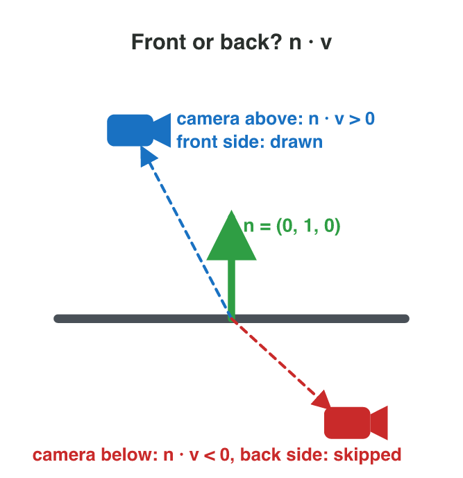

::: {.lead}
In a tower-defence game, a tower looks to the right. A drone appears above
it. The tower must turn towards the drone, and it must take the short way:
to the left or to the right? The dot product (Lecture 3) tells *in front* or
*behind*, but it cannot tell left from right. A second product of two
vectors answers this question: the **cross product**. In 3D it does even
more. It gives a new vector at a right angle to two others. Games use this
vector to find the side that a surface faces: its **normal**. The game needs
the normal, for example, to skip the hidden sides of a model. In this lesson you
compute the cross product, read its sign and its direction, and use it on
the triangles of a 3D model. Every section ends with a short task.
:::

## Key terms



## 4.1 Left or right? The cross product in 2D

A defence tower stands at $T = (2, 1)$ and looks along its forward vector
$\mathbf{f} = (1, 0)$. A drone flies in at $(4, 5)$. The vector from the
tower to the drone is $\mathbf{d} = (2, 4)$. The dot product
$\mathbf{f} \cdot \mathbf{d} = 2$ is positive, so the drone is in front. But
the tower must also know which way to turn.

::: {.callout-important title="Definition 4.1 — The cross product in 2D"}
For two 2D vectors, the **cross product** is one number:
$$\mathbf{f} \times \mathbf{d} = f_x d_y - f_y d_x.$$
If it is **positive**, $\mathbf{d}$ is to the **left** of $\mathbf{f}$
(turn anticlockwise). If it is **negative**, $\mathbf{d}$ is to the
**right** (turn clockwise). If it is **zero**, $\mathbf{d}$ lies on the same
line as $\mathbf{f}$: straight ahead or straight behind.
:::

This rule holds when the $y$-axis points up, as in the worlds of this
course. @fig-sign shows the three cases for $\mathbf{f} = (2, 1)$.

{#fig-sign width=94%}

::: {.callout-note title="Example 4.1 — Which way does the tower turn?"}
The tower at $T = (2, 1)$ faces $\mathbf{f} = (1, 0)$.

1. A drone at $(4, 5)$: $\mathbf{d} = (2, 4)$, and
   $\mathbf{f} \times \mathbf{d} = 1 \times 4 - 0 \times 2 = 4$. Positive:
   **turn left**.
2. A drone at $(5, -1)$: $\mathbf{d} = (3, -2)$, and
   $\mathbf{f} \times \mathbf{d} = 1 \times (-2) - 0 \times 3 = -2$.
   Negative: **turn right**.
3. A drone at $(7, 1)$: $\mathbf{d} = (5, 0)$, and
   $\mathbf{f} \times \mathbf{d} = 0$. On the same line. The dot product is 5,
   so the drone is straight ahead: **fire**.
:::

::: {.callout-warning title="Common mistake"}
Swapping the two vectors. $\mathbf{d} \times \mathbf{f}$ has the opposite
sign: $(1, 0) \times (2, 4) = 4$, but $(2, 4) \times (1, 0) = -4$. Always
put the forward vector first. And a zero does not always mean "fire": a drone straight *behind* the
tower also gives zero. Use the dot product to tell the two cases apart.
:::

::: {.callout-caution title="In game code"}
```csharp
Vector2 toDrone = drone - tower;
float side = forward.x * toDrone.y - forward.y * toDrone.x;
if (side > 0f) TurnLeft(); else if (side < 0f) TurnRight();
```
:::

::: {.callout-note title="Do it · Left or right on paper"}
On squared paper, draw $\mathbf{f} = (2, 1)$ from a point. From the same
point, draw $(1, 3)$, $(3, -1)$ and $(-1, 2)$.

1. Compute $\mathbf{f} \times \mathbf{d}$ for each of the three vectors.
2. Mark each one "left" or "right". Check with your drawing.

*Your result:* three cross products, three words, and the drawing.

::: {.check}
$(2, 1) \times (1, 3) = 6 - 1 = 5$: left. $(2, 1) \times (3, -1) = -2 - 3 = -5$:
right. $(2, 1) \times (-1, 2) = 4 + 1 = 5$: left. In the drawing, the two
"left" arrows are anticlockwise from $\mathbf{f}$.
:::
:::

## 4.2 A vector at a right angle to two vectors

A 3D racing game knows two directions on a flat road: along the road and
across it. The game needs a third direction, at a right angle to both: the
direction that points straight out of the road. The cross product of two 3D
vectors gives exactly this vector.

::: {.callout-important title="Definition 4.2 — The cross product in 3D"}
For two 3D vectors, the **cross product** is a vector:
$$\mathbf{a} \times \mathbf{b} = (a_y b_z - a_z b_y,\ a_z b_x - a_x b_z,\ a_x b_y - a_y b_x).$$
The result is perpendicular to $\mathbf{a}$ and to $\mathbf{b}$.
:::

Each part uses the two *other* axes. The $x$-part uses $y$ and $z$, the
$y$-part uses $z$ and $x$, and the $z$-part uses $x$ and $y$
(@fig-steps). The $z$-part is the 2D cross product of section 4.1.

{#fig-steps width=92%}

::: {.callout-note title="Example 4.2 — The three axes"}
Compute $(1, 0, 0) \times (0, 1, 0)$.

1. $x$-part: $0 \times 0 - 0 \times 1 = 0$.
2. $y$-part: $0 \times 0 - 1 \times 0 = 0$.
3. $z$-part: $1 \times 1 - 0 \times 0 = 1$.
4. The result is $(0, 0, 1)$: the $x$-axis "times" the $y$-axis gives the
   $z$-axis.
:::

::: {.callout-note title="Example 4.3 — Check with the dot product"}
Compute $\mathbf{a} \times \mathbf{b}$ for $\mathbf{a} = (2, 1, 0)$ and
$\mathbf{b} = (0, 3, 1)$ (@fig-steps).

1. $x$: $1 \times 1 - 0 \times 3 = 1$. $y$: $0 \times 0 - 2 \times 1 = -2$.
   $z$: $2 \times 3 - 1 \times 0 = 6$.
2. $\mathbf{a} \times \mathbf{b} = (1, -2, 6)$.
3. Check: $(1, -2, 6) \cdot (2, 1, 0) = 2 - 2 + 0 = 0$, and
   $(1, -2, 6) \cdot (0, 3, 1) = 0 - 6 + 6 = 0$. Both are 0, so the result is
   perpendicular to both vectors.
:::

::: {.callout-warning title="Common mistake"}
Multiplying the matching parts, as in the dot product: $a_x b_x$, $a_y b_y$,
$a_z b_z$. The cross product always mixes two *different* axes. After every
cross product, check the result with the dot product: both dot products must
be 0.
:::

::: {.callout-caution title="In game code"}
```csharp
Vector3 a = new Vector3(2f, 1f, 0f);
Vector3 b = new Vector3(0f, 3f, 1f);
Vector3 n = Vector3.Cross(a, b);     // (1, -2, 6)
```
:::

::: {.callout-note title="Do it · The cross product in GeoGebra 3D"}
Open geogebra.org/3d.

1. Type `u = Vector((2, 1, 0))` and `v = Vector((0, 3, 1))`.
2. Type `w = Cross(u, v)`. Turn the view: is `w` at a right angle to both
   arrows?
3. Type `w * u` and `w * v` (the dot products).

*Your result:* the vector `w`, the two dot products, and one sentence about
what you see.

::: {.check}
`w` $= (1, -2, 6)$, and both dot products are 0: `w` stands at a right angle
to `u` and to `v`, from every view.
:::
:::

## 4.3 Which way does it point? The order and the hand rule

Two vectors on a flat floor have two directions at a right angle to both:
straight up and straight down. Which one does the cross product give? The
answer depends on the **order** of the two vectors:
$$\mathbf{b} \times \mathbf{a} = -(\mathbf{a} \times \mathbf{b}).$$
Swapping the vectors turns the result around (@fig-curl).

To see the direction, use the hand rule of Lecture 1 as a **curl rule**:
point the fingers along $\mathbf{a}$, curl them towards $\mathbf{b}$, and
your thumb shows $\mathbf{a} \times \mathbf{b}$. Use the hand of the tool:
the **left** hand in Unity (left-handed), the **right** hand in GeoGebra and
Blender (right-handed). The numbers of the formula are the same in every
tool. Only the picture on the screen is mirrored.

{#fig-curl width=92%}

::: {.callout-note title="Example 4.4 — The up direction of a spaceship"}
A spaceship flies forward along $\mathbf{f} = (0, 0, 1)$. Its right wing
points along $\mathbf{r} = (1, 0, 0)$. The game needs the ship's "up".

1. $\mathbf{f} \times \mathbf{r}$: $x$: $0 \times 0 - 1 \times 0 = 0$;
   $y$: $1 \times 1 - 0 \times 0 = 1$; $z$: $0 \times 0 - 0 \times 1 = 0$.
2. $\mathbf{f} \times \mathbf{r} = (0, 1, 0)$: **up**.
3. In the other order, $\mathbf{r} \times \mathbf{f} = (0, -1, 0)$: down.
   The wrong order would put the ship's roof under its floor.
:::

::: {.callout-note title="Example 4.5 — Two vectors on one line"}
Compute $(1, 2, 0) \times (2, 4, 0)$.

1. $x$: $2 \times 0 - 0 \times 4 = 0$. $y$: $0 \times 2 - 1 \times 0 = 0$.
   $z$: $1 \times 4 - 2 \times 2 = 0$.
2. The result is the zero vector. The two vectors lie on one line
   ($(2, 4, 0) = 2 \times (1, 2, 0)$), so there is no single direction at a
   right angle to both.
:::

::: {.callout-warning title="Common mistake"}
Using the right hand in Unity. The formula still gives the right numbers,
but your picture of the result points the wrong way. In Unity, curl the
fingers of the left hand.
:::



::: {.callout-note title="Do it · The curl rule in Normal Lab"}
Open the **Normal Lab** simulator above (or scan its QR code). It uses
Unity's axes. The purple edge is $(0, 0, 2)$ and the blue edge is
$(2, 0, 0)$.

1. Curl the fingers of your left hand from the purple edge to the blue edge.
   Where does your thumb point?
2. Compare with the green arrow and with the card "normal n".
3. Press **Swap B and C** and do it again.

*Your result:* the two normals from the cards, and "up" or "down" for each.

::: {.check}
Before the swap: $(0, 4, 0)$, up (the left thumb points up). After **Swap B
and C**: $(0, -4, 0)$, down: swapping the order turns the normal around.
:::
:::

## 4.4 Which way does a surface face? The normal of a triangle

A 3D model in a game is a **triangle mesh**: many small, flat triangles that
share their corners. To draw a triangle well, the game must know which way it
faces. This direction is its **normal**.

::: {.callout-important title="Definition 4.3 — Surface normal"}
The **normal** of a surface is a unit vector at a right angle to the
surface. It points out of its front side. For a triangle with the corners
$A$, $B$ and $C$:
$$\mathbf{n} = (B - A) \times (C - A), \quad \text{then normalize it.}$$
:::

The order in which the corners are listed is the **winding order**. It
decides the front side: listing the corners as $A, C, B$ instead of
$A, B, C$ turns the normal around (@fig-normal). Modelling tools and game
engines keep the winding order of every triangle for this reason.

{#fig-normal width=92%}

::: {.callout-note title="Example 4.6 — A floor triangle"}
A floor triangle has the corners $A = (0, 0, 0)$, $B = (0, 0, 2)$ and
$C = (2, 0, 0)$.

1. Edges: $B - A = (0, 0, 2)$ and $C - A = (2, 0, 0)$.
2. $x$: $0 \times 0 - 2 \times 0 = 0$; $y$: $2 \times 2 - 0 \times 0 = 4$;
   $z$: $0 \times 0 - 0 \times 2 = 0$. So $\mathbf{n} = (0, 4, 0)$.
3. Normalize: $(0, 4, 0) \div 4 = (0, 1, 0)$. The floor faces **up**.
4. With the order $A, C, B$: $(2, 0, 0) \times (0, 0, 2) = (0, -4, 0)$. It
   faces down.
:::

::: {.callout-warning title="Common mistake"}
Using the corners themselves instead of the edges: $B \times C$. The normal
needs two edge vectors that start at the same corner: $B - A$ and $C - A$.
:::

::: {.callout-note title="Do it · Lift the corner"}
In **Normal Lab**, move the slider **height of C** to 1 and then to 2.

1. Each time, write the second edge $C - A$ and the normal $\mathbf{n}$ from
   the cards.
2. Check one normal with the formula on paper.

*Your result:* two rows (edge and normal) and your check.

::: {.check}
Height 1: $C - A = (2, 1, 0)$, $\mathbf{n} = (0, 0, 2) \times (2, 1, 0) =
(0 - 2,\ 4 - 0,\ 0 - 0) = (-2, 4, 0)$. Height 2: $C - A = (2, 2, 0)$,
$\mathbf{n} = (-4, 4, 0)$. The higher the corner, the more the normal leans
to the side.
:::
:::

## 4.5 Facing the camera: back-face culling

The normal tells the game which side of a triangle the camera sees. It uses
the dot product of Lecture 3 (@fig-culling).

A closed model, such as a box, has triangles on every side. The triangles at
the back of the box are hidden, so the game does not draw them: this saves
work for the graphics processor. It is called **back-face culling**. Take the
vector $\mathbf{v}$ from the triangle to the camera. If
$\mathbf{n} \cdot \mathbf{v} > 0$, the camera sees the front side, and the
game draws the triangle. If $\mathbf{n} \cdot \mathbf{v} < 0$, the camera
sees the back side, and the game skips it.

{#fig-culling width=50%}

::: {.callout-note title="Example 4.7 — Draw it or skip it?"}
A floor triangle at $P = (1, 0, 1)$ has the normal $\mathbf{n} = (0, 1, 0)$.

1. Camera at $(1, 5, -4)$: $\mathbf{v} = (0, 5, -5)$, and
   $\mathbf{n} \cdot \mathbf{v} = 5$. Positive: **draw** it.
2. Camera under the floor at $(1, -3, 1)$: $\mathbf{v} = (0, -3, 0)$, and
   $\mathbf{n} \cdot \mathbf{v} = -3$. Negative: **skip** it.
:::

::: {.callout-warning title="Common mistake"}
A wrong winding order. If the corners of a triangle are in the wrong order,
its normal points inwards. The camera then "sees its back", and the game
skips it: the player sees a hole in the model.
:::

::: {.callout-note title="Do it · Look from below"}
In **Normal Lab**, press **View from below**, then **View from above**.

1. Each time, read the message under the cards: front or back?
2. What happens to the green triangle? Why?

*Your result:* two messages, and one sentence about back-face culling.

::: {.check}
From below: "back", and the green triangle is not drawn. From above:
"front", and it is drawn. The game skips a triangle when the camera sees its
back ($\mathbf{n} \cdot \mathbf{v} < 0$).
:::
:::

## Case study: Turret Turn

*Turret Turn* is a made-up tower-defence game. The tower stands at
$T = (4, 4)$ and looks along $\mathbf{f} = (1, 0)$. Four drones fly in:
A at $(7, 6)$, B at $(6, 1)$, C at $(1, 4)$ and D at $(9, 4)$. For each
drone the tower must choose: turn left, turn right, fire straight ahead, or
turn around. It uses the sign of $\mathbf{f} \times \mathbf{d}$, and the
dot product $\mathbf{f} \cdot \mathbf{d}$ when the cross product is zero.
Later the tower looks up: $\mathbf{f} = (0, 1)$. The Game challenge of the
interactive lesson uses these numbers. In the mini-game below you choose for
each drone in four rounds.



## Further reading

Dunn and Parberry, *3D Math Primer for Graphics and Game Development*,
2nd ed., Chapter 2 ("Vectors"): the cross product and its geometric
interpretation; and Chapter 9 on triangles and their normals.

## Exercises

1. A tower faces $(1, 0)$. Is a drone in the direction $(2, 5)$ to the left
   or to the right? And in the direction $(4, -1)$?
2. A tower faces $(1, 0)$. Two drones give $\mathbf{f} \times \mathbf{d} = 0$:
   one in the direction $(5, 0)$, one in the direction $(-3, 0)$. What must
   the tower do for each?
3. Compute $(0, 1, 0) \times (0, 0, 1)$.
4. Compute $(1, 2, 0) \times (0, 1, 3)$. Check your answer with two dot
   products.
5. $\mathbf{a} \times \mathbf{b} = (2, -1, 4)$. What is
   $\mathbf{b} \times \mathbf{a}$?
6. Why is $(3, 0, 6) \times (1, 0, 2)$ the zero vector?
7. In Unity, which hand do you use for the curl rule? And in Blender?
8. Find the normal of the triangle $A = (0, 0, 0)$, $B = (0, 0, 3)$,
   $C = (3, 0, 0)$. Does it face up or down?
9. The same triangle is listed as $A, C, B$. What is its normal now?
10. A wall triangle has the normal $(0, 0, -1)$. The camera is at
    $(2, 1, -6)$, and the triangle is at $(2, 1, 0)$. Does the game draw it?
11. Why does a model with a wrong winding order show holes?
12. *Turret Turn*: the tower at $(4, 4)$ faces $(1, 0)$. What must it do for
    drone B at $(6, 1)$ and for drone C at $(1, 4)$?

## Answers to the exercises

::: {.answers}
1. (1, 0) × (2, 5) = 1 × 5 − 0 × 2 = 5 > 0: left. (1, 0) × (4, −1) = −1 < 0: right.
2. (5, 0): f · d = 5 > 0, straight ahead: fire. (−3, 0): f · d = −3 < 0, behind: turn around.
3. (1 × 1 − 0 × 0, 0 × 0 − 0 × 1, 0 × 0 − 1 × 0) = (1, 0, 0).
4. (2 × 3 − 0 × 1, 0 × 0 − 1 × 3, 1 × 1 − 2 × 0) = (6, −3, 1). Check: (6, −3, 1) · (1, 2, 0) = 6 − 6 + 0 = 0; (6, −3, 1) · (0, 1, 3) = 0 − 3 + 3 = 0.
5. (−2, 1, −4): swapping the order turns the result around.
6. The two vectors lie on one line: (3, 0, 6) = 3 × (1, 0, 2).
7. Unity: the left hand. Blender: the right hand.
8. (B − A) × (C − A) = (0, 0, 3) × (3, 0, 0) = (0, 9, 0); normalized (0, 1, 0): up.
9. (3, 0, 0) × (0, 0, 3) = (0, −9, 0); it faces down.
10. v = (2, 1, −6) − (2, 1, 0) = (0, 0, −6); n · v = 6 > 0: the camera sees the front, so the game draws it.
11. The normals point inwards, so the camera sees the "back" of these triangles, and the game skips them.
12. B: d = (2, −3), f × d = −3: turn right. C: d = (−3, 0), f × d = 0 and f · d = −3: turn around.
:::
