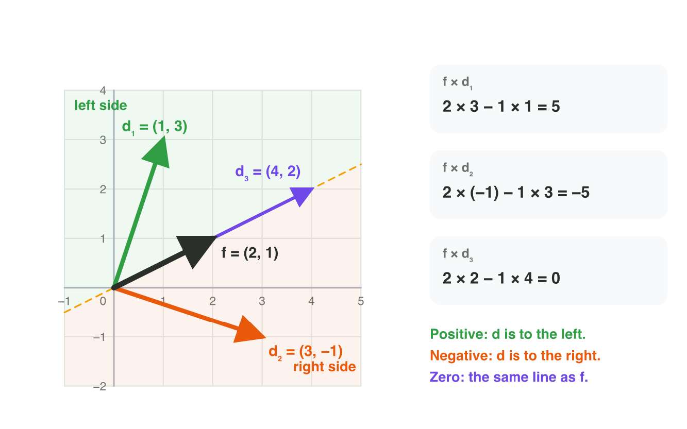
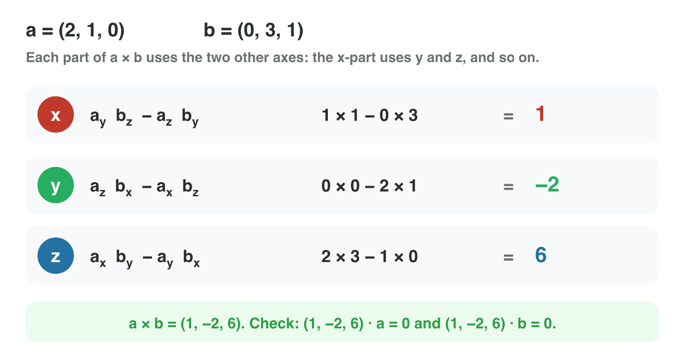
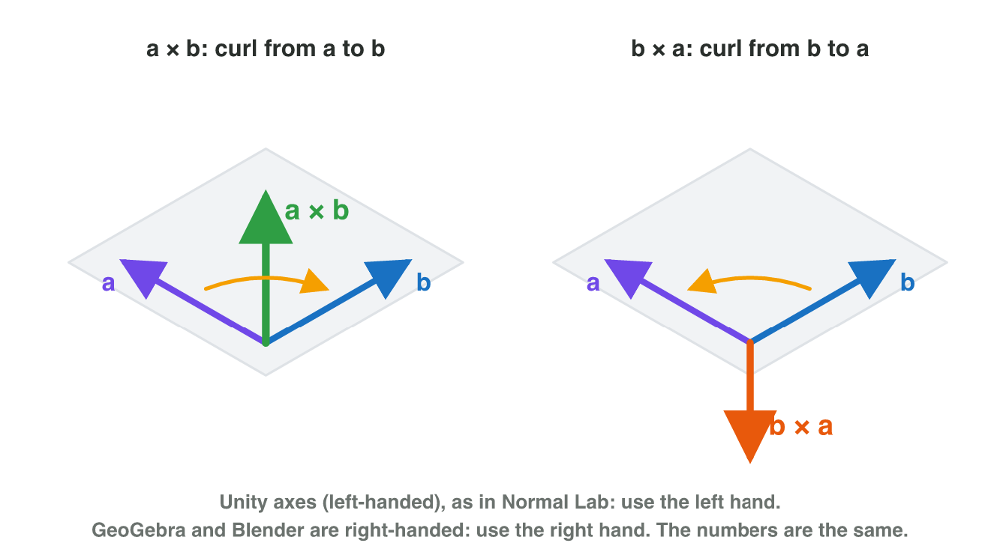
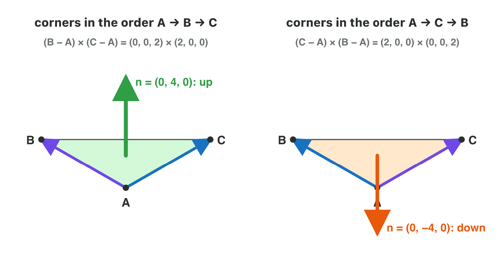
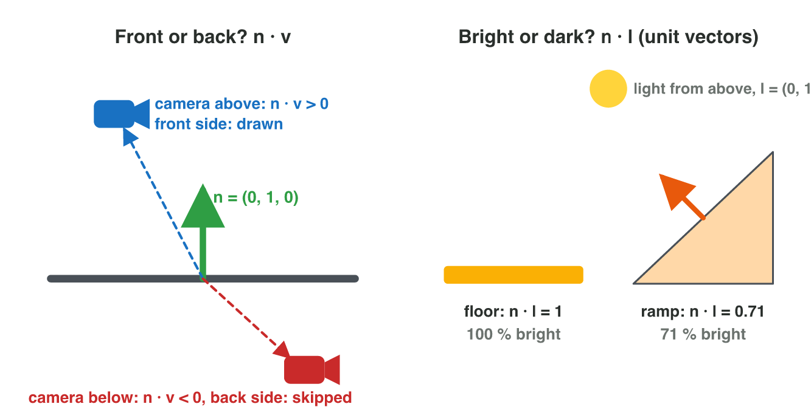

## Keywords



## 5.1 Left or right?

:::: {.columns}
::: {.column width="50%"}
- The 2D cross product is one number: f × d = f~x~ d~y~ − f~y~ d~x~.
- A positive result means that d is to the left of f.
- A negative result means right, and zero means on the same line.
- **Do it:** Draw f = (2, 1) and d = (3, −1). Is d to the left or to the right?
:::
::: {.column width="50%"}

:::
::::

## Example · Which way does the tower turn?

A tower at T = (4, 4) faces f = (1, 0).
**Must it turn left or right to drone A at (7, 6) and to drone B at (6, 1)?**

::: {.reveal}
1. Drone A gives d = (3, 2), so f × d = 1 × 2 − 0 × 3 = 2. It turns **left**.
2. Drone B gives d = (2, −3), so f × d = 1 × (−3) − 0 × 2 = −3. It turns **right**.
3. Drone D at (9, 4) gives 0, and f · d = 5 is positive, so the tower fires.
:::

## Try it 1 · Left or right?

a) A kart faces (3, 4). The checkpoint is in the direction (4, 3). What is f × d?
b) Which way must the kart steer?
c) A tower faces (1, 0), and a drone is in the direction (−3, 0). What must the tower do?

::: {.answer}
a) 3 × 3 − 4 × 4 = −7
b) to the right
c) Turn around: f × d = 0 and f · d = −3.
:::

## 5.2 A vector at a right angle to two vectors

:::: {.columns}
::: {.column width="50%"}
- In 3D, the cross product of two vectors is a new vector.
- Each part of the result uses the two other axes.
- The result is perpendicular to both vectors.
- **Do it:** In GeoGebra 3D, type w = Cross(u, v) for u = (2, 1, 0) and v = (0, 3, 1). What is w?
:::
::: {.column width="50%"}

:::
::::

## Example · Check with the dot product

The vectors are a = (2, 1, 0) and b = (0, 3, 1).
**What is a × b, and is it perpendicular to both?**

::: {.reveal}
1. The x-part is 1 × 1 − 0 × 3 = 1, and the y-part is 0 × 0 − 2 × 1 = −2.
2. The z-part is 2 × 3 − 1 × 0 = 6, so a × b = **(1, −2, 6)**.
3. The dot products with a and with b are both 0, so the result is perpendicular to both.
:::

## Try it 2 · Compute it

a) What is (1, 0, 0) × (0, 1, 0)?
b) What is (0, 1, 0) × (0, 0, 1)?
c) Is the result of the 3D cross product a number or a vector?

::: {.answer}
a) (0, 0, 1)
b) (1, 0, 0)
c) a vector
:::

## 5.3 The order and the hand rule

:::: {.columns}
::: {.column width="50%"}
- Swapping the two vectors turns the result around: b × a = −(a × b).
- Curl the fingers from a towards b, and the thumb shows a × b.
- Use the left hand in Unity and the right hand in GeoGebra and Blender.
- **Do it:** In Normal Lab, curl your left hand from the purple edge to the blue edge. Where does your thumb point?
:::
::: {.column width="50%"}

:::
::::

## Example · The up direction of a spaceship

A spaceship flies forward along f = (0, 0, 1), and its right wing points along r = (1, 0, 0).
**Which vector points up from the ship?**

::: {.reveal}
1. The parts of f × r are 0 × 0 − 1 × 0, then 1 × 1 − 0 × 0, then 0 × 0 − 0 × 1.
2. So f × r = **(0, 1, 0)**, which points up.
3. In the other order, r × f = (0, −1, 0) points down.
:::

## Live demo · Normal Lab



## Try it 3 · Order and hand

a) The result a × b is (2, −1, 4). What is b × a?
b) Which hand do you use for the curl rule in Unity?
c) Why is (1, 2, 0) × (2, 4, 0) the zero vector?

::: {.answer}
a) (−2, 1, −4)
b) the left hand
c) The two vectors lie on one line.
:::

## 5.4 The normal of a triangle

:::: {.columns}
::: {.column width="50%"}
- A 3D model is a mesh of many small, flat triangles.
- The normal of a triangle is n = (B − A) × (C − A), normalized.
- The winding order of the corners decides the front side.
- **Do it:** In Normal Lab, set the height of C to 2. What is the normal n?
:::
::: {.column width="50%"}

:::
::::

## Example · A floor triangle

The corners are A = (0, 0, 0), B = (0, 0, 2) and C = (2, 0, 0).
**Which way does the floor face?**

::: {.reveal}
1. The edges are B − A = (0, 0, 2) and C − A = (2, 0, 0).
2. Their cross product is n = (0, 4, 0), and the unit normal is (0, 1, 0).
3. The floor faces **up**. With the order A, C, B, it would face down.
:::

## Example · A ramp

Corner C is lifted to (2, 2, 0), and A and B stay.
**Which way does the ramp face?** (√32 ≈ 5.66)

::: {.reveal}
1. The edges are (0, 0, 2) and (2, 2, 0).
2. Their cross product is n = (−4, 4, 0), with the length 5.66.
3. The unit normal is about **(−0.71, 0.71, 0)**: up and to the left, at 45°.
:::

## Try it 4 · Normals

a) A triangle has A = (0, 0, 0), B = (0, 0, 3) and C = (3, 0, 0). Which way does it face?
b) The same triangle is listed as A, C, B. What is its normal now?
c) Which two vectors does the game use to compute a normal?

::: {.answer}
a) up: n = (0, 9, 0)
b) (0, −9, 0)
c) the edges B − A and C − A
:::

## 5.5 Facing the camera and the light

:::: {.columns}
::: {.column width="50%"}
- The game draws a triangle only when the dot product of n and v is positive. The vector v points to the camera.
- Skipping the back sides is called back-face culling.
- The brightness of a surface is the dot product of the unit normal and the light direction.
- **Do it:** In Normal Lab, press View from below. What does the message say?
:::
::: {.column width="50%"}

:::
::::

## Example · Draw it or skip it?

A floor triangle at P = (1, 0, 1) has n = (0, 1, 0).
**Does the game draw it for a camera at (1, 5, −4) and for a camera at (1, −3, 1)?**

::: {.reveal}
1. For the first camera, v = (0, 5, −5) and n · v = 5. The game **draws** it.
2. For the second camera, v = (0, −3, 0) and n · v = −3. The game **skips** it.
3. The second camera is under the floor, so it sees the back side.
:::

## Try it 5 · Front, back and light

The facts: the light shines from straight above, along (0, 1, 0).

a) How bright is a floor with the unit normal (0, 1, 0)?
b) How bright is a wall with the unit normal (1, 0, 0)?
c) Why does a wrong winding order make holes in a model?

::: {.answer}
a) 100 %
b) 0 %: no light from above reaches it.
c) The normals point inwards, so the game skips those triangles.
:::

## Game challenge · Turret Turn



## Try it 6 · The tower turns (harder)

The facts: the tower stands at (4, 4). Drone A is at (7, 6), drone C at (1, 4) and drone E at (2, 7).

a) The tower faces (1, 0). What must it do for drone C?
b) The tower now faces (0, 1). What is f × d for drone A, with d = (3, 2)?
c) The tower faces (0, 1). Which way must it turn to drone E, with d = (−2, 3)?

::: {.answer}
a) Turn around: f × d = 0 and f · d = −3.
b) 0 × 2 − 1 × 3 = −3, so it turns right.
c) to the left: f × d = 2
:::

## Summary

- The 2D cross product is one number, and its sign shows left or right.
- The 3D cross product is a vector at a right angle to both vectors.
- Swapping the order turns the result around, and Unity uses the left hand.
- The normal of a triangle is the cross product of two edges, normalized.
- The game skips a triangle when the dot product of its normal and the camera vector is negative.
