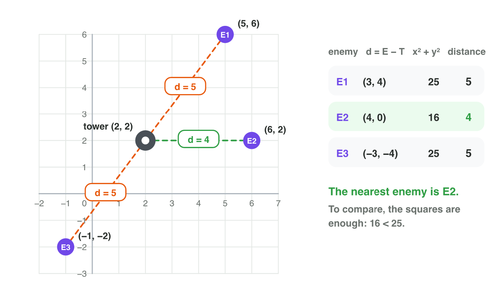
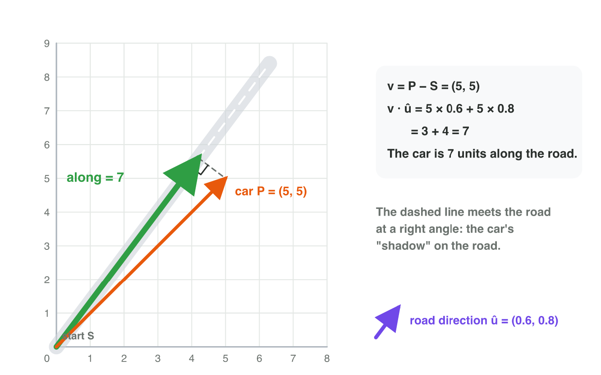
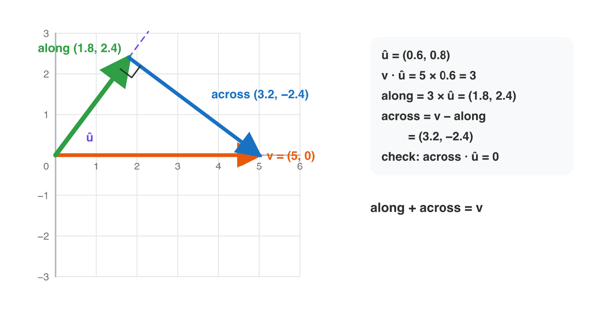
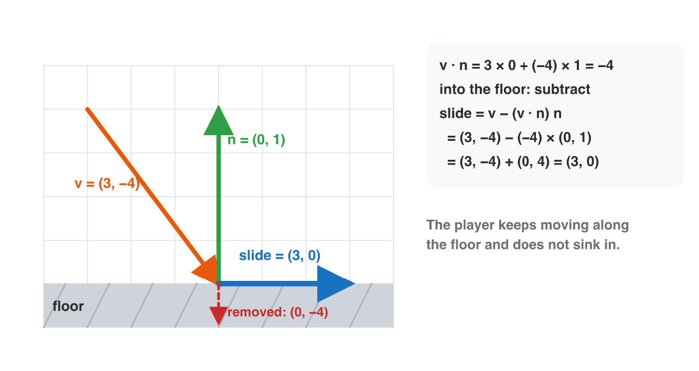
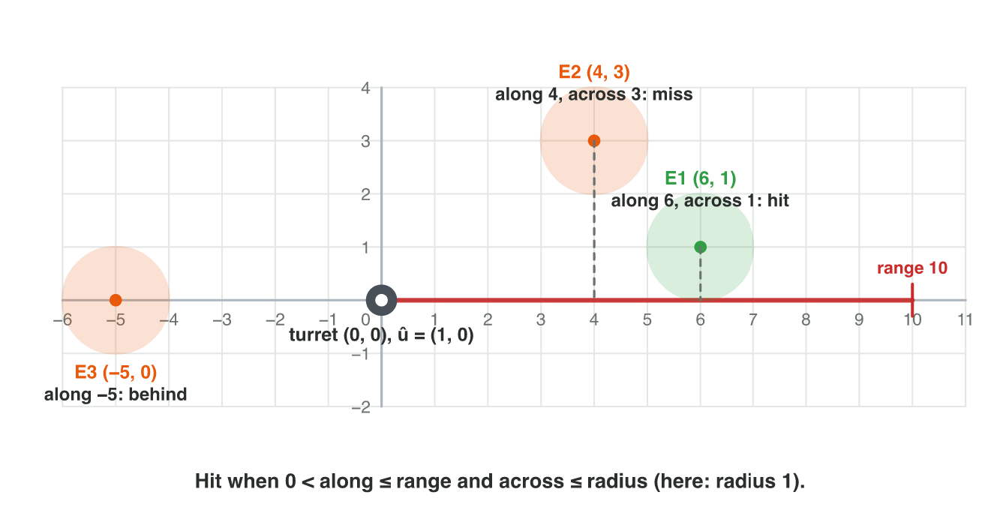

This page is the interactive version of the lesson notes (PDF). Each section
starts with a problem in a game. Then it explains the idea behind it. It ends
with a **Do it** task and one set of questions. Every question on this page
has its answer: try first, then check.

## Key terms



## 5.1 Which target is nearest?

- The **distance** between two points is |B − A|: the magnitude of the
  vector from A to B.
- To find the nearest target, compare the squares x² + y². A bigger
  distance always has a bigger square, so the game skips the square roots.
- Tower T = (2, 2). E1 (5, 6): d = (3, 4), square 25. E2 (6, 2): d = (4, 0),
  square 16. E3 (−1, −2): d = (−3, −4), square 25. The nearest is **E2**.
- In 3D, add the z-part.

{width=90%}

::: {.callout-warning title="Watch out!"}
Do not compare one coordinate only, and start at the tower, not at the
origin.
:::

::: {.callout-note title="Do it · Distances in GeoGebra"}
At geogebra.org/calculator, type `T = (2, 2)`, `E1 = (5, 6)`, `E2 = (6, 2)`,
`E3 = (-1, -2)` and `Distance(T, E1)` (and the same for E2 and E3). Which
enemy is nearest? Check one distance by hand.

::: {.check}
5, 4 and 5: E2 is nearest. By hand: (6, 2) − (2, 2) = (4, 0), length 4.
:::
:::

::: {.callout-tip title="Try it 1 · Nearest"}
Choose the right answer.

::: {.match extra="7|E3"}
The distance between (1, 2) and (4, 6).
:   5

    Why: (3, 4) has the length √(9 + 16) = 5.

A tower at (2, 2). Which enemy is nearest: E1 (5, 6), E2 (6, 2) or E3 (−1, −2)?
:   E2

    Why: the squares are 25, 16 and 25: 16 is the smallest.

The distance between (1, 2, 1) and (3, 3, 3).
:   3

    Why: (2, 1, 2): √(4 + 1 + 4) = √9 = 3.

A tower at (0, 0). The squares to three enemies are 100, 50 and 81. Which distance is the smallest?
:   the one with the square 50

    Why: the smallest square belongs to the smallest distance.

Why can the game compare the squares instead of the distances?
:   a bigger distance always has a bigger square

    Why: squaring keeps the order of positive numbers.
:::
:::

## 5.2 How far along the road?

- A road starts at S and goes along the unit vector û.
- How far along the road is a car at P? The **projection**:
  along = v · û, with v = P − S.
- It is the length of the car's "shadow" on the road. The part to the side
  does not count.
- It is negative when the car is behind the start.
- Road along (0.6, 0.8), car at (5, 5): 5 × 0.6 + 5 × 0.8 = 3 + 4 = **7**.

{width=90%}

::: {.callout-warning title="Watch out!"}
Normalize the direction first. With (3, 4) instead of (0.6, 0.8), the car
gives 35: five times too much.
:::



::: {.callout-note title="Do it · Along the road in Projection Lab"}
In **Projection Lab**, choose û = (0.6, 0.8). Drag the tip of v to (5, 5),
(3, 4) and (−3, −4). Write the value "along" each time. When is it negative?

::: {.check}
(5, 5): 7. (3, 4): 5. (−3, −4): −5. Negative when v points behind the start.
:::
:::

::: {.callout-tip title="Try it 2 · Along the road"}
Choose the right answer. You can use an answer more than once.

::: {.match extra="5|35"}
A road along (1, 0) from (0, 0). How far along is a car at (7, 2)?
:   7

    Why: (7, 2) · (1, 0) = 7; the 2 to the side does not count.

A road along (1, 0) from (0, 0). A car is at (−3, 1). What is "along"?
:   −3, behind the start

    Why: (−3, 1) · (1, 0) = −3: negative means behind.

A road along (0.6, 0.8) from (0, 0). How far along is a car at (5, 5)?
:   7

    Why: 5 × 0.6 + 5 × 0.8 = 3 + 4 = 7.

A road along (0, 1) from (0, 0). How far along is a car at (2, 9)?
:   9

    Why: (2, 9) · (0, 1) = 9.

Why must û be a unit vector?
:   otherwise the result is too big

    Why: a longer direction multiplies the result by its length.
:::
:::

## 5.3 Along and across: splitting a vector

- A wind w blows on a plane that flies along û. Part of the wind pushes
  the plane forward, part pushes it off course.
- **Along** (a vector): (v · û) û.
- **Across** (the **perpendicular part**): v − along.
- along + across = v, and across · û = 0.
- Plane along (1, 0), wind (3, 4): along (3, 0), across (0, 4).
- The same split stops a player sinking into a floor: remove the part
  **into** the floor and keep the rest: slide = v − (v · n̂) n̂, when
  v · n̂ < 0 (n̂ = the unit normal of the floor, Lecture 4).
- Floor n̂ = (0, 1), v = (3, −4): v · n̂ = −4, slide = (3, −4) + (0, 4) =
  **(3, 0)**: the player slides along the floor.

{width=88%}

{width=80%}

::: {.callout-warning title="Watch out!"}
v · û = 3 is only the length. The part along is the vector 3 × û. And in a
slide, minus a negative number adds: (3, −4) − (−4)(0, 1) = (3, 0), not
(3, −8).
:::

::: {.callout-note title="Do it · Split a vector"}
In **Projection Lab**, choose û = (0.8, 0.6) and drag v to (5, 0). Write the
part along and the part across. Add them on paper. Do you get (5, 0)?

::: {.check}
v · û = 4; along (3.2, 2.4); across (1.8, −2.4). Their sum is (5, 0).
:::
:::

::: {.callout-tip title="Try it 3 · Split it and slide"}
Choose the right answer.

::: {.match extra="(3, 4)|(3, −8)"}
A plane flies along (1, 0). The wind is (3, 4). The part along?
:   (3, 0)

    Why: (3, 4) · (1, 0) = 3, and 3 × (1, 0) = (3, 0).

A plane flies along (1, 0). The wind is (3, 4). The part across?
:   (0, 4)

    Why: across = v − along = (3, 4) − (3, 0).

v = (4, 6), û = (0, 1). The part along?
:   (0, 6)

    Why: v · û = 6, so along = 6 × (0, 1).

What is the dot product of the part across and û?
:   0

    Why: the part across is at a right angle to û.

Floor n̂ = (0, 1), v = (4, −2). The slide?
:   (4, 0)

    Why: v · n̂ = −2; (4, −2) − (−2)(0, 1) = (4, 0).

Floor n̂ = (0, 1), v = (2, 5). What does the game do?
:   nothing, the player moves away

    Why: v · n̂ = 5 is positive: not into the floor.
:::
:::

## 5.4 Will the shot hit?

- A laser goes along a **ray**: from a point, in one direction û.
- For the vector d from the turret to the enemy, check three things:
  1. in front: along = d · û > 0;
  2. in range: along ≤ the range;
  3. close to the line: across ≤ the radius of the enemy.
- In 2D: across = |û~x~ d~y~ − û~y~ d~x~|, the 2D cross product without its
  sign.
- Turret (0, 0) along (1, 0), range 10, radius 1: E1 (6, 1) along 6, across
  1: hit. E2 (4, 3): across 3: miss. E3 (−5, 0): behind: miss.

{width=90%}

::: {.callout-warning title="Watch out!"}
A near enemy is not always hit. It can be too far to the side.
:::

::: {.callout-note title="Do it · Hit or miss on paper"}
A turret at (0, 0) fires along (1, 0), range 8, radius 1. The enemies are at
(5, 0), (3, 2), (9, 0) and (−2, 1). Find "along" and "across" for each. Hit
or miss? Why?

::: {.check}
(5, 0): along 5, across 0: hit. (3, 2): across 2: miss (to the side).
(9, 0): along 9 > 8: miss (out of range). (−2, 1): along −2: miss (behind).
:::
:::

::: {.callout-tip title="Try it 5 · Hit or miss?"}
A turret at (0, 0) fires along (1, 0). Range 8, radius 1. Choose the right
answer. You can use an answer more than once.

::: {.match extra="hit, but too far"}
An enemy at (5, 0).
:   hit

    Why: along 5 (in front, in range), across 0.

An enemy at (3, 2).
:   miss: too far to the side

    Why: across 2 is more than the radius 1.

An enemy at (9, 0).
:   miss: out of range

    Why: along 9 is more than the range 8.

An enemy at (−2, 1).
:   miss: behind

    Why: along −2 is negative: behind the turret.

An enemy at (7, 1).
:   hit

    Why: along 7 ≤ 8 and across 1 ≤ 1.
:::
:::

## Game challenge: Asteroid Beam {.challenge}

Work alone. Use every section of today.

**Asteroid Beam** is a mining game. A station at S = (1, 1) fires a beam
along û = (0.6, 0.8). The beam is 10 units long, and each asteroid has the
radius 1. Asteroid A is at (4, 5), B at (5, 4) and C at (7, 9). The beam
stops at the first asteroid that it hits.



::: {.callout-tip title="Try it 6 · Along the beam"}
Asteroid Beam: S = (1, 1), û = (0.6, 0.8), range 10, radius 1. A (4, 5),
B (5, 4), C (7, 9). Choose the right answer.

::: {.match extra="(5, 4)|7"}
The vector d from the station to A.
:   (3, 4)

    Why: A − S = (4 − 1, 5 − 1).

"Along" for asteroid A, with d = (3, 4).
:   5

    Why: 3 × 0.6 + 4 × 0.8 = 1.8 + 3.2 = 5.

"Along" for asteroid B, with d = (4, 3).
:   4.8

    Why: 4 × 0.6 + 3 × 0.8 = 2.4 + 2.4 = 4.8.

"Along" for asteroid C, with d = (6, 8).
:   10

    Why: 6 × 0.6 + 8 × 0.8 = 3.6 + 6.4 = 10.
:::
:::

::: {.callout-tip title="Try it 7 · Which one is hit? (harder)"}
Asteroid Beam: S = (1, 1), û = (0.6, 0.8), range 10, radius 1. A (4, 5):
along 5. B (5, 4): along 4.8. C (7, 9): along 10. Choose the right answer.

::: {.match extra="B, it is nearest|0.6"}
"Across" for asteroid B, with d = (4, 3).
:   1.4

    Why: |0.6 × 3 − 0.8 × 4| = |1.8 − 3.2| = 1.4.

"Across" for asteroid A, with d = (3, 4).
:   0

    Why: |0.6 × 4 − 0.8 × 3| = |2.4 − 2.4| = 0: on the line.

Which asteroid does the beam hit first?
:   A

    Why: A is on the line (across 0), and along 5 is less than C's 10.

Why does the beam not hit B?
:   B is 1.4 units to the side

    Why: across 1.4 is more than the radius 1.

C is on the line too. Why is it not hit?
:   the beam stops at A first

    Why: the beam stops at the first hit: A, at along 5.
:::
:::

## Summary {.summary}

- Distance = |B − A|; to find the nearest, compare the squares.
- Along a direction: v · û (û a unit vector); negative means behind.
- along = (v · û) û and across = v − along; they are at a right angle.
- Slide along a floor: v − (v · n̂) n̂ when v · n̂ < 0.
- A ray hits when 0 < along ≤ range and across ≤ radius.
