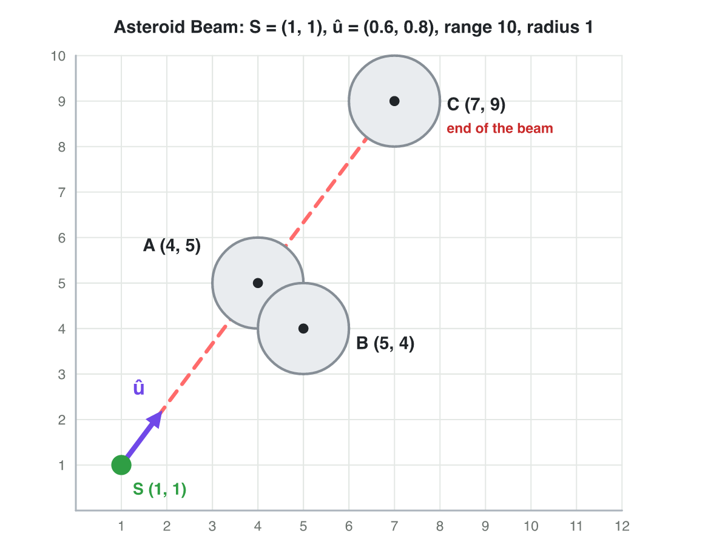
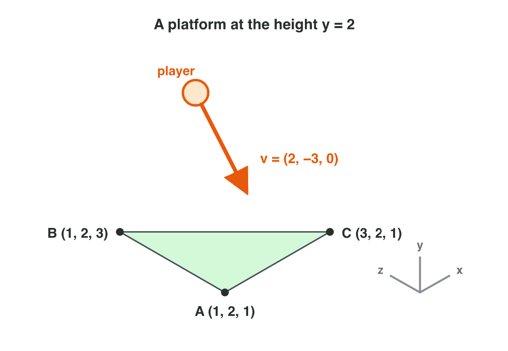

::: {.lead}
In Lecture 3 you learned the cross product in 2D and in 3D, the normal of a
triangle, the distance, how far a point is along a direction and how far it
is to the side. Today you use them in two game problems: a mining beam and a
player who falls onto a platform. There are no new ideas: two short
problems. Do each one alone. The results of the activities are at the end of
this worksheet.
:::

## Recall

- 2D cross product: f × d = f~x~ d~y~ − f~y~ d~x~. Positive: left;
  negative: right; zero: on the same line.
- 3D: the normal of a triangle is (B − A) × (C − A); the order of the
  corners decides which way it faces.
- Distance = |B − A|. With a unit vector û: along = d · û (how far
  forward), side = û × d (how far to the side).

::: {.callout-tip title="Try it 1 · Recall"}
Choose the right answer.

::: {.match extra="(0, 4)|left"}
A tower faces (1, 0). Is a drone in the direction (2, −3) to the left or to the right?
:   right

A car is at (5, 5), and the road goes along (0.6, 0.8) from (0, 0). How far along the road is it?
:   7

What happens to the normal when two corners of a triangle swap?
:   it points the other way
:::
:::

## Activity 1 · Which asteroid does the beam hit?

In *Asteroid Beam*, a station at S = (1, 1) fires a mining beam along
û = (0.6, 0.8). The beam is 10 units long, and each asteroid has the
radius 1. Three asteroids float near it: A (4, 5), B (5, 4) and C (7, 9).
The beam hits an asteroid when it is in front (along > 0), in range
(along ≤ 10) and close to the line (side between −1 and 1). It stops at the
first asteroid it hits.

::: {.callout-note title="Activity 1 · Hit or miss · 25 min"}
{width=72%}

1. For each asteroid, find d = asteroid − S. Which asteroids are nearest to
   the station? Compare the squares of the distances.
2. For each asteroid, compute "along" = d · û.
3. For each asteroid, compute "side" = û × d. Is B to the left or to the
   right of the beam?
4. Which asteroid does the beam hit first? Then play the rounds of
   **Asteroid Beam** (the QR code below).

*Your product:* a table with three rows (d, along, side, hit or miss) and
the asteroid that the beam hits first.

::: {.check}
A: d = (3, 4), square 25, along 1.8 + 3.2 = 5, side 0.6 × 4 − 0.8 × 3 =
2.4 − 2.4 = 0: hit. B: d = (4, 3), square 25, along 2.4 + 2.4 = 4.8, side
0.6 × 3 − 0.8 × 4 = 1.8 − 3.2 = −1.4: 1.4 units to the right, more than
the radius 1, so it is missed. C: d = (6, 8), square 100, along
3.6 + 6.4 = 10, side 4.8 − 4.8 = 0: on the line, but after A. A and B are
nearest (both 5 units away), but only A is hit. The beam hits **A** first.
:::
:::



::: {.callout-tip title="Try it 2 · The beam"}
Another station, at (0, 0), fires along û = (0.6, 0.8). The beam is
10 units long, and each asteroid has the radius 1. Choose the right answer.

::: {.match extra="15|3 to the right"}
An asteroid at (−6, −8). What is "along"?
:   −10

An asteroid at (9, 12). Is it hit?
:   no, out of range

An asteroid at (0, 5). How far to the side is it?
:   3 to the left
:::
:::

## Activity 2 · Land on a platform

A level has a platform at the height 2: a triangle with the corners
A = (1, 2, 1), B = (1, 2, 3) and C = (3, 2, 1). A player falls onto it with
the velocity v = (2, −3, 0). The game tests the fall with the unit normal n̂
of the platform: when v · n̂ is negative, the player moves into the
platform, and the game stops the fall.

::: {.callout-note title="Activity 2 · The normal of the platform · 25 min"}
{width=66%}

1. Find the edges B − A and C − A. Compute the normal
   n = (B − A) × (C − A). Does it face up or down?
2. Divide n by its length: what is the unit normal n̂?
3. The player falls with v = (2, −3, 0). Compute v · n̂. Is the player
   moving into the platform?
4. A modeller lists the corners as A, C, B. Compute the normal and v · n̂
   again. **Normal Lab** (the QR code below) has a triangle with the same
   edges: check both normals there with **Swap B and C**.

*Your product:* two normals, two values of v · n̂, and the order that the
game needs.

::: {.check}
1. Edges (0, 0, 2) and (2, 0, 0). n = (0 × 0 − 2 × 0, 2 × 2 − 0 × 0,
   0 × 0 − 0 × 2) = (0, 4, 0): up.
2. n̂ = (0, 4, 0) ÷ 4 = (0, 1, 0).
3. v · n̂ = 2 × 0 + (−3) × 1 + 0 × 0 = −3: negative, so the player moves
   into the platform, and the game stops the fall.
4. A, C, B: (2, 0, 0) × (0, 0, 2) = (0, −4, 0), so n̂ = (0, −1, 0) and
   v · n̂ = 3. The game thinks that the player moves away, and the player
   falls through the platform. The game needs the order A, B, C.
:::
:::



::: {.callout-tip title="Try it 3 · Normals"}
Choose the right answer.

::: {.match extra="(0, −9, 0)|yes, into it"}
What is (0, 0, 3) × (3, 0, 0)?
:   (0, 9, 0)

A player moves with v = (4, 3, 0) above a floor with n̂ = (0, 1, 0). Is the player moving into the floor?
:   no, away from it

A floor has the normal (0, 6, 0). What is its unit normal?
:   (0, 1, 0)
:::
:::

## Exercises

1. A tower faces (0, 1). Is a drone in the direction (3, 2) to the left or to the right?
2. Compute (1, 0, 0) × (0, 0, 1).
3. A road starts at (0, 0) and goes along (0.8, 0.6). How far along the road is a car at (4, 3)?
4. A laser at (0, 0) fires along (1, 0). How far to the side is a drone at (3, −4), and on which side?
5. Find the normal of the triangle A = (0, 0, 0), B = (0, 0, 1), C = (1, 0, 0). Does it face up or down?

## Answers to the exercises

::: {.answers}
1. (0, 1) × (3, 2) = 0 × 2 − 1 × 3 = −3: to the right.
2. (0 × 1 − 0 × 0, 0 × 0 − 1 × 1, 1 × 0 − 0 × 0) = (0, −1, 0).
3. 4 × 0.8 + 3 × 0.6 = 3.2 + 1.8 = 5.
4. (1, 0) × (3, −4) = 1 × (−4) − 0 × 3 = −4: 4 units to the right.
5. (0, 0, 1) × (1, 0, 0) = (0 × 0 − 1 × 0, 1 × 1 − 0 × 0, 0 × 0 − 0 × 1) = (0, 1, 0): up.
:::
