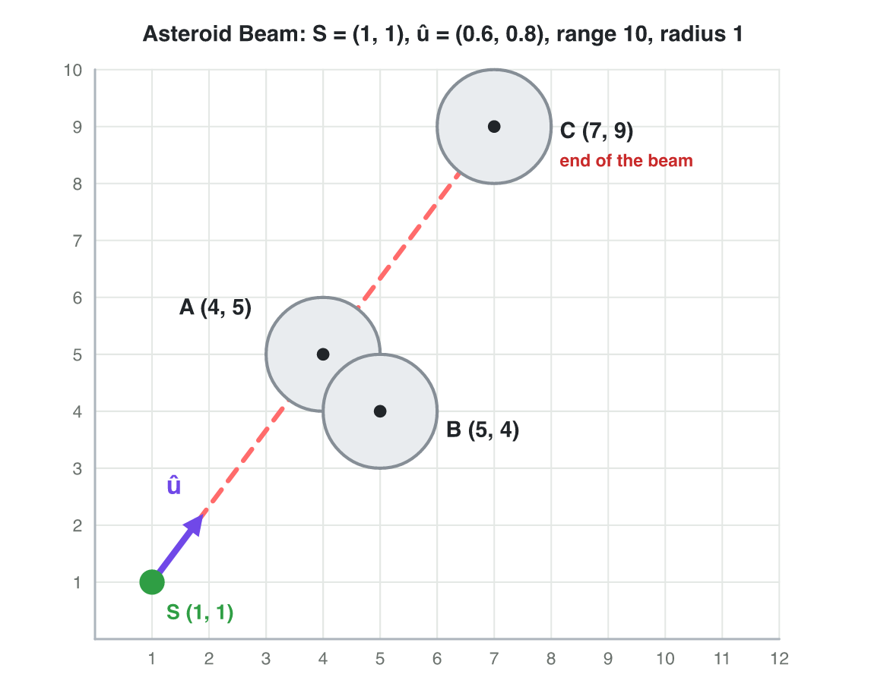
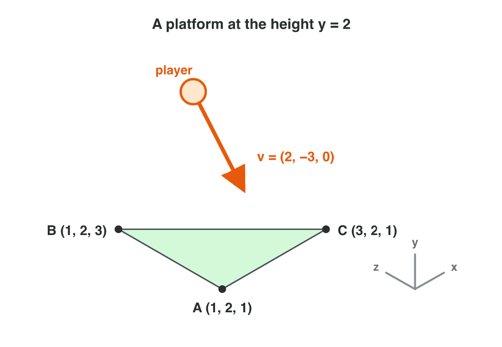

## Recall · Lecture 3

a) A tower faces (1, 0). Is a drone in the direction (2, −3) to the left or to the right?
b) A car is at (5, 5), and the road goes along (0.6, 0.8) from (0, 0). How far along the road is it?
c) What happens to the normal when two corners of a triangle swap?

::: {.answer}
a) to the right
b) 7
c) It points the other way.
:::

## Activity 1 · Hit or miss · 25 min

:::: {.columns}
::: {.column width="50%"}
- A station at S = (1, 1) fires a beam along û = (0.6, 0.8), 10 units long, at asteroids with the radius 1.
- The picture shows the asteroids A (4, 5), B (5, 4) and C (7, 9).
- **Do it:** Find "along" and "side" for each asteroid. Which asteroid does the beam hit first?
- Your product is a table with three rows.
:::
::: {.column width="50%"}

:::
::::

## Live demo · Asteroid Beam



## Check 1 · Hit or miss

Which asteroid does the beam hit first?

::: {.reveal}
1. A has d = (3, 4), along 5 and side 0, so the beam hits it.
2. B has d = (4, 3), along 4.8 and side −1.4, so it is 1.4 units to the right: missed.
3. C has d = (6, 8), along 10 and side 0, so it is on the line but after A.
4. A and B are both 5 units away, but the beam hits **A** first.
:::

## Activity 2 · The platform · 25 min

:::: {.columns}
::: {.column width="50%"}
- A platform has the corners A = (1, 2, 1), B = (1, 2, 3) and C = (3, 2, 1).
- A player falls onto it with v = (2, −3, 0).
- **Do it:** Find the normal in the order A, B, C and in the order A, C, B. Then compute the dot product of v and n̂ for each normal.
- Your product is two normals and two dot products.
:::
::: {.column width="50%"}

:::
::::

## Live demo · Normal Lab



## Check 2 · The normal of the platform

What are the normals, and what does the game do?

::: {.reveal}
1. The edges are (0, 0, 2) and (2, 0, 0), so n = (0, 4, 0) and n̂ = (0, 1, 0): up.
2. v · n̂ = −3 is negative, so the player moves into the platform, and the game stops the fall.
3. In the order A, C, B, the normal is (0, −4, 0), and v · n̂ = 3.
4. With the wrong order, the game thinks that the player moves away, and the player falls through.
:::

## Wrap-up

- You can find the nearest target, how far along a direction and how far to the side.
- You can decide with "along" and "side" what a beam or a shot hits.
- You can find the normal of a platform and check if a player moves into it.
