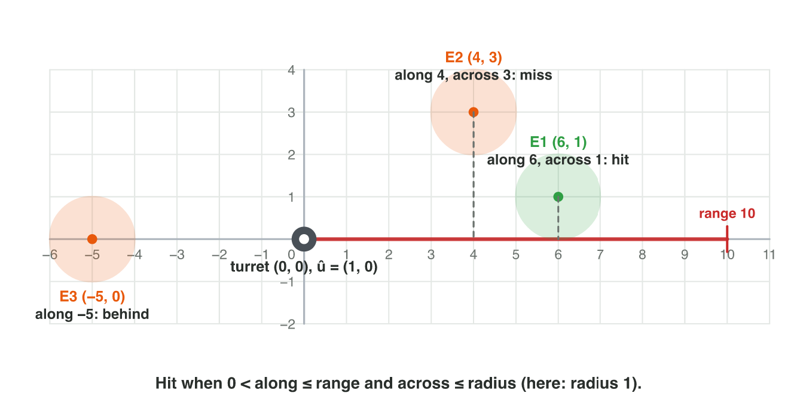
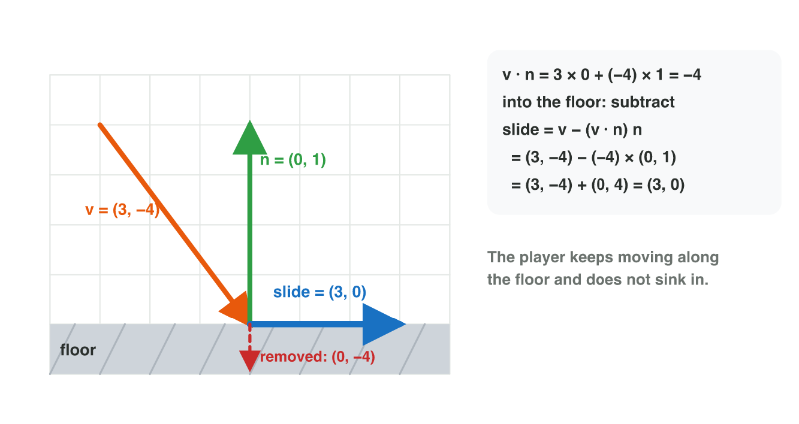

No new ideas today: two short problems on Lecture 3. Do each one alone. Tap,
sort or type your answer at every step: the page checks it at once and tells
you why.

## Recall

- 2D cross product: f × d = f~x~ d~y~ − f~y~ d~x~. Positive: left;
  negative: right; zero: on the same line.
- 3D: the normal of a triangle is (B − A) × (C − A); the order of the
  corners decides which way it faces.
- Distance = |B − A|. Along a unit vector û: v · û. Across = v − along.
  A floor removes only the part into it: the player slides.

::: {.callout-tip title="Try it 1 · Recall"}
Choose the right answer.

::: {.match extra="(0, 4)|left"}
A tower faces (1, 0). Is a drone in the direction (2, −3) to the left or to the right?
:   right

    Why: 1 × (−3) − 0 × 2 = −3: negative.

A car is at (5, 5), and the road goes along (0.6, 0.8) from (0, 0). How far along the road is it?
:   7

    Why: 5 × 0.6 + 5 × 0.8 = 3 + 4.

What happens to the normal when two corners of a triangle swap?
:   it points the other way

    Why: b × a = −(a × b).
:::
:::

## Activity 1 · Which asteroid does the beam hit?

In *Asteroid Beam*, a station at S = (0, 0) fires a mining beam along
û = (0.6, 0.8). The beam is 10 units long, and each asteroid has the
radius 1. The beam hits an asteroid when it is in front (along > 0), in
range (along ≤ 10) and close to the line (across ≤ 1). It stops at the
first asteroid it hits. Four asteroids float near it: A (3, 4), B (7, 1),
C (6, 8) and D (−3, −4).

{width=86%}



::: {.callout-note title="Activity 1 · Hit or miss · 25 min"}
1. Which asteroids are nearest to the station? Compare the squares of the
   distances.
2. For each asteroid, compute "along" = d · û.
3. Split d: the part along is (along) × û, and the part across is d minus
   it. How long is the part across?
4. Is B to the left or to the right of the beam? Use û × d.
5. Which asteroid does the beam hit first? Then play the rounds of
   **Asteroid Beam**.

*Your product:* a table with four rows (along, across, hit or miss) and
the asteroid that the beam hits first.

::: {.choice}
Step 1: which asteroids are nearest to the station S = (0, 0)?

- [x] A and D: both squares are 25.

  Why: A: 9 + 16 = 25; D: 9 + 16 = 25; B: 49 + 1 = 50; C: 36 + 64 = 100.

- [ ] B, because it has the biggest x

  Why: Compare x² + y², not one coordinate: B gives 50.

- [ ] C, because it is on the beam

  Why: On the line does not mean near: C gives 100, the farthest.
:::

::: {.fill answer="5" hint="Multiply the matching parts of (7, 1) and (0.6, 0.8), then add."}
Step 2: what is "along" for B = (7, 1)?

Why: 7 × 0.6 + 1 × 0.8 = 4.2 + 0.8 = 5.
:::

::: {.choice}
Step 4: is B to the left or to the right of the beam?

- [x] to the right

  Why: û × d = 0.6 × 1 − 0.8 × 7 = 0.6 − 5.6 = −5: negative, so right.

- [ ] to the left

  Why: Left would need a positive û × d; here it is −5.

- [ ] on the beam

  Why: On the beam, û × d would be 0.
:::

::: {.sort}
Steps 3 and 5: what happens to each asteroid? Sort them.

Hit first
:   A (3, 4): along 5, across 0

    Why: In front, in range and on the line: the beam stops here.

Missed
:   B (7, 1): along 5, across 5

    Why: The part across is 5 long, more than the radius 1.

:   D (−3, −4): along −5

    Why: Along is negative: D is behind the station.

On the line, but after the stop
:   C (6, 8): along 10, across 0

    Why: The beam is on C's line, but it already stopped at A.
:::
:::

::: {.callout-tip title="Try it 2 · The beam"}
The station is at (0, 0) and fires along û = (0.6, 0.8), 10 units long,
radius 1. Choose the right answer.

::: {.match extra="15|in front"}
An asteroid at (−6, −8). What is "along"?
:   −10

    Why: −3.6 − 6.4 = −10: negative, so behind.

An asteroid at (9, 12). Is it hit?
:   no, out of range

    Why: along = 5.4 + 9.6 = 15, more than 10.

An asteroid at (6, 8) and one at (3, 4) are both on the line. Which one stops the beam?
:   (3, 4)

    Why: along 5 is less than along 10: it comes first.
:::
:::

## Activity 2 · Land on a floor

A level has a floor triangle with the corners A = (0, 0, 0),
B = (0, 0, 2) and C = (2, 0, 0). In the side view, a player falls onto it
with the velocity v = (3, −4), and the floor has the unit normal
n̂ = (0, 1). Later the player runs into a wall on the right with the unit
normal n̂ = (−1, 0) and the velocity (2, 3).

{width=84%}



::: {.callout-note title="Activity 2 · Normal and slide · 25 min"}
1. Compute the normal (B − A) × (C − A). Does it face up or down?
2. The corners are listed as A, C, B. Compute the normal again. Check both
   in **Normal Lab** with **Swap B and C**.
3. The player falls with v = (3, −4) onto the floor. Compute v · n̂. Is the
   player moving into the floor? Find the slide v − (v · n̂) n̂.
4. Find the slide at the wall: v = (2, 3), n̂ = (−1, 0).

*Your product:* two normals and two slides, with one sentence: why does the
player not stop at the floor?

::: {.sort}
Steps 1–2: which normal does each order of the corners give? Sort them.

Faces up
:   A, B, C: n = (0, 4, 0)

    Why: (0, 0, 2) × (2, 0, 0) = (0, 4, 0).

Faces down
:   A, C, B: n = (0, −4, 0)

    Why: (2, 0, 0) × (0, 0, 2) = (0, −4, 0): the order decides the front.

:   A, B, C with Swap B and C pressed

    Why: The swap gives the order A, C, B again: the normal turns around.
:::

::: {.fill answer="(3, 0)" hint="v · n̂ = −4. Minus a negative number adds."}
Step 3: what is the slide v − (v · n̂) n̂ on the floor? Type (x, y).

Why: v · n̂ = −4 (into the floor); (3, −4) − (−4) × (0, 1) = (3, −4) + (0, 4) = (3, 0). The part along the floor stays, so the player keeps moving.
:::

::: {.choice}
Step 4: what is the slide at the wall, v = (2, 3), n̂ = (−1, 0)?

- [x] (0, 3): the player slides up the wall

  Why: v · n̂ = −2; (2, 3) − (−2) × (−1, 0) = (2, 3) − (2, 0) = (0, 3).

- [ ] (4, 3)

  Why: (−2) × (−1, 0) = (2, 0) is taken away, not added.

- [ ] (2, 0)

  Why: The wall removes the x-part (into the wall), not the y-part.
:::
:::

::: {.callout-tip title="Try it 3 · Normal and slide"}
Choose the right answer.

::: {.match extra="(0, −3)|(0, 0, 9)"}
A player moves (5, −2) onto a floor with n̂ = (0, 1). What is the slide?
:   (5, 0)

    Why: v · n̂ = −2; (5, −2) − (−2)(0, 1) = (5, 0).

A player moves (4, 3) above a floor with n̂ = (0, 1). Does the game change the movement?
:   no

    Why: v · n̂ = 3 > 0: the player moves away from the floor.

What is (0, 0, 3) × (3, 0, 0)?
:   (0, 9, 0)

    Why: (0 × 0 − 3 × 0, 3 × 3 − 0 × 0, 0 × 0 − 0 × 3).
:::
:::

## Wrap-up {.summary}

- You can find the nearest target and the part of a vector along and across
  a direction.
- You can decide with "along" and "across" what a beam or a shot hits.
- You can find the normal of a floor and make a player slide along it.
