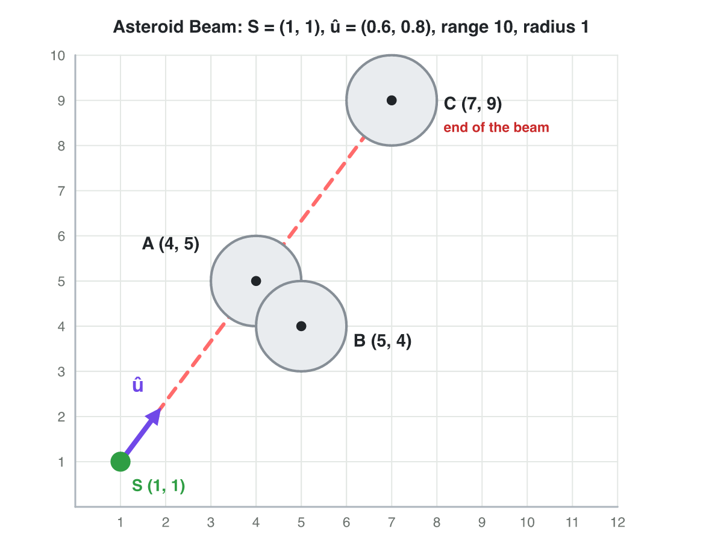
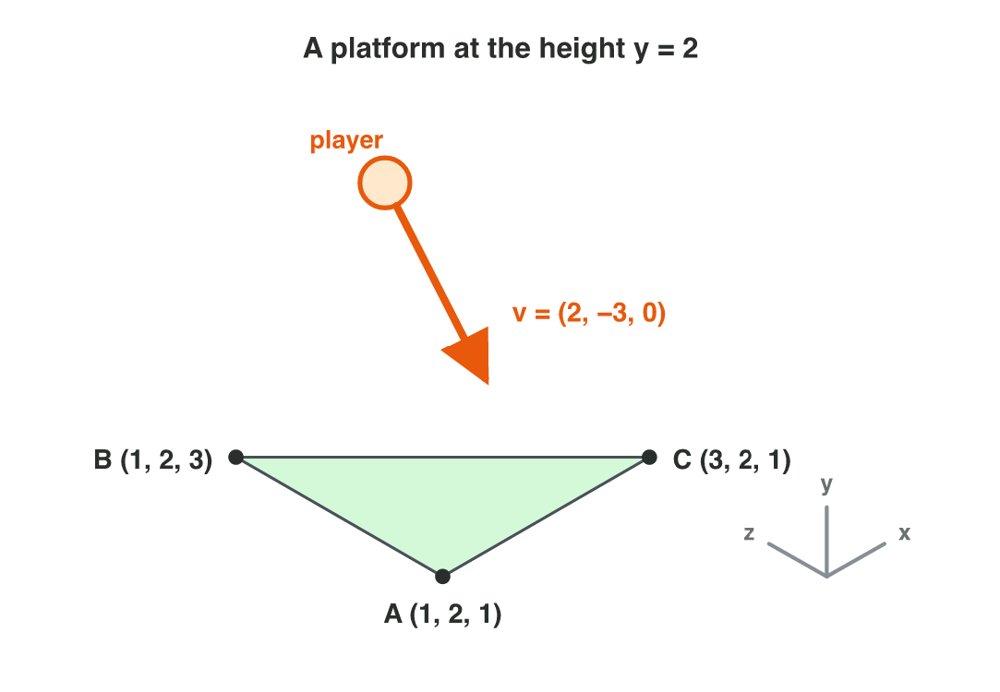

No new ideas today: two short problems on Lecture 3. Do each one alone. Tap,
sort or type your answer at every step: the page checks it at once and tells
you why.

## Recall

- 2D cross product: f × d = f~x~ d~y~ − f~y~ d~x~. Positive: left;
  negative: right; zero: on the same line.
- 3D: the normal of a triangle is (B − A) × (C − A); the order of the
  corners decides which way it faces.
- Distance = |B − A|. With a unit vector û: along = d · û (how far
  forward), side = û × d (how far to the side).

::: {.callout-tip title="Try it 1 · Recall"}
Choose the right answer.

::: {.match extra="(0, 4)|left"}
A tower faces (1, 0). Is a drone in the direction (2, −3) to the left or to the right?
:   right

    Why: 1 × (−3) − 0 × 2 = −3: negative.

A car is at (5, 5), and the road goes along (0.6, 0.8) from (0, 0). How far along the road is it?
:   7

    Why: 5 × 0.6 + 5 × 0.8 = 3 + 4.

What happens to the normal when two corners of a triangle swap?
:   it points the other way

    Why: b × a = −(a × b).
:::
:::

## Activity 1 · Which asteroid does the beam hit?

In *Asteroid Beam*, a station at S = (1, 1) fires a mining beam along
û = (0.6, 0.8). The beam is 10 units long, and each asteroid has the
radius 1. Three asteroids float near it: A (4, 5), B (5, 4) and C (7, 9).
The beam hits an asteroid when it is in front (along > 0), in range
(along ≤ 10) and close to the line (side between −1 and 1). It stops at the
first asteroid it hits.

::: {.callout-note title="Activity 1 · Hit or miss · 25 min"}
{width=78%}

1. For each asteroid, find d = asteroid − S. Which asteroids are nearest to
   the station? Compare the squares of the distances.
2. For each asteroid, compute "along" = d · û.
3. For each asteroid, compute "side" = û × d. Is B to the left or to the
   right of the beam?
4. Which asteroid does the beam hit first? Then play the rounds of
   **Asteroid Beam** below.

*Your product:* a table with three rows (d, along, side, hit or miss) and
the asteroid that the beam hits first.

::: {.choice}
Step 1: which asteroids are nearest to the station S = (1, 1)?

- [x] A and B: both squares are 25.

  Why: A: d = (3, 4), 9 + 16 = 25; B: d = (4, 3), 16 + 9 = 25; C: d = (6, 8), 36 + 64 = 100.

- [ ] C, because it is on the beam

  Why: On the line does not mean near: C gives 100, the farthest.

- [ ] A only, because the beam hits it

  Why: B is just as near: d = (4, 3) also gives 25.
:::

::: {.fill answer="4.8" hint="d = (5, 4) − (1, 1) = (4, 3). Multiply the matching parts of (4, 3) and (0.6, 0.8), then add."}
Step 2: what is "along" for B?

Why: d = (4, 3); 4 × 0.6 + 3 × 0.8 = 2.4 + 2.4 = 4.8.
:::

::: {.choice}
Step 3: what is "side" for B, and where is B?

- [x] −1.4: B is 1.4 units to the right of the beam.

  Why: û × d = 0.6 × 3 − 0.8 × 4 = 1.8 − 3.2 = −1.4: negative, so right.

- [ ] 1.4: B is 1.4 units to the left.

  Why: That is d × û, the other order. Put û first.

- [ ] 0: B is on the beam.

  Why: Only A and C give 0. B gives 1.8 − 3.2 = −1.4.
:::

::: {.sort}
Step 4: what happens to each asteroid? Sort them.

Hit first
:   A: along 5, side 0

    Why: In front, in range and on the line: the beam stops here.

Missed
:   B: along 4.8, side −1.4

    Why: B is 1.4 units to the side, more than the radius 1.

On the line, but after the stop
:   C: along 10, side 0

    Why: The beam is on C's line, but it already stopped at A.
:::
:::



::: {.callout-tip title="Try it 2 · The beam"}
Another station, at (0, 0), fires along û = (0.6, 0.8). The beam is
10 units long, and each asteroid has the radius 1. Choose the right answer.

::: {.match extra="15|3 to the right"}
An asteroid at (−6, −8). What is "along"?
:   −10

    Why: −3.6 − 6.4 = −10: negative, so behind.

An asteroid at (9, 12). Is it hit?
:   no, out of range

    Why: along = 5.4 + 9.6 = 15, more than 10.

An asteroid at (0, 5). How far to the side is it?
:   3 to the left

    Why: 0.6 × 5 − 0.8 × 0 = 3: positive, so left. 3 is more than 1, so the beam misses it.
:::
:::

## Activity 2 · Land on a platform

A level has a platform at the height 2: a triangle with the corners
A = (1, 2, 1), B = (1, 2, 3) and C = (3, 2, 1). A player falls onto it with
the velocity v = (2, −3, 0). The game tests the fall with the unit normal n̂ of the platform:
when v · n̂ is negative, the player moves into the platform, and the game stops
the fall.

::: {.callout-note title="Activity 2 · The normal of the platform · 25 min"}
{width=74%}

1. Find the edges B − A and C − A. Compute the normal
   n = (B − A) × (C − A). Does it face up or down?
2. Divide n by its length: what is the unit normal n̂?
3. The player falls with v = (2, −3, 0). Compute v · n̂. Is the player
   moving into the platform?
4. A modeller lists the corners as A, C, B. Compute the normal and v · n̂
   again. **Normal Lab** (below) has a triangle with the same edges: check
   both normals there with **Swap B and C**.

*Your product:* two normals, two values of v · n̂, and the order that the
game needs.

::: {.fill answer="(0, 4, 0)" hint="First the edges: B − A = (0, 0, 2) and C − A = (2, 0, 0). The y-part is 2 × 2 − 0 × 0."}
Step 1: what is n = (B − A) × (C − A)? Type (x, y, z).

Why: The edges are (0, 0, 2) and (2, 0, 0); (0 × 0 − 2 × 0, 2 × 2 − 0 × 0, 0 × 0 − 0 × 2) = (0, 4, 0): the platform faces up.
:::

::: {.choice}
Steps 2–3: n̂ = (0, 1, 0) and v = (2, −3, 0). Is the player moving into the platform?

- [x] Yes: v · n̂ = −3 is negative.

  Why: 2 × 0 + (−3) × 1 + 0 × 0 = −3: the player moves against the normal, into the platform.

- [ ] No: v · n̂ = 3 is positive.

  Why: (−3) × 1 = −3, not 3: the y-part of v is negative.

- [ ] We cannot tell without the length of v.

  Why: The sign of v · n̂ is enough: negative means into the platform.
:::

::: {.sort}
Step 4: which order of the corners gives each result? Sort the cards.

Order A, B, C
:   n = (0, 4, 0), so n̂ = (0, 1, 0)

    Why: (0, 0, 2) × (2, 0, 0) = (0, 4, 0); divide by its length 4.

:   v · n̂ = −3: the game stops the fall

    Why: (2, −3, 0) · (0, 1, 0) = −3: into the platform.

Order A, C, B
:   n = (0, −4, 0): it faces down

    Why: (2, 0, 0) × (0, 0, 2) = (0, −4, 0): the other order turns the normal around.

:   v · n̂ = 3: the player falls through the platform

    Why: With n̂ = (0, −1, 0), the game thinks that the player moves away from the platform, so it does not stop the fall.
:::
:::



::: {.callout-tip title="Try it 3 · Normals"}
Choose the right answer.

::: {.match extra="(0, −9, 0)|yes, into it"}
What is (0, 0, 3) × (3, 0, 0)?
:   (0, 9, 0)

    Why: (0 × 0 − 3 × 0, 3 × 3 − 0 × 0, 0 × 0 − 0 × 3).

A player moves with v = (4, 3, 0) above a floor with n̂ = (0, 1, 0). Is the player moving into the floor?
:   no, away from it

    Why: v · n̂ = 3 is positive: the player moves away from the floor.

A floor has the normal (0, 6, 0). What is its unit normal?
:   (0, 1, 0)

    Why: Divide by its length 6.
:::
:::

## Wrap-up {.summary}

- You can find the nearest target, how far along a direction and how far
  to the side.
- You can decide with "along" and "side" what a beam or a shot hits.
- You can find the normal of a platform and check if a player moves into it.
