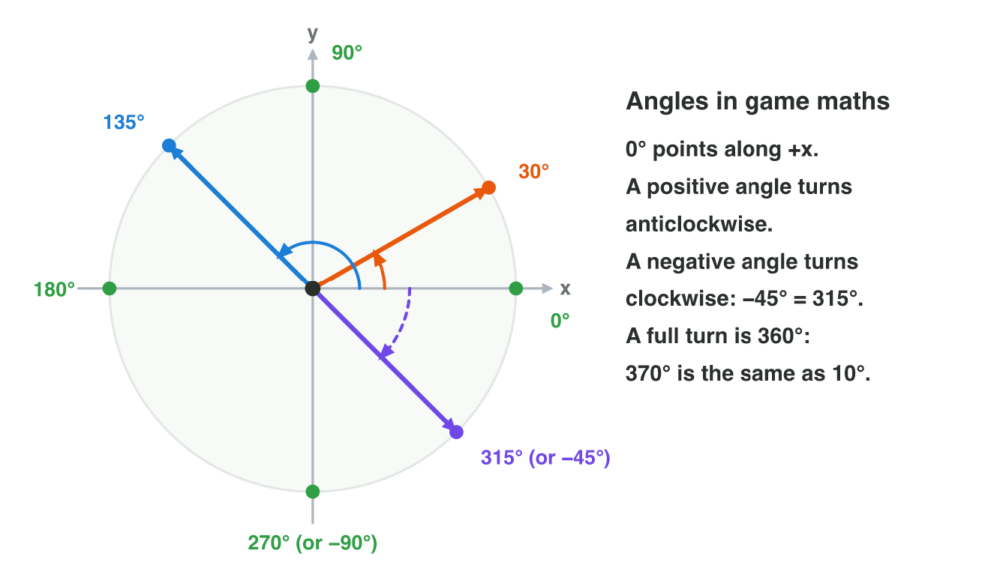
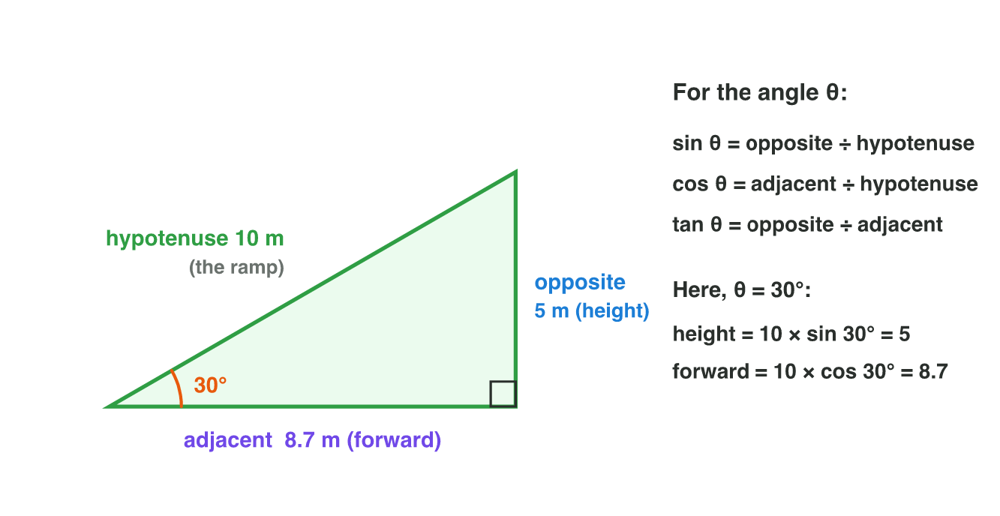
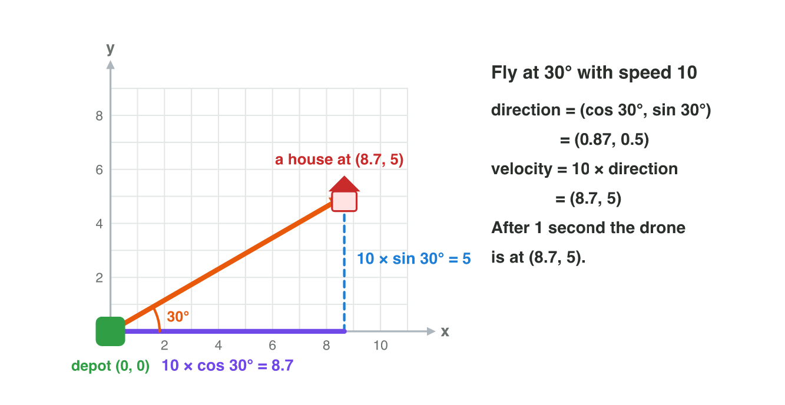

## Keywords



## 4.1 Which way is the drone facing?

:::: {.columns}
::: {.column width="50%"}
- An angle is the turn from the +x axis, measured in degrees.
- 0° points right, 90° up, 180° left and 270° down.
- A positive angle turns anticlockwise, and a full turn is 360°.
- **Do it:** On squared paper, draw arrows for 0°, 90°, 135°, 225° and −45°. What is the second name of −45°?
:::
::: {.column width="50%"}

:::
::::

## Try it 1 · Headings

a) A drone has the heading 180°. Which way does it fly?
b) Which angle is the same direction as −90°?
c) On a map, east is 90°. Which angle is east in game maths?

::: {.answer}
a) to the left (−x)
b) 270°
c) 0°
:::

## 4.2 Sine, cosine and tangent

:::: {.columns}
::: {.column width="50%"}
- A right triangle has one angle of 90°, and its longest side is the hypotenuse.
- sin θ is the opposite side divided by the hypotenuse.
- cos θ is the adjacent side divided by the hypotenuse, and tan θ is opposite ÷ adjacent.
- **Do it:** On your phone's calculator in DEG mode, compute sin 30° and cos 30°. What do you get?
:::
::: {.column width="50%"}

:::
::::

## The common values

| θ | 0° | 30° | 45° | 60° | 90° |
|---|---|---|---|---|---|
| sin θ | 0 | 0.5 | 0.71 | 0.87 | 1 |
| cos θ | 1 | 0.87 | 0.71 | 0.5 | 0 |
| tan θ | 0 | 0.58 | 1 | 1.73 | — |

## Example · The skate ramp

A ramp in a skate game is 10 m long, and it rises at 30°.
**How high is the ramp, and how far forward does it reach?**

::: {.reveal}
1. The height is the opposite side: 10 × sin 30° = 10 × 0.5 = **5 m**.
2. The forward part is the adjacent side: 10 × cos 30° = 10 × 0.87 = **8.7 m**.
3. The level designer places the top of the ramp 5 m high and 8.7 m forward.
:::

## Try it 2 · The right triangle

a) A ramp is 8 m long and rises at 30°. How high is it?
b) A hill rises 3 m over 4 m forward. What is tan θ?
c) Which side of a right triangle is the longest?

::: {.answer}
a) 8 × 0.5 = 4 m
b) 3 ÷ 4 = 0.75
c) the hypotenuse
:::

## 4.3 The unit circle

:::: {.columns}
::: {.column width="50%"}
- The unit circle has the radius 1 and its centre at the origin.
- The point at the angle θ is (cos θ, sin θ), so cos is x and sin is y.
- Larger angles give the same numbers with other signs, for example 150° gives (−0.87, 0.5).
- **Do it:** In Unit Circle Lab, put the point at 30°, 150°, 210° and 330°. What changes?
:::
::: {.column width="50%"}

:::
::::

## Live demo · Unit Circle Lab



## Try it 3 · On the circle

a) What is the point on the unit circle at 180°?
b) At 210°, which signs do cos θ and sin θ have?
c) Why is (0.6, 0.8) on the unit circle?

::: {.answer}
a) (−1, 0)
b) Both are negative.
c) 0.6² + 0.8² = 0.36 + 0.64 = 1
:::

## 4.4 From an angle to a movement

:::: {.columns}
::: {.column width="50%"}
- The direction at the angle θ is the unit vector (cos θ, sin θ).
- The velocity is the speed times this direction.
- A drone at 30° with the speed 10 has the velocity (8.7, 5).
- **Do it:** A boat sails at 60° with the speed 6. What is its velocity?
:::
::: {.column width="50%"}

:::
::::

## Example · The drone at 30°

The heading is 30°, and the speed is 10.
**Which velocity does the drone get?**

::: {.reveal}
1. The direction is (cos 30°, sin 30°) = (0.87, 0.5).
2. The velocity is 10 × (0.87, 0.5) = **(8.7, 5)**.
3. After 1 second the drone is at (8.7, 5).
:::

## Try it 4 · Velocity

a) A car drives at 0° with the speed 12. What is its velocity?
b) A drone flies at 45° with the speed 10. What is its velocity?
c) A drone flies at 90° with the speed 3. What is its velocity?

::: {.answer}
a) (12, 0)
b) (7.1, 7.1)
c) (0, 3)
:::

## 4.5 Which angle is the target at?

:::: {.columns}
::: {.column width="50%"}
- A turret needs the angle of the vector d to its target.
- tan θ = y ÷ x loses the signs, so (4, 4) and (−4, −4) both give 1.
- atan2(y, x) uses the signs and gives the right angle in every quadrant.
- **Do it:** Draw the target (−3, 3) on squared paper. Which quadrant is it in, and which angle does atan2 give?
:::
::: {.column width="50%"}

:::
::::

## Example · Four drones

A turret stands at (0, 0). Drones hover at A (4, 4), B (−4, 4), C (−4, −4) and E (0, −3).
**At which angle is each drone?**

::: {.reveal}
1. A at (4, 4) is at **45°**.
2. B at (−4, 4) is at **135°**, although tan alone would say −45°.
3. C at (−4, −4) is at **−135°**, the same direction as 225°.
4. E at (0, −3) is straight down, at **−90°**.
:::

## Try it 5 · The angle to a target

a) A drone is at (5, 5) from the turret. At which angle is it?
b) A drone is at (0, −3) from the turret. At which angle is it?
c) Why is tan θ = y ÷ x not enough to find the angle?

::: {.answer}
a) 45°
b) −90°
c) The division loses the signs of x and y.
:::

## 4.6 Moving in a circle

:::: {.columns}
::: {.column width="50%"}
- An object on a circle is at C + r × (cos θ, sin θ).
- The angle grows at the angular speed: θ = ω × t.
- One full turn takes the period T = 360° ÷ ω.
- **Do it:** In Wave Lab, choose Orbit with the radius 2 and the period 4 s. Where is the point at 1 s?
:::
::: {.column width="50%"}

:::
::::

## Example · The orb

An orb circles the hero at C = (5, 5) with the radius 2, at 90° per second, starting at 0°.
**Where is the orb at 0 s, 1 s and 2 s?**

::: {.reveal}
1. At 0 s the angle is 0°, so the orb is at (5, 5) + 2 × (1, 0) = **(7, 5)**.
2. At 1 s the angle is 90°, so the orb is at (5, 5) + 2 × (0, 1) = **(5, 7)**.
3. At 2 s the angle is 180°, so the orb is at **(3, 5)**, and one turn takes 4 s.
:::

## Try it 6 · Orbits

a) The same orb at 3 s: where is it?
b) A moon turns at 30° per second. What is its period?
c) A cabin turns at 30° per second. After how many seconds is it at 90°?

::: {.answer}
a) (5, 3)
b) 12 s
c) 3 s
:::

## 4.7 Bobbing up and down

:::: {.columns}
::: {.column width="50%"}
- A value that goes up and down again and again is an oscillation.
- y = c + A × sin(360° × t ÷ T), with the middle c, the amplitude A and the period T.
- The value is at the top at a quarter of the period and at the bottom at three quarters.
- **Do it:** In Wave Lab, choose Bob with A = 3 and T = 4 s. What is the height at 3 s?
:::
::: {.column width="50%"}

:::
::::

## Example · A bobbing coin

A coin moves by y = 4 + 1 × sin(360° × t ÷ 2).
**Where is the coin at 0.5 s, 1 s and 1.5 s?**

::: {.reveal}
1. At 0.5 s the angle is 90°, sin 90° = 1, and the coin is at 4 + 1 = **5**.
2. At 1 s the angle is 180°, sin 180° = 0, and the coin is at the middle, **4**.
3. At 1.5 s the angle is 270°, sin 270° = −1, and the coin is at 4 − 1 = **3**.
:::

## Live demo · Wave Lab



## Try it 7 · Bobbing

a) A coin has the middle 2, the amplitude 0.5 and the period 2 s. How high is it at 0.5 s?
b) A coin bobs between 3 and 5. What are its middle and its amplitude?
c) A lift has the period 6 s. When is it at the top for the first time?

::: {.answer}
a) 2.5
b) the middle 4 and the amplitude 1
c) 1.5 s
:::

## Game challenge · Drone Drop



## Try it 8 · New customers (harder)

The facts: the depot is at (0, 0). The drone flies at the speed 10 for 1 second. cos 30° = 0.87 and sin 30° = 0.5.

a) Which heading reaches Cara at (−7.1, 7.1)?
b) The drone flies at 210°. Where does the parcel fall?
c) A customer lives at (0, −10). Which heading reaches the customer?

::: {.answer}
a) 135°
b) (−8.7, −5)
c) 270° (or −90°)
:::

## Summary

- An angle starts at +x and grows anticlockwise, and 360° is a full turn.
- Sine, cosine and tangent compare the sides of a right triangle.
- The point at the angle θ on the unit circle is (cos θ, sin θ).
- A velocity at the angle θ is speed × (cos θ, sin θ), and atan2 goes back from a vector to its angle.
- An object in a circle is at C + r (cos ωt, sin ωt).
- A bobbing value is c + A sin(360° × t ÷ T).
