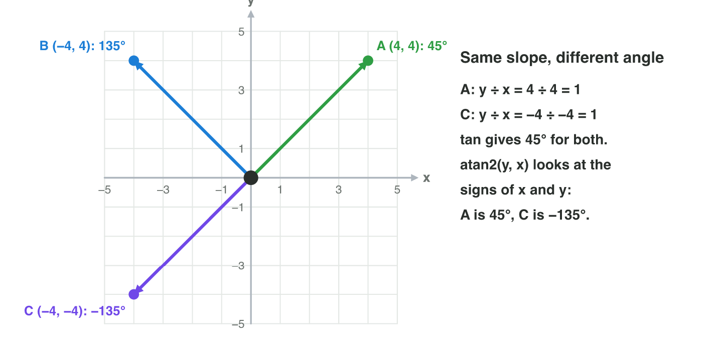
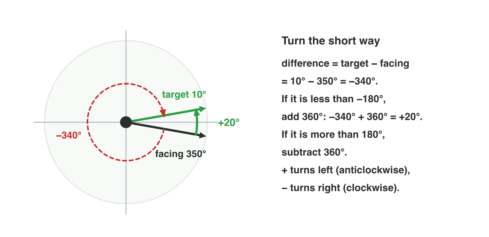
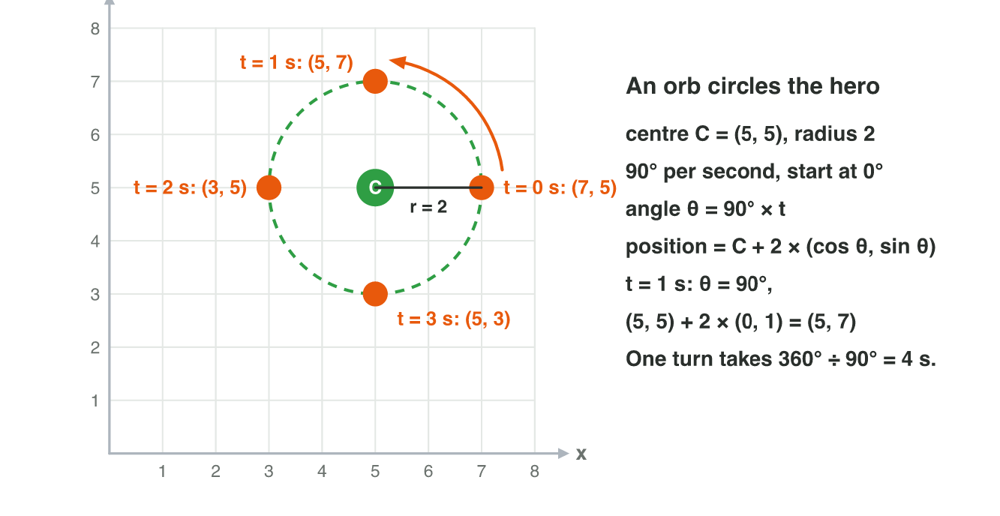
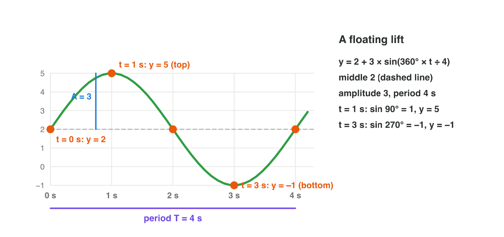
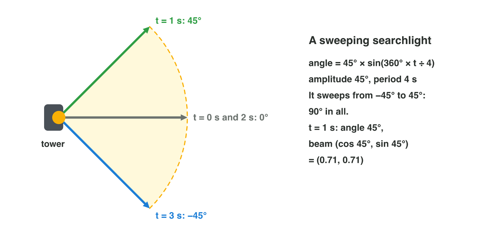

::: {.lead}
A hero waits on a cliff. Beside the cliff, a magic lift floats up and down,
again and again. When can the hero step on? Games are full of motion like
this: turrets that turn towards the player, shields that circle a hero,
coins that bob in the air, searchlights that sweep a yard. In Lecture 6 you
learned sine, cosine and the unit circle. In this lesson you use them to
solve these motion problems: you find the angle to a target, turn the short
way, move an object in a circle, and describe motion that goes back and
forth. Every section ends with a short task.
:::

## Key terms



## 7.1 Which angle is the target at?

A turret stands at the origin. A drone hovers at $(4, 4)$. To turn the
turret, the game needs the *angle* of the drone, not only the vector
$\mathbf{d} = (4, 4)$ to it. In Lecture 6 you went from an angle to a
direction. Now you go back: from a direction to an angle.

The tangent helps first: $\tan\theta = d_y \div d_x = 4 \div 4 = 1$, and
tan 45° = 1, so the drone is at 45°. But there is a problem (@fig-atan2).
A drone at $(-4, -4)$ gives $(-4) \div (-4) = 1$ too. Yet it is behind the
turret, at −135°. The division loses the signs.

::: {.callout-important title="Definition 7.1 — atan2"}
**atan2(y, x)** gives the angle of the vector $(x, y)$ from the positive
x-axis. It looks at the signs of both parts, so it gives the right angle in
every quadrant, from −180° to 180°.
:::

{#fig-atan2 width=94%}

::: {.callout-note title="Example 7.1 — Four drones"}
The turret is at (0, 0).

1. A at $(4, 4)$: atan2(4, 4) = **45°**.
2. B at $(-4, 4)$: atan2(4, −4) = **135°**. tan alone would say −45°.
3. C at $(-4, -4)$: atan2(−4, −4) = **−135°** (the same direction as 225°).
4. E at $(0, -3)$: straight down, atan2(−3, 0) = **−90°**.
:::

::: {.callout-warning title="Common mistake"}
Swapping the order. atan2 takes **y first**: atan2(y, x). With x first, a
drone at $(4, 0)$ comes out at 90° instead of 0°.
:::



::: {.callout-note title="Do it · Angles in Turn Lab"}
Open the **Turn Lab** simulator above (or scan its QR code).

1. Tap the targets $(5, 0)$, $(0, 4)$, $(-3, 3)$ and $(-3, -3)$.
2. Each time, write the vector d and the angle from atan2.

*Your result:* a table with four rows, and the quadrant of each target.

::: {.check}
$(5, 0)$: 0° (on the x-axis). $(0, 4)$: 90° (on the y-axis). $(-3, 3)$:
135° (quadrant II). $(-3, -3)$: −135°, the same as 225° (quadrant III).
:::
:::

## 7.2 Turning the short way

The turret faces 350°. The drone flies to 10°. If the turret turns from 350°
to 10° by subtracting, it turns −340°: almost a full turn clockwise, and the
drone escapes. The short way is only 20° anticlockwise (@fig-turn).

The game finds the short turn in two steps:

1. difference = target angle − facing angle;
2. if the difference is more than 180°, subtract 360°; if it is less than
   −180°, add 360°.

The result is from −180° to 180°. Positive means turn left
(anticlockwise); negative means turn right (clockwise).

{#fig-turn width=94%}

A turret also has a **turning speed**: for example 90° per second. The time
of a turn is the size of the turn divided by this speed.

::: {.callout-note title="Example 7.2 — Three turns"}
The turret turns at 90° per second.

1. Facing 30°, target 120°: 120° − 30° = **+90°**. Turn left, 1 second.
2. Facing 350°, target 10°: 10° − 350° = −340°. Less than −180°, so add
   360°: **+20°**. Turn left, about 0.2 seconds.
3. Facing 0°, target −135°: **−135°**. Turn right, 1.5 seconds.
:::

::: {.callout-warning title="Common mistake"}
Turning by the plain difference. Without step 2, an enemy turns almost a
full circle for a target that is just behind its shoulder. The player sees
a slow, silly spin.
:::

::: {.callout-note title="Do it · The short turn in Turn Lab"}
In **Turn Lab**, choose **Facing 350°** and tap the target $(6, 1)$: it is
at about 9.5°. Read the short turn and press **Turn**. Then choose **Facing
170°** and tap $(-6, -1)$: it is at about −170.5°.

*Your result:* the two short turns (left or right, how many degrees) and
their times.

::: {.check}
Facing 350°, target at 9.5°: 9.5° − 350° = −340.5°; + 360° = about +19.5°:
Turn Lab shows 19° left, about 0.2 s. Facing 170°, target at −170.5°:
−340.5° + 360° = about +19.5°: 19° left again, about 0.2 s.
:::
:::

## 7.3 Moving in a circle

A magic orb circles the hero to protect her. A moon goes around a planet. A
saw blade spins around a pole. All of them move in a circle at a steady
speed. The unit circle of Lecture 6 gives the position: the point at the
angle θ on a circle with the radius r around the centre C is
$C + r(\cos\theta, \sin\theta)$ (@fig-orbit).

The angle grows at a steady rate. This rate is the **angular speed** ω (the
Greek letter "omega"), in degrees per second:
$$\theta = \omega \times t.$$

::: {.callout-important title="Definition 7.2 — Circular motion"}
An object that moves in a circle with the centre C and the radius r, at the
angular speed ω, starting at 0°, is at
$$P(t) = C + r\,(\cos(\omega t),\ \sin(\omega t)).$$
One full turn takes the **period** $T = 360° \div \omega$.
:::

{#fig-orbit width=94%}

::: {.callout-note title="Example 7.3 — The orb"}
C = (5, 5), r = 2, ω = 90° per second.

1. t = 0: θ = 0°, $P = (5, 5) + 2 \times (1, 0) = (7, 5)$.
2. t = 1 s: θ = 90°, $P = (5, 5) + 2 \times (0, 1) = (5, 7)$.
3. t = 2 s: θ = 180°, $P = (3, 5)$; t = 3 s: θ = 270°, $P = (5, 3)$.
4. The period is 360° ÷ 90° = **4 s**: at t = 4 s the orb is back at (7, 5).
:::

::: {.callout-warning title="Common mistake"}
Forgetting the radius or the centre. (cos θ, sin θ) is on a circle of
radius 1 around (0, 0). Multiply by r, then add C.
:::



::: {.callout-note title="Do it · An orbit in Wave Lab"}
Open the **Wave Lab** simulator above. Choose the mode **Orbit**, the
amplitude 2 (the radius) and the period 4 s.

1. Step to 0 s, 1 s, 2 s and 3 s. Write the position each time.
2. Change the period to 8 s. What is the angular speed now?

*Your result:* four positions and the new angular speed.

::: {.check}
Wave Lab circles the centre (0, 2): 0 s: (2, 2); 1 s: (0, 4); 2 s: (−2, 2);
3 s: (0, 0). Period 8 s: ω = 360° ÷ 8 = 45° per second.
:::
:::

## 7.4 Bobbing up and down: oscillating motion

A coin floats in the air and bobs gently, so that the player notices it. A
lift goes up and down beside a cliff. Such motion goes back and forth around
a middle position and repeats: an **oscillation**. Look at the orb of
section 7.3 from the side: its height goes up and down. Its height is the
sine of the angle. So the sine gives the bobbing (@fig-wave):

::: {.callout-important title="Definition 7.3 — Oscillation with sine"}
A value that bobs around the middle c, with the **amplitude** A and the
**period** T, is
$$y(t) = c + A\sin\!\left(360° \times \frac{t}{T}\right).$$
A is the largest distance from the middle. T is the time of one full up and
down.
:::

{#fig-wave width=94%}

At a quarter of the period, the angle is 90° and sin = 1: the top, c + A.
At three quarters, the angle is 270° and sin = −1: the bottom, c − A. At 0,
half and the full period, sin = 0: the middle.

::: {.callout-note title="Example 7.4 — A bobbing coin"}
A coin has the middle 4, the amplitude 1 and the period 2 s:
$y(t) = 4 + 1 \times \sin(360° \times t \div 2)$.

1. t = 0: sin 0° = 0, y = 4 (the middle).
2. t = 0.5 s: the angle is 360° × 0.5 ÷ 2 = 90°, y = 4 + 1 = **5** (the top).
3. t = 1.5 s: the angle is 270°, y = 4 − 1 = **3** (the bottom).
4. The coin moves between 3 and 5: 2 units from bottom to top, which is
   2 × A.
:::

::: {.callout-warning title="Common mistake"}
Reading the amplitude as the whole movement. With A = 3, a value moves from
c − 3 to c + 3: 6 units from bottom to top, twice the amplitude.
:::

::: {.callout-note title="Do it · The lift in Wave Lab"}
In **Wave Lab**, choose the mode **Bob**, the amplitude 3 and the period 4 s.

1. Step to 0 s, 1 s, 2 s, 3 s and 4 s. Write the height each time.
2. Change the period to 8 s. When is the lift at the top now?

*Your result:* five heights and the new time of the top.

::: {.check}
The middle is 2: 0 s: 2; 1 s: 5; 2 s: 2; 3 s: −1; 4 s: 2. With the period
8 s the top comes at a quarter of it: 2 s.
:::
:::

### Sweeping back and forth

The same sine can make an *angle* swing. In a stealth game, a searchlight on a tower sweeps the yard: left, right,
left. Here the *angle* oscillates, not the height. The tower faces +x, and
its light swings 45° to each side, with the period 4 s (@fig-sweep):
$$\text{angle}(t) = 45° \times \sin(360° \times t \div 4).$$
At each moment, the beam points in the direction
(cos angle, sin angle), as in Lecture 6.

{#fig-sweep width=92%}

::: {.callout-note title="Example 7.5 — The searchlight"}
1. t = 0: angle 0°, the beam points along (1, 0).
2. t = 1 s: angle 45° × sin 90° = 45°; the beam points along
   (0.71, 0.71).
3. t = 3 s: angle 45° × sin 270° = −45°; the beam points along
   (0.71, −0.71).
4. It covers 90° in all: 45° to each side.
:::

::: {.callout-warning title="Common mistake"}
Mixing up the two oscillations. For the lift the *position* bobs; for the
searchlight the *angle* swings, and the beam still starts at the tower. Use the angle
to make the direction (cos, sin).
:::

## Case study: Sky Lift

*Sky Lift* is a made-up platform game. A hero waits on a cliff at the height
5. Beside the cliff, a lift floats up and down:
$y(t) = 3 + 2\sin(360° \times t \div 8)$: the middle 3, the amplitude 2, the
period 8 s. The clock starts when the lift is at the middle, going up. The
hero can step on only when the lift is level with the cliff. Lower down
there is a second ledge at the height 1. The Game challenge of the
interactive lesson uses these numbers. In the mini-game below you choose the
moment to jump, in five rounds, one of them on a wheel.



## Further reading

Dunn and Parberry, *3D Math Primer for Graphics and Game Development*,
2nd ed., Chapter 1 (trigonometry: the inverse functions and atan2) and
Chapter 8 (orientation in 2D as an angle).

## Exercises

1. Find the angle of the vectors $(5, 5)$, $(-5, 5)$ and $(0, -2)$ with
   atan2.
2. Why does $\tan\theta = y \div x$ not tell the difference between
   $(2, 2)$ and $(-2, -2)$?
3. Facing 20°, target 110°. Find the short turn and its time at 90° per
   second.
4. Facing 10°, target 340°. Find the short turn. Left or right?
5. Facing 160°, target −160°. Find the short turn.
6. An orb circles $C = (2, 3)$ with the radius 3, at 90° per second,
   starting at 0°. Where is it at 1 s and at 2 s?
7. A moon circles $(0, 0)$ with the radius 6, at 45° per second. What is
   its period?
8. A wheel cabin turns at 30° per second. After how many seconds is it at
    90°?
9. $y = 1 + 2\sin(360° \times t \div 8)$. Find y at 0 s, 2 s, 4 s and 6 s.
10. A coin bobs between 3 and 5. What are its middle and its amplitude?
11. A lift has the period 6 s. When is it at the top for the first time?
12. A searchlight sweeps with angle = 30° × sin(360° × t ÷ 4). What is the
    angle at 1 s, and in which direction does the beam point then?
13. *Sky Lift*: when is the lift level with the cliff (height 5), and when
    with the low ledge (height 1)? Where is the lift at 4 s?

## Answers to the exercises

::: {.answers}
1. 45°, 135° and −90°.
2. (−2) ÷ (−2) = 2 ÷ 2 = 1: the signs cancel. atan2 looks at the signs and gives 45° and −135°.
3. 110° − 20° = +90°: left, 1 second.
4. 340° − 10° = 330°; more than 180°, so 330° − 360° = −30°: 30° right.
5. −160° − 160° = −320°; +360° = +40°: 40° left.
6. 1 s: (2, 3) + 3 × (0, 1) = (2, 6). 2 s: (2, 3) + 3 × (−1, 0) = (−1, 3).
7. 360° ÷ 45° = 8 s.
8. 90° ÷ 30° = 3 s.
9. 1, 3, 1, −1 (the angles are 0°, 90°, 180°, 270°).
10. Middle 4, amplitude 1.
11. At a quarter of the period: 1.5 s.
12. 30° × sin 90° = 30°; the beam points along (0.87, 0.5).
13. At 2 s (y = 3 + 2 = 5) and at 6 s (y = 3 − 2 = 1); the next time at the cliff is 10 s. At 4 s the lift is at the middle, y = 3.
:::
