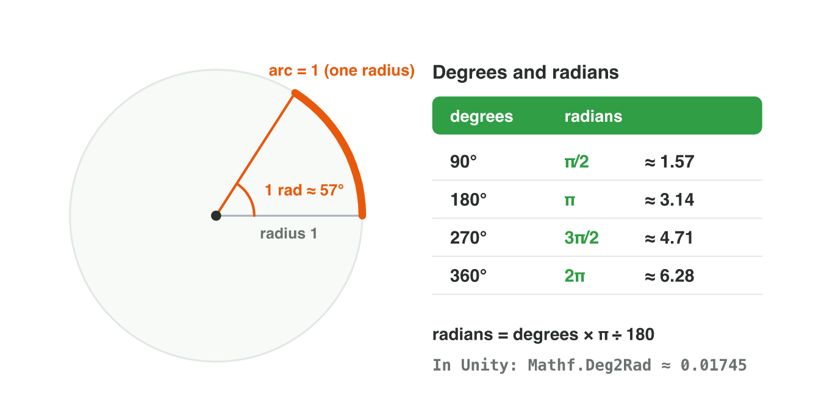

::: {.lead}
A delivery drone waits at the depot. The player taps on the compass and
chooses "fly at 30°". The game must now move the drone: so many units along
x and so many along y, in every frame. How does it turn an angle into a
movement? The answer is **trigonometry**: sine, cosine and tangent. In
lectures 2 to 6 you described directions with vectors. In this lesson you
describe them with an angle, and you change between the two. You will meet
the right triangle, the **unit circle**, and the **radians** that game code
uses. Every section ends with a short task.
:::

## Key terms



## 7.1 Which way is the drone facing? Angles

The compass in the corner of the screen shows the heading of the drone:
"90°". Which way is that? Games need one rule for angles, so that 90°
means the same direction for the artist, the designer and the code.

::: {.callout-important title="Definition 7.1 — Angle of a direction"}
The **angle** of a direction is the amount of turn from the positive
x-axis to that direction. It is measured in **degrees** (°). A full turn is
360°. A positive angle turns **anticlockwise**; a negative angle turns
clockwise.
:::

So 0° points along +x (to the right), 90° along +y (up), 180° along −x and
270° along −y (@fig-dial). Unity uses the same rule for the rotation of a 2D
object around z: a positive angle turns it anticlockwise.

{#fig-dial width=92%}

Two angles show the same direction when they differ by a full turn:
370° = 370° − 360° = 10°, and −90° = −90° + 360° = 270°.

::: {.callout-note title="Example 7.1 — The four main directions"}
1. A drone with the heading 0° flies to the right (+x).
2. With 90° it flies up (+y); with 180° to the left (−x).
3. With 270° it flies down (−y). The same heading is also written −90°.
:::

::: {.callout-note title="Example 7.2 — Turning past a full turn"}
A turret faces 350°. It turns 20° anticlockwise.

1. The new angle is 350° + 20° = 370°.
2. 370° − 360° = 10°. The turret faces 10°, a little above +x.
3. Another turret faces 0° and turns 45° clockwise: 0° − 45° = −45°, the
   same as 315°.
:::

::: {.callout-warning title="Common mistake"}
Using the compass of a map. On a map, 0° is north (up) and angles turn
clockwise. In game maths, 0° is +x (right) and angles turn anticlockwise.
A map heading of 90° (east) is 0° in game maths.
:::

::: {.callout-note title="Do it · Draw five headings"}
On squared paper, draw the x-axis and the y-axis.

1. Draw an arrow from the origin for 0°, 90°, 135°, 225° and −45°. For 45°
   angles, follow the diagonal of the squares.
2. Write the second name of each angle: for example 270° is also −90°.

*Your result:* the drawing with five labelled arrows.
:::

## 7.2 How high is the ramp? Sine, cosine and tangent

A skate game has a ramp that is 10 m long and rises at 30°. The level
designer must know two numbers: how high the ramp goes, and how far forward
it reaches. The ramp, the floor and the height make a **right triangle**:
a triangle with one angle of 90° (@fig-tri).

For one angle θ (the Greek letter "theta") of a right triangle, the three
sides have names:

- the **hypotenuse**: the longest side, opposite the right angle (the ramp);
- the **opposite** side: across from θ (the height);
- the **adjacent** side: next to θ, but not the hypotenuse (the floor).

::: {.callout-important title="Definition 7.2 — Sine, cosine and tangent"}
For an angle θ of a right triangle:
$$\sin\theta = \frac{\text{opposite}}{\text{hypotenuse}}, \qquad \cos\theta = \frac{\text{adjacent}}{\text{hypotenuse}}, \qquad \tan\theta = \frac{\text{opposite}}{\text{adjacent}}.$$
:::

{#fig-tri width=94%}

The three values depend only on the angle, not on the size of the
triangle. A calculator gives them; for the angles that games use most, learn
@tbl-trig (values to two decimals).

| θ | 0° | 30° | 45° | 60° | 90° |
|---|---|---|---|---|---|
| sin θ | 0 | 0.5 | 0.71 | 0.87 | 1 |
| cos θ | 1 | 0.87 | 0.71 | 0.5 | 0 |
| tan θ | 0 | 0.58 | 1 | 1.73 | — |

: Sine, cosine and tangent of the common angles. At 90°, tan does not exist. {#tbl-trig}

From the definition, each side follows from the hypotenuse:
opposite = hypotenuse × sin θ, and adjacent = hypotenuse × cos θ.

::: {.callout-note title="Example 7.3 — The skate ramp"}
The ramp is 10 m long and rises at 30°. How high is it, and how far forward
does it reach?

1. Height (opposite) = 10 × sin 30° = 10 × 0.5 = **5 m**.
2. Forward (adjacent) = 10 × cos 30° = 10 × 0.87 = **8.7 m**.
:::

::: {.callout-note title="Example 7.4 — A hill in a racing game"}
A hill rises 3 m over 4 m forward. The slope itself is 5 m long (3, 4, 5:
lecture 3).

1. sin θ = 3 ÷ 5 = 0.6 and cos θ = 4 ÷ 5 = 0.8.
2. tan θ = 3 ÷ 4 = 0.75. The tangent is the **slope**: 0.75 m up for every
   1 m forward.
3. 0.75 is between tan 30° = 0.58 and tan 45° = 1, so the hill rises at an
   angle between 30° and 45° (about 37°).
:::

::: {.callout-warning title="Common mistake"}
Mixing up the opposite and the adjacent side. They depend on the angle you
look from. For the other sharp angle of the ramp (60°, at the top), the
height is the *adjacent* side.
:::

::: {.callout-note title="Do it · The calculator of your phone"}
Open the calculator of your phone or of the lab computer in scientific mode
(Android: tap the arrow or turn the phone; iPhone: turn the phone, or choose
Scientific; Windows: the menu → Scientific). Check that it shows **DEG**,
not RAD.

1. Compute sin 30°, cos 30° and tan 45°. Compare with @tbl-trig.
2. A ramp is 10 m long and rises at 20°. Compute its height: 10 × sin 20°.

*Your result:* three values and the height of the ramp.
:::

## 7.3 Every angle at once: the unit circle

The drone can fly at 120° or 250° too. But a right triangle has no angle
bigger than 90°. The **unit circle** gives sine and cosine for *every*
angle (@fig-unit).

::: {.callout-important title="Definition 7.3 — The unit circle"}
The **unit circle** is the circle with the radius 1 around the origin. The
point on it at the angle θ is
$$(\cos\theta,\ \sin\theta).$$
So cos θ is the x-coordinate of the point, and sin θ is its y-coordinate.
:::

For angles from 0° to 90°, this is the triangle of section 7.2 with the
hypotenuse 1. For larger angles, the same numbers come back, but with signs:
on the left side of the circle x is negative, below the x-axis y is
negative.

{#fig-unit width=94%}

::: {.callout-note title="Example 7.5 — The four main directions"}
1. 0°: the point (1, 0), so cos 0° = 1 and sin 0° = 0.
2. 90°: (0, 1). 180°: (−1, 0). 270°: (0, −1).
3. At 90° and 270° cos θ = 0. So tan θ = sin θ ÷ cos θ does not exist there.
:::

::: {.callout-note title="Example 7.6 — Mirror angles"}
At 30° the point is (0.87, 0.5) (@fig-unit).

1. 150° is the mirror image across the y-axis: (−0.87, 0.5).
2. 210° is half a turn from 30°: (−0.87, −0.5).
3. 330° is the mirror image across the x-axis: (0.87, −0.5).
:::

Every point of the unit circle is 1 unit from the origin. With the
Pythagorean theorem (lecture 3): $\cos^2\theta + \sin^2\theta = 1$. For
example $0.6^2 + 0.8^2 = 0.36 + 0.64 = 1$. So **(cos θ, sin θ) is always a
unit vector**.

::: {.callout-warning title="Common mistake"}
Writing the point as (sin θ, cos θ). The x-coordinate comes first, and it is
the **cosine**. At 90° the point is (0, 1), not (1, 0).
:::



::: {.callout-note title="Do it · Four points in Unit Circle Lab"}
Open the **Unit Circle Lab** simulator above (or scan its QR code).

1. Put the point at 30°, 150°, 210° and 330°.
2. Each time, write cos θ and sin θ.

*Your result:* a table with four rows, and one sentence: what changes from
one row to the next, and what stays the same?
:::

## 7.4 From an angle to a movement

The player sets the heading of the drone to 30° and the speed to 10 units
per second. In lecture 3 you learned: velocity = direction × speed, where
the direction is a unit vector. The unit circle gives this unit vector
directly: it is (cos θ, sin θ).

::: {.callout-important title="Definition 7.4 — Velocity from an angle"}
An object that moves at the angle θ with the speed s has the velocity
$$\mathbf{v} = s\,(\cos\theta,\ \sin\theta) = (s\cos\theta,\ s\sin\theta).$$
:::

{#fig-vel width=94%}

::: {.callout-note title="Example 7.7 — The drone at 30°"}
The heading is 30°, and the speed is 10 (@fig-vel).

1. The direction is (cos 30°, sin 30°) = (0.87, 0.5).
2. The velocity is 10 × (0.87, 0.5) = **(8.7, 5)** units per second.
3. After 1 second the drone is at (8.7, 5); after 2 seconds at (17.4, 10).
:::

::: {.callout-note title="Example 7.8 — A ball kicked backwards"}
A ball is kicked at 135° with the speed 4.

1. 135° is in the second quadrant: x negative, y positive. The direction is
   (cos 135°, sin 135°) = (−0.71, 0.71).
2. The velocity is 4 × (−0.71, 0.71) = (−2.84, 2.84), about **(−2.8, 2.8)**.
3. The ball moves to the left and up, at the same speed in both parts.
:::

::: {.callout-warning title="Common mistake"}
Multiplying the speed by the angle: "10 × 30 = 300". The angle only chooses
the direction. Multiply the speed by cos θ and by sin θ.
:::

::: {.callout-note title="Do it · Velocity from the unit circle"}
A boat sails at 60° with the speed 6.

1. In **Unit Circle Lab**, put the point at 60°. Read cos 60° and sin 60°.
2. Multiply both by 6 on paper. Check the length of your vector with the
   Pythagorean theorem: is it about 6?

*Your result:* the velocity of the boat and your check.
:::

## 7.5 What game code uses: radians

A student writes `Mathf.Sin(30)` in Unity and gets −0.99, not 0.5. Why?
Game code does not measure angles in degrees. It uses **radians**.

::: {.callout-important title="Definition 7.5 — Radian"}
One **radian** is the angle at which the arc of the unit circle is exactly
1 long. A full turn is 2π radians (π ≈ 3.14), so
$$180° = \pi \text{ rad} \approx 3.14 \text{ rad}, \qquad \text{radians} = \text{degrees} \times \frac{\pi}{180}.$$
:::

{#fig-rad width=94%}

`Mathf.Sin(30)` reads 30 as 30 radians: almost five full turns. Its sine
is −0.99. The right call converts first: `Mathf.Sin(30 * Mathf.Deg2Rad)`.

::: {.callout-note title="Example 7.9 — Converting angles"}
1. 180° = π ≈ **3.14** rad. 90° is half of it: ≈ **1.57** rad.
2. 360° = 2π ≈ **6.28** rad.
3. 1 rad = 180° ÷ π ≈ **57°**.
:::

::: {.callout-caution title="In game code"}
```csharp
float angle = 30 * Mathf.Deg2Rad;                    // 30° → 0.52 rad
Vector2 dir = new Vector2(Mathf.Cos(angle), Mathf.Sin(angle));
Vector2 velocity = 10 * dir;                         // (8.7, 5)
```
`Mathf.Deg2Rad` is π ÷ 180 ≈ 0.01745. `Mathf.Cos` and `Mathf.Sin` take
radians and give the cosine and the sine.
:::

::: {.callout-note title="Example 7.10 — Reading the code"}
1. Line 1 turns 30° into 0.52 rad.
2. Line 2 makes the unit vector (cos 30°, sin 30°) = (0.87, 0.5).
3. Line 3 gives the velocity (8.7, 5): the drone of Example 7.7.
:::

::: {.callout-warning title="Common mistake"}
A calculator in RAD mode. Then sin 30 gives −0.99. Check that the
calculator shows DEG when you work in degrees.
:::

::: {.callout-note title="Do it · DEG and RAD"}
On the calculator of section 7.2:

1. In DEG mode, compute sin 90. Switch to RAD and compute sin 90 again.
2. Still in RAD mode, compute sin 1.57.

*Your result:* the three values, and one sentence: why is the last one 1?
:::

## Case study: Drone Drop

*Drone Drop* is a made-up delivery game. The depot is at (0, 0). The drone
always flies at the speed 10 units per second, for exactly 1 second, and
then drops the parcel. The player only chooses the heading. Three customers
wait: Ana at (8.7, 5), Ben at (0, 10) and Cara at (−7.1, 7.1). Each house is
10 units from the depot, so each heading must point straight at a house.
The Game challenge of the interactive lesson uses these numbers. In the
mini-game below you deliver five parcels.



## Further reading

Dunn and Parberry, *3D Math Primer for Graphics and Game Development*,
2nd ed., Chapter 1 (section on trigonometry): angles, degrees and radians,
the unit circle, and the trigonometric functions.

## Exercises

1. Which direction is 180°? And −90°?
2. A turret faces 340° and turns 30° anticlockwise. Which angle does it face
   now?
3. A ramp is 8 m long and rises at 30°. How high is it?
4. A ladder is 10 m long and leans at 60° to the floor. How far is its foot
   from the wall?
5. A hill rises 6 m over 8 m forward. Find sin θ, cos θ and tan θ.
6. What are the coordinates of the point at 90° on the unit circle? At 180°?
7. The point at 60° is (0.5, 0.87). Write the points at 120°, 240° and
   300°.
8. Why does tan 90° not exist?
9. Show that (0.6, 0.8) is on the unit circle.
10. A car drives at 0° with the speed 12. What is its velocity?
11. A drone flies at 45° with the speed 10. What is its velocity?
12. A ball is thrown at 150° with the speed 2. What is its velocity? Which
    way does it go?
13. Change 90° and 360° into radians. About how many degrees is 2 rad?
14. What does `Mathf.Sin(90 * Mathf.Deg2Rad)` give? And `Mathf.Cos(0)`?
15. *Drone Drop*: which heading reaches Cara at (−7.1, 7.1)? Where does the
    parcel fall with the heading 210°?

## Answers to the exercises

::: {.answers}
1. 180°: to the left (−x). −90°: down (−y), the same as 270°.
2. 340° + 30° = 370°, which is 10°.
3. 8 × sin 30° = 8 × 0.5 = 4 m.
4. The floor part is adjacent: 10 × cos 60° = 10 × 0.5 = 5 m.
5. The slope is 10 m (6, 8, 10). sin θ = 0.6, cos θ = 0.8, tan θ = 0.75.
6. (0, 1) and (−1, 0).
7. 120°: (−0.5, 0.87); 240°: (−0.5, −0.87); 300°: (0.5, −0.87).
8. tan θ = sin θ ÷ cos θ, and cos 90° = 0: you cannot divide by 0.
9. 0.6² + 0.8² = 0.36 + 0.64 = 1, so the point is 1 unit from the origin.
10. 12 × (1, 0) = (12, 0).
11. 10 × (0.71, 0.71) = (7.1, 7.1).
12. 2 × (−0.87, 0.5) = (−1.74, 1): to the left and a little up.
13. 90° ≈ 1.57 rad; 360° ≈ 6.28 rad. 2 rad ≈ 2 × 57° = 114°.
14. sin 90° = 1. cos 0 = 1 (0 rad is 0°).
15. 135°. 210° gives 10 × (−0.87, −0.5) = (−8.7, −5): no house is there.
:::
