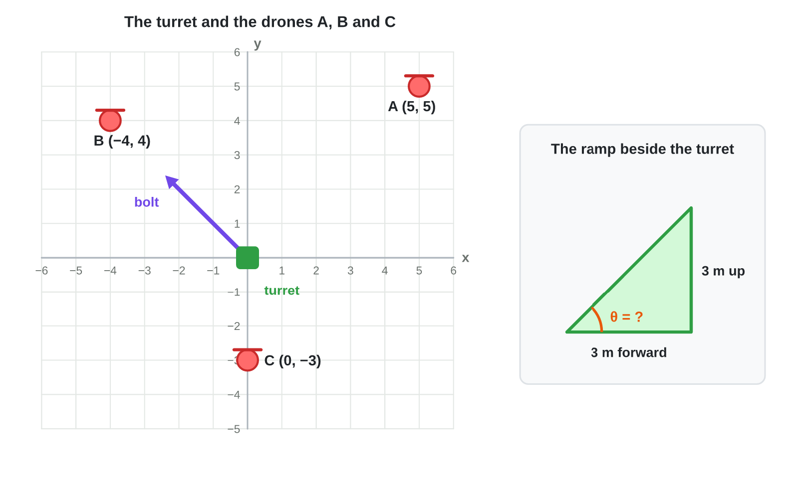
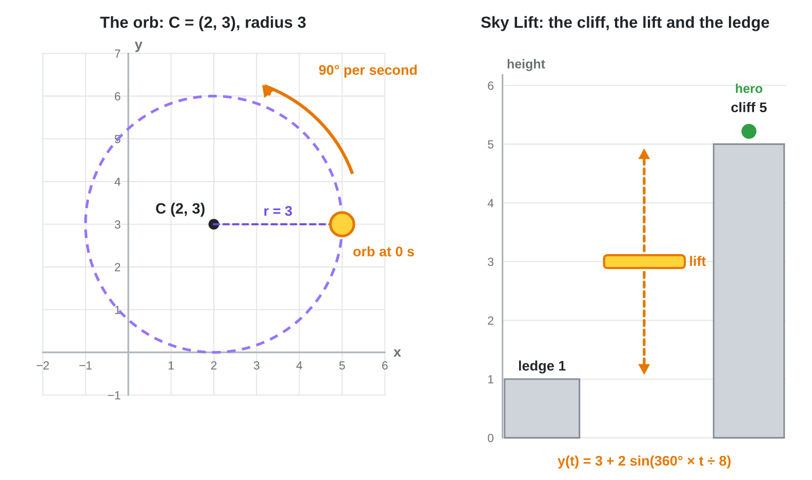

No new ideas today: two short problems on Lecture 4. Do each one alone. Tap,
sort or type your answer at every step: the page checks it at once and tells
you why.

## Recall

- An angle starts at +x and grows anticlockwise. In a right triangle,
  sin = opposite ÷ hypotenuse, cos = adjacent ÷ hypotenuse,
  tan = opposite ÷ adjacent.
- The point at θ on the unit circle is (cos θ, sin θ); a velocity at θ is
  speed × (cos θ, sin θ). atan2(y, x) goes back from a vector to its angle.
- A circle: P = C + r (cos ωt, sin ωt). A bob: y = c + A sin(360° × t ÷ T).

::: {.callout-tip title="Try it 1 · Recall"}
Choose the right answer.

::: {.match extra="(1, 0)|0.87"}
What is the point at 90° on the unit circle?
:   (0, 1)

    Why: cos 90° = 0 and sin 90° = 1: straight up.

What is sin 30°?
:   0.5

    Why: the table of the common values: sin 30° = 0.5.

Which angle does atan2 give for the vector (−4, 4)?
:   135°

    Why: x is negative and y positive: quadrant II, on the diagonal.
:::
:::

## Activity 1 · Aim and fire

A turret stands at the origin. Three drones hover: A (5, 5), B (−4, 4) and
C (0, −3). The turret fires a bolt with the speed 10 at drone B. Beside the
turret, a ramp rises 3 m over 3 m.

::: {.callout-note title="Activity 1 · Angles and velocities · 25 min"}
{width=86%}

1. Find the angle of each drone with atan2. Name its quadrant.
2. Check the three angles in **Turn Lab** (below): tap each drone.
3. The bolt flies at 135° with the speed 10 (at drone B). Find its velocity.
4. Another bolt flies at 30° with the speed 10. Find its velocity.
5. The ramp rises 3 m over 3 m. Find tan θ and the angle of the ramp.

*Your product:* three angles, two velocities and the angle of the ramp.

::: {.sort}
Steps 1–2: which angle does atan2 give for each drone? Sort them.

45°
:   drone A (5, 5)

    Why: (+, +), on the diagonal of quadrant I.

:   a drone at (2, 2)

    Why: The same direction as (5, 5): closer, but the same angle.

135°
:   drone B (−4, 4)

    Why: (−, +), on the diagonal of quadrant II.

−90°
:   drone C (0, −3)

    Why: Straight down, on the y-axis.
:::

::: {.choice}
Step 3: the bolt flies at 135° with the speed 10, at drone B. What is its velocity?

- [x] (−7.1, 7.1)

  Why: 10 × (cos 135°, sin 135°) = 10 × (−0.71, 0.71).

- [ ] (7.1, 7.1)

  Why: cos 135° is negative: the bolt flies to the left.

- [ ] (−7.1, −7.1)

  Why: sin 135° is positive: the bolt flies up.
:::

::: {.fill answer="(8.7, 5)" hint="10 × (cos 30°, sin 30°) = 10 × (0.87, 0.5)."}
Step 4: a bolt flies at 30° with the speed 10. What is its velocity? Type (x, y).

Why: 10 × (0.87, 0.5) = (8.7, 5).
:::

::: {.choice}
Step 5: the ramp rises 3 m over 3 m. What is its angle?

- [x] 45°

  Why: tan θ = 3 ÷ 3 = 1, and tan 45° = 1.

- [ ] 1°

  Why: 1 is the value of tan θ, not the angle.

- [ ] 90°

  Why: 90° would be a wall; tan 90° does not exist.
:::
:::



::: {.callout-tip title="Try it 2 · Aim"}
Choose the right answer.

::: {.match extra="−45°|(4, 0)"}
Which angle does atan2 give for the vector (−5, 5)?
:   135°

    Why: quadrant II, on the diagonal: 180° − 45°.

A drone flies at 90° with the speed 4. What is its velocity?
:   (0, 4)

    Why: 4 × (cos 90°, sin 90°) = 4 × (0, 1).

A ramp rises 5 m over 5 m. What is its angle?
:   45°

    Why: tan θ = 5 ÷ 5 = 1, and tan 45° = 1.
:::
:::

## Activity 2 · The orb and the lift

A shield orb circles a hero at C = (2, 3) with the radius 3, at 90° per
second, starting at 0°. In *Sky Lift*, a hero waits on a cliff at the height
5. Beside the cliff, a lift floats up and down with
y(t) = 3 + 2 sin(360° × t ÷ 8). A low ledge is at the height 1.

::: {.callout-note title="Activity 2 · Circle and bob · 25 min"}
{width=92%}

1. Find the position of the orb at 0 s, 1 s, 2 s and 3 s. What is its
   period?
2. Find the middle, the amplitude and the period of the lift.
3. Find the height of the lift at 0 s, 2 s, 4 s and 6 s.
4. When can the hero step on at the cliff (height 5)? When at the low ledge
   (height 1)? Check with the first round of **Sky Lift** (below).

*Your product:* four positions, four heights and two times.

::: {.order}
Step 1: put the positions of the orb in time order, from 0 s to 3 s.

1. (5, 3)
2. (2, 6)
3. (−1, 3)
4. (2, 0)

Why: C + 3 × (cos θ, sin θ) at 0°, 90°, 180° and 270°: right, top, left, bottom. The period is 360° ÷ 90° = 4 s.
:::

::: {.sort}
Steps 2–3: y(t) = 3 + 2 sin(360° × t ÷ 8). Sort the times by the height of
the lift.

5 (the top)
:   2 s

    Why: A quarter of the period 8 s: 3 + 2 = 5.

3 (the middle)
:   0 s

    Why: sin 0° = 0: the middle, 3.

:   4 s

    Why: Half of the period: back to the middle.

1 (the bottom)
:   6 s

    Why: Three quarters of the period: 3 − 2 = 1.
:::

::: {.choice}
Step 4: when can the hero step on at the low ledge (height 1)?

- [x] at 6 s

  Why: The lift is at the bottom, 1, at three quarters of the period.

- [ ] at 2 s

  Why: At 2 s the lift is at the top, level with the cliff (height 5).

- [ ] at 4 s

  Why: At 4 s the lift is in the middle, at the height 3.
:::
:::



::: {.callout-tip title="Try it 3 · Circle and bob"}
Choose the right answer.

::: {.match extra="4 s|(0, 2)"}
y = 3 + 2 sin(360° × t ÷ 8). What is the height at 6 s?
:   1

    Why: the angle is 270°, sin = −1: 3 − 2.

An orb turns at 30° per second. What is its period?
:   12 s

    Why: 360° ÷ 30° = 12 s.

Which point is at 180° on a circle with the radius 2 around (0, 0)?
:   (−2, 0)

    Why: 2 × (cos 180°, sin 180°) = 2 × (−1, 0).
:::
:::

## Wrap-up {.summary}

- You can find the angle to a target with atan2 and the angle of a ramp with
  the tangent.
- You can turn an angle and a speed into a velocity.
- You can move an object in a circle and time a motion that bobs with sine.
