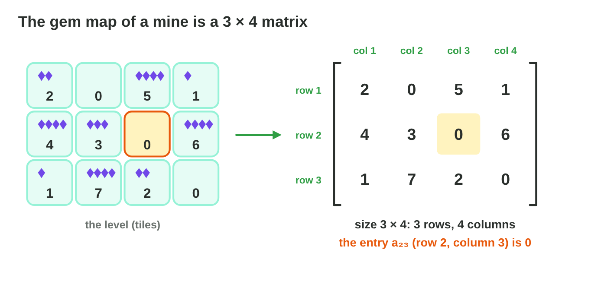
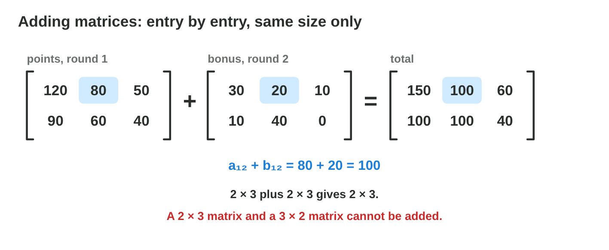
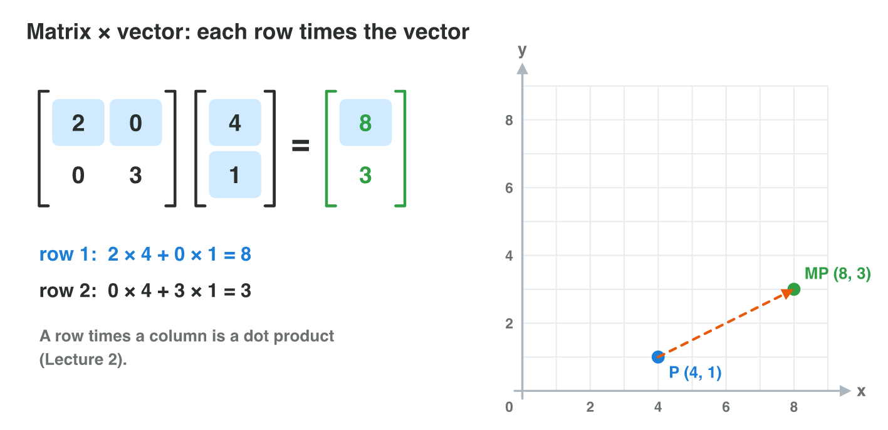
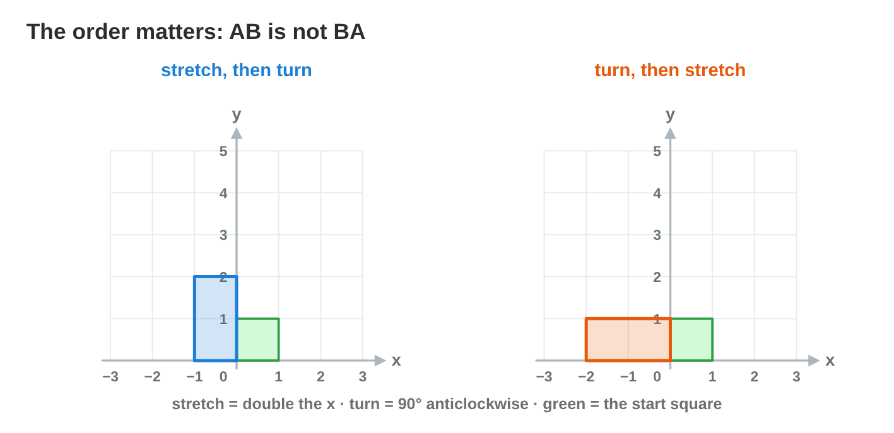
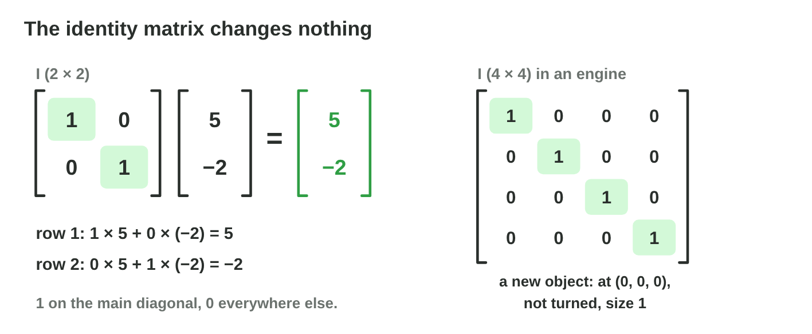
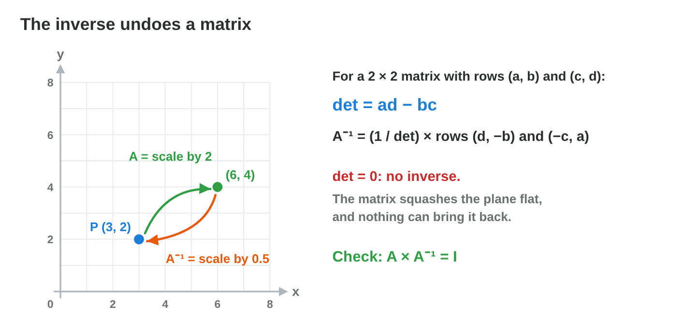

This page is the interactive version of the lesson notes (PDF). Each section
starts with a problem in a game. Then it explains the idea behind it. It
ends with a **Do it** task and one set of questions. Tap, sort or type your
answer: the page checks it at once and tells you why.

## Key terms



## 5.1 The mine map: what a matrix is

- A **matrix** is a table of numbers in **rows** (across) and **columns**
  (down).
- Its **size** is rows × columns. The mine map M of a mining game has 3 rows and
  4 columns: it is **3 × 4** and has 12 entries.
- The **entry** m~23~ is in row 2, column 3. The row always comes first.
- The mine map M: row 1 = (2, 0, 5, 1), row 2 = (4, 3, 0, 6),
  row 3 = (1, 7, 2, 0). So m~23~ = 0, m~32~ = 7, m~14~ = 1.
- The enemy table E: row 1 = slime (HP 40, damage 10, speed 4),
  row 2 = troll (60, 20, 2). E is 2 × 3; the troll's damage is e~22~ = 20.

{width=92%}

::: {.callout-warning title="Watch out!"}
The size is rows × columns, never columns × rows. In a spreadsheet, the cell
C2 is column C, row 2: the other way round.
:::

::: {.callout-note title="Do it · Your own level as a matrix"}
Draw a level of 3 × 3 tiles on squared paper, with a number of coins in each
tile, and write it as a matrix L. Tom drew this level: L has the rows
(2, 0, 1), (0, 4, 3) and (5, 1, 0).

::: {.fill answer="1" hint="Row 3 first, then column 2."}
How many coins are in Tom's tile l~32~?

Why: Row 3 is (5, 1, 0); its column 2 is 1.
:::

::: {.choice}
Are l~32~ and l~23~ the same tile?

- [x] No: l~32~ is row 3, column 2, and l~23~ is row 2, column 3.

  Why: The row always comes first: l~32~ = 1, but l~23~ = 3.

- [ ] Yes: both use the numbers 2 and 3.

  Why: The order of the numbers matters: row first, then column.
:::
:::

::: {.callout-tip title="Try it 1 · Size and entries"}
Use the mine map M above. Choose the right answer.

::: {.match extra="4 × 3|12 × 1"}
What is the size of a matrix with 2 rows and 5 columns?
:   2 × 5

    Why: rows first, then columns.

What is the size of the mine map M?
:   3 × 4

    Why: 3 rows and 4 columns.

How many gems are in m~32~?
:   7

    Why: row 3 is (1, 7, 2, 0); column 2 is 7.

How many gems are in m~23~?
:   0

    Why: row 2 is (4, 3, 0, 6); column 3 is 0.

Which entry of E is the damage of the troll?
:   e~22~

    Why: the troll is row 2 and damage is column 2.
:::
:::

## 5.2 Two rounds, one total: adding and scaling matrices

- Two matrices of the **same size** are added **entry by entry**:
  (A + B)~ij~ = a~ij~ + b~ij~. Subtraction is the same with −.
- Points of round 1, rows (120, 80, 50) and (90, 60, 40), plus the bonus,
  rows (30, 20, 10) and (10, 40, 0), give rows (150, 100, 60) and
  (100, 100, 40).
- A 2 × 3 matrix and a 3 × 2 matrix **cannot** be added.
- A number k times a matrix: **every entry** is multiplied by k. Hard mode =
  1.5 × the enemy table: the troll's HP 60 becomes 90.
- k = −1 changes every sign.

{width=88%}



::: {.callout-warning title="Watch out!"}
Check the sizes before you add. And a number multiplies every entry, not only
one row.
:::

::: {.callout-note title="Do it · Add and scale in Matrix Lab"}
In **Matrix Lab**, A has the rows (2, 0, 5) and (4, 3, 1), and B has the
rows (1, 3, 0) and (2, 1, 6). Choose A + B and tap one entry of the result.
Then choose k × A with k = 1.5, and then k = −1.

::: {.fill answer="7" hint="Add the two entries in the same place: row 2, column 3."}
What is the entry in row 2, column 3 of A + B?

Why: a~23~ + b~23~ = 1 + 6 = 7.
:::

::: {.choice}
k = −1. What happens to A?

- [x] Every sign changes.

  Why: −1 multiplies every entry: 2 becomes −2, 5 becomes −5.

- [ ] Only the first row changes.

  Why: A number multiplies every entry, not one row.

- [ ] Nothing changes.

  Why: Only k = 1 leaves the matrix as it is.
:::
:::

::: {.callout-tip title="Try it 2 · Adding and scaling"}
Choose the right answer.

::: {.match extra="(3, 1, 0)|1.5"}
Rows (3, 1) and (0, 2) plus rows (1, 1) and (4, −2). What is row 1 of the sum?
:   (4, 2)

    Why: (3 + 1, 1 + 1) = (4, 2).

Player 1 has 80 points in level 2 and gets a bonus of 20. What is the total?
:   100

    Why: entries in the same place are added: 80 + 20.

Can a 2 × 3 matrix and a 3 × 2 matrix be added?
:   no, the sizes are different

    Why: only matrices of the same size can be added.

What is 3 × the matrix with rows (2, 0) and (−1, 4)?
:   rows (6, 0) and (−3, 12)

    Why: every entry × 3.

Hard mode is 1.5 × the stats. The slime has 40 HP. What is its new HP?
:   60

    Why: 1.5 × 40 = 60.

What does −1 × a matrix do?
:   it changes every sign

    Why: every entry × (−1): plus becomes minus and minus becomes plus.
:::
:::

## 5.3 Casting a spell: a matrix times a vector

- A spell is a 2 × 2 matrix; the crystal's position is a column vector.
- Matrix × vector: **each row times the vector** (a dot product, Lecture 2).
  For the rows (a, b) and (c, d) and the vector (x, y): the result is
  (ax + by, cx + dy).
- Stretch = rows (2, 0) and (0, 3). On (4, 1): row 1 gives 2 × 4 + 0 × 1 = 8,
  row 2 gives 0 × 4 + 3 × 1 = 3. The crystal goes to **(8, 3)**.
- Turn = rows (0, −1) and (1, 0). On (3, 2): (−2, 3). (x, y) becomes (−y, x).
- One matrix moves every point of a sprite in the same way.
- Two spells in a row are one **matrix × matrix**: entry (i, j) of AB = row i
  of A · column j of B. AB exists when A has as many columns as B has rows.

{width=92%}



::: {.callout-warning title="Watch out!"}
Do not multiply entry by entry. Every row uses both x and y.
:::

::: {.callout-note title="Do it · Check Turn in Multiply Lab"}
On paper, multiply Turn (rows (0, −1) and (1, 0)) by P = (2, 3). Then press
"Turn 90°" in **Multiply Lab** and drag P to (2, 3). Compare.

::: {.choice}
Where does Turn send P = (2, 3)?

- [x] (−3, 2)

  Why: Row 1: 0 × 2 + (−1) × 3 = −3; row 2: 1 × 2 + 0 × 3 = 2.

- [ ] (3, −2)

  Why: That turns the other way (clockwise); row 1 gives −3, not 3.

- [ ] (0, 0)

  Why: That multiplies entry by entry; every row uses both x and y.
:::
:::

::: {.callout-tip title="Try it 3 · Matrix × vector"}
Choose the right answer.

::: {.match extra="(2, 15)|(6, 0)|3 × 3"}
What is the matrix with rows (3, 0) and (0, 1) times (2, 5)?
:   (6, 5)

    Why: row 1: 3 × 2 + 0 × 5 = 6; row 2: 0 × 2 + 1 × 5 = 5.

What is the matrix with rows (1, 2) and (0, 1) times (1, 3)?
:   (7, 3)

    Why: row 1: 1 + 6 = 7; row 2: 0 + 3 = 3.

Turn has the rows (0, −1) and (1, 0). Where does it send (4, 0)?
:   (0, 4)

    Why: row 1: 0 − 0 = 0; row 2: 4 + 0 = 4.

Stretch has the rows (2, 0) and (0, 3). Where does it send (4, 1)?
:   (8, 3)

    Why: row 1: 2 × 4 = 8; row 2: 3 × 1 = 3.

Each entry of a matrix × vector is …
:   one row times the vector

    Why: each row gives one coordinate (a dot product).

A = rows (1, 1), (0, 2); B = rows (3, 0), (1, 1). What is AB?
:   rows (4, 1) and (2, 2)

    Why: row 1 · columns: 3 + 1 = 4, 0 + 1 = 1; row 2: 0 + 2 = 2, 0 + 2 = 2.

A is 3 × 2 and B is 2 × 5. What is the size of AB?
:   3 × 5

    Why: the inner 2s match; the outer numbers give 3 × 5.
:::
:::

## 5.4 First stretch, then turn: the order matters

- In general **AB ≠ BA**: matrix multiplication is **not commutative**.
- With A = rows (1, 2), (3, 0) and B = rows (4, 1), (0, 2):
  AB = rows (4, 5), (12, 3) but BA = rows (7, 8), (6, 0).
- In AB**v**, the matrix next to the vector acts first: **first B, then A**.
  Read from right to left.
- Flip = rows (−1, 0), (0, 1); Turn = rows (0, −1), (1, 0). Point (3, 1):
  Flip then Turn gives (−1, −3). Turn then Flip gives (1, 3).

{width=92%}

::: {.callout-warning title="Watch out!"}
Do not read a product from left to right. In AB**v**, B acts first.
:::

::: {.callout-note title="Do it · Order on paper and in the lab"}
Take the point (3, 1). Apply Flip then Turn, and Turn then Flip, on paper.
Then do the same in **Multiply Lab**, one matrix after the other.

::: {.sort}
Which order gives each point? Sort the points.

Flip then Turn
:   after the first spell: (−3, 1)

    Why: Flip changes the sign of x: (3, 1) → (−3, 1).

:   at the end: (−1, −3)

    Why: Turn sends (−3, 1) to (−1, −3).

Turn then Flip
:   after the first spell: (−1, 3)

    Why: Turn sends (3, 1) to (−1, 3).

:   at the end: (1, 3)

    Why: Flip changes the sign of x: (−1, 3) → (1, 3). Not the same end point.
:::
:::

::: {.callout-tip title="Try it 4 · The order"}
Choose the right answer.

::: {.match extra="always|(3, −1)"}
Is AB always equal to BA?
:   no

    Why: matrix multiplication is not commutative.

In AB**v**, which matrix acts first?
:   B

    Why: the matrix next to the vector acts first.

From (3, 1), Flip then Turn: where does the point go?
:   (−1, −3)

    Why: Flip: (−3, 1); Turn: (−y, x) = (−1, −3).

From (3, 1), Turn then Flip: where does the point go?
:   (1, 3)

    Why: Turn: (−1, 3); Flip: (1, 3).

In which order do you read a product of transformations?
:   from right to left

    Why: the one next to the vector acts first.
:::
:::

## 5.5 The spell that changes nothing: the identity

- The **identity matrix** I has 1 on the main diagonal and 0 everywhere
  else.
- I**v** = **v** and IA = AI = A: it changes nothing.
- I × (5, −2): row 1 = 1 × 5 + 0 × (−2) = 5; row 2 = −2. The point stays.
- A new object, not moved, not turned, size 1, has the identity matrix.
- A matrix full of 1s is **not** the identity: rows (1, 1), (1, 1) send
  (5, −2) to (3, 3).

{width=92%}

::: {.callout-warning title="Watch out!"}
The identity has 1s only on the main diagonal.
:::

::: {.callout-note title="Do it · The identity in Multiply Lab"}
Press "Identity" in **Multiply Lab** and drag P to three points. Then change
the 0 of row 1 into a 1, so the rows are (1, 1) and (0, 1).

::: {.choice}
With the identity, where is MP?

- [x] always on P

  Why: I**v** = **v**: the identity changes nothing.

- [ ] always at the origin

  Why: That would be the zero matrix, not the identity.

- [ ] twice as far from the origin

  Why: That is Grow, rows (2, 0) and (0, 2).
:::

::: {.choice}
Now the rows are (1, 1) and (0, 1). Where does (2, 3) go?

- [x] (5, 3): the house leans.

  Why: Row 1 gives 2 + 3 = 5; row 2 gives 3. y is added to x.

- [ ] (2, 3): it stays.

  Why: Only the identity keeps every point; now row 1 also adds y.

- [ ] (3, 3)

  Why: Row 2 is (0, 1): it keeps y = 3; row 1 gives 2 + 3 = 5.
:::
:::

::: {.callout-tip title="Try it 5 · The identity"}
Choose the right answer.

::: {.match extra="rows (1, 1) and (1, 1)|(0, 0)"}
What is I × (7, −3)?
:   (7, −3)

    Why: the identity changes nothing.

Which matrix is the 2 × 2 identity?
:   rows (1, 0) and (0, 1)

    Why: 1 on the main diagonal, 0 everywhere else.

A new object has the identity matrix. Does it move?
:   no, it stays where it is

    Why: the identity keeps every point where it is.

Rows (1, 1) and (1, 1) times (5, −2) gives …
:   (3, 3)

    Why: both rows give 5 + (−2) = 3: not the identity.

What is I × A?
:   A

    Why: multiplying by I changes nothing.
:::
:::

## 5.6 Undo: the inverse matrix

- The **inverse** A^−1^ undoes A: A A^−1^ = A^−1^ A = I.
- Grow = rows (2, 0), (0, 2) doubles x and y. Its inverse halves them: rows
  (0.5, 0), (0, 0.5) = Shrink. Shrink × (6, 4) = (3, 2).
- Some spells cannot be undone. Squash = rows (1, 2), (1, 2) sends (2, 0)
  and (0, 1) to the same point (2, 2): nothing can bring them back. Squash
  has **no inverse**.

{width=88%}

::: {.callout-warning title="Watch out!"}
The inverse is not "1 ÷ every entry", and not every matrix has one. Check:
A^−1^ A must give I.
:::

::: {.callout-note title="Do it · Undo in Multiply Lab"}
In **Multiply Lab**, press "Grow" and drag P to (2, 1). Then enter Shrink,
the rows (0.5, 0) and (0, 0.5), and put P at the new point. Then press
"Squash".

::: {.fill answer="(4, 2)" hint="Grow doubles x and y."}
Where does Grow send (2, 1)? Type (x, y).

Why: (2 × 2, 2 × 1) = (4, 2); Shrink brings (4, 2) back to (2, 1).
:::

::: {.choice}
Why can the house not come back after Squash?

- [x] Squash sends different points to the same place.

  Why: (2, 0) and (0, 1) both go to (2, 2): no matrix can tell them apart again.

- [ ] Its inverse is 1 ÷ every entry.

  Why: The inverse is not 1 ÷ every entry, and Squash has no inverse at all.

- [ ] Its entries are too big.

  Why: Grow has big entries too, and Shrink undoes it.
:::
:::

::: {.callout-tip title="Try it 6 · Undo"}
Choose the right answer.

::: {.match extra="rows (2, 0) and (0, 2)|(12, 8)"}
Which spell undoes Grow (rows (2, 0) and (0, 2))?
:   rows (0.5, 0) and (0, 0.5)

    Why: Grow doubles x and y; halving undoes it.

What is A × A^−1^?
:   the identity I

    Why: the inverse undoes A: together they change nothing.

Grow3 = rows (3, 0) and (0, 3). Which matrix undoes it?
:   rows (1/3, 0) and (0, 1/3)

    Why: Grow3 triples x and y; dividing by 3 undoes it.

Why has Squash no inverse?
:   it sends two points to the same place

    Why: from the same end point, no spell can know where a point came from.

Shrink × (6, 4)?
:   (3, 2)

    Why: (0.5 × 6, 0.5 × 4).
:::
:::

## Game challenge: Crystal Spells {.challenge}

Work alone. Use every section of today.

**Crystal Spells** is a puzzle game. The crystal starts at (2, 1). Each
spell is a 2 × 2 matrix: **Grow** = rows (2, 0), (0, 2); **Shrink** = rows
(0.5, 0), (0, 0.5); **Turn** = rows (0, −1), (1, 0); **Flip** = rows (−1, 0),
(0, 1); **Stay** = the identity.



::: {.callout-tip title="Try it 7 · One spell"}
Crystal at (2, 1). Grow = rows (2, 0), (0, 2); Turn = rows (0, −1), (1, 0);
Flip = rows (−1, 0), (0, 1); Stay = identity. Choose the right answer.

::: {.match extra="Shrink|(1, 2)"}
Where does Grow send the crystal?
:   (4, 2)

    Why: (2 × 2, 2 × 1).

Which spell sends the crystal to (−1, 2)?
:   Turn

    Why: Turn: (x, y) → (−y, x) = (−1, 2).

Which spell sends the crystal to (−2, 1)?
:   Flip

    Why: Flip changes only the sign of x.

Which spell keeps the crystal at (2, 1)?
:   Stay

    Why: Stay is the identity.
:::
:::

::: {.callout-tip title="Try it 8 · Spells in a row (harder)"}
Grow = rows (2, 0), (0, 2); Shrink = rows (0.5, 0), (0, 0.5); Turn = rows
(0, −1), (1, 0); Flip = rows (−1, 0), (0, 1). Choose the right answer.

::: {.match extra="(2, −1)|Turn"}
Grow sent the crystal to (4, 2) by mistake. Which spell undoes it?
:   Shrink

    Why: Shrink is the inverse of Grow.

From (2, 1): Flip, then Turn. Where does the crystal land?
:   (−1, −2)

    Why: Flip: (−2, 1); Turn: (−1, −2).

From (1, 2): Turn, then Grow. Where does the crystal land?
:   (−4, 2)

    Why: Turn: (−2, 1); Grow: (−4, 2).

Grow × Turn as one matrix: what are its rows?
:   (0, −2) and (2, 0)

    Why: row 1 of Grow (2, 0) · the columns of Turn: 0, −2; row 2 (0, 2): 2, 0.
:::
:::

## Summary {.summary}

- A matrix is a table in rows × columns; the entry a~ij~ is row i, column j.
- Add matrices of the same size entry by entry; k × A multiplies every entry.
- Matrix × vector: each row times the vector; matrix × matrix: row · column.
- The order matters: in AB**v**, B acts first.
- The identity changes nothing; the inverse undoes a matrix (not every matrix has one).
