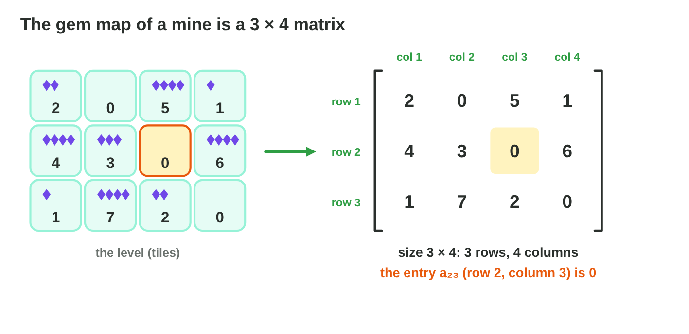
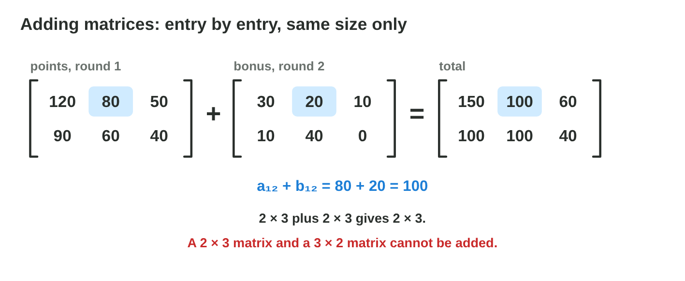

## Keywords



## 8.1 The mine map: what a matrix is

:::: {.columns}
::: {.column width="50%"}
- A matrix is a table of numbers in rows and columns.
- Its size is rows × columns, so the mine map M is a 3 × 4 matrix.
- The entry m~23~ is in row 2 and column 3, and the row always comes first.
- **Do it:** Draw a level of 3 × 3 tiles with coins and write it as a matrix L. Are l~32~ and l~23~ the same tile?
:::
::: {.column width="50%"}

:::
::::

## Example · Reading the mine map

The mine map M has the rows (2, 0, 5, 1), (4, 3, 0, 6) and (1, 7, 2, 0).
**What is its size, and what are m~32~ and m~23~?**

::: {.reveal}
1. M has 3 rows and 4 columns, so its size is **3 × 4**.
2. m~32~ is in row 3, column 2, so it is **7**.
3. m~23~ is in row 2, column 3, so it is **0**: swapping the numbers gives another tile.
:::

## Try it 1 · Size and entries

a) What is the size of a matrix with 2 rows and 5 columns?
b) How many gems are in m~14~ of the mine map M?
c) The enemy table E has the rows (40, 10, 4) and (60, 20, 2). Which entry is the troll's damage?

::: {.answer}
a) 2 × 5
b) 1
c) e~22~ = 20
:::

## 8.2 Adding and scaling matrices

:::: {.columns}
::: {.column width="50%"}
- Two matrices of the same size are added entry by entry.
- Each entry of the sum is a~ij~ + b~ij~, and the size stays the same.
- Matrices of different sizes cannot be added.
- A number k times a matrix multiplies every entry by k.
- **Do it:** In Matrix Lab, choose A + B and tap three entries of the result. What are the sums?
:::
::: {.column width="50%"}

:::
::::

## Live demo · Matrix Lab



## Try it 2 · Adding and scaling

a) What is row 1 of the sum of the rows (3, 1), (0, 2) and the rows (1, 1), (4, −2)?
b) Can a 2 × 3 matrix and a 3 × 2 matrix be added?
c) Hard mode multiplies the stats by 1.5. What is the new HP of a slime with 40 HP?

::: {.answer}
a) (4, 2)
b) No: the sizes are different.
c) 60
:::

## 8.3 A matrix times a vector

:::: {.columns}
::: {.column width="50%"}
- A spell is a 2 × 2 matrix, and the position is a column vector.
- Each row of the matrix times the vector gives one new coordinate.
- Stretch, with the rows (2, 0) and (0, 3), sends (4, 1) to (8, 3).
- **Do it:** Multiply Turn, with the rows (0, −1) and (1, 0), by (2, 3). Where does the point go?
:::
::: {.column width="50%"}

:::
::::

## Example · The spell Turn

Turn has the rows (0, −1) and (1, 0), and the crystal stands at (3, 2).
**Where does Turn send the crystal?**

::: {.reveal}
1. Row 1 gives 0 × 3 + (−1) × 2 = −2.
2. Row 2 gives 1 × 3 + 0 × 2 = 3.
3. The crystal goes to **(−2, 3)**: a turn of 90° anticlockwise.
:::

## Live demo · Multiply Lab



## Try it 3 · Matrix × vector

a) What is the matrix with the rows (3, 0) and (0, 1) times (2, 5)?
b) What is the matrix with the rows (1, 2) and (0, 1) times (1, 3)?
c) Where does Turn send the point (4, 0)?

::: {.answer}
a) (6, 5)
b) (7, 3)
c) (0, 4)
:::

## 8.3 A matrix times a matrix

:::: {.columns}
::: {.column width="50%"}
- AB exists when A has as many columns as B has rows.
- The entry in row i, column j of AB is row i of A times column j of B.
- A 2 × 3 matrix times a 3 × 4 matrix gives a 2 × 4 matrix.
- **Do it:** A has the rows (2, 1) and (0, 3), and B has the rows (1, 0) and (4, 2). What is AB?
:::
::: {.column width="50%"}

:::
::::

## Example · Four dot products

A has the rows (1, 2) and (3, 0), and B has the rows (4, 1) and (0, 2).
**What is AB?**

::: {.reveal}
1. Row 1 of A gives 1 × 4 + 2 × 0 = 4 and 1 × 1 + 2 × 2 = 5.
2. Row 2 of A gives 3 × 4 + 0 × 0 = 12 and 3 × 1 + 0 × 2 = 3.
3. AB has the rows **(4, 5)** and **(12, 3)**.
:::

## Try it 4 · Matrix × matrix

a) A has the rows (1, 1) and (0, 2), and B has the rows (3, 0) and (1, 1). What is AB?
b) A is 3 × 2 and B is 2 × 5. What is the size of AB?
c) Can a 2 × 3 matrix be multiplied by a 2 × 3 matrix?

::: {.answer}
a) rows (4, 1) and (2, 2)
b) 3 × 5
c) No, because 3 and 2 are different.
:::

## 8.4 The order matters

:::: {.columns}
::: {.column width="50%"}
- In general AB is not equal to BA.
- In AB**v**, the matrix next to the vector acts first, so B acts before A.
- Stretch then turn gives another shape than turn then stretch.
- **Do it:** Apply Flip then Turn to (3, 1), and then Turn then Flip. Are the points the same?
:::
::: {.column width="50%"}

:::
::::

## Example · AB and BA

A has the rows (1, 2) and (3, 0), and B has the rows (4, 1) and (0, 2).
**Is AB the same as BA?**

::: {.reveal}
1. AB has the rows (4, 5) and (12, 3).
2. BA has the rows (7, 8) and (6, 0).
3. They are different, so **the order matters**.
:::

## Try it 5 · The order

a) Is AB always equal to BA?
b) In AB**v**, which matrix acts first?
c) A = rows (1, 2), (3, 0) and B = rows (4, 1), (0, 2). What is BA?

::: {.answer}
a) No.
b) B
c) rows (7, 8) and (6, 0)
:::

## 8.5 The identity matrix

:::: {.columns}
::: {.column width="50%"}
- The identity matrix I has 1 on the main diagonal and 0 everywhere else.
- I times any vector or matrix leaves it as it is.
- A new object in an engine starts with the 4 × 4 identity.
- **Do it:** In Multiply Lab, press Identity and drag P. Where is MP?
:::
::: {.column width="50%"}

:::
::::

## Example · The identity times a point

The identity I has the rows (1, 0) and (0, 1), and the point is (5, −2).
**Where does I send the point?**

::: {.reveal}
1. Row 1 gives 1 × 5 + 0 × (−2) = 5.
2. Row 2 gives 0 × 5 + 1 × (−2) = −2.
3. The point stays at **(5, −2)**: the identity changes nothing.
:::

## Try it 6 · The identity

a) What is I × (7, −3)?
b) Which matrix is the 2 × 2 identity?
c) Where do the rows (1, 1) and (1, 1) send the point (5, −2)?

::: {.answer}
a) (7, −3)
b) rows (1, 0) and (0, 1)
c) (3, 3), so it is not the identity.
:::

## 8.6 Undo: the inverse matrix

:::: {.columns}
::: {.column width="50%"}
- The inverse A^−1^ undoes A, so A A^−1^ is the identity.
- Grow doubles x and y, so its inverse Shrink halves them.
- Squash sends two points to the same place, so it has no inverse.
- **Do it:** In Multiply Lab, apply Grow to (2, 1) and then Shrink. Where does the point end?
:::
::: {.column width="50%"}

:::
::::

## Example · Undo Grow

Grow has the rows (2, 0) and (0, 2), and the crystal jumped from (3, 2) to (6, 4).
**Which spell brings it back?**

::: {.reveal}
1. Grow doubles x and y, so the undo must halve them.
2. Shrink has the rows (0.5, 0) and (0, 0.5).
3. Shrink × (6, 4) = **(3, 2)**: the crystal is back.
:::

## Try it 7 · Undo

a) Which matrix undoes Grow3, with the rows (3, 0) and (0, 3)?
b) What is A × A^−1^?
c) Why has Squash no inverse?

::: {.answer}
a) the rows (1/3, 0) and (0, 1/3)
b) the identity I
c) It sends two points to the same place.
:::

## Game challenge · Crystal Spells



## Try it 8 · Spells in a row (harder)

The facts: Grow has the rows (2, 0) and (0, 2). Turn has the rows (0, −1) and (1, 0). Flip has the rows (−1, 0) and (0, 1).

a) Grow sent the crystal to (4, 2) by mistake. Which spell undoes it?
b) From (2, 1), the player casts Flip and then Turn. Where does the crystal land?
c) From (1, 2), the player casts Turn and then Grow. Where does the crystal land?

::: {.answer}
a) Shrink, the inverse of Grow
b) (−1, −2)
c) (−4, 2)
:::

## Summary

- A matrix is a table in rows × columns, and the row comes first.
- Matrices of the same size are added entry by entry, and k × A multiplies every entry.
- Each row of a matrix times a vector gives one new coordinate.
- AB is usually not BA, and in AB**v** the matrix B acts first.
- The identity changes nothing, and the inverse undoes a matrix.
