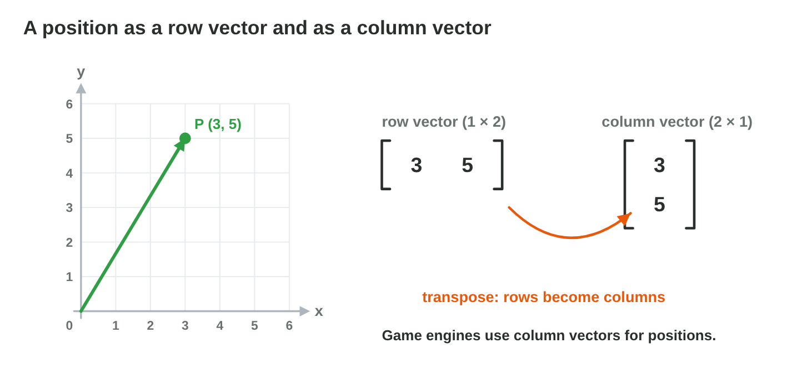
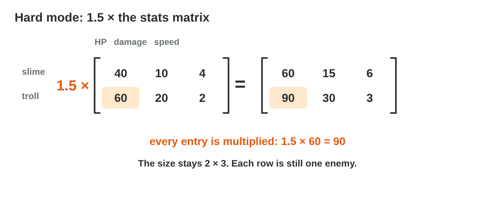
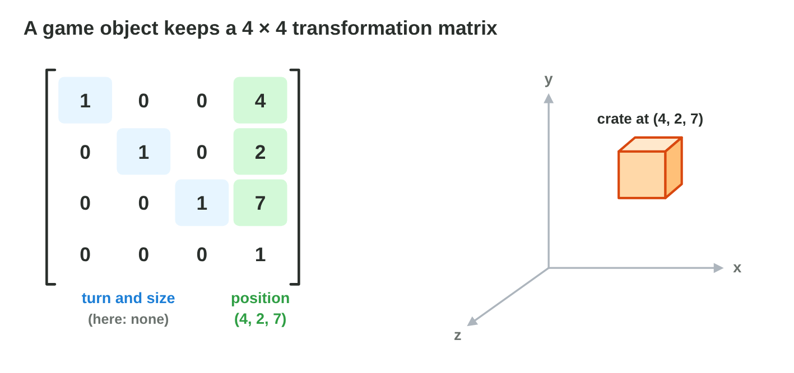

## Keywords



## 9.1 The mine map: what a matrix is

:::: {.columns}
::: {.column width="50%"}
- A matrix is a table of numbers in rows and columns.
- Its size is rows × columns, so the mine map M is a 3 × 4 matrix.
- The entry m~23~ is in row 2 and column 3, and the row always comes first.
- **Do it:** Draw a level of 3 × 3 tiles with coins and write it as a matrix L. Are l~32~ and l~23~ the same tile?
:::
::: {.column width="50%"}

:::
::::

## Example · Reading the mine map

The mine map M has the rows (2, 0, 5, 1), (4, 3, 0, 6) and (1, 7, 2, 0).
**What is its size, and what are m~32~ and m~23~?**

::: {.reveal}
1. M has 3 rows and 4 columns, so its size is **3 × 4**.
2. m~32~ is in row 3, column 2, so it is **7**.
3. m~23~ is in row 2, column 3, so it is **0**: swapping the numbers gives another tile.
:::

## Try it 1 · Size and entries

a) What is the size of a matrix with 2 rows and 5 columns?
b) How many gems are in m~14~ of the mine map M?
c) The enemy table E has the rows (40, 10, 4) and (60, 20, 2). Which entry is the troll's damage?

::: {.answer}
a) 2 × 5
b) 1
c) e~22~ = 20
:::

## 9.2 Row and column vectors

:::: {.columns}
::: {.column width="50%"}
- A row vector has one row, and a column vector has one column.
- Game engines write positions as column vectors.
- The transpose turns the rows of a matrix into its columns.
- **Do it:** Write the transpose of the mine map M. What is its size?
:::
::: {.column width="50%"}

:::
::::

## Example · Three enemies in one matrix

Three enemies stand at (2, 1), (5, 3) and (0, 4), and their positions are the columns of one matrix P.
**What are the rows of P, and what is its size?**

::: {.reveal}
1. Row 1 holds the x-coordinates: (2, 5, 0).
2. Row 2 holds the y-coordinates: (1, 3, 4).
3. P has 2 rows and 3 columns, so it is a **2 × 3** matrix.
:::

## Try it 2 · Rows, columns and the transpose

a) What is the size of the column vector for P = (3, 5)?
b) A matrix is 2 × 3. What is the size of its transpose?
c) Does the transpose change any of the numbers?

::: {.answer}
a) 2 × 1
b) 3 × 2
c) No, it only moves them.
:::

## 9.3 Adding matrices

:::: {.columns}
::: {.column width="50%"}
- Two matrices of the same size are added entry by entry.
- Each entry of the sum is a~ij~ + b~ij~, and the size stays the same.
- Matrices of different sizes cannot be added.
- **Do it:** In Matrix Lab, choose A + B and tap three entries of the result. What are the sums?
:::
::: {.column width="50%"}

:::
::::

## Example · Moving three enemies at once

The positions have the rows (2, 5, 0) and (1, 3, 4). The steps have the rows (1, −1, 0) and (0, 0, −2).
**Where are the three enemies after the step?**

::: {.reveal}
1. Add the entries in the same place: row 1 gives (3, 4, 0).
2. Row 2 gives (1, 3, 2).
3. The enemies stand at **(3, 1), (4, 3) and (0, 2)**.
:::

## Live demo · Matrix Lab



## Try it 3 · Adding

a) Rows (3, 1) and (0, 2) plus rows (1, 1) and (4, −2): what is the sum?
b) Can a 2 × 3 matrix and a 3 × 2 matrix be added?
c) What is (5, 2) − (1, 3)?

::: {.answer}
a) rows (4, 2) and (4, 0)
b) No, the sizes are different.
c) (4, −1)
:::

## 9.4 A number times a matrix

:::: {.columns}
::: {.column width="50%"}
- A number k times a matrix multiplies every entry by k.
- The size of the matrix does not change.
- Hard mode multiplies the enemy table by 1.5, so the troll's HP 60 becomes 90.
- **Do it:** In Matrix Lab, set k = −1. What happens to the signs?
:::
::: {.column width="50%"}

:::
::::

## Example · A number times a vector

A velocity is the column vector (3, −1).
**What are 2 × (3, −1) and −1 × (3, −1)?**

::: {.reveal}
1. 2 × (3, −1) = (6, −2): every entry is doubled.
2. −1 × (3, −1) = (−3, 1): every sign changes.
3. So A − B is the same as A + (−1)B.
:::

## Try it 4 · A number times a matrix

a) What is 3 × the matrix with rows (2, 0) and (−1, 4)?
b) The slime has 40 HP. What is its HP in hard mode (1.5 ×)?
c) A 2 × 3 matrix is multiplied by 5. What is the size of the result?

::: {.answer}
a) rows (6, 0) and (−3, 12)
b) 60
c) 2 × 3
:::

## 9.5 The engine's matrix for every object

:::: {.columns}
::: {.column width="50%"}
- A square matrix has as many rows as columns, for example 4 × 4.
- An engine keeps a 4 × 4 transformation matrix for every object.
- Its last column holds the position (x, y, z) and a 1.
- **Do it:** A tree's last column is (3, 0, 5, 1), and a lamp's is (−2, 4, 5, 1). Which object is higher?
:::
::: {.column width="50%"}

:::
::::

## Example · Where is the crate?

The crate's matrix has the rows (1, 0, 0, 4), (0, 1, 0, 2), (0, 0, 1, 7) and (0, 0, 0, 1).
**Where is the crate, and what changes when it moves 2 units along +x?**

::: {.reveal}
1. The last column is (4, 2, 7, 1).
2. The crate stands at **(4, 2, 7)**.
3. After the move, only the 4 changes: it becomes **6**.
:::

## Try it 5 · The engine's matrix

a) An object's last column is (−3, 1, 8, 1). Where is the object?
b) Which entries form the main diagonal of a square matrix?
c) In code, which entry of the maths is m[0, 3]?

::: {.answer}
a) (−3, 1, 8)
b) a~11~, a~22~, a~33~ and so on
c) row 1, column 4
:::

## Game challenge · Gem Grid



## Try it 6 · Hard night (harder)

The facts: M has the rows (2, 0, 5, 1), (4, 3, 0, 6) and (1, 7, 2, 0). N has the rows (1, 1, 0, 0), (0, 2, 1, 0) and (0, 0, 3, 1).

a) How many gems are in row 2, column 2 of M + N?
b) How many gems are in m~13~ in hard mode (2M)?
c) How many gems are in row 3, column 3 of 2M + N?

::: {.answer}
a) 3 + 2 = 5
b) 2 × 5 = 10
c) 2 × 2 + 3 = 7
:::

## Summary

- A matrix is a table of numbers, and its size is rows × columns.
- The entry a~ij~ is in row i and column j.
- Matrices of the same size are added entry by entry.
- A number times a matrix multiplies every entry.
- An engine keeps a 4 × 4 matrix for every object, and its last column is the position.
