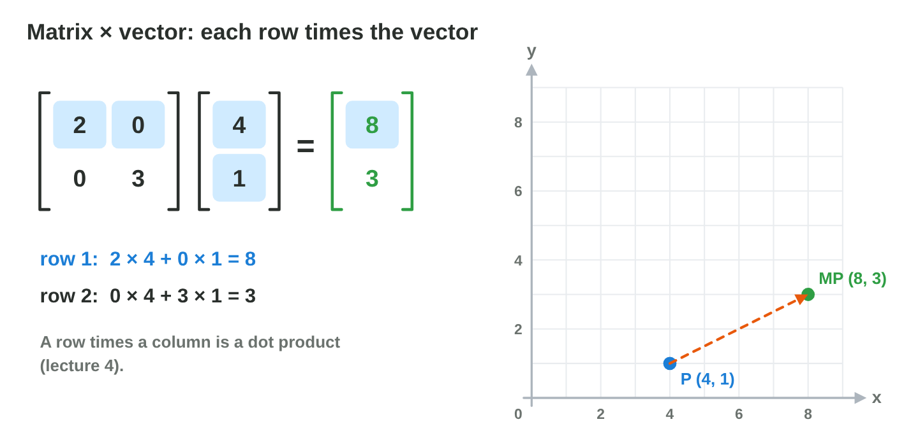
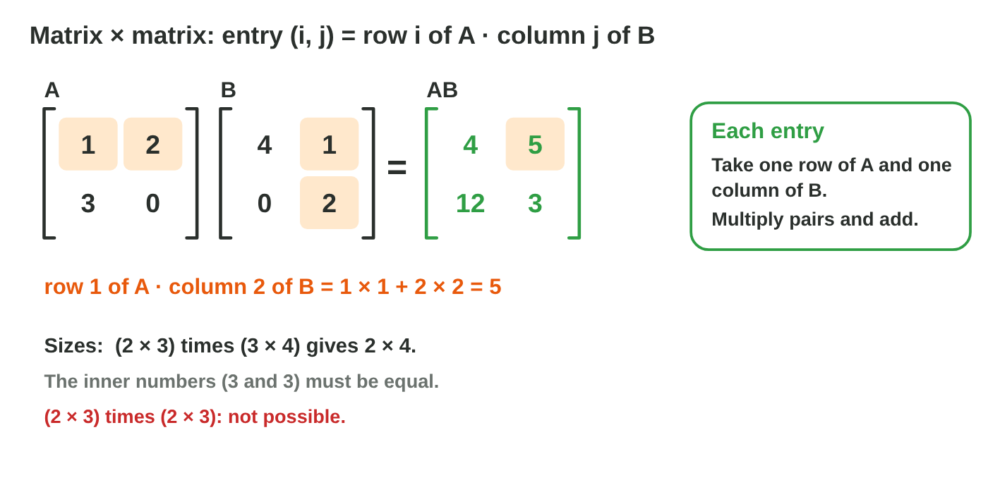
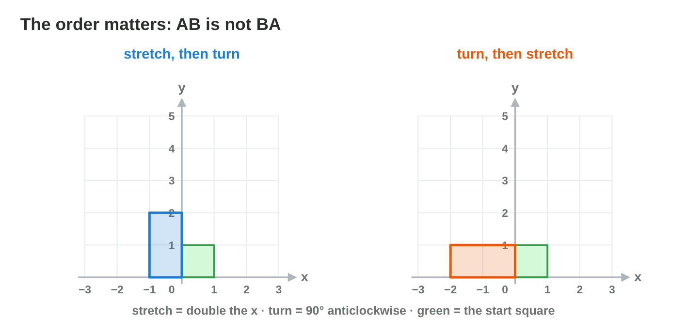
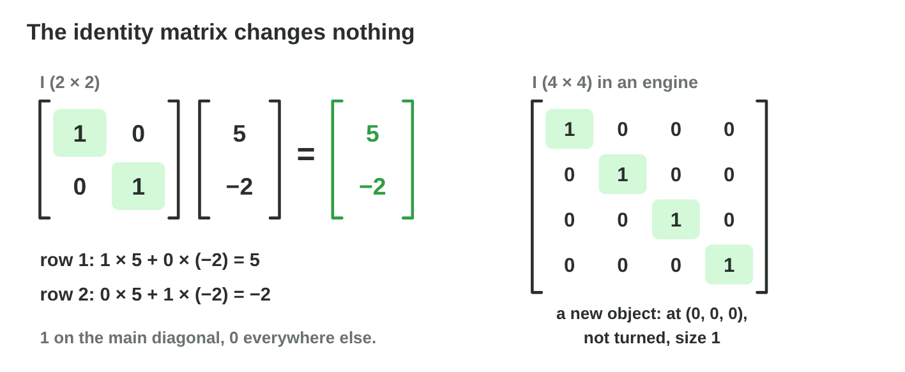
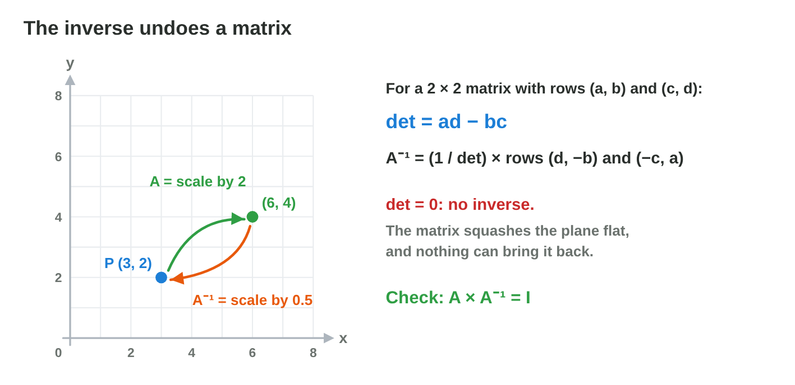

::: {.lead}
In a puzzle game, every spell moves a crystal: one spell doubles its
position, one turns it by 90°, one mirrors it. Each spell is a 2 × 2
matrix, and casting a spell is a **multiplication**: matrix times position.
Two spells in a row are one matrix times another. A spell that changes
nothing is the **identity**, and a spell that undoes another is its
**inverse**. In lecture 9 you named, added and scaled matrices. In this
lesson you multiply them, and you use them to move points: the first step
towards the transformations of lectures 11 to 14. Every section ends with a
short task.
:::

## Key terms



## 10.1 Casting a spell: a matrix times a vector

The crystal of *Crystal Spells* stands at (4, 1). The spell "Stretch" doubles
x and triples y. The game keeps the spell as a 2 × 2 matrix and the position
as a column vector, and multiplies them (@fig-mv).

::: {.callout-important title="Definition 10.1 — Matrix times vector"}
To multiply a matrix A by a column vector **v**, take each **row** of A times
**v**: multiply the pairs of numbers and add them. This is the dot product of
lecture 4. For a 2 × 2 matrix:
$$\begin{bmatrix} a & b \\ c & d \end{bmatrix} \begin{bmatrix} x \\ y \end{bmatrix} = \begin{bmatrix} ax + by \\ cx + dy \end{bmatrix}$$
:::

{#fig-mv width=96%}

::: {.callout-note title="Example 10.1 — The spell Stretch"}
$$\begin{bmatrix} 2 & 0 \\ 0 & 3 \end{bmatrix} \begin{bmatrix} 4 \\ 1 \end{bmatrix} = \begin{bmatrix} 2 \times 4 + 0 \times 1 \\ 0 \times 4 + 3 \times 1 \end{bmatrix} = \begin{bmatrix} 8 \\ 3 \end{bmatrix}$$

1. Row 1 times the vector gives the new x: 8.
2. Row 2 times the vector gives the new y: 3.
3. The crystal moves from (4, 1) to (8, 3).
:::

::: {.callout-note title="Example 10.2 — The spell Turn"}
Turn has the rows (0, −1) and (1, 0). The crystal stands at (3, 2).

1. Row 1: 0 × 3 + (−1) × 2 = −2.
2. Row 2: 1 × 3 + 0 × 2 = 3.
3. The crystal goes to (−2, 3): (x, y) became (−y, x), a turn of 90°
   anticlockwise. Lecture 12 explains why.
:::

A 2 × 2 matrix times a 2 × 1 vector gives a 2 × 1 vector: the result is
again a position. One matrix can move every point of a sprite in the same
way: this is how games apply a transformation.

::: {.callout-warning title="Common mistake"}
Multiplying entry by entry: 2 × 4 and 3 × 1 only. Every row uses **both**
coordinates: 0 × 4 + 3 × 1. The zeros matter in other matrices.
:::



::: {.callout-note title="Do it · Check Turn in Multiply Lab"}
Open **Multiply Lab** (above, or scan the QR code).

1. On paper, multiply Turn (rows (0, −1) and (1, 0)) by P = (2, 3).
2. In the lab, press "Turn 90°" and drag P to (2, 3). Compare.

*Your result:* your two rows of calculation and the point from the lab.
:::

## 10.2 Two spells at once: a matrix times a matrix

A model of 2000 points gets two spells in a row. The game does not multiply
every point twice. It multiplies the two matrices **once** and uses the
result for every point. So we need the product of two matrices (@fig-mm).

::: {.callout-important title="Definition 10.2 — Matrix times matrix"}
The product AB exists when A has as many **columns** as B has **rows**. If A
is m × n and B is n × p, then AB is m × p. Its entry in row *i*, column *j*
is row *i* of A times column *j* of B (a dot product).
:::

{#fig-mm width=96%}

::: {.callout-note title="Example 10.3 — Four dot products"}
A has the rows (1, 2) and (3, 0); B has the rows (4, 1) and (0, 2).

1. Row 1 · column 1: 1 × 4 + 2 × 0 = 4. Row 1 · column 2: 1 × 1 + 2 × 2 = 5.
2. Row 2 · column 1: 3 × 4 + 0 × 0 = 12. Row 2 · column 2: 3 × 1 + 0 × 2 = 3.
3. $AB = \begin{bmatrix} 4 & 5 \\ 12 & 3 \end{bmatrix}$.
:::

::: {.callout-note title="Example 10.4 — Which products exist?"}
1. (2 × 3) times (3 × 4): the inner numbers 3 and 3 are equal, so the
   product exists and is 2 × 4.
2. (2 × 2) times (2 × 1): the product is 2 × 1, a column vector, as in
   section 10.1.
3. (2 × 3) times (2 × 3): the inner numbers 3 and 2 differ. No product.
:::

::: {.callout-note title="Example 10.5 — Grow and Turn in one spell"}
Grow has the rows (2, 0) and (0, 2); Turn has the rows (0, −1) and (1, 0).

1. Grow × Turn: row 1 · columns gives (0, −2); row 2 gives (2, 0).
2. The new spell has the rows (0, −2) and (2, 0).
3. On (1, 0) it gives (0, 2): turned by 90° and twice as far.
:::

::: {.callout-warning title="Common mistake"}
Multiplying entry by entry, as in addition: 1 × 4, 2 × 1, …. That is not the
matrix product. Each entry of AB is a whole row times a whole column.
:::

::: {.callout-note title="Do it · A product on paper"}
A has the rows (2, 1) and (0, 3); B has the rows (1, 0) and (4, 2).

1. Compute the four entries of AB. Write each dot product.
2. What is the size of AB?

*Your result:* the matrix AB with your four calculations.
:::

## 10.3 First stretch, then turn: the order matters

A level designer stretches a platform to double width and then turns it by
90°. A second designer turns first and stretches after. Their platforms are
not the same (@fig-order). With numbers, AB and BA usually differ.

::: {.callout-important title="Definition 10.3 — Not commutative"}
Matrix multiplication is **not commutative**: in general $AB \neq BA$. In
$AB\mathbf{v}$, the matrix next to the vector acts first: first B, then A.
Read a product of transformations from **right to left**.
:::

{#fig-order width=96%}

::: {.callout-note title="Example 10.6 — AB and BA"}
With A and B of Example 10.3:

1. $BA$: row 1 of B times the columns of A: 4 × 1 + 1 × 3 = 7 and
   4 × 2 + 1 × 0 = 8.
2. Row 2 of B: 0 × 1 + 2 × 3 = 6 and 0 × 2 + 2 × 0 = 0.
3. $BA = \begin{bmatrix} 7 & 8 \\ 6 & 0 \end{bmatrix}$, but
   $AB = \begin{bmatrix} 4 & 5 \\ 12 & 3 \end{bmatrix}$.
:::

::: {.callout-note title="Example 10.7 — Flip and Turn on one point"}
Flip has the rows (−1, 0) and (0, 1); Turn has the rows (0, −1) and (1, 0).
The point is (2, 1).

1. Flip first: (−2, 1). Then Turn: (−1, −2).
2. Turn first: (−1, 2). Then Flip: (1, 2).
3. Different points: in the matrix "Turn × Flip", Flip acts first.
:::

::: {.callout-warning title="Common mistake"}
Reading a product from left to right. In $AB\mathbf{v}$, B acts first.
:::

::: {.callout-note title="Do it · Order on paper and in the lab"}
Take the point (3, 1).

1. On paper, apply Flip then Turn, and Turn then Flip.
2. In **Multiply Lab**, put P at (3, 1). Press "Flip x" and read MP. Then
   enter that point as P, press "Turn 90°", and read MP again.

*Your result:* the two end points, and which order the lab followed.
:::

## 10.4 The spell that changes nothing: the identity

A new object in a scene stands at the origin, is not turned and has size 1.
Its matrix must change nothing. This matrix is the **identity** (@fig-id).

::: {.callout-important title="Definition 10.4 — Identity matrix"}
The **identity matrix** I is the square matrix with 1 on the main diagonal
and 0 everywhere else. For every matrix A and vector **v** of matching size:
$IA = AI = A$ and $I\mathbf{v} = \mathbf{v}$.
:::

{#fig-id width=96%}

::: {.callout-note title="Example 10.8 — I times a point"}
$$\begin{bmatrix} 1 & 0 \\ 0 & 1 \end{bmatrix} \begin{bmatrix} 5 \\ -2 \end{bmatrix} = \begin{bmatrix} 1 \times 5 + 0 \times (-2) \\ 0 \times 5 + 1 \times (-2) \end{bmatrix} = \begin{bmatrix} 5 \\ -2 \end{bmatrix}$$

1. The 1 in row 1 keeps x; the 0 removes y from the new x.
2. The 1 in row 2 keeps y. The point stays at (5, −2).
:::

::: {.callout-note title="Example 10.9 — The identity in an engine"}
1. The 4 × 4 identity has the rows (1, 0, 0, 0), (0, 1, 0, 0), (0, 0, 1, 0)
   and (0, 0, 0, 1).
2. Its last column is (0, 0, 0, 1): an object with this matrix stands at the
   origin (lecture 9).
:::

::: {.callout-caution title="In game code"}
```csharp
Matrix4x4 m = Matrix4x4.identity;     // changes nothing
Vector3 p = m.MultiplyPoint(new Vector3(5, -2, 0));   // (5, -2, 0)
```
`Matrix4x4.identity` is Unity's 4 × 4 identity. `MultiplyPoint` multiplies
the matrix by a point.
:::

::: {.callout-warning title="Common mistake"}
Thinking that a matrix of 1s is the identity. The matrix with the rows (1, 1)
and (1, 1) sends (5, −2) to (3, 3). The identity has 1s only on the main
diagonal.
:::

::: {.callout-note title="Do it · The identity in Multiply Lab"}
In **Multiply Lab**, press "Identity".

1. Drag P to three different points. Where is MP each time?
2. Change one 0 into a 1. What happens to the house?

*Your result:* three points and one sentence about the change.
:::

## 10.5 Undo: the inverse matrix

The player casts Grow by mistake: the crystal jumps from (3, 2) to (6, 4).
The game needs the spell that brings it back. This is the **inverse** of
Grow (@fig-inv).

::: {.callout-important title="Definition 10.5 — Inverse and determinant"}
The **inverse** of a square matrix A is the matrix $A^{-1}$ with
$AA^{-1} = A^{-1}A = I$: it undoes A. For a 2 × 2 matrix with the rows
(a, b) and (c, d), the **determinant** is $\det A = ad - bc$, and
$$A^{-1} = \frac{1}{ad - bc} \begin{bmatrix} d & -b \\ -c & a \end{bmatrix}.$$
If $\det A = 0$, A has **no inverse**.
:::

{#fig-inv width=96%}

::: {.callout-note title="Example 10.10 — Undo Grow"}
Grow has the rows (2, 0) and (0, 2).

1. det = 2 × 2 − 0 × 0 = 4.
2. The inverse is $\frac{1}{4}$ times the rows (2, 0) and (0, 2): the rows
   (0.5, 0) and (0, 0.5). This is Shrink.
3. Check: Shrink × (6, 4) = (3, 2). The crystal is back.
:::

::: {.callout-note title="Example 10.11 — An inverse with the formula"}
A has the rows (2, 1) and (1, 1).

1. det = 2 × 1 − 1 × 1 = 1.
2. $A^{-1}$ has the rows (1, −1) and (−1, 2).
3. Check one entry of $AA^{-1}$: row 1 · column 1 = 2 × 1 + 1 × (−1) = 1.
   The other entries give 0, 0 and 1: the identity.
:::

::: {.callout-note title="Example 10.12 — A squash cannot be undone"}
Squash has the rows (1, 2) and (1, 2). det = 1 × 2 − 2 × 1 = 0. It sends
(2, 0) and (0, 1) to the same point (2, 2). No matrix can know which point
came first, so there is no inverse.
:::

::: {.callout-caution title="In game code"}
```csharp
Matrix4x4 back = m.inverse;                   // undoes m
Matrix4x4 w2l = transform.worldToLocalMatrix; // the inverse of localToWorldMatrix
```
Games use the inverse to go back: for example from a tap on the screen to
the board of a game that is turned.
:::

::: {.callout-warning title="Common mistake"}
Taking 1 ÷ every entry. The inverse of the rows (2, 1) and (1, 1) is not the
rows (0.5, 1) and (1, 1). Use the formula, then check that $AA^{-1} = I$.
:::

::: {.callout-note title="Do it · Which spells can be undone?"}
Compute the determinant of three matrices: rows (4, 0) and (0, 2); rows
(3, 6) and (1, 2); rows (0, −1) and (1, 0).

1. Which ones have an inverse? Write the inverse of the first one.
2. In **Multiply Lab**, press "Squash" and look at the house. Why can it not
   come back?

*Your result:* three determinants, one inverse and one sentence.
:::

## Case study: Crystal Spells

*Crystal Spells* is a made-up puzzle game. The crystal starts at (2, 1).
Each spell is a 2 × 2 matrix: **Grow** = rows (2, 0) and (0, 2); **Shrink** =
rows (0.5, 0) and (0, 0.5); **Turn** = rows (0, −1) and (1, 0); **Flip** =
rows (−1, 0) and (0, 1); **Stay** = the identity. The player must predict
where a spell sends the crystal, choose the spell for a gate, keep the
crystal still on a trap, and undo a mistake. The Game challenge of the
interactive lesson uses these numbers. In the mini-game below you play five
rounds.



## Further reading

Dunn and Parberry, *3D Math Primer for Graphics and Game Development*,
2nd ed., Chapter 4 (multiplying matrices, the identity matrix) and Chapter 6
(the determinant and the inverse of a matrix).

## Exercises

1. Multiply the rows (3, 0) and (0, 1) by the vector (2, 5).
2. Multiply the rows (1, 2) and (0, 1) by the vector (1, 3).
3. Turn has the rows (0, −1) and (1, 0). Where does it send (4, 0)?
4. A is 3 × 2 and B is 2 × 5. Does AB exist? What is its size? Does BA
   exist?
5. Compute AB for A = rows (1, 1), (0, 2) and B = rows (3, 0), (1, 1).
6. Compute BA for the same A and B. Is it equal to AB?
7. In $AB\mathbf{v}$, which matrix acts first on **v**?
8. Write the 3 × 3 identity matrix.
9. What is I × (7, −3)?
10. Compute the determinant of the rows (5, 2) and (2, 1).
11. Find the inverse of the rows (5, 2) and (2, 1). Check one entry of
    $AA^{-1}$.
12. Find the inverse of the rows (4, 0) and (0, 0.5).
13. Why does the matrix with the rows (2, 4) and (1, 2) have no inverse?
14. *Crystal Spells*: the crystal is at (2, 1). Which spell sends it to
    (−2, 1)? Which spell undoes Grow?
15. *Crystal Spells*: from (1, 2), cast Turn and then Grow. Where does the
    crystal land?

## Answers to the exercises

::: {.answers}
1. (6, 5).
2. (1 + 6, 0 + 3) = (7, 3).
3. (0, 4).
4. Yes, 3 × 5. BA: (2 × 5) times (3 × 2): 5 and 3 differ, so no.
5. Rows (4, 1) and (2, 2).
6. Rows (3, 3) and (1, 3). No: AB ≠ BA.
7. B, the matrix next to the vector.
8. Rows (1, 0, 0), (0, 1, 0), (0, 0, 1).
9. (7, −3).
10. 5 × 1 − 2 × 2 = 1.
11. Rows (1, −2) and (−2, 5). Row 1 · column 1: 5 × 1 + 2 × (−2) = 1.
12. Rows (0.25, 0) and (0, 2).
13. det = 2 × 2 − 4 × 1 = 0.
14. Flip. Shrink.
15. Turn gives (−2, 1); Grow gives (−4, 2).
:::
