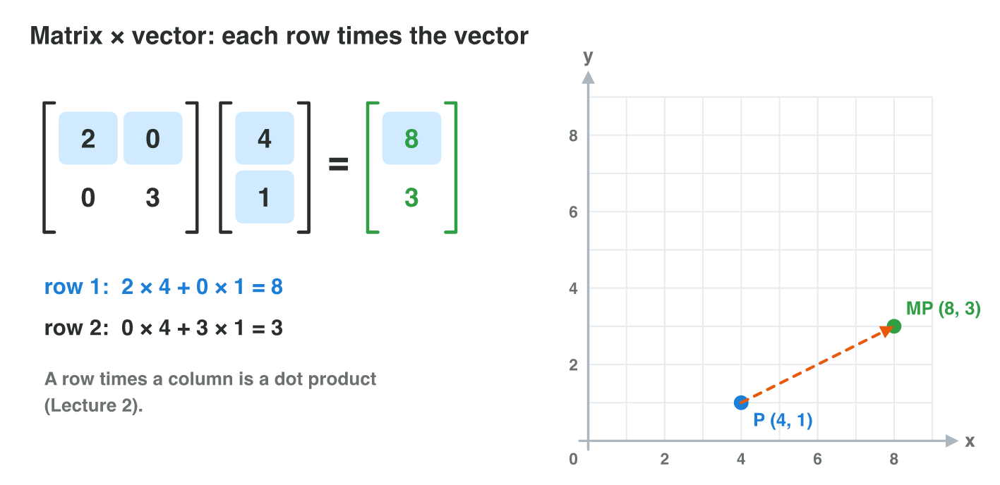
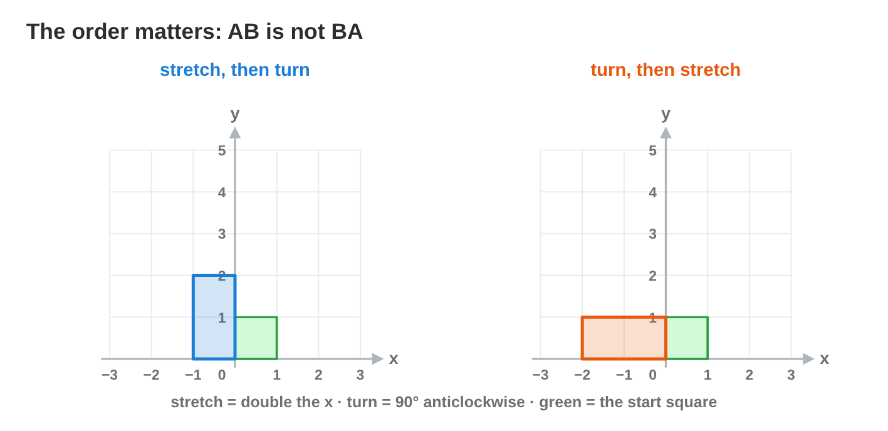

No new ideas today: three short problems on Lecture 5. Do each one alone.
Tap, sort or type your answer at every step: the page checks it at once and
tells you why.

## Recall

- A matrix has the size rows × columns; the entry a~ij~ is in row i,
  column j. Same-size matrices are added entry by entry; k × A multiplies
  every entry by k.
- Matrix × vector: each row times the vector gives one coordinate. In
  AB**v**, B acts first.
- The identity I changes nothing; the inverse undoes a matrix.

::: {.callout-tip title="Try it 1 · Recall"}
Choose the right answer.

::: {.match extra="4 × 2|(4, 1)"}
What is the size of a matrix with 2 rows and 4 columns?
:   2 × 4

    Why: Rows first, then columns.

What are the rows (2, 0) and (0, 1) times the vector (3, 5)?
:   (6, 5)

    Why: Row 1: 2 × 3 + 0 × 5 = 6; row 2: 0 × 3 + 1 × 5 = 5.

In AB**v**, which matrix acts first on **v**?
:   B

    Why: The matrix next to the vector acts first.
:::
:::

## Activity 1 · The enemy table

An RPG keeps its enemies in a matrix E. Row 1 is the slime, row 2 the
troll; the columns are HP, damage and speed:

| | HP | damage | speed |
|---|---|---|---|
| slime (row 1) | 40 | 10 | 4 |
| troll (row 2) | 60 | 20 | 2 |

{width=82%}

::: {.callout-note title="Activity 1 · Read, add and scale · 15 min"}
1. Write the size of E, and the entries e~13~ and e~22~ with their
   meaning.
2. A patch adds the matrix with the rows (10, 0, 0) and (0, 5, 1) to E.
   Write the new E.
3. Hard mode is 1.5 × E (use the old E). Write the troll's hard-mode row.

*Your product:* the size, two entries, the new E and one row.

::: {.choice}
Step 1: what is the size of E?

- [x] 2 × 3

  Why: 2 rows (slime, troll) and 3 columns (HP, damage, speed).

- [ ] 3 × 2

  Why: The size is rows × columns: the rows come first.

- [ ] 6

  Why: 6 is the number of entries; the size gives rows and columns.
:::

::: {.fill answer="20" hint="Row 2 is the troll; column 2 is the damage."}
Step 1: what is e~22~?

Why: Row 2, column 2: the damage of the troll, 20.
:::

::: {.choice}
Step 2: after the patch, what is the slime's row?

- [x] (50, 10, 4)

  Why: (40 + 10, 10 + 0, 4 + 0): add the entries in the same place.

- [ ] (40, 15, 5)

  Why: (0, 5, 1) is the troll's row of the patch, not the slime's.

- [ ] (50, 15, 5)

  Why: Each row of E gets only the same row of the patch.
:::

::: {.fill answer="(90, 30, 3)" hint="Multiply every entry of (60, 20, 2) by 1.5."}
Step 3: what is the troll's hard-mode row, 1.5 × (60, 20, 2)? Type (a, b, c).

Why: (1.5 × 60, 1.5 × 20, 1.5 × 2) = (90, 30, 3).
:::
:::

::: {.callout-tip title="Try it 2 · The table"}
E has the rows slime (40, 10, 4) and troll (60, 20, 2); the columns are HP,
damage and speed. Choose the right answer.

::: {.match extra="e~31~|2 × 4"}
Which entry is the HP of the troll?
:   e~21~

    Why: The troll is row 2, and HP is column 1.

What is the size of E with a third enemy?
:   3 × 3

    Why: One more row; the columns stay HP, damage and speed.

What is the slime's damage in hard mode (1.5 × E)?
:   15

    Why: 1.5 × 10 = 15.
:::
:::

## Activity 2 · Spells on a point

A crystal puzzle uses spells. **Stretch** has the rows (2, 0) and (0, 3);
**Turn** has the rows (0, −1) and (1, 0); **Mirror** has the rows (1, 0)
and (0, −1).



::: {.callout-note title="Activity 2 · Cast and check · 15 min"}
1. On paper, cast Stretch, Turn and Mirror on the point (3, −1). Write both
   rows of each calculation.
2. In **Multiply Lab**, enter each matrix, put P at (3, −1) and compare.

*Your product:* three points with their calculations.

::: {.sort}
Which spell made each point? The spells were cast on (3, −1) and on (1, 2).
Sort the end points.

Stretch
:   (6, −3), from (3, −1)

    Why: (2 × 3 + 0, 0 + 3 × (−1)) = (6, −3).

:   (2, 6), from (1, 2)

    Why: x × 2 and y × 3.

Turn
:   (1, 3), from (3, −1)

    Why: (0 × 3 + (−1) × (−1), 1 × 3 + 0) = (1, 3).

:   (−2, 1), from (1, 2)

    Why: Turn makes (x, y) into (−y, x).

Mirror
:   (3, 1), from (3, −1)

    Why: Mirror changes only the sign of y.

:   (1, −2), from (1, 2)

    Why: The rows (1, 0) and (0, −1) keep x and turn the sign of y.
:::
:::

::: {.callout-tip title="Try it 3 · Spells"}
Stretch = rows (2, 0), (0, 3); Turn = rows (0, −1), (1, 0); Mirror = rows
(1, 0), (0, −1). Choose the right answer.

::: {.match extra="(−3, 1)|(3, −2)"}
What does Stretch do to (1, 2)?
:   (2, 6)

    Why: (2 × 1, 3 × 2) = (2, 6).

What does Turn do to (4, 2)?
:   (−2, 4)

    Why: Turn sends (x, y) to (−y, x).

What does Mirror do to (5, 2)?
:   (5, −2)

    Why: Mirror keeps x and changes the sign of y.
:::
:::

## Activity 3 · Two spells, their order and undo

The game casts Grow (rows (2, 0), (0, 2)) and Turn (rows (0, −1), (1, 0))
on every point of a model. It multiplies the two matrices once and uses the
result for every point. Flip has the rows (−1, 0) and (0, 1). Shrink has
the rows (0.5, 0) and (0, 0.5).

{width=82%}

::: {.callout-note title="Activity 3 · Combine and undo · 18 min"}
1. Compute Grow × Turn. Check it on (1, 0).
2. Take the point (4, −1). Apply Flip then Turn, and Turn then Flip. Are
   the two end points the same?
3. Which spell undoes Grow? Which matrix changes nothing?

*Your product:* one matrix, two end points and two answers.

::: {.choice}
Step 1: what is Grow × Turn?

- [x] the rows (0, −2) and (2, 0)

  Why: Row × column: (2 × 0 + 0 × 1, 2 × (−1) + 0 × 0) = (0, −2), then (2, 0). On (1, 0) it gives (0, 2).

- [ ] the rows (2, −1) and (1, 2)

  Why: That adds the two matrices; a product multiplies rows by columns.

- [ ] the rows (0, −1) and (1, 0)

  Why: That is Turn alone; Grow also doubles everything.
:::

::: {.fill answer="(1, −4)" hint="First Flip: (−4, −1). Then Turn: (x, y) becomes (−y, x)."}
Step 2: apply Flip then Turn to (4, −1). Where does it end? Type (x, y).

Why: Flip: (−4, −1); Turn: (1, −4). Turn then Flip gives (−1, 4): the order matters.
:::

::: {.choice}
Step 3: which spell undoes Grow?

- [x] Shrink, the rows (0.5, 0) and (0, 0.5)

  Why: Shrink halves what Grow doubled: it is the inverse of Grow.

- [ ] Turn

  Why: Turn changes the direction, not the size.

- [ ] the identity

  Why: The identity changes nothing, so the point stays twice as far.
:::
:::

::: {.callout-tip title="Try it 4 · Order and undo"}
Grow = rows (2, 0), (0, 2); Turn = rows (0, −1), (1, 0); Flip = rows
(−1, 0), (0, 1). Choose the right answer.

::: {.match extra="(4, 1)|Flip"}
From (4, −1), Flip then Turn. Where does the point land?
:   (1, −4)

    Why: Flip: (−4, −1); Turn: (−y, x) = (1, −4).

From (4, −1), Turn then Flip. Where does the point land?
:   (−1, 4)

    Why: Turn: (1, 4); Flip: (−1, 4).

Flip twice. Which matrix is it?
:   the identity

    Why: The sign of x changes twice, so nothing changes.

Does (2 × 3) times (2 × 3) exist?
:   no

    Why: A has 3 columns but B has 2 rows.
:::
:::

## At home · Task with AI

::: {.callout-note .ai-task title="Task with AI · A spell on a whole sprite"}
An extra for the curious: let an AI assistant draw it. Copy the prompt
into an AI assistant that the university allows (for example Microsoft
Copilot with your university account), and look at the picture.

::: {.prompt}
Draw a grid from −6 to 6 on both axes. Draw a small house in blue: the
corners (0, 0), (2, 0), (2, 2), (1, 3) and (0, 2), joined in this order and
back to the start. Multiply every corner by the matrix with the rows (0, −1)
and (1, 0), and draw the new house in orange. Make a table of the old and
the new corners.
:::

::: {.choice}
What should the orange house show? The AI can be wrong: compare.

- [x] The blue house turned 90° anticlockwise about (0, 0), with the roof at (−3, 1).

  Why: This matrix is Turn: (x, y) becomes (−y, x), so (1, 3) goes to (−3, 1).

- [ ] The blue house moved 2 units to the right.

  Why: A matrix times a point turns, stretches or flips it; it never moves the origin.
:::

::: {.try-change}
**Change:** use the matrix with the rows (2, 0) and (0, 2) (the spell Grow) and
ask again.

::: {.choice}
What changes?

- [x] The house is twice as big and still stands on (0, 0).

  Why: Grow doubles every corner: the roof goes to (2, 6).

- [ ] The house keeps its size and moves away from (0, 0).

  Why: (0, 0) × 2 is still (0, 0); every other corner is twice as far.
:::
:::

::: {.try-change}
**Change:** use the matrix with the rows (1, 0) and (0, 1) and ask again.

::: {.choice}
What changes?

- [x] Nothing: the orange house lies on the blue one.

  Why: This is the identity: it changes nothing.

- [ ] The house turns by 90° again.

  Why: Only Turn has the rows (0, −1) and (1, 0); this matrix keeps every corner.
:::
:::

**Your own idea:** change one more number or word, and look again. The AI
can be wrong: compare its result with the answers.
:::

## Wrap-up {.summary}

- You can read, add and scale a table of game data as a matrix.
- You can cast a spell matrix on a point and check it in Multiply Lab.
- You can combine two spells, see why the order matters, and undo a spell.
