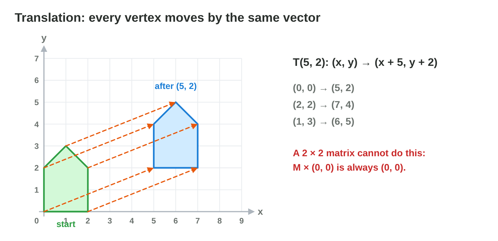
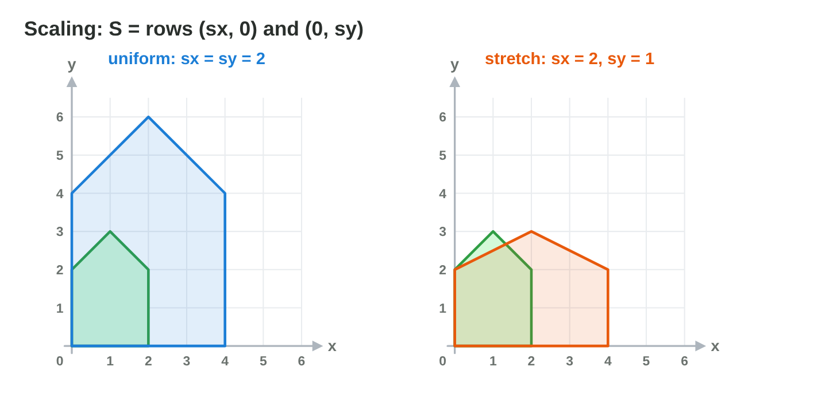

This page is the interactive version of the lesson notes (PDF). Each section
starts with a problem in a game. Then it explains the idea behind it. It ends
with a **Do it** task and one set of questions. Every question on this page
has its answer: try first, then check.

## Key terms



## 6.1 Move the platform: translation

- A **translation** by (t~x~, t~y~) moves every point (x, y) to
  (x + t~x~, y + t~y~).
- Every **vertex** (corner) moves by the same vector. Size and direction stay.
- The house moved by (5, 2): (0, 0) → (5, 2); (2, 2) → (7, 4); (1, 3) →
  (6, 5).
- To move a corner from (1, 1) to (5, 4), the move is the difference:
  **(4, 3)**.
- A 2 × 2 matrix cannot translate: M × (0, 0) is always (0, 0). (Lecture 7
  solves this.)

{width=92%}



::: {.callout-warning title="Watch out!"}
The move is the difference between the new point and the old point, not the
new point.
:::

::: {.callout-note title="Do it · Predict, then check"}
On paper: where does the corner (2, 2) go with the move (−3, 1)? Then set
tx = −3, ty = 1 in **Transform Lab** (sx = sy = 1) and compare.

::: {.check}
(2 − 3, 2 + 1) = (−1, 3), the same as the lab.
:::
:::

::: {.callout-tip title="Try it 1 · Translation"}
Choose the right answer.

::: {.match extra="(6, 2)|(−1, 5)"}
Translate (3, −1) by (−2, 4).
:   (1, 3)

    Why: (3 − 2, −1 + 4).

A corner must go from (2, 5) to (7, 1). What is the move?
:   (5, −4)

    Why: new − old = (7 − 2, 1 − 5).

The house moves by (5, 2). Where does its roof (1, 3) go?
:   (6, 5)

    Why: (1 + 5, 3 + 2).

Why can a 2 × 2 matrix not translate?
:   it always keeps (0, 0) at (0, 0)

    Why: any matrix × (0, 0) gives (0, 0).

What changes in a translation?
:   only the place

    Why: size and direction stay; the shape only moves.
:::
:::

## 6.2 Bigger and smaller: scaling

- A **scaling** multiplies the coordinates by the **scale factors**:
  S = rows (s~x~, 0) and (0, s~y~), so (x, y) → (s~x~ x, s~y~ y).
- **Uniform scaling:** s~x~ = s~y~; the shape keeps its proportions.
- A factor > 1 makes it bigger; between 0 and 1 smaller.
- House × 2: roof (1, 3) → (2, 6).

{width=92%}

::: {.callout-warning title="Watch out!"}
A scaling multiplies; it never adds.
:::

::: {.callout-note title="Do it · Uniform or stretched?"}
In **Transform Lab** (tx = ty = 0, pivot "origin"), set sx = sy = 2, then
sx = 2, sy = 1. Where does the corner (2, 2) go each time? Which house keeps
its shape?

::: {.check}
(2, 2) → (4, 4) with (2, 2), and → (4, 2) with (2, 1). The uniform scaling
keeps the shape; the stretch makes the house wide and flat.
:::
:::

::: {.callout-tip title="Try it 2 · Scaling"}
Choose the right answer.

::: {.match extra="(4, 6)|(2.5, 4.5)"}
The factors (3, 0.5). Where does (2, 4) go?
:   (6, 2)

    Why: (3 × 2, 0.5 × 4).

Is the scaling (2, 1) uniform?
:   no, it stretches x only

    Why: uniform means s~x~ = s~y~; here 2 ≠ 1.

What does the factor 0.5 do?
:   it halves the size

    Why: every coordinate × 0.5: half as big.

The house is scaled by 2. Where does its roof (1, 3) go?
:   (2, 6)

    Why: (2 × 1, 2 × 3).

A tree top (1, 2) with the factors (1, 3). Where does it go?
:   (1, 6)

    Why: x × 1 and y × 3: tall and thin.
:::
:::

## 6.3 Grow in place: the pivot

- A scaling matrix keeps only the **origin** still. A crate at (2, 2)–(4, 4)
  scaled by 2 jumps to (4, 4)–(8, 8).
- To grow in place, scale about a **pivot** C: (1) move by −C, (2) scale,
  (3) move back by +C. One point: **P' = C + S (P − C)**.
- Crate about its centre (3, 3): (4, 4) → (1, 1) → (2, 2) → **(5, 5)**. The
  new corners: (1, 1), (5, 1), (5, 5), (1, 5).

{width=92%}

::: {.callout-warning title="Watch out!"}
Do not forget step 3: move the shape back by +C.
:::

::: {.callout-note title="Do it · Three pivots"}
In **Transform Lab** (tx = ty = 0, sx = sy = 2), try the pivots origin, feet
(1, 0) and centre (1, 1.5). Which point of the house stays still each time?

::: {.check}
Origin: (0, 0) stays. Feet: the feet (1, 0) stay on the ground. Centre: the
centre (1, 1.5) stays and the house grows around it.
:::
:::

::: {.callout-tip title="Try it 3 · The pivot"}
Choose the right answer.

::: {.match extra="(10, 10)|(4, 4)"}
Scale (5, 5) by 2 about the pivot (3, 3).
:   (7, 7)

    Why: (5, 5) − (3, 3) = (2, 2); × 2 = (4, 4); + (3, 3).

The head (2, 4), the feet (2, 0). Scale by 2 about the feet. Where is the head?
:   (2, 8)

    Why: (0, 4) × 2 = (0, 8); + (2, 0).

Which point stays still in a scaling about a pivot?
:   the pivot

    Why: P − C = (0, 0) for the pivot, and 2 × (0, 0) = (0, 0).

The crate (2, 2)–(4, 4) scaled by 2 about the origin: where is its corner (4, 4)?
:   (8, 8)

    Why: (2 × 4, 2 × 4): it jumps away.

What is step 1 of a scaling about the pivot C?
:   move the shape by −C

    Why: move the pivot to the origin first.
:::
:::

## 6.4 Turn it: rotation and the rotation matrix

- A **rotation** by θ around the origin:
  **x' = x cos θ − y sin θ**, **y' = x sin θ + y cos θ**.
- A positive θ turns anticlockwise. The distance from the origin stays the
  same.
- Blade tip (4, 0), 30° (cos 0.87, sin 0.5): (3.46, 2).
- (3, 1) by 90° (cos 0, sin 1): (−1, 3), the spell Turn of Lecture 5.
- As a matrix: **R(θ) = rows (cos θ, −sin θ) and (sin θ, cos θ)**. Its
  columns are where (1, 0) and (0, 1) go. R(90°) = rows (0, −1), (1, 0).

{width=92%}

{width=82%}



::: {.callout-warning title="Watch out!"}
The minus sign is in x'. Without it the point turns clockwise.
:::

::: {.callout-note title="Do it · Rotate by hand, check in the lab"}
On paper, rotate (2, 2) by 90° and by 180° around the origin. Then check both
in **Rotate Lab** with the pivot at the origin.

::: {.check}
90°: (2 × 0 − 2 × 1, 2 × 1 + 2 × 0) = (−2, 2). 180°: (−2, −2). The lab shows
the same points.
:::
:::

::: {.callout-tip title="Try it 4 · Rotate a point"}
Choose the right answer.

::: {.match extra="(2, 4.35)|(1, −3)|rows (1, 0) and (0, 1)"}
Rotate (5, 0) by 30° (cos 0.87, sin 0.5).
:   (4.35, 2.5)

    Why: (5 × 0.87 − 0, 5 × 0.5 + 0).

Rotate (3, 1) by 180°.
:   (−3, −1)

    Why: cos 180° = −1, sin 180° = 0: both signs change.

Rotate (0, 2) by 90°.
:   (−2, 0)

    Why: (−y, x) = (−2, 0).

Rotate (3, 1) by 90°.
:   (−1, 3)

    Why: (−y, x) = (−1, 3).

What stays the same in a rotation around the origin?
:   the distance from the origin

    Why: the point moves on a circle around the origin.

Which matrix is R(180°)?
:   rows (−1, 0) and (0, −1)

    Why: cos 180° = −1 and sin 180° = 0.

What is R(90°) × (2, −1)?
:   (1, 2)

    Why: (0 × 2 + (−1)(−1), 1 × 2 + 0) = (1, 2).
:::
:::

## 6.5 Turn the drawbridge: rotation about a pivot, and back

- About the pivot C: **P' = C + R(θ) (P − C)**: move by −C, rotate, move
  back.
- The drawbridge: hinge H = (2, 1), end E = (6, 1). E − H = (4, 0).
- 90°: (0, 4) + H = **(2, 5)**. 30°: (3.46, 2) + H = **(5.46, 3)**.
- Rotating E itself around the origin gives (−1, 6): the bridge flies away.
- A rotation keeps lengths and angles. To **undo** it, turn back by the same
  angle: the inverse of R(θ) is **R(−θ)**.

{width=92%}

::: {.callout-warning title="Watch out!"}
Subtract the pivot first, and add it back at the end. To undo 30°, turn −30°,
not another 30°.
:::

::: {.callout-note title="Do it · A pivot in Rotate Lab"}
Tap the grid at (1, 0) to move the pivot. Set θ = 90° and read P' for
P = (2, 2). Check by hand: P − C, R(90°), + C.

::: {.check}
P − C = (1, 2); R(90°) gives (−2, 1); + C = (−1, 1). The lab shows (−1, 1).
:::
:::

::: {.callout-tip title="Try it 5 · About a pivot and back"}
Choose the right answer.

::: {.match extra="(−2, 5)|(5, 0)|R(30°)"}
Rotate (5, 2) by 90° about (3, 2).
:   (3, 4)

    Why: P − C = (2, 0); R(90°) gives (0, 2); + C = (3, 4).

A door: hinge (1, 1), handle (1, 3). Turn by −90° about the hinge.
:   (3, 1)

    Why: P − C = (0, 2); R(−90°) gives (2, 0); + C = (3, 1).

The drawbridge (H = (2, 1), E = (6, 1)) turns 90°. Where is the end?
:   (2, 5)

    Why: E − H = (4, 0); R(90°) gives (0, 4); + H = (2, 5).

What is step 1 of a rotation about a pivot C?
:   subtract C

    Why: move the pivot to the origin first.

Which rotation undoes R(30°)?
:   R(−30°)

    Why: turn back by the same angle the other way.

A gun of length 2 turns by 45°. How long is it now?
:   still 2

    Why: a rotation keeps every length.
:::
:::

## Game challenge: Drawbridge {.challenge}

Work alone. Use every section of today.

**Drawbridge** is a castle game. The bridge turns around its hinge
**H = (1, 1)**; it is 3 units long; lying flat, its end is at **E = (4, 1)**.
A ship needs the end at (1, 4); a knight needs it on the ledge at
(3.6, 2.5).



::: {.callout-tip title="Try it 6 · The bridge"}
H = (1, 1), E = (4, 1), so E − H = (3, 0). Choose the right answer.

::: {.match extra="45°|−90°"}
Which turn puts the end at (1, 4)?
:   90°

    Why: R(90°) × (3, 0) = (0, 3); + H = (1, 4).

Which turn puts the end at (3.6, 2.5)? (cos 30° = 0.87, sin 30° = 0.5)
:   30°

    Why: R(30°) × (3, 0) = (2.6, 1.5); + H = (3.6, 2.5).

Where is the end at 180°?
:   (−2, 1)

    Why: R(180°) × (3, 0) = (−3, 0); + H = (−2, 1).

Where is the end at −90°?
:   (1, −2)

    Why: R(−90°) × (3, 0) = (0, −3); + H = (1, −2).
:::
:::

::: {.callout-tip title="Try it 7 · Back down (harder)"}
H = (1, 1), the bridge is 3 long, E − H = (3, 0). Choose the right answer.

::: {.match extra="60°|(4, 4)"}
The bridge stands at 60°. Which turn brings it back flat?
:   −60°

    Why: the inverse of R(60°) is R(−60°).

At 60°, where is the end? (cos 60° = 0.5, sin 60° = 0.87)
:   about (2.5, 3.6)

    Why: R(60°) × (3, 0) = (1.5, 2.6); + H = (2.5, 3.6).

A player turns the end (4, 1) by 90° around the origin by mistake. Where does it go?
:   (−1, 4)

    Why: (−y, x) = (−1, 4): the bridge leaves its hinge.

Which part of the bridge never moves?
:   the hinge H

    Why: the pivot of a rotation stays where it is.
:::
:::

## Summary {.summary}

- Translation: every vertex moves by the same vector.
- Scaling: multiply the coordinates by s~x~ and s~y~; about a pivot: −C, scale, +C.
- Rotation: R(θ) = rows (cos θ, −sin θ), (sin θ, cos θ); positive θ is anticlockwise.
- About a pivot: P' = C + R(θ)(P − C). Undo with R(−θ).
