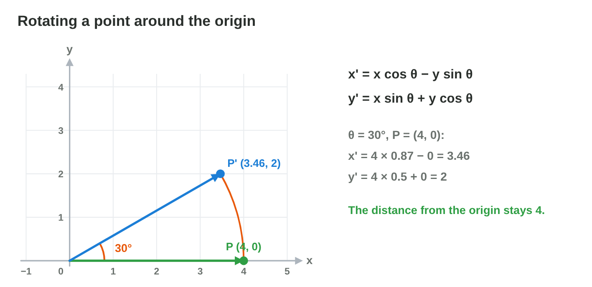
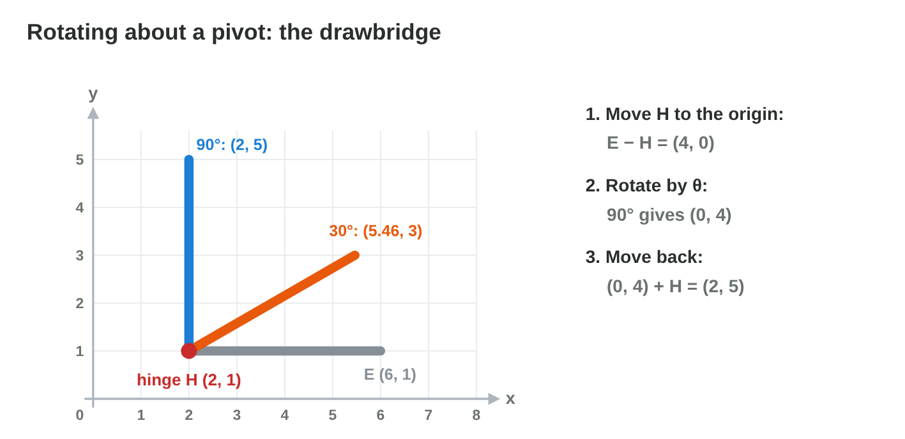
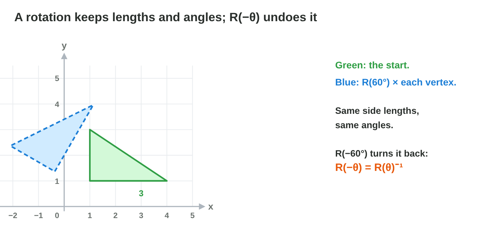
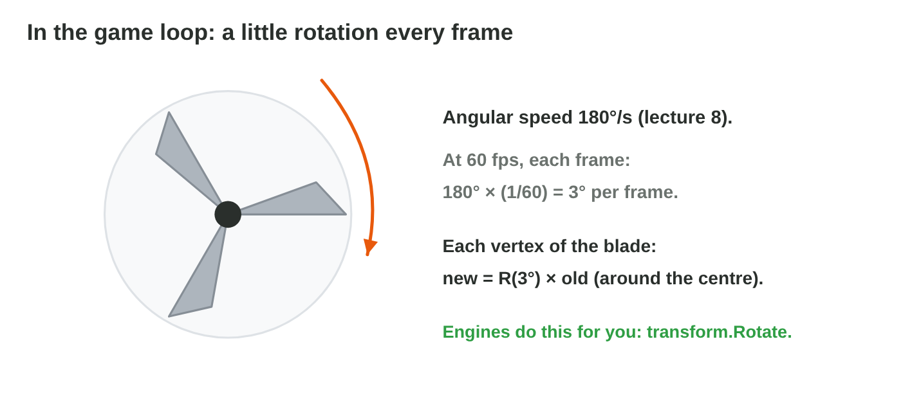

## Keywords



## 12.1 Turn a point around the origin

:::: {.columns}
::: {.column width="50%"}
- A rotation turns every point by the same angle around one fixed point.
- x' = x cos θ − y sin θ, and y' = x sin θ + y cos θ.
- The distance from the origin stays the same.
- **Do it:** Rotate (2, 2) by 90° on paper. Does Rotate Lab give the same point?
:::
::: {.column width="50%"}

:::
::::

## Example · The blade tip

The tip of a blade is at (4, 0), and it turns by 30° (cos 0.87, sin 0.5).
**Where is the tip now?**

::: {.reveal}
1. x' = 4 × 0.87 − 0 × 0.5 = 3.46.
2. y' = 4 × 0.5 + 0 × 0.87 = 2.
3. The tip is at **(3.46, 2)**, still 4 units from the centre.
:::

## Live demo · Rotate Lab



## Try it 1 · Rotate a point

a) Where does (5, 0) go after a rotation by 30°?
b) Where does (3, 1) go after a rotation by 180°?
c) Where does (0, 2) go after a rotation by 90°?

::: {.answer}
a) (4.35, 2.5)
b) (−3, −1)
c) (−2, 0)
:::

## 12.2 The rotation matrix

:::: {.columns}
::: {.column width="50%"}
- R(θ) has the rows (cos θ, −sin θ) and (sin θ, cos θ).
- Its first column is where (1, 0) goes, and its second column is where (0, 1) goes.
- R(90°) has the rows (0, −1) and (1, 0), the spell Turn of lecture 10.
- **Do it:** Write R(45°) with cos 45° = sin 45° = 0.71. Where does it send (2, 0)?
:::
::: {.column width="50%"}

:::
::::

## Example · R(30°) times (2, 2)

R(30°) has the rows (0.87, −0.5) and (0.5, 0.87).
**Where does the corner (2, 2) of a house go?**

::: {.reveal}
1. Row 1: 0.87 × 2 − 0.5 × 2 = 1.74 − 1 = 0.74.
2. Row 2: 0.5 × 2 + 0.87 × 2 = 1 + 1.74 = 2.74.
3. The corner goes to **(0.74, 2.74)**.
:::

## Try it 2 · The matrix

a) What are the rows of R(180°)?
b) Where does R(θ) send the point (1, 0)?
c) What is R(90°) × (2, −1)?

::: {.answer}
a) (−1, 0) and (0, −1)
b) (cos θ, sin θ)
c) (1, 2)
:::

## 12.3 Rotation about a pivot

:::: {.columns}
::: {.column width="50%"}
- To rotate about a pivot C, subtract C, rotate and add C again.
- For one point, P' = C + R(θ)(P − C).
- The drawbridge turns about its hinge H = (2, 1), not about the origin.
- **Do it:** Rotate (5, 2) by 90° about the pivot (3, 2). Where does it go?
:::
::: {.column width="50%"}

:::
::::

## Example · The bridge goes up

The hinge is H = (2, 1), and the end of the flat bridge is E = (6, 1).
**Where is the end after a turn of 90° about H?**

::: {.reveal}
1. E − H = (4, 0).
2. R(90°) × (4, 0) = (0, 4).
3. (0, 4) + (2, 1) = **(2, 5)**: the bridge stands up.
:::

## Try it 3 · About a pivot

a) A door has its hinge at (1, 1) and its handle at (1, 3). Where is the handle after a turn of −90°?
b) Where is the end of the drawbridge after a turn of 30°?
c) What is the first step of a rotation about a pivot C?

::: {.answer}
a) (3, 1)
b) (5.46, 3)
c) Subtract C.
:::

## 12.4 What a rotation keeps

:::: {.columns}
::: {.column width="50%"}
- A rotation keeps every length and every angle of a shape.
- R(−θ) undoes R(θ), and it is the transpose of R(θ).
- The determinant of a rotation matrix is always 1.
- **Do it:** Rotate the side from (1, 1) to (4, 1) by 90°. Is it still 3 long?
:::
::: {.column width="50%"}

:::
::::

## Example · Turning back

The blade tip went from (4, 0) to (3.46, 2) with R(30°), and R(−30°) has the rows (0.87, 0.5) and (−0.5, 0.87).
**Where does R(−30°) send the tip?**

::: {.reveal}
1. Row 1: 0.87 × 3.46 + 0.5 × 2 = 3.01 + 1, which is about 4.
2. Row 2: −0.5 × 3.46 + 0.87 × 2 = −1.73 + 1.74, which is about 0.
3. The tip is back at **(4, 0)**.
:::

## Try it 4 · Keep and undo

a) Which matrix undoes R(30°)?
b) A gun of length 2 turns by 45°. How long is it now?
c) What is the determinant of any rotation matrix?

::: {.answer}
a) R(−30°)
b) still 2
c) 1
:::

## 12.5 A little turn every frame

:::: {.columns}
::: {.column width="50%"}
- Each frame turns an object by the angular speed times the frame time.
- A windmill at 180° per second turns 3° per frame at 60 fps.
- In Unity, transform.Rotate(0, 0, 180 * Time.deltaTime) does this.
- **Do it:** A turret turns at 90° per second at 30 fps. How many degrees does it turn per frame?
:::
::: {.column width="50%"}

:::
::::

## Example · The windmill at 60 fps

A windmill turns at 180° per second, and the game runs at 60 fps.
**How much does it turn in each frame, and after 30 frames?**

::: {.reveal}
1. One frame lasts 1/60 s, so each frame turns 180 × 1/60 = **3°**.
2. After 30 frames, it has turned 30 × 3° = **90°**.
3. At 30 fps, each frame turns 6°, so the speed stays the same.
:::

## Try it 5 · Every frame

a) A wheel turns at 360° per second. How many degrees per frame does it turn at 60 fps?
b) Why does the code multiply by Time.deltaTime?
c) How many frames at 30 fps does a turret at 90° per second need for a quarter turn?

::: {.answer}
a) 6°
b) so that the speed does not depend on the frame rate
c) 30 frames
:::

## Game challenge · Drawbridge



## Try it 6 · Back down (harder)

The facts: the hinge is H = (2, 1), the bridge is 4 units long, and flat its end is at (6, 1).

a) Where is the end of the bridge at 180°?
b) The bridge stands at 60°. Which turn brings it back flat?
c) Where does the end (6, 1) go after 90° around the origin by mistake?

::: {.answer}
a) (−2, 1)
b) −60°
c) (−1, 6)
:::

## Summary

- A rotation turns every point by the same angle around one point.
- The rotation matrix has the rows (cos θ, −sin θ) and (sin θ, cos θ).
- About a pivot, we subtract it, rotate and add it back.
- A rotation keeps lengths and angles, and R(−θ) undoes it.
- In the game loop, an object turns by ω × Δt in each frame.
