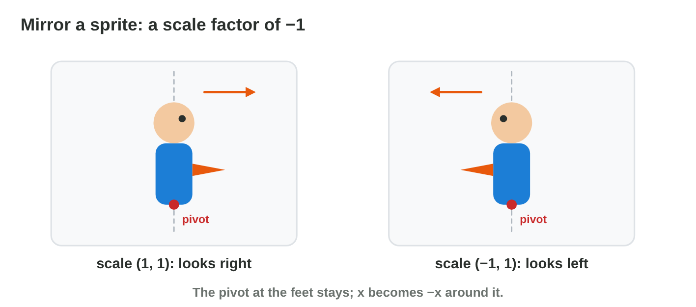

No new ideas today: you apply what you learned in Lecture 9. Do each
activity alone, then open "Check your result". Every question on this page
has its answer: try first, then check.

## Recall

- A translation moves every vertex by the same vector (t~x~, t~y~).
- A scaling multiplies: (x, y) → (s~x~ x, s~y~ y). About a pivot C:
  P' = C + S (P − C).
- A rotation by θ: R(θ) = rows (cos θ, −sin θ), (sin θ, cos θ). About a
  pivot: P' = C + R(θ)(P − C). R(−θ) undoes R(θ).

::: {.callout-tip title="Try it 1 · Recall"}
Choose the right answer.

::: {.match extra="(4, 2)|R(45°)"}
Translate (2, 3) by (1, −1).
:   (3, 2)

    Why: (2 + 1, 3 − 1).

Rotate (2, 0) by 90° around the origin.
:   (0, 2)

    Why: (−y, x) = (0, 2).

Which rotation undoes R(45°)?
:   R(−45°)

    Why: turn back by the same angle the other way.
:::
:::

## Activity 1 · A stretched tree

A forest level uses one tree sprite. Its trunk stands at (1, 0) and its top
is at (1, 2). The designer needs a tall, thin tree and a small bush from the
same sprite.

{width=80%}



::: {.callout-note title="Activity 1 · Tall tree, small bush · 10 min"}
1. Scale the tree with the factors (1, 3) about the origin. Where does the
   top go? Is the scaling uniform?
2. Scale it with (0.5, 0.5). Where does the top go now?
3. In **Transform Lab**, set sx = 1, sy = 3 and look at the house. Which
   way does it stretch?

*Your product:* two points, the word "uniform" or "not uniform" for each,
and one sentence about the lab.

::: {.check}
(1, 3): the top goes to (1, 6); not uniform: the tree is three times as high
but not wider. (0.5, 0.5): (0.5, 1); uniform: half as big, same shape. In
the lab the house stretches up only.
:::
:::

::: {.callout-tip title="Try it 2 · Stretch"}
Choose the right answer.

::: {.match extra="(3, 6)|uniform"}
The top (1, 2) with the factors (1, 3).
:   (1, 6)

    Why: x × 1 and y × 3.

Is the scaling (1, 3) uniform?
:   no

    Why: uniform needs s~x~ = s~y~.

The top (1, 2) with the factors (0.5, 0.5).
:   (0.5, 1)

    Why: both coordinates × 0.5.
:::
:::

## Activity 2 · Grow from the feet

A power-up makes a hero 1.5 times as big. The feet are at (1, 0) on the
ground, and the head is at (1, 3). The feet must stay on the ground.

{width=80%}

::: {.callout-note title="Activity 2 · The power-up · 10 min"}
1. Scale the head by 1.5 about the feet (1, 0). Write the three steps.
2. Scale the head by 1.5 about the origin instead. Where is it now? Where
   are the feet?
3. Which pivot do you choose in the game? Why?

*Your product:* two head positions with the steps, and your choice with a
reason.

::: {.check}
About the feet: (1, 3) − (1, 0) = (0, 3); × 1.5 = (0, 4.5); + (1, 0) =
(1, 4.5). The feet stay at (1, 0). About the origin: the head goes to
(1.5, 4.5) and the feet to (1.5, 0): the hero slides to the right. Choose the
feet as the pivot, so the hero grows in place on the ground.
:::
:::

::: {.callout-tip title="Try it 3 · Grow in place"}
Choose the right answer.

::: {.match extra="(1.5, 4.5)|the origin"}
The head (1, 3), scaled by 1.5 about the feet (1, 0).
:   (1, 4.5)

    Why: (0, 3) × 1.5 = (0, 4.5); + (1, 0).

The head (2, 4), the feet (2, 0). Scale by 2 about the feet.
:   (2, 8)

    Why: (0, 4) × 2 = (0, 8); + (2, 0).

Which pivot keeps the feet on the ground?
:   the feet

    Why: the pivot is the point that stays still.
:::
:::

## Activity 3 · Turn the enemy round

An enemy walks to the right. At a wall it must look to the left. The game
does not need a second drawing: it scales the sprite with the factors
(−1, 1). A flag stands on its pole at (5, 0) and its tip is at (7, 2).

{width=80%}

::: {.callout-note title="Activity 3 · Mirror about the pole · 10 min"}
1. Mirror the tip with (−1, 1) about the pole (5, 0): subtract the pole,
   scale, add it back.
2. Mirror the tip about the origin instead. Where is it?
3. In **Transform Lab**, set sx = −1, sy = 1 and try the pivots "feet" and
   "origin".

*Your product:* two tip positions, and one sentence: which pivot keeps the
flag at its pole?

::: {.check}
About the pole: (7, 2) − (5, 0) = (2, 2); × (−1, 1) = (−2, 2); + (5, 0) =
(3, 2): the flag points left at the same pole. About the origin: (−7, 2):
the flag jumps far to the other side. The pole is the right pivot.
:::
:::

::: {.callout-tip title="Try it 4 · Mirror"}
Choose the right answer.

::: {.match extra="(7, −2)|(5, 2)"}
The tip (7, 2) mirrored about the pole (5, 0).
:   (3, 2)

    Why: (2, 2) → (−2, 2); + (5, 0).

The tip (7, 2) mirrored about the origin.
:   (−7, 2)

    Why: the factor −1 changes the sign of x.

Which factors mirror a sprite left and right?
:   (−1, 1)

    Why: −1 on x turns it round; 1 on y keeps the height.
:::
:::

## Activity 4 · Two steps in the right order

A designer often needs two steps: make a block bigger, and put it in its
place. In games the usual order is **scale, (turn,) then move**.

{width=80%}

::: {.callout-note title="Activity 4 · Order on paper · 12 min"}
A coin is at (2, 1).

1. Scale by 3 (about the origin), then move by (1, 0). Where is the coin?
2. Move by (1, 0) first, then scale by 3. Where is it now?
3. A unit block has the corners (0, 0) and (1, 1). Which two steps make it
   a 2 × 2 block with the corners (3, 1) and (5, 3)?

*Your product:* two coin positions and your two steps for the block.

::: {.check}
Scale then move: (6, 3) → (7, 3). Move then scale: (3, 1) → (9, 3): the move
was tripled too. The block: scale 2 ((1, 1) → (2, 2)), then move (3, 1):
(0, 0) → (3, 1) and (2, 2) → (5, 3).
:::
:::

::: {.callout-tip title="Try it 5 · Order"}
Choose the right answer.

::: {.match extra="(9, 3)|move first"}
The coin (2, 1): scale 3, then move (1, 0).
:   (7, 3)

    Why: (6, 3) + (1, 0).

The coin (2, 1): move (1, 0), then scale 3.
:   (9, 3)

    Why: (3, 1) × 3: the move was tripled too.

In which order do games usually combine them?
:   scale, then move

    Why: scaling first keeps the move as it is.
:::
:::

::: {.callout-note .ai-task title="Task with AI · Build a level from one sprite"}
**Goal:** a plan that places 6 copies of one block (corners (0, 0) and
(1, 1)) in a level, each with its own size, turn and place, with the
transformations in the right order. With an AI assistant you can try many
plans quickly; you check them.

1. **Do it yourself:** sketch your level on squared paper: 6 blocks, each
   with the corners where it must end (some bigger, one turned by 90°).
2. **Ask the AI:** start with this prompt and add your targets.

   ::: {.prompt}
   A unit square has the corners (0, 0) and (1, 1). For each target below,
   give the transformations in the order scale, rotate (about the origin,
   in degrees), then translate, and the new corners. Show the steps for
   one corner of each block. Targets:
   :::

3. **Check:** for two blocks, do the steps by hand on the corner (1, 1). Then
   check one block in **Transform Lab** or **Rotate Lab**. If the AI used
   another order, see where the block lands.

*Your product:* your sketch, the AI's plan, your two hand checks, and one
sentence on any mistake you found.

::: {.check}
A good plan gives each block "scale, then rotate, then translate", and the
corner (1, 1) lands on your sketch for every block you check. A block turned
by 90° about the origin needs its move chosen after the turn: (1, 1) becomes
(−1, 1) first. AI tools often translate first or forget that the turn also
moves the corners: check the turned block by hand.
:::
:::

## Activity 5 · Rotation matrices at work

A turret gun is 2 units long; its tip is at (2, 0) when it points right. A
windmill blade has its tip at (2, 2).

{width=78%}



::: {.callout-note title="Activity 5 · Build and check · 12 min"}
cos 45° = sin 45° = 0.71; cos 30° = 0.87, sin 30° = 0.5.

1. Write R(45°) and turn the gun tip (2, 0). Is the gun still 2 long?
2. Turn the blade tip (2, 2) with R(30°).
3. Turn the blade tip back with R(−30°) in **Rotate Lab**. Where is it?

*Your product:* the matrix R(45°), two turned points and your check.

::: {.check}
R(45°) = rows (0.71, −0.71), (0.71, 0.71); the gun tip goes to (1.42, 1.42);
its length is √(1.42² + 1.42²), about √(2 + 2) = 2: unchanged. R(30°) × (2, 2) = (1.74 − 1,
1 + 1.74) = (0.74, 2.74). R(−30°) brings it back to about (2, 2).
:::
:::

::: {.callout-tip title="Try it 6 · At work"}
Choose the right answer.

::: {.match extra="(2, 0.74)|2.74"}
R(30°) × (2, 2), with cos 30° = 0.87 and sin 30° = 0.5.
:   (0.74, 2.74)

    Why: row 1: 1.74 − 1; row 2: 1 + 1.74.

A gun of length 2 is turned by 45°. Its length?
:   2

    Why: a rotation keeps every length.

The blade was turned by 30°. Which rotation brings it back?
:   R(−30°)

    Why: the inverse of R(θ) is R(−θ).
:::
:::

## Game challenge: Sky Steps {.challenge}

Work alone. Use every activity of today.

**Sky Steps** is a platform game. Its designer builds a level from small
pieces. A platform with the corners (1, 1) and (3, 2) must land on its
outline at (3, 6) and (5, 7). A crate (2, 1)–(3, 2) must be three times as
big at (6, 3)–(9, 6). A crate (1, 1)–(3, 3) must grow to twice its size in
place, to (0, 0)–(4, 4). A flag on its pole at (3, 2) must point to the left.
And a unit block (0, 0)–(1, 1) must become the 3 × 3 step at (2, 1)–(5, 4).



::: {.callout-tip title="Try it 7 · The level (harder)"}
Sky Steps: platform (1, 1)–(3, 2) → (3, 6)–(5, 7); crate (2, 1)–(3, 2) →
(6, 3)–(9, 6); crate (1, 1)–(3, 3) → (0, 0)–(4, 4) in place; flag on the pole
(3, 2); unit block → (2, 1)–(5, 4). Choose the right answer.

::: {.match extra="move (3, 6)|scale 3 about its centre"}
Which move puts the platform on its outline?
:   move (2, 5)

    Why: (3, 6) − (1, 1) = (2, 5).

Which transformation fits the crate (2, 1)–(3, 2)?
:   scale 3 about the origin

    Why: (2, 1) × 3 = (6, 3) and (3, 2) × 3 = (9, 6).

Which pivot makes the crate (1, 1)–(3, 3) grow in place?
:   its centre (2, 2)

    Why: about (2, 2): (1, 1) → (0, 0) and (3, 3) → (4, 4).

Which two steps make the unit block the step at (2, 1)–(5, 4)?
:   scale 3, then move (2, 1)

    Why: (1, 1) × 3 = (3, 3); + (2, 1) = (5, 4).

The flag tip is at (5, 4.4). Where is it after the mirror about the pole (3, 2)?
:   (1, 4.4)

    Why: (5, 4.4) − (3, 2) = (2, 2.4) → (−2, 2.4); + (3, 2) = (1, 4.4).
:::
:::

## Wrap-up {.summary}

- You can stretch or grow a sprite and choose the pivot that keeps it in place.
- You can mirror a sprite about its own pivot with the factors (−1, 1).
- You can combine scaling and moving in the right order.
- You can build a rotation matrix, turn a point and turn it back.
