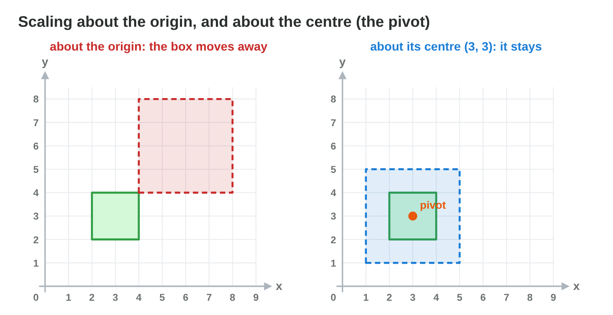
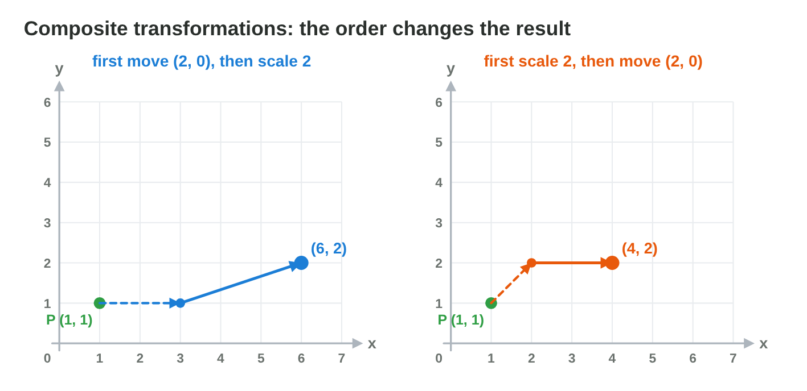
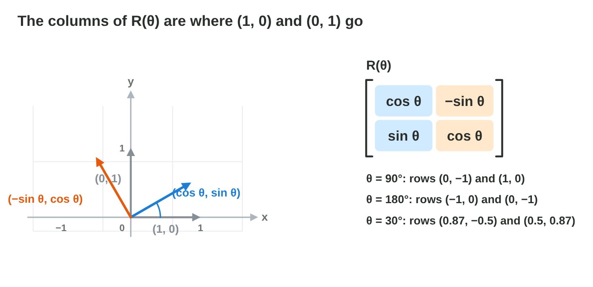

## Recall · Lecture 6

a) Where is (2, 3) after a translation by (1, −1)?
b) Where is (2, 0) after a rotation by 90° around the origin?
c) Which rotation undoes R(45°)?

::: {.answer}
a) (3, 2)
b) (0, 2)
c) R(−45°)
:::

## Activity 1 · The power-up · 15 min

:::: {.columns}
::: {.column width="50%"}
- A hero with the feet at (1, 0) and the head at (1, 3) grows 1.5 times.
- **Do it:** Scale the head about the feet in three steps. Then scale it about the origin. Which pivot do you choose, and why?
- Your product is two head positions and a choice with a reason.
:::
::: {.column width="50%"}

:::
::::

## Check 1 · The power-up

Where does the head go, and which pivot is right?

::: {.reveal}
1. About the feet: (1, 3) − (1, 0) = (0, 3), times 1.5 is (0, 4.5), plus (1, 0) is (1, 4.5).
2. About the origin, the head goes to (1.5, 4.5) and the feet to (1.5, 0).
3. The hero slides to the right, so the feet are the right pivot.
:::

## Activity 2 · Order on paper · 15 min

:::: {.columns}
::: {.column width="50%"}
- A coin is at (2, 1), and games usually scale first and move last.
- **Do it:** Scale the coin by 3 and move it by (1, 0), in both orders. Which two steps make the unit block a 2 × 2 block at (3, 1)–(5, 3)?
- Your product is two coin positions and two steps.
:::
::: {.column width="50%"}

:::
::::

## Check 2 · Order on paper

Why do the two orders give different points?

::: {.reveal}
1. Scale then move: (2, 1) → (6, 3) → (7, 3).
2. Move then scale: (2, 1) → (3, 1) → (9, 3), because the move is tripled too.
3. The block: scale by 2, then move by (3, 1), so (1, 1) goes to (2, 2) and then to (5, 3).
:::

## Activity 3 · Build and check · 18 min

:::: {.columns}
::: {.column width="50%"}
- A gun tip is at (2, 0), and a blade tip at (2, 2); cos 45° = sin 45° = 0.71, cos 30° = 0.87 and sin 30° = 0.5.
- **Do it:** Write R(45°) and turn the gun tip. Turn the blade tip with R(30°), then back with R(−30°) in Rotate Lab.
- Your product is one matrix, two turned points and a check.
:::
::: {.column width="50%"}

:::
::::

## Live demo · Rotate Lab



## Check 3 · Build and check

What are the turned points?

::: {.reveal}
1. R(45°) has the rows (0.71, −0.71) and (0.71, 0.71), and the gun tip goes to (1.42, 1.42).
2. The gun is still 2 long, because a rotation keeps every length.
3. R(30°) × (2, 2) = (1.74 − 1, 1 + 1.74) = (0.74, 2.74).
4. R(−30°) brings the blade tip back to about (2, 2).
:::

## Wrap-up

- You can grow a sprite and choose the pivot that keeps it in place.
- You can combine scaling and moving in the right order.
- You can turn a point with the rotation matrix and turn it back.
