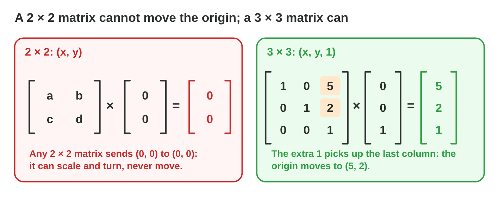
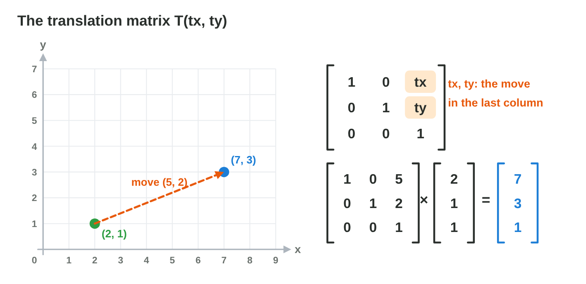
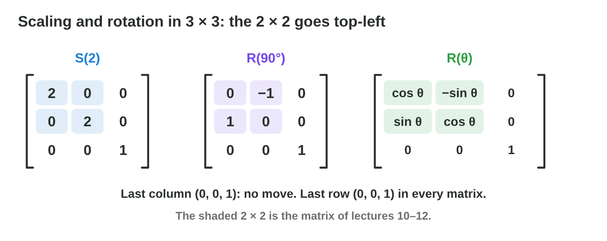
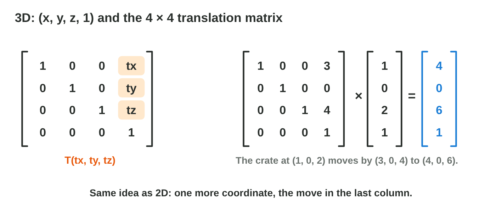
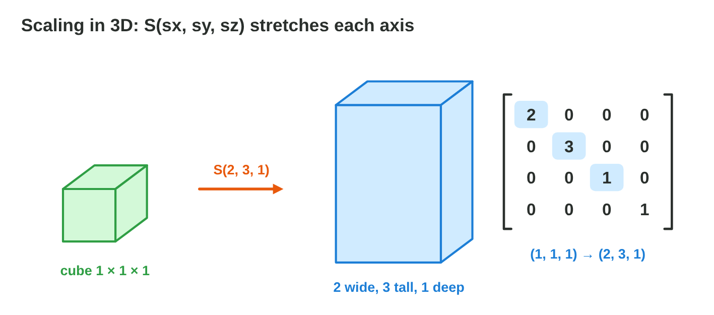
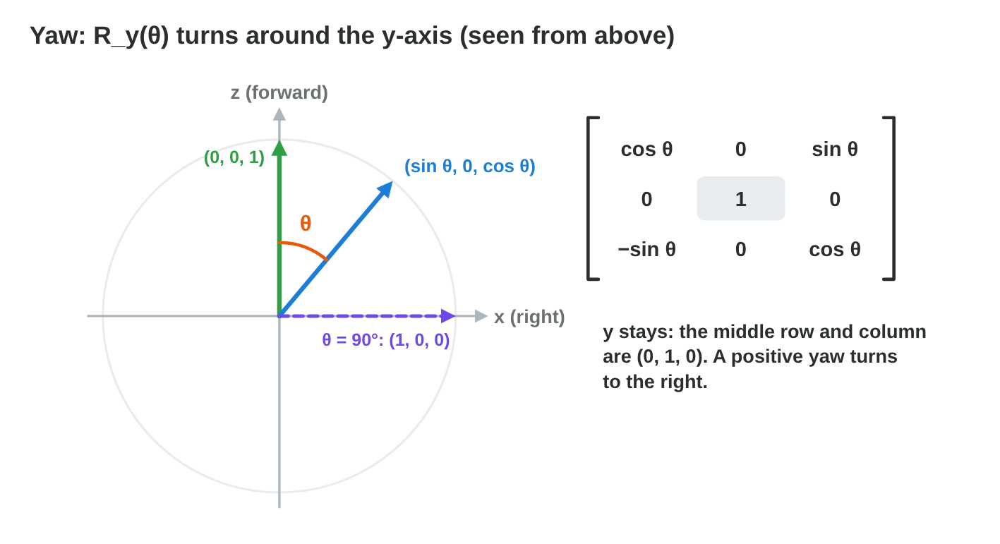

::: {.lead}
A game engine wants **one** kind of tool for every move, scale and turn, so
that it can join them into a single matrix and use it for every vertex of a
model. In Lecture 9 the move was an addition, while the scale and the turn
were matrices. The trick is one more coordinate: the point (x, y) becomes
(x, y, 1). In this lesson you build the **translation matrix**, you join a
scale, a turn and a move into one matrix M = T × R × S, and you do the same
in 3D with 4 × 4 matrices, up to the turn of a lighthouse lamp around the
y-axis. Every section ends with a short task.
:::

## Key terms



## 10.1 Why a 2 × 2 matrix cannot move a shape

Every 2 × 2 matrix sends the origin to the origin:
$\begin{bmatrix} a & b \\ c & d \end{bmatrix}\begin{bmatrix} 0 \\ 0 \end{bmatrix} = \begin{bmatrix} 0 \\ 0 \end{bmatrix}$.
So a 2 × 2 matrix can scale and turn a shape around the origin, but it can
never move it (@fig-homog). In Lecture 9 we moved shapes with an addition
instead. To make the move a matrix too, we add one coordinate.

::: {.callout-important title="Definition 10.1 — Homogeneous coordinates"}
In **homogeneous coordinates**, the 2D point (x, y) is written with a third
coordinate w = 1:
$$(x,\ y) \;\longrightarrow\; (x,\ y,\ 1).$$
Transformations of 2D points then become 3 × 3 matrices. The last row of
these matrices is always (0, 0, 1), so w stays 1.
:::

{#fig-homog width=96%}

::: {.callout-note title="Example 10.1 — Writing points with w = 1"}
1. The cannon at (2, 1) becomes (2, 1, 1).
2. The origin (0, 0) becomes (0, 0, 1).
3. To read the 2D point again, drop the last 1: (7, 3, 1) is the point
   (7, 3).
:::

::: {.callout-warning title="Common mistake"}
Writing the point (x, y) as (x, y, 0). With w = 0 the move is lost: a point
needs w = 1.
:::

::: {.callout-note title="Do it · Add the third coordinate"}
1. Write the points (4, −2), (0, 3) and (0, 0) in homogeneous coordinates.
2. Multiply any 2 × 2 matrix you like by (0, 0). What do you always get?

*Your result:* three points with three coordinates, and one sentence.

::: {.check}
(4, −2, 1), (0, 3, 1) and (0, 0, 1). Any 2 × 2 matrix times (0, 0) gives
(0, 0): the origin never moves, so a 2 × 2 matrix cannot translate.
:::
:::

## 10.2 The translation matrix

With the third coordinate, the move goes into the last column of a 3 × 3
matrix. The 1 of the point picks it up (@fig-tmat).

::: {.callout-important title="Definition 10.2 — Translation matrix"}
The **translation matrix** that moves every point by (tx, ty) is
$$T(t_x, t_y) = \begin{bmatrix} 1 & 0 & t_x \\ 0 & 1 & t_y \\ 0 & 0 & 1 \end{bmatrix}, \qquad T\begin{bmatrix} x \\ y \\ 1 \end{bmatrix} = \begin{bmatrix} x + t_x \\ y + t_y \\ 1 \end{bmatrix}.$$
It is undone by $T(-t_x, -t_y)$.
:::

{#fig-tmat width=96%}

::: {.callout-note title="Example 10.2 — A move by (5, 2)"}
T(5, 2) × (2, 1, 1):

1. Row 1: 1 × 2 + 0 × 1 + 5 × 1 = **7**.
2. Row 2: 0 × 2 + 1 × 1 + 2 × 1 = **3**.
3. Row 3: 0 + 0 + 1 = **1**. The point is (7, 3), as with the addition of
   Lecture 9.
:::

::: {.callout-warning title="Common mistake"}
Putting tx and ty in the last **row**. The last row stays (0, 0, 1); the
move goes into the last **column**.
:::

::: {.callout-note title="Do it · Build T(−3, 4)"}
1. Write T(−3, 4).
2. Multiply it by (5, 1, 1). Check the answer with an addition.

*Your result:* one matrix and one point.

::: {.check}
T(−3, 4) = rows (1, 0, −3), (0, 1, 4), (0, 0, 1). T(−3, 4) × (5, 1, 1) =
(2, 5, 1). Check: 5 − 3 = 2 and 1 + 4 = 5.
:::
:::

## 10.3 Scale, turn and move in one matrix

The scale and the turn of Lecture 9 also become 3 × 3 matrices: the
2 × 2 matrix goes into the top-left corner, and the rest is like the
identity (@fig-sr3).

::: {.callout-important title="Definition 10.3 — Scaling and rotation in 3 × 3"}
$$S(s_x, s_y) = \begin{bmatrix} s_x & 0 & 0 \\ 0 & s_y & 0 \\ 0 & 0 & 1 \end{bmatrix}, \qquad R(\theta) = \begin{bmatrix} \cos\theta & -\sin\theta & 0 \\ \sin\theta & \cos\theta & 0 \\ 0 & 0 & 1 \end{bmatrix}.$$
The last column (0, 0, 1) means: no move. They scale and turn around the
origin.
:::

{#fig-sr3 width=96%}

::: {.callout-warning title="Common mistake"}
Writing a 0 in the bottom-right corner. Then w becomes 0 and the point turns
into a direction. The corner is always 1.
:::

### One matrix for the whole move: M = T × R × S

A game object has a scale, a turn and a position. The engine joins them
into one matrix, multiplies it once, and then uses it for every vertex
(@fig-trs).

::: {.callout-important title="Definition 10.4 — The TRS matrix"}
The **TRS matrix** of an object is
$$M = T \times R \times S.$$
Read it from right to left: first **S** (scale), then **R** (rotate), then
**T** (translate). For every vertex, $M \times (x, y, 1)$ gives the same
point as the three steps one after the other.
:::

{#fig-trs width=96%}

::: {.callout-note title="Example 10.3 — Building M"}
S(2), R(90°), T(5, 1).

1. R × S = rows (0, −1, 0), (1, 0, 0), (0, 0, 1) times S(2) = rows
   (0, −2, 0), (2, 0, 0), (0, 0, 1).
2. T × (R × S) adds the move to the last column: **M = rows (0, −2, 5),
   (2, 0, 1), (0, 0, 1)**.
3. The point (1, 0, 1): row 1 gives 0 + 0 + 5 = 5; row 2 gives 2 + 0 + 1 = 3.
   It goes to **(5, 3)**.
:::

::: {.callout-note title="Example 10.4 — Check with three steps"}
The point (1, 0) step by step:

1. S(2): (2, 0).
2. R(90°): (0, 2).
3. T(5, 1): (5, 3). The same point as with M.
:::

::: {.callout-warning title="Common mistake"}
Changing the order. T × R turns first and then moves; R × T moves first and
then turns the moved point around the origin. For (1, 0) with T(2, 0) and
R(90°): T × R gives (2, 1), but R × T gives (0, 3).
:::



::: {.callout-note title="Do it · Build M in Matrix Chain"}
1. In **Matrix Chain**, set scale 2, θ = 90°, tx = 5, ty = 1. Compare M with
   Example 10.3.
2. Set θ = 180° and read M again. Where does the nose (2, 0.3) go?

*Your result:* two matrices and one point.

::: {.check}
θ = 90°: M = rows (0, −2, 5), (2, 0, 1), (0, 0, 1), as in Example 10.3.
θ = 180°: M = rows (−2, 0, 5), (0, −2, 1), (0, 0, 1); the nose (2, 0.3) goes to
(−4 + 5, −0.6 + 1) = (1, 0.4).
:::
:::

## 10.4 Move and scale in 3D: 4 × 4 matrices

In 3D, a point has three coordinates. As in 2D, we add w = 1: the
point (x, y, z) becomes (x, y, z, 1), and a transformation is a 4 × 4 matrix
(@fig-t4).

::: {.callout-important title="Definition 10.5 — Translation in 3D"}
The **translation matrix** that moves every point by (tx, ty, tz) is
$$T(t_x, t_y, t_z) = \begin{bmatrix} 1 & 0 & 0 & t_x \\ 0 & 1 & 0 & t_y \\ 0 & 0 & 1 & t_z \\ 0 & 0 & 0 & 1 \end{bmatrix}.$$
The move is in the last column; the last row is (0, 0, 0, 1). A direction,
such as the way a cannon fires, gets w = 0: the move is multiplied by 0, so
a direction is not moved.
:::

{#fig-t4 width=96%}

::: {.callout-note title="Example 10.5 — Moving a crate"}
A crate stands at (1, 0, 2). It slides by (3, 0, 4).

1. Row 1: 1 + 0 + 0 + 3 × 1 = **4**.
2. Row 2: 0 + 0 + 0 + 0 = **0**. Row 3: 2 + 4 = **6**.
3. The crate is at (4, 0, 6). T(−3, 0, −4) brings it back.
:::

::: {.callout-warning title="Common mistake"}
Forgetting the fourth coordinate. A 4 × 4 matrix cannot multiply (x, y, z):
write (x, y, z, 1) for a point and (x, y, z, 0) for a direction.
:::

### Scaling in 3D

A pillar in a temple is a cube made 4 units tall. A 3D scaling has one
factor for each axis (@fig-s3).

::: {.callout-important title="Definition 10.6 — Scaling in 3D"}
$$S(s_x, s_y, s_z) = \begin{bmatrix} s_x & 0 & 0 & 0 \\ 0 & s_y & 0 & 0 \\ 0 & 0 & s_z & 0 \\ 0 & 0 & 0 & 1 \end{bmatrix}.$$
It multiplies x by sx, y by sy and z by sz, around the origin (the pivot of
the object). With sx = sy = sz it is a uniform scaling.
:::

{#fig-s3 width=96%}

::: {.callout-note title="Example 10.6 — A tall box"}
The corner (1, 1, 1) of the unit cube with S(2, 3, 1):

1. x: 2 × 1 = 2. y: 3 × 1 = 3. z: 1 × 1 = 1.
2. The corner goes to **(2, 3, 1)**: the box is 2 wide, 3 tall, 1 deep.
:::

::: {.callout-warning title="Common mistake"}
Thinking that "scale 2" doubles the volume. A uniform scale of 2 doubles
every side, so the volume grows 2 × 2 × 2 = 8 times.
:::

::: {.callout-note title="Do it · A pillar"}
1. Which scaling turns the unit cube into a pillar 1 wide, 4 tall and 1
   deep? Where does the corner (1, 1, 1) go?
2. Then move the pillar with T(1, 2, 3): where does the point (4, 0, 0, 1)
   go, and where does the direction (4, 0, 0, 0) go?

*Your result:* one matrix and three points.

::: {.check}
S(1, 4, 1): (1, 1, 1) → (1, 4, 1). T(1, 2, 3) × (4, 0, 0, 1) = (5, 2, 3, 1); the
direction (4, 0, 0, 0) stays (4, 0, 0, 0): w = 0 ignores the move.
:::
:::

## 10.5 Yaw: turning around the y-axis

In 3D, a rotation turns around an **axis**. The lighthouse lamp and the tank
turn around the upright y-axis; this turn is the **yaw**. The y coordinate
stays the same; x and z mix like x and y did in 2D (@fig-yaw).

::: {.callout-important title="Definition 10.7 — Rotation around the y-axis"}
$$R_y(\theta) = \begin{bmatrix} \cos\theta & 0 & \sin\theta \\ 0 & 1 & 0 \\ -\sin\theta & 0 & \cos\theta \end{bmatrix}.$$
In 4 × 4 form, add the last row and column (0, 0, 0, 1). The forward vector (0, 0, 1) goes to **(sin θ, 0, cos θ)**. In Unity (y up,
z forward), a positive yaw turns to the right, seen from above.
:::

{#fig-yaw width=96%}

::: {.callout-note title="Example 10.7 — The beam at 90°"}
The lamp of the lighthouse looks forward, along (0, 0, 1). It turns by 90°:
cos 90° = 0, sin 90° = 1.

1. Row 1: 0 × 0 + 0 × 0 + 1 × 1 = **1**.
2. Row 2: 0. Row 3: −1 × 0 + 0 + 0 × 1 = **0**.
3. The beam points along (1, 0, 0): to the right.
:::



::: {.callout-warning title="Common mistake"}
Using the 2D matrix with sin θ in row 1 as −sin θ. Around the y-axis, the
minus sign is in **row 3**: R_y(90°) must send (0, 0, 1) to (1, 0, 0).
:::

::: {.callout-note title="Do it · Yaw by hand, check in Yaw Lab"}
1. Compute R_y(180°) × (0, 0, 1) and R_y(−90°) × (0, 0, 1).
2. In **Yaw Lab**, set θ = 180° and θ = −90°, and compare with the forward
   vector shown.

*Your result:* two vectors from paper and the same two from the lab.

::: {.check}
R_y(180°) × (0, 0, 1) = (0, 0, −1): backwards. R_y(−90°) × (0, 0, 1) =
(sin(−90°), 0, cos(−90°)) = (−1, 0, 0): to the left. Yaw Lab shows the same
forward vectors.
:::
:::

## Case study: Lighthouse

*Lighthouse* is a made-up night game. The lighthouse stands at the origin;
its lamp turns around the y-axis, and at the yaw θ the beam points along
R_y(θ) × (0, 0, 1) = (sin θ, 0, cos θ). Ships wait 10 units away: at
(10, 0, 0), at (0, 0, −10), at (5, 0, 8.7) and at (−7.1, 0, 7.1). The player
must choose the yaw for each ship, and then the turn from 90° to a ship at
(−10, 0, 0). The Game challenge of the interactive lesson uses these
numbers. In the mini-game below you turn the lamp.



## Further reading

Dunn and Parberry, *3D Math Primer for Graphics and Game Development*,
2nd ed., Chapter 6 (homogeneous coordinates and 4 × 4 matrices) and
Chapter 5 (rotation and scaling in 3D).

## Exercises

1. Write the point (3, −2) in homogeneous coordinates.
2. Write the translation matrix T(4, −1).
3. Compute T(4, −1) × (2, 5, 1).
4. Which matrix undoes T(4, −1)?
5. Write S(3) (uniform scaling by 3) as a 3 × 3 matrix.
6. M = T(5, 1) × R(90°) × S(2) has the rows (0, −2, 5), (2, 0, 1), (0, 0, 1).
   Where does the point (0, 1) go?
7. Apply T(2, 0) × R(90°) and R(90°) × T(2, 0) to the point (1, 0). Are the
   results the same?
8. Compute T(1, 2, 3) × (4, 0, 0, 1).
9. Apply S(2, 2, 2) to the point (1, −1, 3).
10. Write R_y(90°) as a 3 × 3 matrix.
11. Compute R_y(180°) × (3, 2, 1).
12. A player has a yaw of 30° (sin 30° = 0.5, cos 30° = 0.87). What is the
    forward vector?

## Answers to the exercises

::: {.answers}
1. (3, −2, 1).
2. Rows (1, 0, 4), (0, 1, −1), (0, 0, 1).
3. (2 + 4, 5 − 1, 1) = (6, 4, 1).
4. T(−4, 1).
5. Rows (3, 0, 0), (0, 3, 0), (0, 0, 1).
6. (0 × 0 − 2 × 1 + 5, 2 × 0 + 0 × 1 + 1) = (3, 1).
7. T × R: (0, 1) then (2, 1). R × T: (3, 0) then (0, 3). No, the order matters.
8. (5, 2, 3, 1).
9. (2, −2, 6).
10. Rows (0, 0, 1), (0, 1, 0), (−1, 0, 0).
11. cos 180° = −1, sin 180° = 0: (−3, 2, −1).
12. (sin 30°, 0, cos 30°) = (0.5, 0, 0.87).
:::
