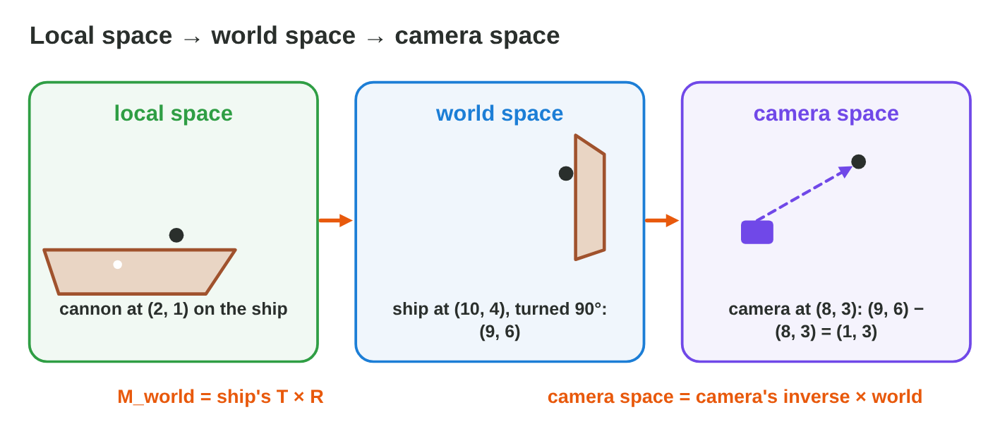

::: {.lead}
In the pirate game *Cannon Cove*, a ship sails into the harbour and turns.
The cannon on its deck must move and turn with the ship, and the camera must
show both. In lectures 11 and 12 you moved, scaled and turned shapes, but
the move was an addition and the scale and turn were matrices. A game
engine wants **one** kind of tool for all three, so that it can join them
into a single matrix. The trick is a third coordinate: the point (x, y)
becomes (x, y, 1). In this lesson you build the **translation matrix**, you
join a scale, a turn and a move into one matrix M = T × R × S, you see why a
direction gets a 0 instead of a 1, and you follow a point from the ship to
the world to the camera. Every section ends with a short task.
:::

## Key terms



## 13.1 Why a 2 × 2 matrix cannot move a shape

Every 2 × 2 matrix sends the origin to the origin:
$\begin{bmatrix} a & b \\ c & d \end{bmatrix}\begin{bmatrix} 0 \\ 0 \end{bmatrix} = \begin{bmatrix} 0 \\ 0 \end{bmatrix}$.
So a 2 × 2 matrix can scale and turn a shape around the origin, but it can
never move it (@fig-homog). In lecture 11 we moved shapes with an addition
instead. To make the move a matrix too, we add one coordinate.

::: {.callout-important title="Definition 13.1 — Homogeneous coordinates"}
In **homogeneous coordinates**, the 2D point (x, y) is written with a third
coordinate w = 1:
$$(x,\ y) \;\longrightarrow\; (x,\ y,\ 1).$$
Transformations of 2D points then become 3 × 3 matrices. The last row of
these matrices is always (0, 0, 1), so w stays 1.
:::

{#fig-homog width=96%}

::: {.callout-note title="Example 13.1 — Writing points with w = 1"}
1. The cannon at (2, 1) becomes (2, 1, 1).
2. The origin (0, 0) becomes (0, 0, 1).
3. To read the 2D point again, drop the last 1: (7, 3, 1) is the point
   (7, 3).
:::

::: {.callout-warning title="Common mistake"}
Writing the point (x, y) as (x, y, 0). With w = 0 the move is lost (section
13.5): a point needs w = 1.
:::

::: {.callout-note title="Do it · Add the third coordinate"}
1. Write the points (4, −2), (0, 3) and (0, 0) in homogeneous coordinates.
2. Multiply any 2 × 2 matrix you like by (0, 0). What do you always get?

*Your result:* three points with three coordinates, and one sentence.
:::

## 13.2 The translation matrix

With the third coordinate, the move goes into the last column of a 3 × 3
matrix. The 1 of the point picks it up (@fig-tmat).

::: {.callout-important title="Definition 13.2 — Translation matrix"}
The **translation matrix** that moves every point by (tx, ty) is
$$T(t_x, t_y) = \begin{bmatrix} 1 & 0 & t_x \\ 0 & 1 & t_y \\ 0 & 0 & 1 \end{bmatrix}, \qquad T\begin{bmatrix} x \\ y \\ 1 \end{bmatrix} = \begin{bmatrix} x + t_x \\ y + t_y \\ 1 \end{bmatrix}.$$
It is undone by $T(-t_x, -t_y)$.
:::

{#fig-tmat width=96%}

::: {.callout-note title="Example 13.2 — A move by (5, 2)"}
T(5, 2) × (2, 1, 1):

1. Row 1: 1 × 2 + 0 × 1 + 5 × 1 = **7**.
2. Row 2: 0 × 2 + 1 × 1 + 2 × 1 = **3**.
3. Row 3: 0 + 0 + 1 = **1**. The point is (7, 3), as with the addition of
   lecture 11.
:::

::: {.callout-note title="Example 13.3 — Moving back"}
The ship moved by T(10, 4). To move it back, use T(−10, −4). Check with the
point (12, 5): 12 − 10 = 2 and 5 − 4 = 1, so (2, 1, 1). Like every inverse
(lecture 10), T(10, 4) × T(−10, −4) = I.
:::

::: {.callout-warning title="Common mistake"}
Putting tx and ty in the last **row**. The last row stays (0, 0, 1); the
move goes into the last **column**.
:::

::: {.callout-note title="Do it · Build T(−3, 4)"}
1. Write T(−3, 4).
2. Multiply it by (5, 1, 1). Check the answer with an addition.

*Your result:* one matrix and one point.
:::

## 13.3 Scaling and rotation as 3 × 3 matrices

The scale and the turn of lectures 11 and 12 also become 3 × 3 matrices: the
2 × 2 matrix goes into the top-left corner, and the rest is like the
identity (@fig-sr3).

::: {.callout-important title="Definition 13.3 — Scaling and rotation in 3 × 3"}
$$S(s_x, s_y) = \begin{bmatrix} s_x & 0 & 0 \\ 0 & s_y & 0 \\ 0 & 0 & 1 \end{bmatrix}, \qquad R(\theta) = \begin{bmatrix} \cos\theta & -\sin\theta & 0 \\ \sin\theta & \cos\theta & 0 \\ 0 & 0 & 1 \end{bmatrix}.$$
The last column (0, 0, 1) means: no move. They scale and turn around the
origin.
:::

{#fig-sr3 width=96%}

::: {.callout-note title="Example 13.4 — R(90°) in 3 × 3"}
R(90°) = rows (0, −1, 0), (1, 0, 0), (0, 0, 1). Multiply by the cannon
(2, 1, 1):

1. Row 1: 0 × 2 + (−1) × 1 + 0 = **−1**.
2. Row 2: 1 × 2 + 0 × 1 + 0 = **2**.
3. The cannon turns to (−1, 2, 1), as in lecture 12.
:::

::: {.callout-warning title="Common mistake"}
Writing a 0 in the bottom-right corner. Then w becomes 0 and the point turns
into a direction. The corner is always 1.
:::

::: {.callout-note title="Do it · Two 3 × 3 matrices"}
1. Write S(3, 1) and R(180°) as 3 × 3 matrices.
2. Multiply each by (1, 2, 1).

*Your result:* two matrices and two points.
:::

## 13.4 One matrix for the whole move: M = T × R × S

A game object has a scale, a turn and a position. The engine joins them
into one matrix, multiplies it once, and then uses it for every vertex
(@fig-trs).

::: {.callout-important title="Definition 13.4 — The TRS matrix"}
The **TRS matrix** of an object is
$$M = T \times R \times S.$$
Read it from right to left: first **S** (scale), then **R** (rotate), then
**T** (translate). For every vertex, $M \times (x, y, 1)$ gives the same
point as the three steps one after the other.
:::

{#fig-trs width=96%}

::: {.callout-note title="Example 13.5 — Building M"}
S(2), R(90°), T(5, 1).

1. R × S = rows (0, −1, 0), (1, 0, 0), (0, 0, 1) times S(2) = rows
   (0, −2, 0), (2, 0, 0), (0, 0, 1).
2. T × (R × S) adds the move to the last column: **M = rows (0, −2, 5),
   (2, 0, 1), (0, 0, 1)**.
3. The point (1, 0, 1): row 1 gives 0 + 0 + 5 = 5; row 2 gives 2 + 0 + 1 = 3.
   It goes to **(5, 3)**.
:::

::: {.callout-note title="Example 13.6 — Check with three steps"}
The point (1, 0) step by step:

1. S(2): (2, 0).
2. R(90°): (0, 2).
3. T(5, 1): (5, 3). The same point as with M.
:::

::: {.callout-warning title="Common mistake"}
Changing the order. T × R turns first and then moves; R × T moves first and
then turns the moved point around the origin. For (1, 0) with T(2, 0) and
R(90°): T × R gives (2, 1), but R × T gives (0, 3).
:::



::: {.callout-note title="Do it · Build M in Matrix Chain"}
1. In **Matrix Chain**, set scale 2, θ = 90°, tx = 5, ty = 1. Compare M with
   Example 13.5.
2. Set θ = 180° and read M again. Where does the nose (2, 0.3) go?

*Your result:* two matrices and one point.
:::

## 13.5 Points and directions: w = 1 and w = 0

The cannon on the ship is a **point**: when the ship moves, it moves too.
The way the cannon fires is a **direction**: when the ship moves, the
direction must not change; it only turns with the ship (@fig-pd).

::: {.callout-important title="Definition 13.5 — Points and directions"}
A **point** has w = 1: $(x, y, 1)$. The last column of M (the move) is added.
A **direction** has w = 0: $(x, y, 0)$. The move is multiplied by 0, so only
the scale and the turn act on it.
:::

{#fig-pd width=96%}

::: {.callout-note title="Example 13.7 — The cannon fires"}
M = T(5, 1) × R(90°) = rows (0, −1, 5), (1, 0, 1), (0, 0, 1).

1. The point (1, 1, 1): (0 − 1 + 5, 1 + 0 + 1) = **(4, 2)**.
2. The direction (2, 0, 0): (0 + 0 + 0, 2 + 0 + 0) = **(0, 2)**. The 5 and the
   1 are multiplied by 0.
3. The cannon now fires straight up, from (4, 2).
:::

::: {.callout-caution title="In game code"}
```csharp
Matrix4x4 m = Matrix4x4.TRS(new Vector3(5, 1, 0),
                            Quaternion.Euler(0, 0, 90), Vector3.one);
Vector3 p = m.MultiplyPoint3x4(new Vector3(1, 1, 0));  // (4, 2, 0): w = 1
Vector3 d = m.MultiplyVector(new Vector3(2, 0, 0));    // (0, 2, 0): w = 0
```
Unity keeps every transform as a 4 × 4 matrix (lecture 14), even in 2D.
`MultiplyPoint3x4` uses w = 1, `MultiplyVector` uses w = 0.
:::

::: {.callout-warning title="Common mistake"}
Moving a velocity or a direction with the position. A bullet direction
(1, 0) "moved" by (5, 1) becomes (6, 1): the bullet now flies the wrong
way. Use w = 0 for directions.
:::

::: {.callout-note title="Do it · Point or direction?"}
M = T(5, 1) × R(90°).

1. Apply M to the point (2, 0, 1) and to the direction (2, 0, 0).
2. Which one moved, and which one only turned?

*Your result:* two results and one sentence.
:::

## 13.6 Local, world and camera space

The cannon is built on the ship: it sits at (2, 1) **on the ship**,
whatever the ship does. The game needs it in the world, and then as the
camera sees it (@fig-spaces).

::: {.callout-important title="Definition 13.6 — Three spaces"}
- **Local space** (object space): the coordinates of the object, measured
  from its own pivot.
- **World space**: the coordinates of the whole level. The object's matrix
  M (its TRS matrix) takes local to world.
- **Camera space**: the coordinates measured from the camera. The inverse of
  the camera's matrix takes world to camera space.
:::

{#fig-spaces width=96%}

::: {.callout-note title="Example 13.8 — From the ship to the camera"}
The ship stands at (10, 4) and is turned by 90°. The camera stands at (8, 3)
and is not turned.

1. Local → world: R(90°) × (2, 1) = (−1, 2); + (10, 4) = **(9, 6)**. The
   ship's matrix is rows (0, −1, 10), (1, 0, 4), (0, 0, 1).
2. World → camera: the inverse of T(8, 3) is T(−8, −3). (9, 6) − (8, 3) =
   **(1, 3)**.
3. The cannon is 1 unit right of the camera and 3 units above it.
:::

::: {.callout-caution title="In game code"}
```csharp
Vector3 world = ship.transform.TransformPoint(new Vector3(2, 1, 0));   // local → world
Vector3 aim   = ship.transform.TransformDirection(Vector3.right);      // a direction, w = 0
Vector3 local = ship.transform.InverseTransformPoint(world);           // world → local
```
:::

::: {.callout-warning title="Common mistake"}
Adding the camera position instead of subtracting it. Camera space measures
**from** the camera: world point minus camera position (for a camera that
is not turned).
:::

::: {.callout-note title="Do it · Three spaces"}
A ship stands at (6, 3), not turned. A flag is at (1, 2) on the ship. The
camera stands at (5, 0).

1. Where is the flag in the world?
2. Where is it in camera space?

*Your result:* two points.
:::

## Case study: Cannon Cove

*Cannon Cove* is a made-up pirate game. The cannon sits at (2, 1) in the
ship's local space. The ship enters the harbour at (10, 4), first not
turned and then turned by 90°. The camera stands at (8, 3). The player must
find the cannon in the world, pick the ship's 3 × 3 matrix, find the cannon
in camera space and say which way the cannon fires. The Game challenge of
the interactive lesson uses these numbers. In the mini-game below you play
it.



## Further reading

Dunn and Parberry, *3D Math Primer for Graphics and Game Development*,
2nd ed., Chapter 6 (homogeneous coordinates and 4 × 4 matrices) and
Chapter 3 (object, world and camera space).

## Exercises

1. Write the point (3, −2) in homogeneous coordinates.
2. Write the translation matrix T(4, −1).
3. Compute T(4, −1) × (2, 5, 1).
4. Which matrix undoes T(4, −1)?
5. Write S(3) (uniform scaling by 3) as a 3 × 3 matrix.
6. Write R(180°) as a 3 × 3 matrix.
7. M = T(5, 1) × R(90°) × S(2) has the rows (0, −2, 5), (2, 0, 1), (0, 0, 1).
   Where does the point (0, 1) go?
8. Apply T(2, 0) × R(90°) and R(90°) × T(2, 0) to the point (1, 0). Are the
   results the same?
9. M = T(5, 1) × R(90°). Apply it to the direction (0, 3, 0).
10. Why does a direction have w = 0?
11. A ship stands at (6, 3), not turned. A cannon is at (1, 2) on the ship.
    Where is it in the world?
12. The same ship is turned by 90°. Where is the cannon now?
13. The camera stands at (3, 3) and is not turned. Where is the world point
    (4, 4) in camera space?
14. Which Unity method takes a point from local space to world space?

## Answers to the exercises

::: {.answers}
1. (3, −2, 1).
2. Rows (1, 0, 4), (0, 1, −1), (0, 0, 1).
3. (2 + 4, 5 − 1, 1) = (6, 4, 1).
4. T(−4, 1).
5. Rows (3, 0, 0), (0, 3, 0), (0, 0, 1).
6. Rows (−1, 0, 0), (0, −1, 0), (0, 0, 1).
7. (0 × 0 − 2 × 1 + 5, 2 × 0 + 0 × 1 + 1) = (3, 1).
8. T × R: (0, 1) then (2, 1). R × T: (3, 0) then (0, 3). No, the order matters.
9. R(90°) × (0, 3) = (−3, 0); the move is ignored: (−3, 0, 0).
10. Because a direction must not move with the object; w = 0 multiplies the
    move by 0.
11. (7, 5).
12. R(90°) × (1, 2) = (−2, 1); + (6, 3) = (4, 4).
13. (4, 4) − (3, 3) = (1, 1).
14. `transform.TransformPoint` (or `MultiplyPoint3x4` with the object's
    matrix).
:::
