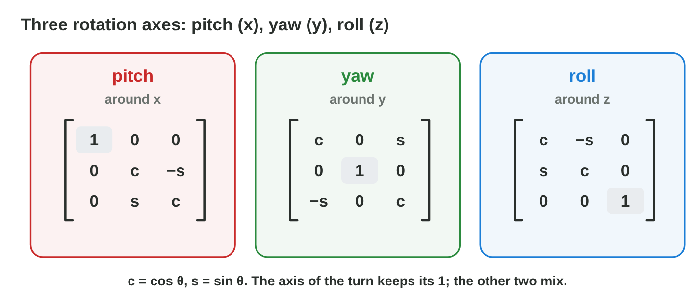

This page is the interactive version of the lesson notes (PDF). Each section
starts with a problem in a game. Then it explains the idea behind it. It ends
with a **Do it** task and one set of questions. The full explanations,
examples and exercises are in the notes.

## Key terms



## 14.1 From 3 × 3 to 4 × 4: translation in 3D

- A 3D point becomes **(x, y, z, 1)**; a direction is (x, y, z, 0).
- **T(tx, ty, tz)**: the 4 × 4 identity with (tx, ty, tz) in the last
  column.
- The crate (1, 0, 2) with T(3, 0, 4): (4, 0, 6). T(−3, 0, −4) moves it
  back.

{width=92%}

::: {.callout-warning title="Watch out!"}
A 4 × 4 matrix needs four coordinates: w = 1 for a point, w = 0 for a
direction.
:::

::: {.callout-note title="Do it · Build T(1, 2, 3)"}
Write T(1, 2, 3). Multiply it by the point (4, 0, 0, 1) and by the
direction (4, 0, 0, 0).
:::

::: {.callout-tip title="Try it 1 · Translation in 3D"}
Choose the right answer.

::: {.match extra="(4, 0, 0, 1)|(1, 2, 3, 0)"}
What is T(1, 2, 3) × (4, 0, 0, 1)?
:   (5, 2, 3, 1)

What is T(1, 2, 3) × (4, 0, 0, 0)?
:   (4, 0, 0, 0)

Which matrix undoes T(1, 2, 3)?
:   T(−1, −2, −3)

How do you write the point (2, 5, −1) for a 4 × 4 matrix?
:   (2, 5, −1, 1)
:::
:::

## 14.2 Scaling in 3D

- **S(sx, sy, sz)**: sx, sy, sz on the main diagonal, then 1.
- S(2, 3, 1) × (1, 1, 1) = (2, 3, 1): the box is 2 wide, 3 tall, 1 deep.
- A uniform scale of 2 doubles each side, so the volume is 8 times bigger.

{width=92%}

::: {.callout-warning title="Watch out!"}
Scale 2 in all three axes makes the volume 8 times bigger, not 2 times.
:::

::: {.callout-note title="Do it · A pillar"}
Which scaling turns the unit cube into a pillar 1 wide, 4 tall and 1 deep?
Where does the corner (1, 1, 1) go?
:::

::: {.callout-tip title="Try it 2 · Scaling in 3D"}
Choose the right answer.

::: {.match extra="(3, 1, 6)|2 times"}
What is S(2, 2, 2) × (1, −1, 3)?
:   (2, −2, 6)

Which scaling makes a pillar 1 wide, 4 tall, 1 deep?
:   S(1, 4, 1)

A cube gets a uniform scale of 2. How much bigger is its volume?
:   8 times

Where does S(2, 3, 1) send (1, 1, 1)?
:   (2, 3, 1)
:::
:::

## 14.3 Yaw: turning around the y-axis

- **R_y(θ) = rows (cos θ, 0, sin θ), (0, 1, 0), (−sin θ, 0, cos θ)**. y
  stays.
- Forward (0, 0, 1) goes to **(sin θ, 0, cos θ)**. A positive yaw turns to
  the right (seen from above).
- 90°: forward → (1, 0, 0). The right side (2, 0, 0) → (0, 0, −2).
- Unity: `Quaternion.Euler(0, 30, 0)`; `transform.forward` = (0.5, 0, 0.87).

{width=92%}



::: {.callout-warning title="Watch out!"}
Around y, the minus sign is in row 3. Check: R_y(90°) sends (0, 0, 1) to
(1, 0, 0).
:::

::: {.callout-note title="Do it · Yaw by hand, check in Yaw Lab"}
Compute R_y(180°) × (0, 0, 1) and R_y(−90°) × (0, 0, 1). Then set the same
angles in **Yaw Lab** and compare.
:::

::: {.callout-tip title="Try it 3 · Yaw"}
Choose the right answer.

::: {.match extra="(0, 1, 0)|(1, 0, 1)"}
What is R_y(90°) × (0, 0, 1)?
:   (1, 0, 0)

What is R_y(180°) × (3, 2, 1)?
:   (−3, 2, −1)

What is R_y(90°) × (2, 0, 0)?
:   (0, 0, −2)

A player has a yaw of 30°. What is the forward vector?
:   (0.5, 0, 0.87)

What is R_y(−90°) × (0, 0, 1)?
:   (−1, 0, 0)
:::
:::

## 14.4 Pitch and roll

- **Pitch:** around x, R_x(θ). **Roll:** around z, R_z(θ). **Yaw:** around
  y.
- The axis of the turn keeps its 1; the other two coordinates mix.
- R_x(90°) × (0, 0, 1) = (0, −1, 0): in Unity a positive pitch points the
  nose down. R_z(90°) × (1, 0, 0) = (0, 1, 0).
- `Quaternion.Euler(x, y, z)` turns around z, then x, then y.

{width=92%}

::: {.callout-warning title="Watch out!"}
The order of the turns matters: pitch then yaw is not yaw then pitch.
:::

::: {.callout-note title="Do it · Which axis?"}
A car drives up a ramp: is that pitch, yaw or roll? Compute R_z(180°) ×
(1, 2, 0).
:::

::: {.callout-tip title="Try it 4 · Three axes"}
Choose the right answer.

::: {.match extra="around y|(0, 1, 0)"}
Around which axis is the pitch?
:   around x

Around which axis is the roll?
:   around z

What is R_x(90°) × (0, 0, 1)?
:   (0, −1, 0)

What is R_z(180°) × (1, 2, 0)?
:   (−1, −2, 0)

A car drives up a ramp. Which turn is it?
:   a pitch
:::
:::

## 14.5 The TRS matrix in 3D and the hierarchy

- Every object has M = T × R × S (4 × 4). Unity:
  `Matrix4x4.TRS(position, rotation, scale)`.
- **Hierarchy:** child world matrix = parent world matrix × child local
  matrix.
- Tank (10, 0, 5), yaw 90°; barrel tip (0, 1, 2) in the tank's space:
  R_y(90°) gives (2, 1, 0); + (10, 0, 5) = **(12, 1, 5)**.
- `transform.localPosition` is in the parent's space; `transform.position`
  is in the world.

{width=92%}

::: {.callout-warning title="Watch out!"}
Do not just add the local position: turn it with the parent first.
:::

::: {.callout-note title="Do it · The tank turns back"}
The tank stands at (10, 0, 5) with a yaw of 180°. Where is the barrel tip
(0, 1, 2) in the world? And with the tank at (0, 0, 0), yaw 0?
:::

::: {.callout-tip title="Try it 5 · Parent and child"}
The barrel tip is at (0, 1, 2) in the tank's space. Choose the right answer.

::: {.match extra="(10, 1, 7)|(2, 1, 0)"}
The tank is at (0, 0, 0), yaw 0. Where is the tip in the world?
:   (0, 1, 2)

The tank is at (10, 0, 5), yaw 90°. Where is the tip?
:   (12, 1, 5)

The tank is at (10, 0, 5), yaw 180°. Where is the tip?
:   (10, 1, 3)

How do you get the child's world matrix?
:   parent world matrix × child local matrix
:::
:::

## Game challenge: Lighthouse {.challenge}

Work alone. Use every section of today.

**Lighthouse** is a night game. The lighthouse stands at the origin. At the
yaw θ the beam points along **(sin θ, 0, cos θ)**. Ships wait 10 units away.



::: {.callout-tip title="Try it 6 · Light the ships"}
Choose the yaw for each ship.

::: {.match extra="45°|−180°"}
Which yaw lights a ship at (10, 0, 0)?
:   90°

Which yaw lights a ship at (0, 0, −10)?
:   180°

Which yaw lights a ship at (5, 0, 8.7)?
:   30°

Which yaw lights a ship at (−7.1, 0, 7.1)?
:   −45°
:::
:::

::: {.callout-tip title="Try it 7 · A busy night (harder)"}
Choose the right answer.

::: {.match extra="(5, 0, 8.7)|1°"}
The lamp points at 90°. Which turn reaches a ship at (−10, 0, 0)?
:   180°

The beam is 10 long at a yaw of 60°. Where does it end?
:   (8.7, 0, 5)

The lighthouse stands at (20, 0, 0). Which yaw lights a ship at (30, 0, 0)?
:   90°

The lamp turns at 30° per second at 60 fps. How much does it turn per frame?
:   0.5°
:::
:::

## Summary {.summary}

- In 3D, points are (x, y, z, 1) and transformations are 4 × 4 matrices.
- T(tx, ty, tz) has the move in its last column; S(sx, sy, sz) has the
  factors on the diagonal.
- The yaw R_y(θ) keeps y and sends forward (0, 0, 1) to (sin θ, 0, cos θ).
- Pitch turns around x, roll around z; the order of the turns matters.
- A child's world matrix is its parent's world matrix times its local
  matrix.
