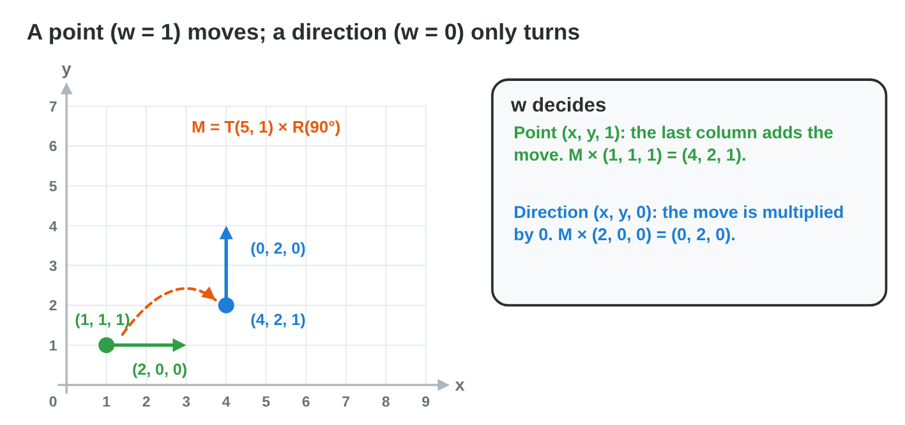
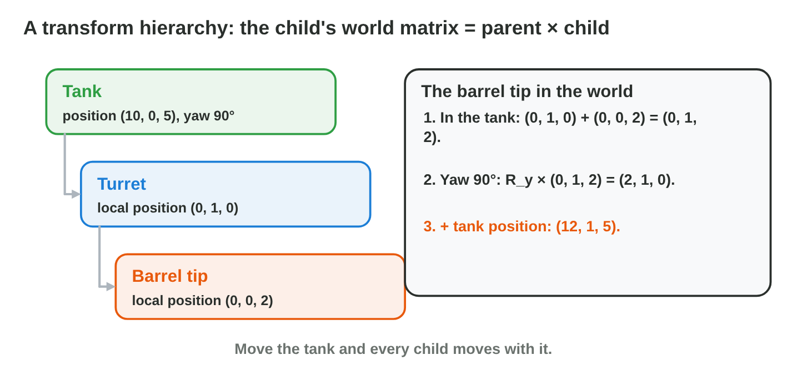

## Recall · Lecture 7

a) What is T(2, 3) × (1, 1, 1)?
b) In M = T × R × S, which matrix acts last?
c) What is R(90°) × (1, 0, 1)?

::: {.answer}
a) (3, 4, 1)
b) T
c) (0, 1, 1)
:::

## Activity 1 · Point or direction? · 15 min

:::: {.columns}
::: {.column width="50%"}
- A point gets w = 1 and moves; a direction gets w = 0 and only turns.
- **Do it:** Apply M = T(5, 1) × R(90°) to the point (2, 0, 1) and to the direction (2, 0, 0). Which one moved?
- Your product is two results and one sentence.
:::
::: {.column width="50%"}

:::
::::

## Check 1 · Point or direction?

What does M do to the point and to the direction?

::: {.reveal}
1. The point (2, 0, 1) goes to (0 − 0 + 5, 2 + 0 + 1) = (5, 3).
2. The direction (2, 0, 0) goes to (0, 2): it only turns.
3. The move is multiplied by w = 0, so a direction never moves.
:::

## Activity 2 · Local, world, camera · 18 min

:::: {.columns}
::: {.column width="50%"}
- A flag sits at (1, 2) on a ship at (6, 3), and the camera stands at (5, 0).
- **Do it:** Find the flag in the world with the ship not turned, then turned by 90°. Where is the turned flag in camera space?
- Your product is two world points and one camera point.
:::
::: {.column width="50%"}

:::
::::

## Live demo · Matrix Chain



## Check 2 · Local, world, camera

Where is the flag in each space?

::: {.reveal}
1. Not turned, the flag is at (1, 2) + (6, 3) = (7, 5) in the world.
2. Turned by 90°: R(90°) × (1, 2) = (−2, 1), plus (6, 3) gives (4, 4).
3. In camera space it is (4, 4) − (5, 0) = (−1, 4), to the left of the camera.
:::

## Activity 3 · The tank turns back · 15 min

:::: {.columns}
::: {.column width="50%"}
- The barrel tip is at (0, 1, 2) in the tank's space, and a yaw of 180° sends (x, y, z) to (−x, y, −z).
- **Do it:** The tank stands at (10, 0, 5) with a yaw of 180°. Where is the barrel tip in the world? Why is adding without the turn wrong?
- Your product is one point and one sentence.
:::
::: {.column width="50%"}

:::
::::

## Check 3 · The tank turns back

Where is the barrel tip of the turned tank?

::: {.reveal}
1. The yaw turns the tip: (0, 1, 2) becomes (0, 1, −2).
2. The move adds the tank's place: (0, 1, −2) + (10, 0, 5) = (10, 1, 3).
3. Adding without the turn gives (10, 1, 7), as if the tank still faced forward.
:::

## Wrap-up

- You can tell a point (w = 1) from a direction (w = 0) and transform both.
- You can take a point from local space to world space and to camera space.
- You can place a child object of a turning parent in 3D.
