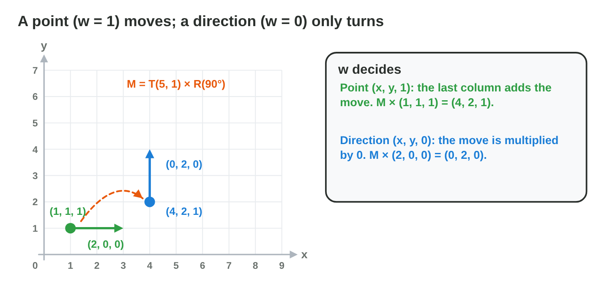
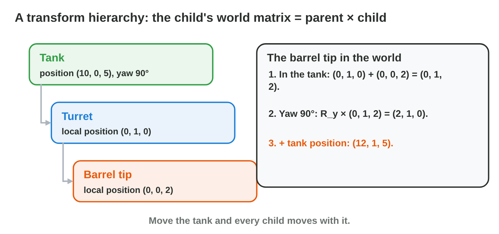

No new ideas today: three short problems on Lecture 7. Do each one alone.
Tap, sort or type your answer at every step: the page checks it at once and
tells you why.

## Recall

- In homogeneous coordinates a 2D point is (x, y, 1); a 3D point is
  (x, y, z, 1).
- T(tx, ty) has the move in its last column. M = T × R × S: scale first,
  then turn, then move.
- The move is multiplied by the last coordinate w.

::: {.callout-tip title="Try it 1 · Recall"}
Choose the right answer.

::: {.match extra="(3, 4, 1)|S"}
What is T(2, 3) × (1, 1, 1)?
:   (3, 4, 1)

    Why: (1 + 2, 1 + 3, 1) = (3, 4, 1).

In M = T × R × S, which acts last?
:   T

    Why: Read from right to left: S, then R, then T.

What is R(90°) × (1, 0, 1)?
:   (0, 1, 1)

    Why: (−y, x) = (0, 1); w stays 1.
:::
:::

## Activity 1 · Points move, directions do not

The cannon on a ship is a **point**: when the ship moves, it moves too. The
way the cannon fires is a **direction**: it turns with the ship but must
not move. So a point gets w = 1 and a direction gets w = 0: the move in
the last column is multiplied by w.

{width=82%}

::: {.callout-note title="Activity 1 · Point or direction? · 15 min"}
M = T(5, 1) × R(90°) = rows (0, −1, 5), (1, 0, 1), (0, 0, 1).

1. Apply M to the point (2, 0, 1) and to the direction (2, 0, 0).
2. Which one moved, and which one only turned?

*Your product:* two results and one sentence.

::: {.fill answer="(5, 3)|(5, 3, 1)" hint="Row 1: 0 × 2 − 1 × 0 + 5 × 1. Row 2: 1 × 2 + 0 + 1 × 1."}
Step 1: what is M × the point (2, 0, 1)? Type (x, y).

Why: (0 − 0 + 5, 2 + 0 + 1) = (5, 3).
:::

::: {.choice}
Steps 1–2: what is M × the direction (2, 0, 0)?

- [x] (0, 2): it only turned

  Why: w = 0, so the 5 and the 1 of the move are multiplied by 0.

- [ ] (5, 3): it moved

  Why: (5, 3) is the point; a direction does not move.

- [ ] (2, 0): nothing happened

  Why: The direction still turns by 90° with the ship.
:::
:::

::: {.callout-tip title="Try it 2 · w = 1 or w = 0"}
M = T(5, 1) × R(90°) = rows (0, −1, 5), (1, 0, 1), (0, 0, 1). Choose the
right answer.

::: {.match extra="(3, 5)|w = 2"}
What is M × the point (1, 1, 1)?
:   (4, 2)

    Why: (0 − 1 + 5, 1 + 0 + 1) = (4, 2).

What is M × the direction (0, 3, 0)?
:   (−3, 0)

    Why: Only R(90°) acts: (−y, x) = (−3, 0).

Which w does a velocity get?
:   w = 0

    Why: A velocity is a direction: it must not move with the object.
:::
:::

## Activity 2 · From the ship to the world and the camera

A flag is built on a ship: it sits at (1, 2) in the ship's **local space**,
measured from the ship's pivot. The ship's matrix M takes local to **world
space**. The camera measures everything **from itself**: for a camera that
is not turned, camera space is the world point minus the camera position.



::: {.callout-note title="Activity 2 · Local, world, camera · 18 min"}
1. The ship stands at (6, 3), not turned. Where is the flag in the world?
2. The ship turns by 90° and stays at (6, 3). Where is the flag now? Check
   it in **Matrix Chain** (scale 1, θ = 90°, tx = 6, ty = 3).
3. The camera stands at (5, 0). Where is the flag of step 2 in camera
   space? Is it to the left or to the right of the camera?

*Your product:* two world points and one camera-space point.

::: {.fill answer="(7, 5)" hint="Not turned: add the ship's position to the local point."}
Step 1: where is the flag (1, 2) in the world? Type (x, y).

Why: (1, 2) + (6, 3) = (7, 5).
:::

::: {.order}
Step 2: put the steps for the turned ship in order.

1. Start in the ship's local space: the flag is at (1, 2).
2. Turn the local point: R(90°) × (1, 2) = (−2, 1).
3. Move with the ship: (−2, 1) + (6, 3) = (4, 4).

Why: In M = T × R the turn acts first, then the move.
:::

::: {.choice}
Step 3: where is the flag (4, 4) in the space of the camera at (5, 0)?

- [x] (−1, 4): to the left of the camera

  Why: (4, 4) − (5, 0) = (−1, 4); x is negative, so left.

- [ ] (9, 4): to the right of the camera

  Why: Camera space subtracts the camera position; it does not add it.

- [ ] (−1, 4): to the right of the camera

  Why: A negative x is to the left.
:::
:::

::: {.callout-tip title="Try it 3 · Local, world, camera"}
The flag is at (1, 2) on the ship. Choose the right answer.

::: {.match extra="(1, 2)|(7, 7)"}
The ship at (6, 3) is turned by 180°. Where is the flag in the world?
:   (5, 1)

    Why: R(180°) × (1, 2) = (−1, −2); + (6, 3) = (5, 1).

The camera stands at (3, 3). Where is the world point (4, 4) in camera space?
:   (1, 1)

    Why: (4, 4) − (3, 3) = (1, 1).

Which matrix takes world to camera space for a camera at (3, 3)?
:   T(−3, −3)

    Why: It is the inverse of the camera's move T(3, 3).
:::
:::

## Activity 3 · Parent and child

In a 3D game a turret sits on a tank: it is a **child** of the tank. A
child's position is in its parent's local space, so when the tank moves or
turns, the turret and its barrel move and turn with it: world (child) =
M (parent) × local (child).

{width=82%}

::: {.callout-note title="Activity 3 · The tank turns back · 15 min"}
The barrel tip is at (0, 1, 2) in the tank's space. A yaw of 180° sends
(x, y, z) to (−x, y, −z).

1. The tank stands at (10, 0, 5) with a yaw of 180°. Where is the barrel
   tip in the world?
2. Why is (10, 0, 5) + (0, 1, 2) wrong?

*Your product:* one point and one sentence.

::: {.choice}
Step 1: where is the barrel tip in the world?

- [x] (10, 1, 3)

  Why: The yaw sends (0, 1, 2) to (0, 1, −2); + (10, 0, 5) = (10, 1, 3).

- [ ] (10, 1, 7)

  Why: That adds without the turn: the tank faces the other way.

- [ ] (−10, 1, −3)

  Why: The yaw turns the local point, not the tank's position.
:::

::: {.choice}
Step 2: why is (10, 0, 5) + (0, 1, 2) wrong?

- [x] It forgets that the tank turned: the barrel now points backwards.

  Why: world (child) = M (parent) × local (child): the turn comes first.

- [ ] The barrel tip is a direction, so it must not move.

  Why: The tip is a point (w = 1): it moves with the tank.

- [ ] The two points must be subtracted.

  Why: The tank's position is added, but only after the turn.
:::
:::

::: {.callout-tip title="Try it 4 · Parent and child"}
The barrel tip is at (0, 1, 2) in the tank's space. Choose the right
answer.

::: {.match extra="(10, 1, 7)|(0, 1, −2)"}
The tank at (4, 0, 0), yaw 0. Where is the tip in the world?
:   (4, 1, 2)

    Why: No turn: (0, 1, 2) + (4, 0, 0).

The tank turns. What happens to the turret?
:   it turns with the tank

    Why: A child moves and turns with its parent.

Which axis does a yaw turn around?
:   the y-axis

    Why: Yaw turns left and right around the up axis.
:::
:::

## At home · Task with AI

::: {.callout-note .ai-task title="Task with AI · A planet and its moon"}
An extra for the curious: let an AI assistant draw it. Copy the prompt
into an AI assistant that the university allows (for example Microsoft
Copilot with your university account), and look at the picture.

::: {.prompt}
Draw a grid from −6 to 6 on both axes, with the sun at (0, 0). A planet is a
child of the sun: it sits at (4, 0) in the sun's space, and the sun's space
turns by 90° anticlockwise every second. A moon is a child of the planet: it
sits at (1, 0) in the planet's space, and the planet's space also turns by
90° anticlockwise every second. Draw the planet in blue and the moon in
grey at t = 0, 1, 2 and 3 seconds, with the time next to each dot, and make
a table of their world positions.
:::

::: {.choice}
What should the picture show? The AI can be wrong: compare.

- [x] Planet (4, 0), (0, 4), (−4, 0), (0, −4); moon (5, 0), (−1, 4), (−3, 0), (−1, −4).

  Why: The moon turns with the sun and with its planet: twice as fast. At t = 2 it is between the planet and the sun.

- [ ] The moon is always 5 units from the sun, just outside its planet.

  Why: The planet's own space turns too, so the moon goes round its planet.
:::

::: {.try-change}
**Change:** stop the planet's own turn (only the sun's space turns), and ask
again.

::: {.choice}
What changes?

- [x] The moon stays outside its planet: (5, 0), (0, 5), (−5, 0), (0, −5).

  Why: It only turns with the sun now, always 5 units from it.

- [ ] The moon stops moving.

  Why: It still turns with the sun's space.
:::
:::

::: {.try-change}
**Change:** put the moon at (2, 0) in the planet's space, and ask again.

::: {.choice}
What changes?

- [x] Every moon dot is 2 units from its planet; the planet does not change.

  Why: Only the child's local position changed: (6, 0), (−2, 4), (−2, 0), (−2, −4).

- [ ] The planet moves farther from the sun.

  Why: The planet's local position (4, 0) is the same.
:::
:::

**Your own idea:** change one more number or word, and look again. The AI
can be wrong: compare its result with the answers.
:::

## Wrap-up {.summary}

- You can tell a point (w = 1) from a direction (w = 0) and transform both.
- You can take a point from local space to world space and to camera space.
- You can place a child object of a turning parent in 3D.
