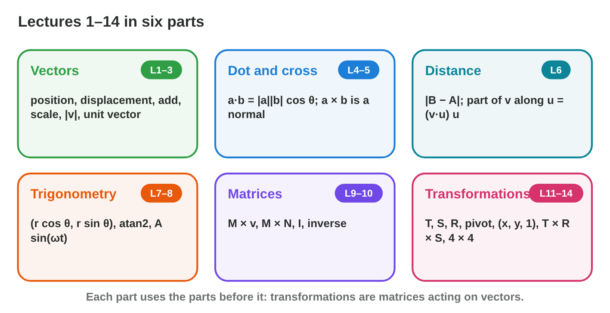

This page is the interactive version of the revision notes (PDF). Each
section repeats the key facts of one part of the course. It ends with a
**Do it** task and one set of questions. The full examples and the
exercises are in the notes.

## Key terms



{width=92%}

## 15.1 Positions and vectors (lectures 1–3)

- Unity: x right, y up, z forward. A **vector** is a step: B − A.
- **Length** |v| = √(x² + y²); **unit vector** v / |v|.
- Velocity = speed × unit direction; per frame: position += velocity × Δt.
- Drone (1, 2) → (7, 10): step (6, 8), length 10, direction (0.6, 0.8).

{width=86%}

::: {.callout-warning title="Watch out!"}
|(6, 8)| is 10, not 6 + 8 = 14.
:::

::: {.callout-note title="Do it · Vectors"}
A ship sails from (−2, 3) to (4, −5). Find the step, its length and the unit
direction. How long does the trip take at 2 units per second?
:::

::: {.callout-tip title="Try it 1 · Vectors"}
Choose the right answer.

::: {.match extra="14|(6, −8, 1)"}
What is the step from (−2, 3) to (4, −5)?
:   (6, −8)

How long is (6, −8)?
:   10

What is the unit direction of (6, −8)?
:   (0.6, −0.8)

A trip of 10 units at 2 units per second takes how long?
:   5 seconds

Normalize (0, −4).
:   (0, −1)
:::
:::

## 15.2 The dot and the cross product (lectures 4–5)

- **a · b** = ax bx + ay by = |a| |b| cos θ. Positive: in front; 0:
  perpendicular; negative: behind.
- cos θ = (a · b) / (|a| |b|).
- **a × b** (3D) is perpendicular to both: the normal. x × y = z.
- Guard f = (1, 0), player d = (3, 4): f · d = 3, cos θ = 0.6, θ ≈ 53°.

{width=86%}



::: {.callout-warning title="Watch out!"}
The dot product is cos θ only for unit vectors.
:::

::: {.callout-note title="Do it · Dot and cross"}
In **Dot Lab**, find two vectors with a dot product of 0. Then compute
(0, 1, 0) × (1, 0, 0).
:::

::: {.callout-tip title="Try it 2 · Two products"}
Choose the right answer.

::: {.match extra="(0, 0, 1)|in front"}
What is (2, 3) · (−3, 2)?
:   0

A guard looks along (1, 0). The player is at (−3, 4). Where is the player?
:   behind

What is (0, 1, 0) × (1, 0, 0)?
:   (0, 0, −1)

f = (1, 0), d = (3, 4). What is cos θ?
:   0.6
:::
:::

## 15.3 Distance and projection (lecture 6)

- **Distance** |B − A|; compare **squared** lengths to find the nearest.
- Along a unit vector u: (v · u) u. Across: v − (v · u) u.
- Wall slide: keep the part along the wall. Bounce: turn the normal part
  round.
- v = (4, −3), floor normal (0, 1): slide (4, 0); bounce (4, 3).

{width=86%}

::: {.callout-warning title="Watch out!"}
Project only onto a unit vector.
:::

::: {.callout-note title="Do it · Nearest enemy"}
Enemies at (3, 4), (−5, 1) and (2, −2) from the player. Which is nearest?
:::

::: {.callout-tip title="Try it 3 · Distance and projection"}
Choose the right answer.

::: {.match extra="(3, 4)|(0, −2)"}
Which enemy is nearest: (3, 4), (−5, 1) or (2, −2)?
:   (2, −2)

v = (3, −2) hits a floor with normal (0, 1). What is the slide?
:   (3, 0)

v = (4, −3) bounces on a floor with normal (0, 1). What is the new v?
:   (4, 3)

What is the distance of (1, 1) and (4, 5)?
:   5
:::
:::

## 15.4 Trigonometry (lectures 7–8)

- sin = opposite / hypotenuse; cos = adjacent / hypotenuse; tan =
  opposite / adjacent.
- Direction at angle θ with length r: (r cos θ, r sin θ).
- Angle of a vector: **atan2(y, x)**, with the right quadrant.
- 180° = π radians; oscillation y = A sin(ωt).

{width=86%}

::: {.callout-warning title="Watch out!"}
`Mathf.Sin` wants radians: multiply degrees by `Mathf.Deg2Rad`.
:::

::: {.callout-note title="Do it · Angles"}
A cannon fires at 60° with speed 20 (cos 0.5, sin 0.87). Find the
velocity. Which angle does atan2(−3, −3) give?
:::

::: {.callout-tip title="Try it 4 · Angles"}
Choose the right answer.

::: {.match extra="(17.4, 10)|45°"}
A cannon fires at 60° with speed 20. What is the velocity?
:   (10, 17.4)

Which angle does atan2(4, −4) give?
:   135°

Which angle does atan2(−3, −3) give?
:   −135°

How many radians are 90°?
:   π / 2
:::
:::

## 15.5 Matrices (lectures 9–10)

- M × v: each row times v. M × N: rows times columns; M N ≠ N M.
- Identity I: 1 on the main diagonal.
- Inverse of rows (a, b), (c, d): 1 / (ad − bc) × rows (d, −b), (−c, a).
  No inverse when ad − bc = 0.
- Spell rows (2, 1), (1, 1): det 1, inverse rows (1, −1), (−1, 2).

{width=86%}

::: {.callout-warning title="Watch out!"}
A matrix product is rows times columns, not entry by entry.
:::

::: {.callout-note title="Do it · Matrices"}
Compute rows (1, 2), (0, 1) times rows (3, 0), (1, 1). Does rows (2, 4),
(1, 2) have an inverse?
:::

::: {.callout-tip title="Try it 5 · Matrices"}
Choose the right answer.

::: {.match extra="rows (3, 0), (0, 1)|yes, det = 8"}
What is rows (1, 2), (0, 1) times rows (3, 0), (1, 1)?
:   rows (5, 2), (1, 1)

Does rows (2, 4), (1, 2) have an inverse?
:   no, det = 0

What is the inverse of rows (3, 1), (2, 1)?
:   rows (1, −1), (−2, 3)

What is rows (1, 2), (3, 4) times (1, 1)?
:   (3, 7)
:::
:::

## 15.6 Transformations (lectures 11–14)

- S(sx, sy), R(θ), T(tx, ty); about a pivot: −C, transform, +C.
- Points (x, y, 1), directions (x, y, 0); 3 × 3 in 2D, 4 × 4 in 3D.
- **M = T × R × S**: scale, then rotate, then translate.
- Yaw (Unity): forward (0, 0, 1) → (sin θ, 0, cos θ).

{width=86%}



::: {.callout-warning title="Watch out!"}
In T × R × S, S acts first.
:::

::: {.callout-note title="Do it · One matrix"}
In **Matrix Chain**, build M for scale 1, θ = 180°, move (2, 3). Where does
(1, 0) go?
:::

::: {.callout-tip title="Try it 6 · Transformations"}
Choose the right answer.

::: {.match extra="(0, 2)|(4, 4)"}
Rotate (2, 0) by 90° about the pivot (1, 1).
:   (2, 2)

Apply T(−1, 2) to (4, 4, 1).
:   (3, 6, 1)

M = T(2, 3) × R(180°). Where does (1, 0, 1) go?
:   (1, 3, 1)

A tank has a yaw of 90°. What is its forward vector?
:   (1, 0, 0)
:::
:::

## Game challenge: Island Quest {.challenge}

Work alone. Use every section of today.

**Island Quest** takes a boat around six islands, one for each part of
lectures 1–14. On each island, one problem from a game.



::: {.callout-tip title="Try it 7 · The islands"}
Choose the right answer.

::: {.match extra="(4, 6), 7 units|(5, 8.7)"}
A drone at (1, 2) flies (3, 4). Where is it, and how far did it fly?
:   (4, 6), 5 units

A cannon fires at 30° with speed 10. What is the velocity?
:   (8.7, 5)

What is the inverse of rows (2, 1), (1, 1)?
:   rows (1, −1), (−1, 2)

A ball v = (4, 2) meets a floor with normal (0, 1). What is the part along the floor?
:   (4, 0)
:::
:::

::: {.callout-tip title="Try it 8 · Mixed (harder)"}
Choose the right answer.

::: {.match extra="(6, 2, 1)|(10, 0)"}
M = T(5, 1) × R(90°). Where does the point (1, 1, 1) go?
:   (4, 2, 1)

M = T(5, 1) × R(90°). Where does the direction (1, 0, 0) go?
:   (0, 1, 0)

The guard looks along (1, 0) with a 90° view. Can he see a player at (3, 4)?
:   no, the angle is 53°

A drone flies (6, 8) at 5 units per second. What is its velocity?
:   (3, 4)
:::
:::

## Summary {.summary}

- Vectors: steps, lengths, unit directions, motion per frame.
- Dot product: in front or behind, the angle; cross product: the normal.
- Distance and projection: nearest, slide and bounce.
- Trigonometry: (r cos θ, r sin θ) and atan2.
- Matrices: rows times columns, identity, inverse.
- Transformations: S, R, T, pivots, (x, y, 1) and M = T × R × S.
