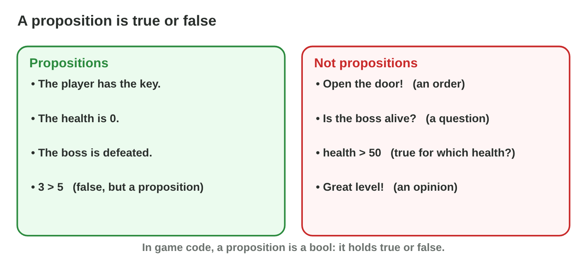
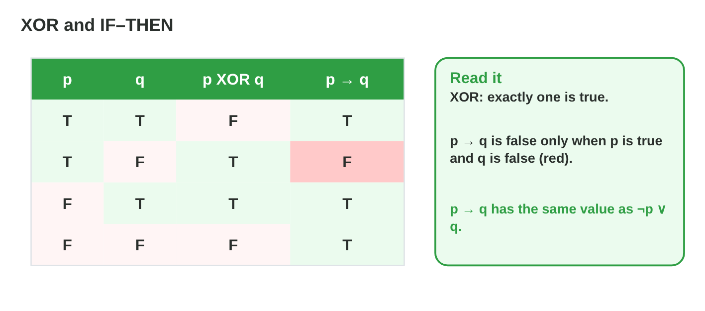
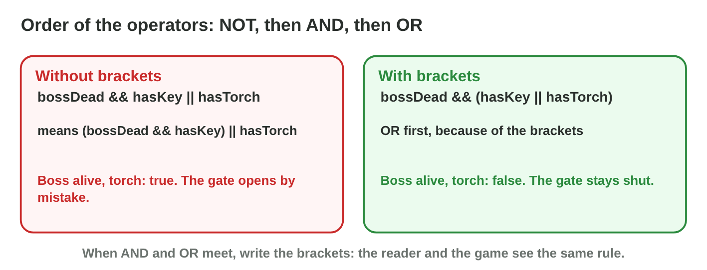
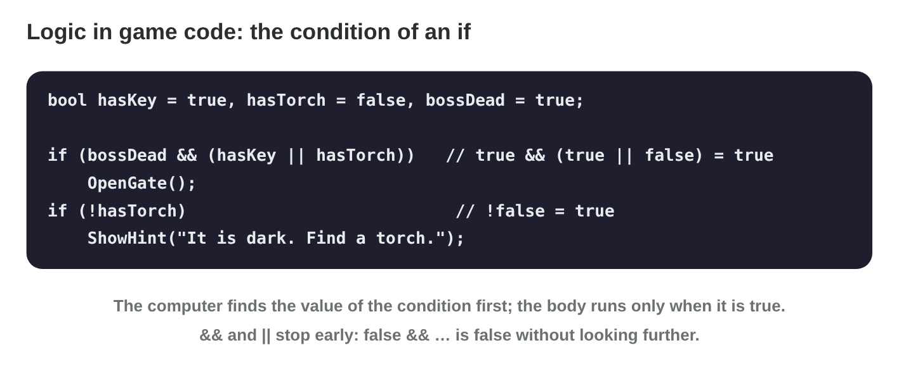

::: {.lead}
In the dungeon game *Torch Hall*, the iron door opens only when the player
has the key and holds a torch. A trap fires when the player has no torch. A
lever works when exactly one of two switches is up. Every one of these
rules is a sentence that is **true or false** at each moment, and the game
checks it many times per second. Mathematics calls such sentences
**propositions**, and joins them with **logical operators**: NOT, AND, OR,
XOR and IF–THEN. In this lesson you learn the value of each operator,
build longer conditions with brackets, and read them in C# code. Every
section ends with a short task.
:::

## Key terms



## 16.1 Propositions: true or false

A game asks itself questions all the time: Does the player have the key? Is
the health 0? Is the boss defeated? The answer is always yes or no
(@fig-prop).

::: {.callout-important title="Definition 16.1 — Proposition"}
A **proposition** is a statement that is either **true** or **false**, not
both. Its **truth value** is T (true, 1) or F (false, 0). We name
propositions with small letters: p, q, r. In code, a proposition is a
**Boolean variable** (`bool`).
:::

{#fig-prop width=96%}

::: {.callout-note title="Example 16.1 — Propositions of Torch Hall"}
1. p: "The player has the key." In code: `bool hasKey`.
2. q: "The player holds a torch." `bool hasTorch`.
3. r: "The health is 0." `health == 0`, true or false.
4. "3 > 5" is a proposition too: it is false.
:::

::: {.callout-warning title="Common mistake"}
Calling "health > 50" a proposition while health is unknown. It becomes a
proposition (true or false) only when health has a value. Orders ("Open
the door!") and questions are never propositions.
:::

::: {.callout-note title="Do it · Find the propositions"}
1. Write three propositions about a racing game (for example, "the car is
   on the track").
2. Write one sentence that is not a proposition, and say why.

*Your result:* four sentences.
:::

## 16.2 NOT, AND and OR

Two propositions can be joined into a new one. The three basic operators
are NOT, AND and OR (@fig-nao).

::: {.callout-important title="Definition 16.2 — NOT, AND, OR"}
- **Negation** ¬p (NOT p) is true when p is false.
- **Conjunction** p ∧ q (p AND q) is true only when **both** are true.
- **Disjunction** p ∨ q (p OR q) is true when **at least one** is true.

In C#: `!p`, `p && q`, `p || q`.
:::

{#fig-nao width=96%}

::: {.callout-note title="Example 16.2 — Two doors"}
The player has the key (p = T) but no torch (q = F).

1. Iron door, p ∧ q: T ∧ F = **F**. It stays shut.
2. Wooden door, p ∨ q: T ∨ F = **T**. It opens.
3. The trap ¬q: ¬F = **T**. It fires.
:::



::: {.callout-warning title="Common mistake"}
Thinking that OR means "one but not both". In logic and in code, p ∨ q is
also true when both are true.
:::

::: {.callout-note title="Do it · Four cases"}
1. In **Logic Lab**, set p and q to each of the four cases.
2. Write the values of ¬p, p ∧ q and p ∨ q for each case, and compare with
   @fig-nao.

*Your result:* a small table of four rows.
:::

## 16.3 XOR: exactly one

A lever in Torch Hall works when exactly one of two switches is up: not
none, not both. Everyday "or" sometimes means this; logic gives it its own
name (@fig-xi).

::: {.callout-important title="Definition 16.3 — Exclusive or"}
**Exclusive or** p ⊕ q (p XOR q) is true when **exactly one** of p and q is
true. It is false when both are true and when both are false. In C# for
`bool` values: `p ^ q` (or `p != q`).
:::

{#fig-xi width=96%}

::: {.callout-note title="Example 16.3 — The lever"}
1. Left up, right down: T ⊕ F = **T**. The lever works.
2. Both up: T ⊕ T = **F**. Nothing happens.
3. A game of two players: "exactly one player holds the flag" is
   holdsA ⊕ holdsB.
:::

::: {.callout-warning title="Common mistake"}
Using OR for "either the sword or the shield, not both". `sword || shield`
also lets the player take both. Use XOR.
:::

::: {.callout-note title="Do it · OR or XOR?"}
For each rule, choose OR or XOR: (a) "attack with a sword or a bow, one at
a time"; (b) "the alarm rings when a door or a window opens"; (c) "the
light is on when one switch is up".

*Your result:* three answers.
:::

## 16.4 IF–THEN: implication

The designer writes a rule: "If the player has the crown, then the boss is
defeated." When is this rule **broken**? Only when the player has the
crown and the boss is still alive (@fig-xi).

::: {.callout-important title="Definition 16.4 — Implication"}
The **implication** p → q (IF p THEN q) is false only when p is true and q
is false. In every other case it is true. It has the same value as
¬p ∨ q. In p → q, p is the **condition** and q the **result**.
:::

::: {.callout-note title="Example 16.4 — Checking the crown rule"}
p: "the player has the crown"; q: "the boss is defeated".

1. Crown and boss defeated: T → T = T. The rule is kept.
2. Crown, boss alive: T → F = **F**. A bug: the player got the crown too
   early.
3. No crown: F → T and F → F are both T. The rule says nothing about
   players without the crown.
4. A test in code: `if (hasCrown && !bossDead) ReportBug();`
:::

::: {.callout-warning title="Common mistake"}
Turning the rule round. "If crown, then boss defeated" is not "if boss
defeated, then crown": a player may beat the boss and not take the crown.
:::

::: {.callout-note title="Do it · When is the rule broken?"}
Rule: "If the level is finished, then all coins are collected." Write the
one case that breaks it, and the C# condition that finds it.

*Your result:* one sentence and one condition.
:::

## 16.5 Compound propositions and brackets

Real rules join several operators. The last gate of Torch Hall opens when
the boss is defeated and the player has the key or a torch. The order of
the operators decides the meaning (@fig-prec).

::: {.callout-important title="Definition 16.5 — Compound propositions and precedence"}
A **compound proposition** joins propositions with several operators. The
**operator precedence** is: first **NOT**, then **AND**, then **OR**
(IF–THEN last). Brackets are computed first. So p ∧ q ∨ r means
(p ∧ q) ∨ r.
:::

{#fig-prec width=96%}

::: {.callout-note title="Example 16.5 — The last gate"}
Boss alive (b = F), no key (k = F), torch (t = T).

1. b ∧ (k ∨ t) = F ∧ (F ∨ T) = F ∧ T = **F**: the gate stays shut.
2. b ∧ k ∨ t = (F ∧ F) ∨ T = F ∨ T = **T**: the gate opens, a bug.
3. The rule needs the brackets.
:::

::: {.callout-note title="Example 16.6 — NOT before AND"}
¬p ∧ q means (¬p) ∧ q, not ¬(p ∧ q). With p = T, q = T: (¬T) ∧ T = F, but
¬(T ∧ T) = F as well; with p = F, q = F: (¬F) ∧ F = F, but ¬(F ∧ F) = T.
The two are different.
:::

::: {.callout-warning title="Common mistake"}
Writing a long condition without brackets and trusting it. Write the
brackets whenever AND and OR meet; the next reader (and you, later) will
see the rule at once.
:::

::: {.callout-note title="Do it · Compute"}
p = T, q = F, r = T. Compute (a) p ∨ q ∧ r; (b) (p ∨ q) ∧ r;
(c) ¬p ∨ ¬q.

*Your result:* three truth values.
:::

## 16.6 Logic in game code

In a game, every `if` and every `while` has a condition: a compound
proposition that the computer evaluates (@fig-code).

::: {.callout-important title="Definition 16.6 — Conditions in C#"}
`!` is NOT, `&&` is AND, `||` is OR, `^` is XOR for `bool` values. `&&` and
`||` stop early (**short-circuit**): in `a && b`, if a is false, b is not
evaluated; in `a || b`, if a is true, b is not evaluated.
:::

{#fig-code width=96%}

::: {.callout-note title="Example 16.7 — A safe check"}
```csharp
if (enemy != null && enemy.isAlive)   // if enemy is null, isAlive is never read
    Attack(enemy);
```
1. No enemy: `enemy != null` is false, so the whole condition is false at
   once; the game does not crash.
2. With `enemy.isAlive && enemy != null` (the other order), the game
   crashes when there is no enemy.
:::

::: {.callout-caution title="In game code"}
```csharp
bool canOpen = bossDead && (hasKey || hasTorch);
bool trap    = !hasTorch;
bool lever   = leftUp ^ rightUp;
bool ruleOK  = !hasCrown || bossDead;    // crown → boss defeated
```
:::

::: {.callout-warning title="Common mistake"}
Writing `&` or `|` (single) where `&&` or `||` is meant. In C# they also
work on `bool`, but they never stop early, so the safe check of Example
16.7 crashes again.
:::

::: {.callout-note title="Do it · Write the conditions"}
Write C# conditions for: (a) "the player can jump when on the ground and
not stunned"; (b) "show a warning when the health is below 20 or the time is
below 10 seconds".

*Your result:* two conditions.
:::

## Case study: Door Logic

*Torch Hall* is a made-up dungeon game. Its designer writes every door rule
in words: the iron door needs the key and a torch; the wooden door needs
the key or a torch; a trap fires without a torch; a lever works when exactly
one switch is up; the crown rule "if crown, then boss defeated" must be
checked; and the last gate needs the defeated boss and the key or a torch.
The Game challenge of the interactive lesson uses these rules. In the
mini-game below you choose the condition for each door.



## Further reading

Rosen, *Discrete Mathematics and Its Applications*, 8th ed., Section 1.1
(propositional logic). Microsoft Learn, "Boolean logical operators (C#
reference)".

## Exercises

1. Is "Collect all the coins!" a proposition? Why?
2. p = T, q = F. Find ¬p, p ∧ q and p ∨ q.
3. When is p ∧ q true?
4. When is p ∨ q false?
5. p = T, q = T. Find p ⊕ q.
6. Write XOR for `bool` values in C# in two ways.
7. p = F, q = F. Find p → q.
8. Which case breaks the rule p → q?
9. Write p → q with ¬ and ∨.
10. In which order are NOT, AND and OR computed?
11. p = F, q = T, r = T. Find p ∧ q ∨ r and p ∧ (q ∨ r).
12. Write in C#: "the shop is open when it is day and the player is not in a
    fight".
13. Why is `enemy != null && enemy.isAlive` safe?
14. The rule: "If the timer is 0, then the level is over." Write the C#
    condition that finds a bug in this rule.

## Answers to the exercises

::: {.answers}
1. No: it is an order, not a statement that is true or false.
2. ¬p = F; p ∧ q = F; p ∨ q = T.
3. Only when both p and q are true.
4. Only when both p and q are false.
5. F.
6. `p ^ q` and `p != q`.
7. T.
8. p true and q false.
9. ¬p ∨ q.
10. NOT first, then AND, then OR.
11. (F ∧ T) ∨ T = T; F ∧ (T ∨ T) = F.
12. `isDay && !inFight`.
13. If enemy is null, `&&` stops before reading `enemy.isAlive`.
14. `timer == 0 && !levelOver`.
:::
