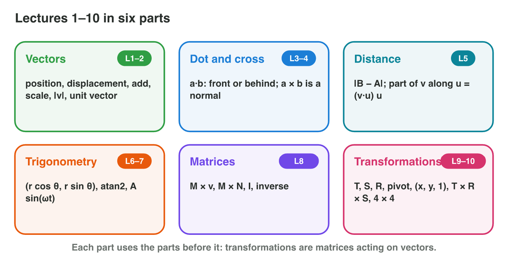
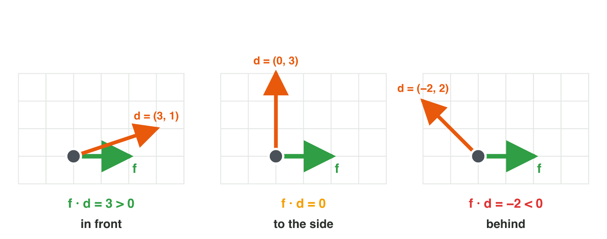
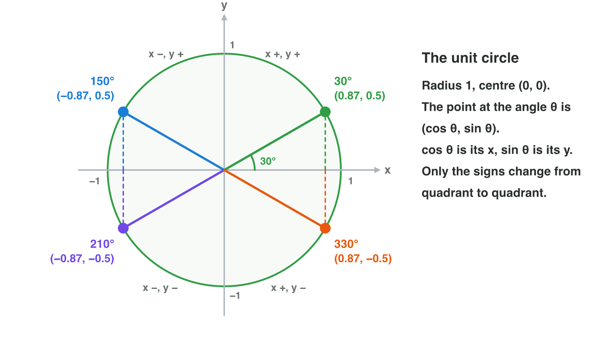
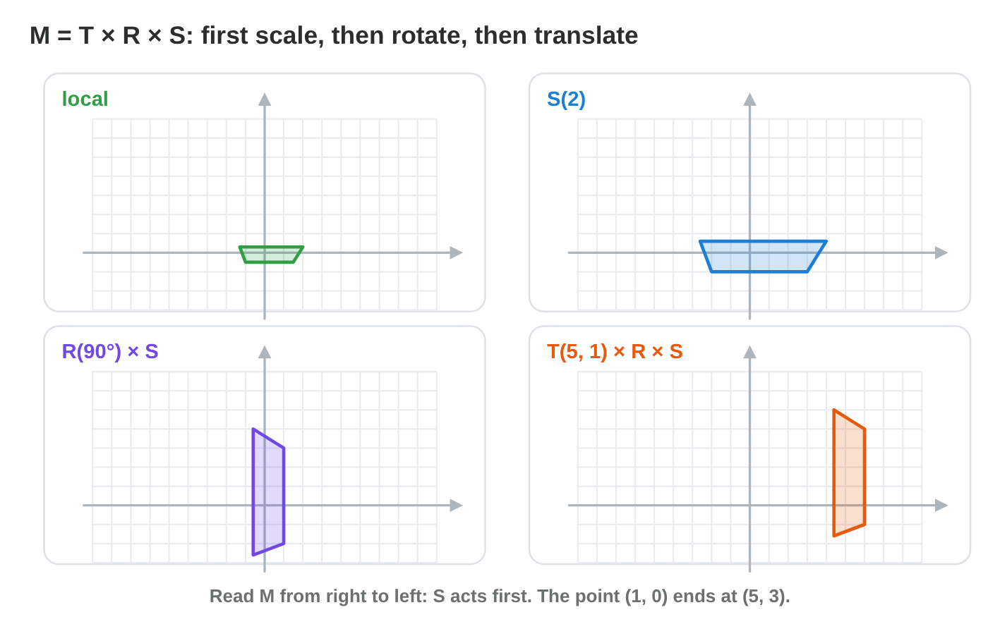

No new ideas today: three short problems that revise Lectures 1–7 before the
midterm. Do each one alone. Tap, sort or type your answer at every step: the
page checks it at once and tells you why.

## Recall

{width=88%}

- **Vectors and products (Lectures 1–3):** a step is B − A; length
  |v| = √(x² + y²); unit vector v ÷ |v|. The dot product says in front or
  behind; the 2D cross product says left or right.
- **Distance and angles (Lectures 3–4):** distance |B − A|; along a beam
  v · û; the direction at θ is (cos θ, sin θ); atan2(y, x) gives the angle.
- **Matrices and transformations (Lectures 5–7):** rows times columns; the
  inverse undoes; M = T × R × S; points w = 1, directions w = 0.

::: {.callout-tip title="Try it 1 · Recall"}
Choose the right answer.

::: {.match extra="14|(1, 0)"}
How long is (6, 8)?
:   10

    Why: √(36 + 64) = √100 = 10, not 6 + 8.

What is (2, 3) · (−3, 2)?
:   0

    Why: −6 + 6 = 0: the vectors are perpendicular.

What is R(90°) × (1, 0)?
:   (0, 1)

    Why: (−y, x) = (0, 1).
:::
:::

## Activity 1 · A ship and a guard (Lectures 1–3)

A ship sails from (−2, 3) to (4, −5) at 2 units per second. On the shore, a
guard looks along f = (1, 0). A player stands at d = (−3, 4) from the
guard.

{width=78%}

::: {.callout-note title="Activity 1 · Vectors and products · 18 min"}
1. Find the step of the ship, its length and its unit direction.
2. Find its velocity at 2 units per second, and how long the trip takes.
3. Compute f · d and f × d for the player. Is the player in front or
   behind, to the left or to the right?

*Your product:* five values for the ship and two answers for the player.

::: {.fill answer="10" hint="The step is (4, −5) − (−2, 3). Then √(x² + y²)."}
Step 1: how long is the step of the ship?

Why: The step is (6, −8), and √(36 + 64) = √100 = 10. The unit direction is (0.6, −0.8).
:::

::: {.choice}
Step 2: what are the velocity at 2 units per second and the time of the trip?

- [x] (1.2, −1.6) and 5 seconds

  Why: 2 × (0.6, −0.8) = (1.2, −1.6), and 10 ÷ 2 = 5 seconds.

- [ ] (12, −16) and 5 seconds

  Why: Multiply the unit direction by the speed, not the whole step.

- [ ] (1.2, −1.6) and 20 seconds

  Why: Time = length ÷ speed = 10 ÷ 2 = 5 seconds.
:::

::: {.choice}
Step 3: where is the player d = (−3, 4), for f = (1, 0)?

- [x] behind, and to the left

  Why: f · d = −3 is negative (behind); f × d = 1 × 4 − 0 × (−3) = 4 is positive (left).

- [ ] in front, and to the left

  Why: f · d = −3 is negative, so the player is behind.

- [ ] behind, and to the right

  Why: f × d = 4 is positive, so the player is to the left.
:::
:::

::: {.callout-tip title="Try it 2 · Vectors and products"}
Choose the right answer.

::: {.match extra="(6, 8)|in front"}
What is (0, −4) normalized?
:   (0, −1)

    Why: Its length is 4: (0 ÷ 4, −4 ÷ 4).

A drone flies along (6, 8) at 5 units per second. What is its velocity?
:   (3, 4)

    Why: The unit direction (0.6, 0.8) × 5 = (3, 4).

The guard looks along (1, 0). Is a player at d = (2, −1) to the left or to the right?
:   to the right

    Why: f × d = 1 × (−1) − 0 × 2 = −1: negative means right.

What is (1, 0, 0) × (0, 1, 0)?
:   (0, 0, 1)

    Why: The x-axis × the y-axis gives the z-axis.
:::
:::

## Activity 2 · A tower and a cannon (Lectures 3–4)

A tower stands at (0, 0). Enemies are at (3, 4), (−5, 1) and (2, −2). A
cannon fires at 60° with the speed 20 (cos 60° = 0.5, sin 60° = 0.87), and
a turret must aim at an enemy at (−4, 4).

{width=78%}

::: {.callout-note title="Activity 2 · Distance and angles · 18 min"}
1. Which enemy is nearest to the tower? Compare the squares of the
   distances.
2. Find the velocity of the cannon ball.
3. Find the angle of the enemy at (−4, 4) with atan2(4, −4).

*Your product:* three squares, one velocity and one angle.

::: {.order}
Step 1: put the enemies in order, from the nearest to the farthest.

1. (2, −2): square 8
2. (3, 4): square 25
3. (−5, 1): square 26

Why: x² + y² gives 4 + 4 = 8, 9 + 16 = 25 and 25 + 1 = 26: the smallest square is the nearest.
:::

::: {.fill answer="(10, 17.4)" hint="20 × (cos 60°, sin 60°) = 20 × (0.5, 0.87)."}
Step 2: what is the velocity of the cannon ball? Type (x, y).

Why: 20 × (0.5, 0.87) = (10, 17.4).
:::

::: {.choice}
Step 3: what is atan2(4, −4)?

- [x] 135°

  Why: x is minus and y is plus: quadrant II, on the diagonal.

- [ ] 45°

  Why: tan alone loses the signs; atan2 sees that x is minus.

- [ ] −45°

  Why: −45° is down-right; this enemy is up-left.
:::
:::

::: {.callout-tip title="Try it 3 · Distance and angles"}
Choose the right answer.

::: {.match extra="7|45°"}
What is the distance between (1, 1) and (4, 5)?
:   5

    Why: The step (3, 4) has the length 5.

A beam goes along û = (0.6, 0.8). How far along it is the enemy at (3, 4)?
:   5

    Why: (3, 4) · (0.6, 0.8) = 1.8 + 3.2 = 5.

Which angle does atan2(−3, −3) give?
:   −135°

    Why: Both parts are negative: quadrant III.

A turret faces 350° and must face 10°. What is the short turn?
:   +20°

    Why: 10° − 350° = −340°; + 360° = +20°.
:::
:::

## Activity 3 · Spells and a flag (Lectures 5–7)

Two spells: A has the rows (1, 2) and (0, 1); B has the rows (3, 0) and
(1, 1). Grow has the rows (2, 0) and (0, 2). A flag sits at (1, 0) in its
own space; it is turned by 180° and moved by (2, 3).

{width=78%}



::: {.callout-note title="Activity 3 · Matrices · 18 min"}
1. Compute AB and BA. Are they equal?
2. Which matrix undoes Grow? Check it on (3, 2).
3. Write M = T(2, 3) × R(180°). Where do the point (1, 0, 1) and the
   direction (1, 0, 0) go? Check the point in **Matrix Chain**.

*Your product:* two matrices, one inverse with its check, one matrix M and
two results.

::: {.choice}
Step 1: what is AB?

- [x] the rows (5, 2) and (1, 1)

  Why: Row × column: (1 × 3 + 2 × 1, 1 × 0 + 2 × 1) = (5, 2), then (1, 1). BA has the rows (3, 6) and (1, 3): the order matters.

- [ ] the rows (3, 6) and (1, 3)

  Why: That is BA: with B first, the product is different.

- [ ] the rows (4, 2) and (1, 2)

  Why: That adds A and B; a product multiplies rows by columns.
:::

::: {.choice}
Step 2: which matrix undoes Grow?

- [x] Shrink, the rows (0.5, 0) and (0, 0.5)

  Why: (3, 2) → Grow (6, 4) → Shrink (3, 2): back where it started.

- [ ] Grow again

  Why: A second Grow makes it 4 times as big.

- [ ] R(180°)

  Why: A turn changes the direction, not the size.
:::

::: {.sort}
Step 3: M = T(2, 3) × R(180°) has the rows (−1, 0, 2), (0, −1, 3) and
(0, 0, 1). What does it do to each one? Sort them.

Turns and moves
:   the point (1, 0, 1): it goes to (1, 3)

    Why: (−1 + 2, 0 + 3): w = 1, so the move is added.

:   the point (0, 0, 1): it goes to (2, 3)

    Why: The origin of the flag moves by (2, 3).

Only turns
:   the direction (1, 0, 0): it goes to (−1, 0)

    Why: w = 0: the move is multiplied by 0.

:   the direction (0, 1, 0): it goes to (0, −1)

    Why: A direction turns by 180° and does not move.
:::
:::

::: {.callout-tip title="Try it 4 · Matrices and transformations"}
Choose the right answer.

::: {.match extra="rows (3, 0), (0, 1)|(4, 4)"}
What are the rows (1, 2), (3, 4) times (1, 1)?
:   (3, 7)

    Why: 1 + 2 = 3 and 3 + 4 = 7.

Which matrix undoes Grow, rows (2, 0), (0, 2)?
:   rows (0.5, 0), (0, 0.5)

    Why: Grow doubles; halving undoes it.

What is T(−1, 2) × (4, 4, 1)?
:   (3, 6, 1)

    Why: (4 − 1, 4 + 2, 1) = (3, 6, 1).

Rotate (2, 0) by 90° about the pivot (1, 1). Where is it?
:   (2, 2)

    Why: (2, 0) − (1, 1) = (1, −1); turned: (1, 1); + (1, 1) = (2, 2).
:::
:::

## Wrap-up {.summary}

- You can find steps, lengths, unit directions and velocities, and decide
  front, back, left and right with the two products.
- You can find the nearest target, turn an angle into a velocity and find
  the angle of a vector.
- You can multiply matrices, undo a spell and build M = T × R × S.
