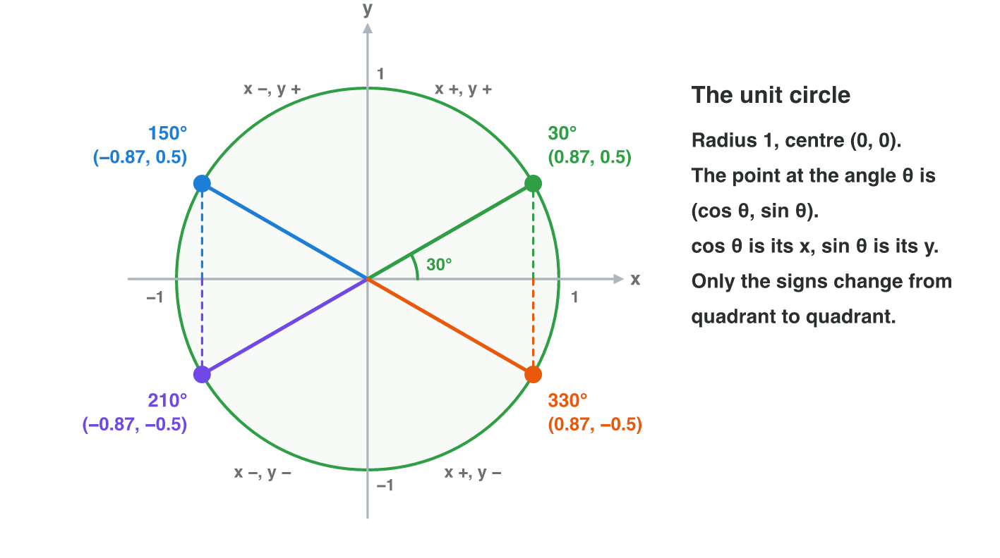

## Recall · Lectures 1–10

a) How long is the vector (6, 8)?
b) What is the dot product (2, 3) · (−3, 2)?
c) What is R(90°) × (1, 0)?

::: {.answer}
a) 10
b) 0
c) (0, 1)
:::

## Activity 1 · Vectors and products · 18 min

:::: {.columns}
::: {.column width="50%"}
- A ship sails from (−2, 3) to (4, −5) at 2 units per second, and a guard looks along f = (1, 0) at a player at d = (−3, 4).
- **Do it:** Find the step, length, unit direction, velocity and time of the ship. Is the player in front or behind, left or right?
- Your product is five values and two answers.
:::
::: {.column width="50%"}

:::
::::

## Check 1 · Vectors and products

What are the results for the ship and the player?

::: {.reveal}
1. The step is (6, −8), its length is 10, and the unit direction is (0.6, −0.8).
2. The velocity is 2 × (0.6, −0.8) = (1.2, −1.6), and the trip takes 10 ÷ 2 = 5 seconds.
3. f · d = −3 is negative, so the player is behind the guard.
4. f × d = 1 × 4 − 0 × (−3) = 4 is positive, so the player is to the left.
:::

## Activity 2 · Distance and angles · 18 min

:::: {.columns}
::: {.column width="50%"}
- Enemies stand at (3, 4), (−5, 1) and (2, −2), and a cannon fires at 60° with the speed 20 (cos 60° = 0.5, sin 60° = 0.87).
- **Do it:** Find the nearest enemy with the squares. Find the velocity of the ball and the angle of an enemy at (−4, 4).
- Your product is three squares, a velocity and an angle.
:::
::: {.column width="50%"}

:::
::::

## Check 2 · Distance and angles

What are the nearest enemy, the velocity and the angle?

::: {.reveal}
1. The squares are 25, 26 and 8, so (2, −2) is the nearest enemy.
2. The ball's velocity is 20 × (0.5, 0.87) = (10, 17.4).
3. atan2(4, −4) = 135°, because the angle is in quadrant II.
:::

## Activity 3 · Matrices · 18 min

:::: {.columns}
::: {.column width="50%"}
- A has the rows (1, 2) and (0, 1); B has the rows (3, 0) and (1, 1); a flag at (1, 0) is turned by 180° and moved by (2, 3).
- **Do it:** Compute AB and BA. Which matrix undoes Grow? Write M = T(2, 3) × R(180°) and apply it to the point and the direction.
- Your product is matrices, an inverse and two results.
:::
::: {.column width="50%"}

:::
::::

## Check 3 · Matrices

What do the matrices give?

::: {.reveal}
1. AB has the rows (5, 2) and (1, 1), but BA has (3, 6) and (1, 3): the order matters.
2. Shrink, with the rows (0.5, 0) and (0, 0.5), undoes Grow.
3. M has the rows (−1, 0, 2), (0, −1, 3) and (0, 0, 1), so the point (1, 0, 1) goes to (1, 3).
4. The direction (1, 0, 0) goes to (−1, 0), because it only turns.
:::

## Wrap-up

- You can find steps, lengths, velocities, and front or behind, left or right.
- You can find the nearest target and the velocity and angle of a shot.
- You can multiply matrices, undo a spell and build M = T × R × S.
