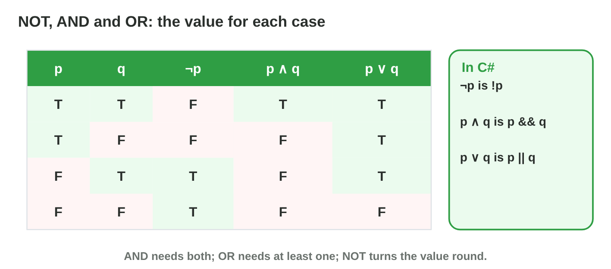
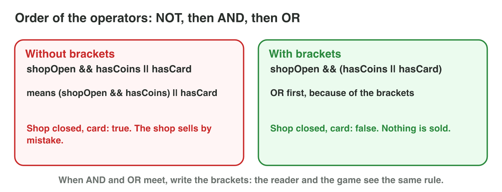
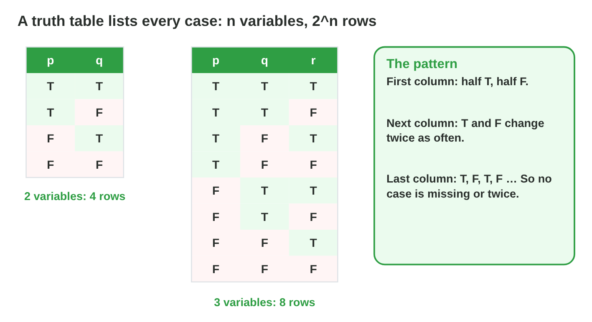
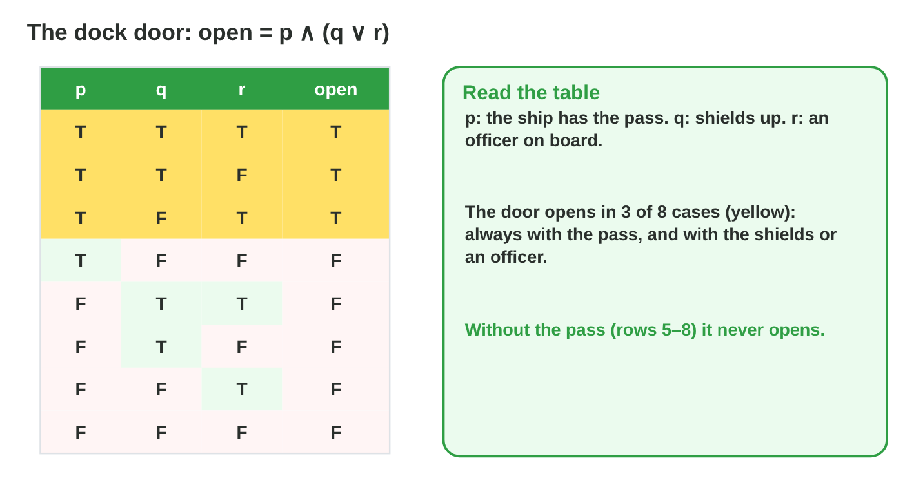

This page is the interactive version of the lesson notes (PDF). Each section
starts with a problem in a game. Then it explains the idea behind it. It ends
with a **Do it** task and one set of questions. Every question on this page
has its answer: try first, then check.

## Key terms



## 11.1 Propositions: true or false

- A **proposition** is a statement that is **true** or **false**.
- We name them p, q, r. In code: a `bool` (`hasPass`, `hasOxygen`).
- "3 > 5" is a proposition (false). "Open the door!" and "Is the boss
  alive?" are not.

{width=92%}

::: {.callout-warning title="Watch out!"}
"health > 50" is true or false only when health has a value.
:::

::: {.callout-note title="Do it · Find the propositions"}
Write three propositions about a racing game and one sentence that is not
a proposition.

::: {.check}
A good answer: "the car is on the track", "the lap is finished", "the speed
is over 100"; "Drive faster!" is not one (an order). Check: each proposition
can be answered true or false.
:::
:::

::: {.callout-tip title="Try it 1 · Propositions"}
Is it a proposition? Choose the right answer.

::: {.match extra="yes, it is true|yes, it is an order"}
"The player has the pass."
:   yes, it is true or false

    Why: at any moment it is true or false.

"Open the door!"
:   no, it is an order

    Why: an order is not true or false.

"3 > 5"
:   yes, it is false

    Why: a statement can be false and still be a proposition.

"Is the boss alive?"
:   no, it is a question

    Why: a question is not true or false.
:::
:::

## 11.2 NOT, AND, OR and XOR

- **¬p** (NOT, `!p`): true when p is false.
- **p ∧ q** (AND, `p && q`): true only when **both** are true.
- **p ∨ q** (OR, `p || q`): true when **at least one** is true.
- **p ⊕ q** (XOR, `p ^ q`): true when **exactly one** is true.
- Pass (T), no oxygen (F): airlock p ∧ q = F; cargo hatch p ∨ q = T; alarm
  ¬q = T. A radio with two antennas works only when exactly one is on: XOR.

{width=88%}

{width=88%}



::: {.callout-warning title="Watch out!"}
OR is also true when both are true. "A sword or a shield, not both" is XOR.
:::

::: {.callout-note title="Do it · Four cases in Logic Lab"}
In **Logic Lab**, try the four cases of p and q. Write ¬p, p ∧ q, p ∨ q and
p ⊕ q for each. Then: is "attack with a sword or a bow, one at a time" OR or
XOR?

::: {.check}
(T, T): F, T, T, F. (T, F): F, F, T, T. (F, T): T, F, T, T. (F, F): T, F, F, F.
"One at a time" is XOR.
:::
:::

::: {.callout-tip title="Try it 2 · NOT, AND, OR, XOR"}
p = "has the pass", q = "has oxygen". Choose the value or the operator. You can use an answer more than once.

::: {.match extra="true or false|p && q"}
p = T, q = F. What is p ∧ q?
:   false

    Why: AND needs both to be true.

p = T, q = F. What is p ∨ q?
:   true

    Why: OR needs at least one to be true.

q = F. What is ¬q?
:   true

    Why: NOT turns false into true.

p = T, q = T. What is p ⊕ q?
:   false, both are true

    Why: XOR needs exactly one.

How do you write XOR for bools in C#?
:   p ^ q

    Why: ^ (or !=) is XOR for bool values.

"The alarm rings when a door or a window opens." Which operator?
:   OR

    Why: it should also ring when both open: OR.
:::
:::

## 11.3 IF–THEN: implication

- **p → q** is false **only** when p is true and q is false.
- p → q has the same value as **¬p ∨ q**.
- Rule "reactor off → lights red" is broken only when the reactor is off and
  the lights are not red: `reactorOff && !lightsRed`.
- Turning it round (q → p) is a different rule.

::: {.callout-warning title="Watch out!"}
When p is false, p → q is true: the rule says nothing then.
:::

::: {.callout-note title="Do it · When is the rule broken?"}
Rule: "If the level is finished, then all coins are collected." Write the
case that breaks it, and the C# condition.

::: {.check}
A finished level with coins missing: `levelFinished && !allCoins`.
:::
:::

::: {.callout-tip title="Try it 3 · IF–THEN"}
Choose the right answer.

::: {.match extra="p && q|p is false"}
When is p → q false?
:   p is true and q is false

    Why: that is the only case that breaks the rule.

p = F, q = F. What is p → q?
:   true

    Why: when the condition is false, the rule is not broken.

Which expression has the same value as p → q?
:   ¬p ∨ q

    Why: both are false only when p = T and q = F.

Which C# condition finds a bug in "reactor off → lights red"?
:   reactorOff && !lightsRed

    Why: the rule is broken when p is true and q is false.
:::
:::

## 11.4 Compound propositions and brackets

- Order: **NOT**, then **AND**, then **OR**. Brackets first.
- p ∧ q ∨ r means (p ∧ q) ∨ r.
- Shop closed, no coins, a card: s ∧ (c ∨ k) = F, but s ∧ c ∨ k = T (a bug).
- Write brackets whenever AND and OR meet.

{width=92%}

::: {.callout-warning title="Watch out!"}
¬p ∧ q is (¬p) ∧ q, not ¬(p ∧ q).
:::

::: {.callout-note title="Do it · Compute"}
p = T, q = F, r = T. Compute p ∨ q ∧ r, (p ∨ q) ∧ r and ¬p ∨ ¬q.

::: {.check}
T ∨ (F ∧ T) = T; (T ∨ F) ∧ T = T; F ∨ T = T.
:::
:::

::: {.callout-tip title="Try it 4 · Brackets"}
p = T, q = F, r = T. Choose the value. You can use an answer more than once.

::: {.match extra="first OR|both"}
p ∨ q ∧ r
:   true

    Why: AND first: F ∧ T = F; then T ∨ F = T.

(p ∨ q) ∧ r
:   true

    Why: bracket first: T ∨ F = T; then T ∧ T = T.

¬p ∨ ¬q
:   true

    Why: F ∨ T = T.

¬(p ∨ r)
:   false

    Why: p ∨ r = T, and NOT turns it to F.

What is computed first: AND or OR?
:   AND

    Why: the order is NOT, then AND, then OR.
:::
:::

## 11.5 Every case at once: truth tables

- One column per variable, one row per combination: **n variables → 2^n
  rows**. p, q: 4 rows; p, q, r: 8 rows.
- Order: first column half T, half F; each next column changes twice as
  often.
- For a longer proposition, add a **helper column** for each operator, from
  the inside out. ¬(p ∧ ¬q): ¬q = F, T, F, T; p ∧ ¬q = F, T, F, F; result
  T, F, T, T.

{width=86%}

{width=86%}



::: {.callout-warning title="Watch out!"}
¬(p ∧ q) is not ¬p ∧ ¬q. Compute the bracket first.
:::

::: {.callout-note title="Do it · Predict, then check"}
Build the table of (p ∨ q) ∧ ¬p on paper. Then check it in **Truth Table
Lab** in Quiz mode.

::: {.check}
From (T, T) to (F, F): F, F, T, F. It is true only when p = F and q = T.
:::
:::

::: {.callout-tip title="Try it 5 · Truth tables"}
Choose the right answer. For a column, read the rows from (T, T) to (F, F).

::: {.match extra="6|T, T, T, T"}
How many rows has a table with 3 variables?
:   8

    Why: 2 × 2 × 2 = 8.

How many rows has a table with 5 variables?
:   32

    Why: 2^5 = 32.

In the usual order, what is the first row of p, q, r?
:   T, T, T

    Why: every column starts with T.

The column of p ∧ ¬q.
:   F, T, F, F

    Why: true only when p = T and q = F (row 2).

The column of ¬p ∨ q.
:   T, F, T, T

    Why: false only when p = T and q = F.

The column of ¬(p ∨ q).
:   F, F, F, T

    Why: p ∨ q is false only in the last row.
:::
:::

## 11.6 A game rule as a truth table

- The **true rows** are the situations in which the rule fires.
- Dock door p ∧ (q ∨ r): true in 3 of 8 rows; never without the pass.
- Check: does it fire in every case it should, and in no case it should
  not?

{width=90%}

::: {.callout-warning title="Watch out!"}
Bugs hide in unusual rows, not in "everything true".
:::

::: {.callout-note title="Do it · The repair bay"}
Build the table of (d ∧ ¬e) ∨ o. In how many cases does the bay open?

::: {.check}
5 of 8: always with an officer (4 rows), and without one only when docked
with the engine off (T, F, F).
:::
:::

::: {.callout-tip title="Try it 6 · Read the rule"}
Choose the right answer.

::: {.match extra="8|0"}
In how many rows is p ∧ (q ∨ r) true?
:   3

    Why: p must be T (4 rows) and q or r: all but (T, F, F).

In how many rows is p ∨ q ∨ r true?
:   7

    Why: false only when all three are F: 8 − 1.

In how many rows is (d ∧ ¬e) ∨ o true?
:   5

    Why: the 4 rows with o = T, and (T, F, F).

In how many rows is p ∧ q ∧ r true?
:   1

    Why: only (T, T, T).
:::
:::

## Game challenge: Door Logic {.challenge}

Work alone. Use every section of today.

In **Torch Hall**, every door has a rule in words: the iron door, the wooden
door, a trap, a lever with two switches, the crown rule and the last gate.
Choose the condition the code must check.



::: {.callout-tip title="Try it 7 · The doors"}
Choose the right condition.

::: {.match extra="hasKey ^ hasTorch|!hasKey"}
The iron door: the key and a torch.
:   hasKey && hasTorch

    Why: "and": both are needed.

The wooden door: the key or a torch.
:   hasKey || hasTorch

    Why: "or": at least one.

The trap: no torch.
:   !hasTorch

    Why: NOT turns "has a torch" round.

The lever: exactly one switch up.
:   left ^ right

    Why: "exactly one" is XOR.
:::
:::

::: {.callout-tip title="Try it 8 · The last gate (harder)"}
Choose the right answer.

::: {.match extra="bossDead && hasKey || hasTorch|true"}
Which condition opens the last gate (boss defeated, and key or torch)?
:   bossDead && (hasKey || hasTorch)

    Why: brackets make "key or torch" one part.

Which condition checks that the crown rule is kept?
:   !hasCrown || bossDead

    Why: crown → boss defeated is the same as ¬crown ∨ boss defeated.

Boss alive, no key, torch: what is bossDead && hasKey || hasTorch?
:   true, a bug

    Why: && first: F && F = F; then F || T = T: the gate opens by mistake.

Boss alive, no key, torch: what is bossDead && (hasKey || hasTorch)?
:   false

    Why: F && (F || T) = F && T = F.
:::
:::

## Summary {.summary}

- A proposition is true or false; in code it is a `bool`.
- NOT turns it round; AND needs both; OR needs at least one; XOR exactly one.
- p → q is false only when p is true and q is false.
- NOT before AND before OR; write brackets when AND and OR meet.
- A truth table has 2^n rows; its true rows show when a rule fires.
