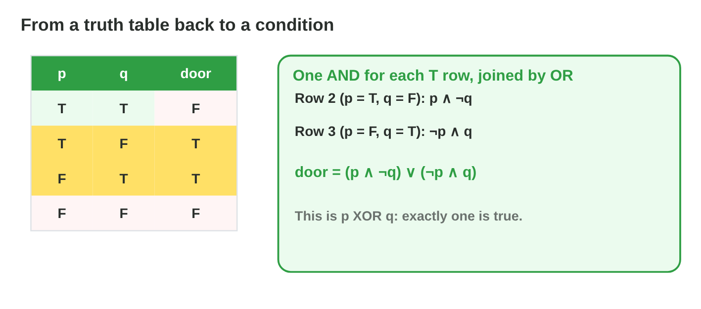
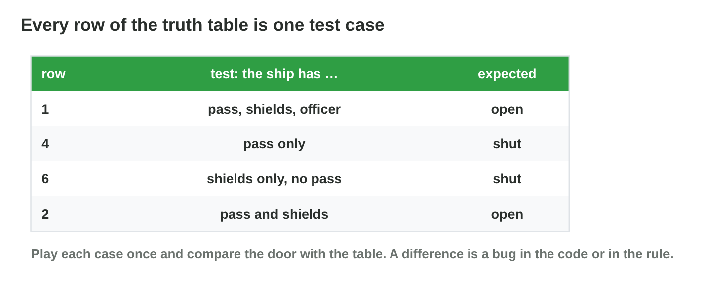

This page is the interactive version of the lesson notes (PDF). Each section
starts with a problem in a game. Then it explains the idea behind it. It ends
with a **Do it** task and one set of questions. The full explanations,
examples and exercises are in the notes.

## Key terms



## 17.1 Building a truth table

- One column per variable, one row per combination: **n variables → 2^n
  rows**.
- Order: first column half T, half F; each next column changes twice as
  often.
- p, q: 4 rows. p, q, r: 8 rows. 4 variables: 16 rows.

{width=90%}

::: {.callout-warning title="Watch out!"}
A random order misses cases. Follow the pattern and count the rows.
:::

::: {.callout-note title="Do it · How many cases?"}
How many rows have 4 variables, and 5? Write the 8 rows of p, q, r in the
usual order.
:::

::: {.callout-tip title="Try it 1 · Rows"}
Choose the right answer.

::: {.match extra="6|12"}
How many rows has a table with 2 variables?
:   4

How many rows has a table with 3 variables?
:   8

How many rows has a table with 5 variables?
:   32

In the usual order, what is the first row of p, q, r?
:   T, T, T
:::
:::

## 17.2 A compound proposition, column by column

- Add a **helper column** for each operator, from the inside out.
- ¬(p ∧ ¬q): ¬q = F, T, F, T; p ∧ ¬q = F, T, F, F; result T, F, T, T.
- The last column is the value of the whole proposition.

{width=90%}



::: {.callout-warning title="Watch out!"}
¬(p ∧ q) is not ¬p ∧ ¬q. Compute the bracket first.
:::

::: {.callout-note title="Do it · Predict, then check"}
Build the table of (p ∨ q) ∧ ¬p on paper. Then check it in **Truth Table
Lab** in Quiz mode.
:::

::: {.callout-tip title="Try it 2 · Compute the columns"}
Give the last column, from row (T, T) to row (F, F).

::: {.match extra="T, T, T, T|F, F, F, F"}
p ∧ ¬q
:   F, T, F, F

¬p ∨ q
:   T, F, T, T

(p ∨ q) ∧ ¬p
:   F, F, T, F

¬(p ∨ q)
:   F, F, F, T
:::
:::

## 17.3 Tautologies, contradictions and equivalence

- **Tautology:** T in every row (p ∨ ¬p). **Contradiction:** F in every row
  (p ∧ ¬p).
- **Equivalent (≡):** the same last column in every row; one can replace
  the other.
- p → q ≡ ¬p ∨ q ≡ ¬(p ∧ ¬q).
- "Open when the alarm is on and off" is a contradiction: the door never
  opens.

{width=90%}

::: {.callout-warning title="Watch out!"}
Equivalent means equal in **every** row, not in most rows.
:::

::: {.callout-note title="Do it · Same or not?"}
Build the tables of p → q and q → p. Are they equivalent? Which row shows
it?
:::

::: {.callout-tip title="Try it 3 · Always, never, same"}
Choose the right answer.

::: {.match extra="neither, it depends|a test case"}
p ∨ ¬p is …
:   a tautology

alarm ∧ ¬alarm is …
:   a contradiction

p → q and ¬p ∨ q are …
:   equivalent

p → q and q → p are …
:   not equivalent
:::
:::

## 17.4 A game rule as a truth table

- The **true rows** are the situations in which the rule fires.
- Dock door p ∧ (q ∨ r): true in 3 of 8 rows; never without the pass.
- Check: does it fire in every case it should, and in no case it should
  not?

{width=90%}

::: {.callout-warning title="Watch out!"}
Bugs hide in unusual rows, not in "everything true".
:::

::: {.callout-note title="Do it · The repair bay"}
Build the table of (d ∧ ¬e) ∨ o. In how many cases does the bay open?
:::

::: {.callout-tip title="Try it 4 · Read the rule"}
Choose the right answer.

::: {.match extra="8|0"}
In how many rows is p ∧ (q ∨ r) true?
:   3

In how many rows is p ∨ q ∨ r true?
:   7

In how many rows is (d ∧ ¬e) ∨ o true?
:   5

In how many rows is p ∧ q ∧ r true?
:   1
:::
:::

## 17.5 From a truth table back to a condition

- For each **true row**: an AND of the variables, with ¬ for each F.
- Join the ANDs with **OR**.
- True rows (T, F) and (F, T): (p ∧ ¬q) ∨ (¬p ∧ q) = p XOR q.

{width=90%}

::: {.callout-warning title="Watch out!"}
Do not forget the ¬ of the false variables.
:::

::: {.callout-note title="Do it · Write the condition"}
A door opens only in the rows (T, T) and (F, F). Write the condition and
say it in words.
:::

::: {.callout-tip title="Try it 5 · Back to a condition"}
Choose the condition for the true rows.

::: {.match extra="p ∧ q|p ∨ q"}
Only (T, F).
:   p ∧ ¬q

Only (F, F).
:   ¬p ∧ ¬q

(T, F) and (F, T).
:   (p ∧ ¬q) ∨ (¬p ∧ q)

(T, T) and (F, F).
:   (p ∧ q) ∨ (¬p ∧ ¬q)
:::
:::

## 17.6 Every row is a test case

- A **test case**: inputs + the expected result. One per row.
- All rows = a complete test. Many variables: the true rows and their
  neighbours.
- Bug: `hasPass && shieldsUp || officer` opens for an officer without a
  pass (row F, F, T).

{width=90%}

::: {.callout-warning title="Watch out!"}
Test the false rows too: the door must stay shut in them.
:::

::: {.callout-note title="Do it · A test plan"}
Write four test cases for the repair bay: two true rows and two false rows.
:::

::: {.callout-tip title="Try it 6 · Testing"}
Choose the right answer.

::: {.match extra="1|16"}
How many test cases test a rule with 3 variables completely?
:   8

The code opens for (F, F, T), the table says shut. What is it?
:   a bug

Which fix makes the dock door code right?
:   hasPass && (shieldsUp || officer)

Why test the false rows?
:   to see that the door stays shut
:::
:::

## Game challenge: Rule Detective {.challenge}

Work alone. Use every section of today.

In **Star Dock**, the conditions of six doors are lost. Only the test logs
are left: a truth table for each door. Find the condition that gives
exactly the log.



::: {.callout-tip title="Try it 7 · The logs"}
Choose the condition, the log from (T, T) to (F, F).

::: {.match extra="¬p ∧ q|¬(p ∨ q)"}
T, F, F, F
:   p ∧ q

T, T, T, F
:   p ∨ q

F, T, T, F
:   p XOR q

T, F, T, T
:   p → q
:::
:::

::: {.callout-tip title="Try it 8 · Three inputs (harder)"}
Choose the right answer.

::: {.match extra="p ∧ (q ∨ r)|6"}
(p ∧ q) ∨ r is true in how many of 8 rows?
:   5

In the cargo bay p ∧ ¬r, which variable does not matter?
:   q

p ∧ ¬r is true in which rows?
:   (T, T, F) and (T, F, F)

Which condition is true in only one row of three variables?
:   p ∧ q ∧ r
:::
:::

## Summary {.summary}

- A truth table lists all 2^n cases of a rule in a fixed order.
- Helper columns compute a compound proposition from the inside out.
- Tautology: always T; contradiction: always F; equivalent: the same table.
- From a table: one AND per true row, joined with OR.
- Every row is a test case; test the false rows too.
