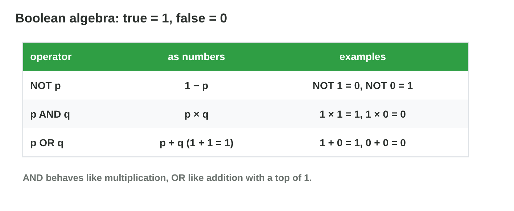
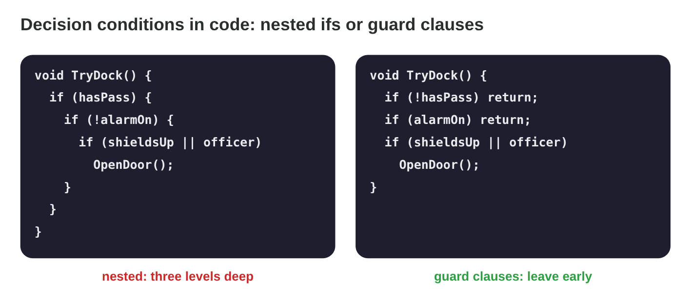

::: {.lead}
The door code of *Star Dock* has grown over many versions. One line reads
`if (!(!hasPass))`, another `if ((hasPass && shieldsUp) || (hasPass &&
!shieldsUp))`. Both work, but nobody understands them, and long
conditions hide bugs. In lecture 17 you checked conditions with truth
tables. A table with many variables gets long, so mathematics offers a
faster tool: **Boolean algebra**, a set of laws to rewrite a condition into
a simpler one with the same value in every case. In this lesson you
calculate with 1 and 0, learn the laws, use De Morgan's laws, simplify
conditions step by step, and write clear decisions in game code. Every
section ends with a short task.
:::

## Key terms



## 18.1 Calculating with 1 and 0

George Boole had the idea to calculate with truth values like with numbers.
True is **1**, false is **0** (@fig-arith).

::: {.callout-important title="Definition 18.1 — Boolean operations as numbers"}
With the values 1 and 0:
$$\neg p = 1 - p, \qquad p \wedge q = p \times q, \qquad p \vee q = p + q \ \text{(with } 1 + 1 = 1).$$
AND behaves like multiplication: one 0 makes the result 0. OR behaves like
addition with a top of 1.
:::

{#fig-arith width=94%}

::: {.callout-note title="Example 18.1 — The dock door in numbers"}
p = 1 (pass), q = 0 (shields down), r = 1 (officer). The door is
p ∧ (q ∨ r):

1. q ∨ r = 0 + 1 = 1.
2. p ∧ 1 = 1 × 1 = **1**: the door opens.
3. With p = 0: 0 × 1 = 0, whatever q and r are.
:::

::: {.callout-warning title="Common mistake"}
Counting 1 + 1 = 2 in Boolean algebra. There are only two values: 1 OR 1
is 1.
:::

::: {.callout-note title="Do it · Calculate"}
With p = 1, q = 0, r = 0, compute p ∨ (q ∧ r), (p ∨ q) ∧ r and
¬p ∨ ¬q, with numbers.

*Your result:* three values (0 or 1).
:::

## 18.2 The laws of Boolean algebra

Like a + 0 = a for numbers, Boolean algebra has laws that are true for every
value. Each law is an equivalence: you can check it with a truth table
(@fig-laws).

::: {.callout-important title="Definition 18.2 — The main laws"}
- **Identity:** p ∧ T ≡ p, p ∨ F ≡ p. **Domination:** p ∧ F ≡ F,
  p ∨ T ≡ T.
- **Idempotent:** p ∧ p ≡ p, p ∨ p ≡ p. **Complement:** p ∧ ¬p ≡ F,
  p ∨ ¬p ≡ T. **Double negation:** ¬¬p ≡ p.
- **Commutative** and **associative**: order and brackets of the same
  operator do not matter.
- **Distributive:** p ∧ (q ∨ r) ≡ (p ∧ q) ∨ (p ∧ r) and
  p ∨ (q ∧ r) ≡ (p ∨ q) ∧ (p ∨ r).
- **Absorption:** p ∨ (p ∧ q) ≡ p, p ∧ (p ∨ q) ≡ p.
:::

{#fig-laws width=94%}

::: {.callout-note title="Example 18.2 — Checking absorption"}
p ∨ (p ∧ q): if p = T, the OR is T; if p = F, then p ∧ q = F and the OR is
F. So the value is always the value of p: p ∨ (p ∧ q) ≡ p. In code,
`docked || (docked && alarm)` is just `docked`.
:::



::: {.callout-warning title="Common mistake"}
Using a law for numbers that is false for logic, or the other way round.
For example p ∨ (q ∧ r) ≡ (p ∨ q) ∧ (p ∨ r) is true in logic, but
a + (b × c) = (a + b) × (a + c) is false for numbers.
:::

::: {.callout-note title="Do it · Check two laws"}
1. In **Equivalence Lab**, check the distributive law and the absorption
   law.
2. Type p ∨ (q ∧ r) and (p ∨ q) ∧ (p ∨ r). Equivalent?

*Your result:* three answers.
:::

## 18.3 De Morgan's laws

A NOT in front of brackets is the most common source of mistakes in game
conditions. De Morgan's laws say how to remove it (@fig-dm).

::: {.callout-important title="Definition 18.3 — De Morgan's laws"}
$$\neg(p \wedge q) \equiv \neg p \vee \neg q, \qquad \neg(p \vee q) \equiv \neg p \wedge \neg q.$$
Moving the NOT into the brackets turns each part round **and** swaps AND
and OR.
:::

{#fig-dm width=94%}

::: {.callout-note title="Example 18.3 — When can the ship not dock?"}
The ship can dock when `hasPass && shieldsUp`. It **cannot** dock when
`!(hasPass && shieldsUp)`.

1. De Morgan: `!hasPass || !shieldsUp`.
2. In words: no pass, **or** shields down. One missing thing is enough.
3. `!hasPass && !shieldsUp` (both missing) would be wrong: a ship with a pass
   but no shields could still dock.
:::

::: {.callout-warning title="Common mistake"}
Moving the NOT in without swapping the operator: ¬(p ∧ q) ≢ ¬p ∧ ¬q. Check
the row (T, F): the left side is T, the right side is F.
:::

::: {.callout-note title="Do it · Remove the NOT"}
Rewrite without a NOT in front of brackets: (a) `!(isDay || isLit)`;
(b) `!(hasKey && !doorLocked)`.

*Your result:* two conditions.
:::

## 18.4 Simplifying a condition

With the laws, a long condition can be rewritten step by step into a short
one. Each step uses one law, so the value never changes (@fig-simp).

::: {.callout-important title="Definition 18.4 — Simplification"}
To **simplify** a condition, apply one law at a time and name it. Useful
order: remove double NOTs and NOTs in front of brackets (De Morgan), take a
common part out (distributive), then use complement, identity and
absorption. Check the result with a truth table.
:::

{#fig-simp width=94%}

::: {.callout-note title="Example 18.4 — A long door rule"}
`(hasPass && shieldsUp) || (hasPass && !shieldsUp)`

1. Distributive: hasPass ∧ (shieldsUp ∨ ¬shieldsUp).
2. Complement: hasPass ∧ T.
3. Identity: **hasPass**. The shields never mattered.
:::

::: {.callout-note title="Example 18.5 — A NOT and an OR"}
¬(¬p ∨ q)

1. De Morgan: ¬¬p ∧ ¬q.
2. Double negation: **p ∧ ¬q**.
3. Check one row: p = T, q = F gives T on both sides.
:::

::: {.callout-warning title="Common mistake"}
Two laws in one step without checking. Write each step with its law, and
check the end result with a truth table or the Equivalence Lab.
:::

::: {.callout-note title="Do it · Simplify"}
Simplify step by step, with the name of each law: (a) p ∧ (p ∨ q);
(b) ¬(¬p ∧ ¬q); (c) (p ∨ q) ∧ (p ∨ ¬q).

*Your result:* three short conditions.
:::

## 18.5 Clear decision conditions in game code

A game makes thousands of decisions per second. Clear conditions are
easier to read, test and change (@fig-guard).

::: {.callout-important title="Definition 18.5 — Guard clauses and named conditions"}
A **guard clause** checks a condition at the start of a function and
leaves the function early (`return`) when it fails. This replaces nested
`if`s. A long condition can also get a **name**: a `bool` variable that says
what it means.
:::

{#fig-guard width=94%}

::: {.callout-note title="Example 18.6 — The dock decision"}
Nested: `if (hasPass) { if (!alarmOn) { if (shieldsUp || officer) Open(); } }`.

1. As one condition: hasPass ∧ ¬alarmOn ∧ (shieldsUp ∨ officer).
2. With guard clauses: `if (!hasPass) return; if (alarmOn) return;` then
   `if (shieldsUp || officer) Open();`.
3. Each guard is the NOT of one part: De Morgan in daily use.
:::

::: {.callout-caution title="In game code"}
```csharp
bool isSafe   = shieldsUp || officerOnBoard;
bool mayEnter = hasPass && !alarmOn;
if (mayEnter && isSafe) OpenDockDoor();
```
Names make the rule readable: "may enter and is safe".
:::

::: {.callout-warning title="Common mistake"}
Writing the guard with the wrong NOT: `if (hasPass) return;` leaves for the
ships that **have** the pass. The guard is the opposite of the condition to
go on.
:::

::: {.callout-note title="Do it · Rewrite with guards"}
Rewrite with guard clauses: `if (isAlive) { if (hasAmmo && !reloading) Fire(); }`.

*Your result:* three lines of code.
:::

## Case study: Code Cleaner

The code of *Star Dock* has six strange conditions: `!(!hasPass)`;
`!(shieldsUp && engineOn)`; `!(alarm || docked)`; `hasPass && true`;
`docked || (docked && alarm)`; and
`(hasPass && shieldsUp) || (hasPass && engineOn)`. Each one must be
replaced by its simplest equivalent condition. The Game challenge of the
interactive lesson uses these lines. In the mini-game below you clean them.



## Further reading

Rosen, *Discrete Mathematics and Its Applications*, 8th ed., Section 1.3
(propositional equivalences) and Chapter 12 (Boolean algebra).

## Exercises

1. With p = 1, q = 0: compute p ∧ q, p ∨ q and ¬p as numbers.
2. Why is 1 + 1 = 1 in Boolean algebra?
3. Simplify p ∧ T and p ∨ T.
4. Simplify p ∨ ¬p and p ∧ ¬p.
5. Simplify ¬¬¬p.
6. Write ¬(p ∧ q) without brackets.
7. Write ¬(p ∨ ¬q) without brackets.
8. Is ¬(p ∧ q) equivalent to ¬p ∧ ¬q? Give a row that decides.
9. Simplify (p ∧ q) ∨ (p ∧ ¬q).
10. Simplify p ∨ (p ∧ q).
11. Simplify ¬(¬p ∧ ¬q).
12. Write the condition of `if (a) { if (b) { if (!c) Go(); } }` as one
    condition.
13. Write it with guard clauses.
14. Simplify `!(isDead || !hasAmmo)` and say it in words.

## Answers to the exercises

::: {.answers}
1. 0, 1, 0.
2. There are only two values; true OR true is true.
3. p; T.
4. T; F.
5. ¬p.
6. ¬p ∨ ¬q.
7. ¬p ∧ q.
8. No: the row (T, F) gives T and F.
9. p.
10. p.
11. p ∨ q.
12. a ∧ b ∧ ¬c.
13. `if (!a) return; if (!b) return; if (c) return; Go();`
14. `!isDead && hasAmmo`: alive and with ammunition.
:::
