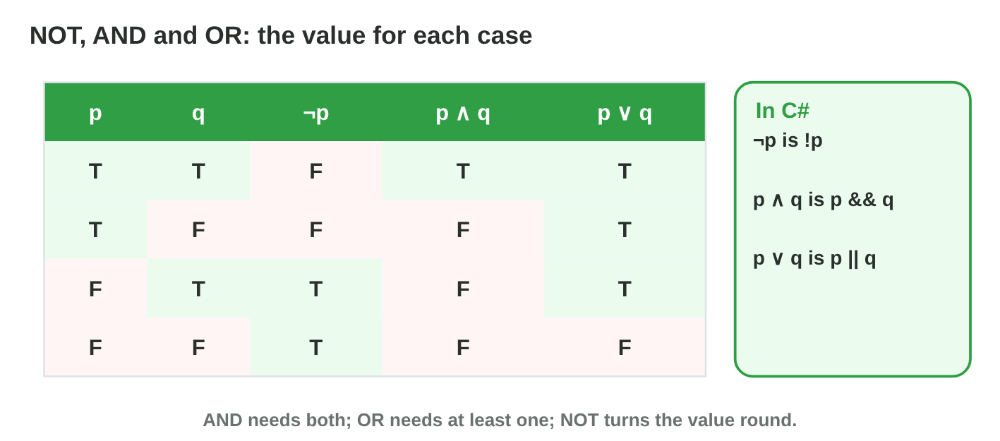
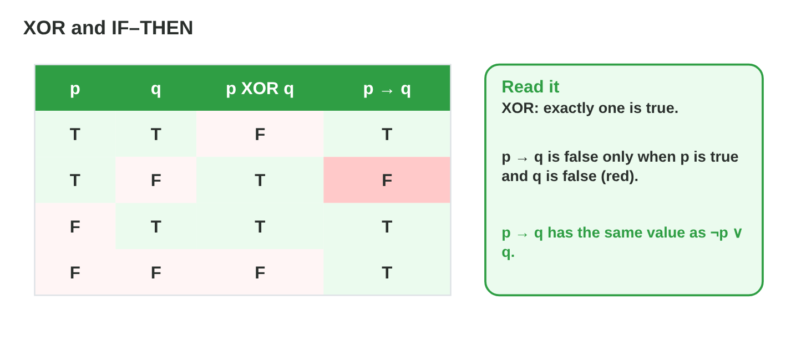

No new ideas today: three short problems on Lecture 8. Do each one alone.
Tap, sort or type your answer at every step: the page checks it at once and
tells you why.

## Recall

- NOT `!p`, AND `p && q`, OR `p || q`, XOR `p ^ q`. The order is NOT, AND,
  OR; brackets first.
- p → q is false only when p is true and q is false.
- A truth table with n variables has 2^n rows; its true rows show when a
  rule fires.

::: {.callout-tip title="Try it 1 · Recall"}
Choose the right answer.

::: {.match extra="6|p || q"}
How many rows has the truth table of 3 variables?
:   8

    Why: 2 × 2 × 2 = 8.

Which C# condition means "exactly one of p and q"?
:   p ^ q

    Why: XOR is true when exactly one is true.

p = T, q = F. What is p → q?
:   false

    Why: That is the only case that breaks an IF–THEN rule.
:::
:::

## Activity 1 · Rules in game code

A farm game has these game states as `bool` variables: `isDay`, `inFight`,
`hasSeeds`, `hasWater`, `isRaining`. The designer writes the rules in
words.

{width=80%}

::: {.callout-note title="Activity 1 · Words to code · 15 min"}
Write each rule as a C# condition.

1. The shop is open when it is day and the player is not in a fight.
2. The player can plant when there are seeds and (water or rain).
3. The scarecrow warning shows when it is night or the player is in a
   fight.
4. A crop grows when it is raining or the player has water, but not both.

*Your product:* four conditions.

::: {.choice}
Rule 1: the shop is open when it is day and the player is not in a fight.

- [x] `isDay && !inFight`

  Why: Day AND NOT in a fight.

- [ ] `isDay || !inFight`

  Why: OR would open the shop at night when there is no fight.

- [ ] `!isDay && inFight`

  Why: That is night and in a fight: the opposite of the rule.
:::

::: {.choice}
Rule 2: the player can plant when there are seeds and (water or rain).

- [x] `hasSeeds && (hasWater || isRaining)`

  Why: The brackets keep "water or rain" together, and the seeds are always needed.

- [ ] `hasSeeds && hasWater || isRaining`

  Why: && is computed first: rain alone would let the player plant without seeds.

- [ ] `hasSeeds || hasWater || isRaining`

  Why: OR everywhere lets the player plant with water but no seeds.
:::

::: {.choice}
Rule 3: the warning shows when it is night or the player is in a fight.

- [x] `!isDay || inFight`

  Why: Night is NOT day; OR shows the warning in either case.

- [ ] `!(isDay || inFight)`

  Why: That is night AND no fight, so a fight would hide the warning.

- [ ] `!isDay && inFight`

  Why: AND would need night and a fight at the same time.
:::

::: {.choice}
Rule 4: a crop grows when it is raining or the player has water, but not
both.

- [x] `isRaining ^ hasWater`

  Why: "But not both" is XOR: exactly one is true.

- [ ] `isRaining || hasWater`

  Why: OR is also true when both are true.

- [ ] `isRaining && hasWater`

  Why: AND is true only when both are true, the case the rule excludes.
:::
:::

::: {.callout-tip title="Try it 2 · Code"}
Choose the right condition.

::: {.match extra="hasSeeds && hasWater || isRaining|isDay || !inFight"}
"Plant when there are seeds and water or rain."
:   hasSeeds && (hasWater || isRaining)

    Why: Without brackets, rain alone would allow planting with no seeds.

"Open when it is day and the player is not in a fight."
:   isDay && !inFight

    Why: "And" is &&, "not" is !.

"Exactly one of two switches is up."
:   left ^ right

    Why: "Exactly one" is XOR.
:::
:::

## Activity 2 · Every row is a test case

A tester uses the truth table as a test plan: each row is a situation with
the result that the table predicts. The dock door rule is p ∧ (q ∨ r)
(pass, shields up, officer on board), but the code says
`if (hasPass && shieldsUp || officer)`.



::: {.callout-note title="Activity 2 · Find the bug · 18 min"}
1. Make the truth table of p ∧ (q ∨ r) in **Truth Table Lab**. How many
   rows are true?
2. Test the row (F, F, T): no pass, no shields, an officer. What does the
   table say? What does the code do?
3. Write the corrected condition.

*Your product:* the number of true rows, one bug and its fix.

::: {.fill answer="3" hint="p must be true, and q or r true."}
Step 1: how many of the 8 rows of p ∧ (q ∨ r) are true?

Why: (T, T, T), (T, T, F) and (T, F, T): 3 rows, never without the pass.
:::

::: {.choice}
Step 2: row (F, F, T). The table says "shut". What does the code do?

- [x] It opens the door.

  Why: && is computed first, so `hasPass && shieldsUp` is false, but `… || officer` is true.

- [ ] It keeps the door shut, like the table.

  Why: Without brackets the officer alone makes the condition true.

- [ ] It shows an error.

  Why: The code runs; it just gives a different answer from the table.
:::

::: {.choice}
Step 3: which condition is the fix?

- [x] `hasPass && (shieldsUp || officer)`

  Why: The brackets make OR first, like p ∧ (q ∨ r).

- [ ] `(hasPass && shieldsUp) || officer`

  Why: These brackets only show the bug: && first, as before.

- [ ] `hasPass || shieldsUp || officer`

  Why: OR everywhere opens the door without a pass.
:::
:::

::: {.callout-tip title="Try it 3 · Testing"}
Choose the right answer.

::: {.match extra="only the true rows|4"}
Why test the false rows too?
:   to see that it does not fire when it should not

    Why: A rule can be wrong by firing in a false row.

How many test cases cover every case of a 3-condition rule?
:   8

    Why: One for each row: 2^3 = 8.

The code `hasPass && shieldsUp || officer` opens for an officer alone. Why?
:   && is computed before ||

    Why: It means (hasPass && shieldsUp) || officer.
:::
:::

## Activity 3 · IF–THEN rules in a quest

A quest has two rules: "If the player has the map, then the cave is shown"
and "If the dragon is awake, then the music is loud". A tester writes down
four game states (map, cave shown, dragon awake, music loud):
A (T, T, F, F); B (T, F, T, T); C (F, T, T, F); D (F, F, F, F).

{width=78%}

::: {.callout-note title="Activity 3 · Which states break a rule? · 15 min"}
1. For each state, is rule 1 kept? Is rule 2 kept?
2. Write the C# condition that finds a broken rule 1.

*Your product:* a table of four states with "kept" or "broken", and one
condition.

::: {.sort}
Step 1: which rule does each state break? Sort the states.

No rule broken
:   A (T, T, F, F)

    Why: Map and cave shown; the dragon sleeps, so rule 2 says nothing.

:   D (F, F, F, F)

    Why: No map and no dragon: neither rule says anything.

Rule 1 broken
:   B (T, F, T, T)

    Why: The player has the map, but the cave is not shown.

Rule 2 broken
:   C (F, T, T, F)

    Why: The dragon is awake, but the music is not loud.
:::

::: {.choice}
Step 2: which condition finds a broken rule 1?

- [x] `hasMap && !caveShown`

  Why: p → q breaks only when p is true and q is false.

- [ ] `!hasMap && caveShown`

  Why: Without the map, rule 1 says nothing.

- [ ] `hasMap || !caveShown`

  Why: OR is also true for a player without the map and without the cave.
:::
:::

::: {.callout-tip title="Try it 4 · Rules kept or broken"}
Choose the right answer. You can use an answer more than once.

::: {.match extra="both broken"}
State B (map, no cave). Is rule 1 kept or broken?
:   broken

    Why: T → F is false.

State D (no map, no cave). Is rule 1 kept or broken?
:   kept

    Why: F → F is true: the rule says nothing without the map.

State C (dragon awake, music not loud). Is rule 2 kept or broken?
:   broken

    Why: T → F is false.
:::
:::

## At home · Task with AI

::: {.callout-note .ai-task title="Task with AI · A coloured truth table"}
An extra for the curious: let an AI assistant make the table. Copy the
prompt into an AI assistant that the university allows (for example
Microsoft Copilot with your university account), and look at the result.

::: {.prompt}
A boss door opens when the player has the key AND (the boss is awake OR the
timer is 0) AND the player is NOT invisible. Make the truth table with the
columns key, awake, timer, invisible and opens, with all 16 rows of true
and false (the key column first: 8 true, then 8 false). Colour the rows
where the door opens green.
:::

::: {.choice}
How many green rows should the table have? The AI can be wrong: compare.

- [x] 3 of 16

  Why: The key is true, invisible is false, and awake or timer is true: 3 ways.

- [ ] 8 of 16

  Why: The key alone is not enough: awake or timer, and not invisible, too.

- [ ] 1 of 16

  Why: OR lets the door open with awake, with the timer, or with both.
:::

::: {.try-change}
**Change:** remove "AND NOT invisible" from the rule, and ask again.

::: {.choice}
How many green rows now?

- [x] 6

  Why: The same 3 rows, now with invisible true and with invisible false.

- [ ] 3

  Why: One condition less lets the door open more often.
:::
:::

::: {.try-change}
**Change:** change OR to AND, and ask again.

::: {.choice}
How many green rows now?

- [x] 1

  Why: Key, awake and timer must all be true, and invisible false.

- [ ] 6

  Why: AND makes the rule harder to meet, not easier.
:::
:::

**Your own idea:** change one more number or word, and look again. The AI
can be wrong: compare its result with the answers.
:::

## Wrap-up {.summary}

- You can write the rules of a game as conditions with NOT, AND, OR, XOR
  and brackets.
- You can use a truth table as a test plan and find a bug.
- You can check which game states keep or break an IF–THEN rule.
