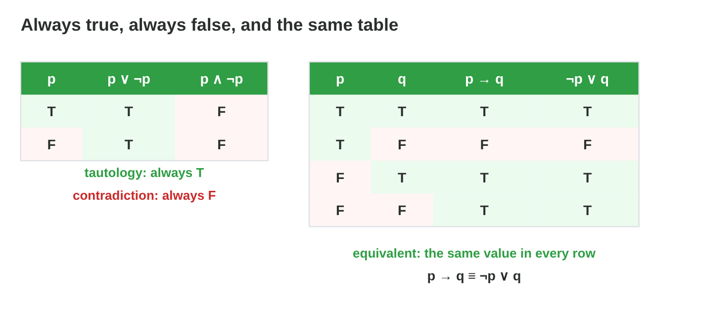
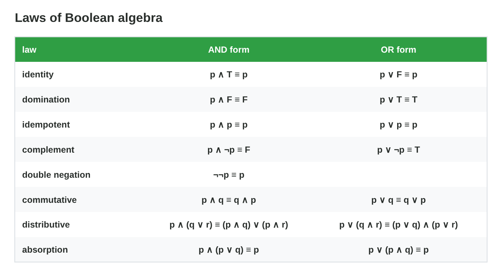
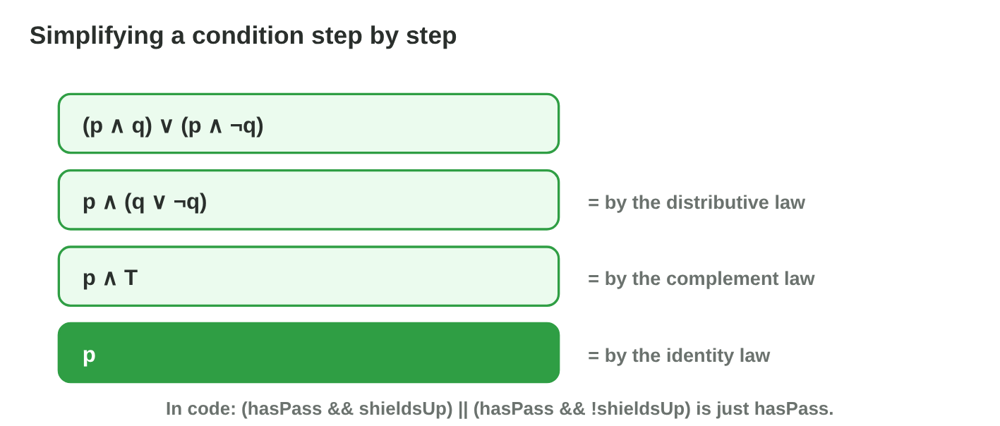
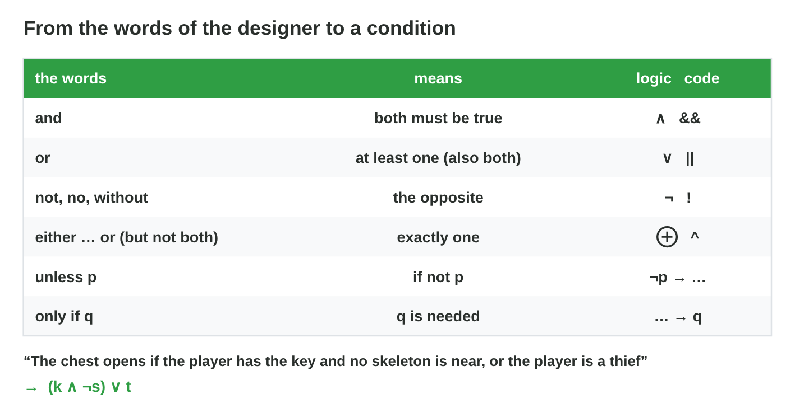
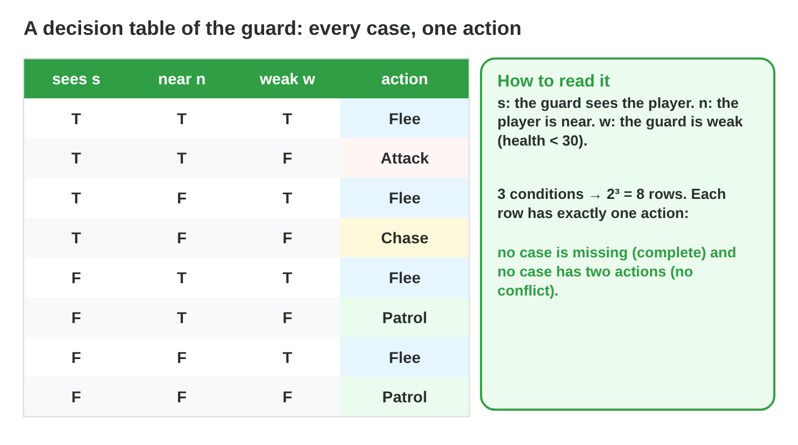
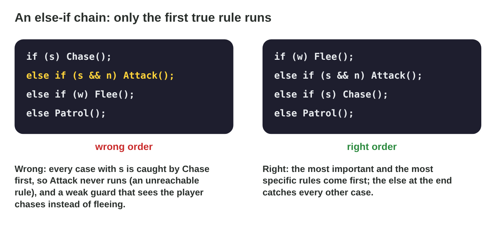

::: {.lead}
A game designer writes the rules in plain words; a programmer turns them
into conditions; a tester asks if two conditions are really the same. Long
conditions hide bugs: a door that never opens, a NOT in the wrong place, a
rule that never runs. In Lecture 8 you met the logical operators and truth
tables. In this lesson you find conditions that are always or never true,
use the laws of **Boolean algebra** to make a condition shorter, turn rule
words into exact conditions, and put every case of a decision into a
**decision table** and an else-if chain. Every section ends with a short
task.
:::

## Key terms



## 9.1 Always, never or the same: tautologies and equivalence

Some propositions have the same value in every row. And two different
propositions can have the same table (@fig-te).

::: {.callout-important title="Definition 9.1 — Tautology, contradiction, equivalence"}
A **tautology** is true in every row (p ∨ ¬p). A **contradiction** is false
in every row (p ∧ ¬p). Two propositions are **equivalent** (≡) when their
last columns are the same in every row; then one can replace the other.
:::

{#fig-te width=94%}

::: {.callout-note title="Example 9.1 — A door that never opens"}
A designer writes: "open when the alarm is on and the alarm is off":
alarm ∧ ¬alarm. Its column is F, F: a contradiction. The door never opens.
The truth table finds this bug before any player does.
:::

::: {.callout-note title="Example 9.2 — Two ways to write a rule"}
"If the ship is docked, the engine is off" is docked → ¬engine. The table
gives F only for docked = T, engine = T. So it is equivalent to
¬docked ∨ ¬engine, and also to ¬(docked ∧ engine).
:::

::: {.callout-warning title="Common mistake"}
Calling two propositions equivalent because they agree in some rows. They
must agree in **every** row.
:::

::: {.callout-note title="Do it · Same or not?"}
Build the tables of p → q and q → p. Are they equivalent? Which row shows
it?

*Your result:* two columns and one row.

::: {.check}
From (T, T) to (F, F): p → q gives T, F, T, T and q → p gives T, T, F, T.
They are **not** equivalent: the row (T, F) (and the row (F, T)) shows it.
:::
:::

## 9.2 The laws of Boolean algebra

Like a + 0 = a for numbers, Boolean algebra has laws that are true for every
value. Each law is an equivalence: you can check it with a truth table
(@fig-laws).

::: {.callout-important title="Definition 9.2 — The main laws"}
- **Identity:** p ∧ T ≡ p, p ∨ F ≡ p. **Domination:** p ∧ F ≡ F,
  p ∨ T ≡ T.
- **Idempotent:** p ∧ p ≡ p, p ∨ p ≡ p. **Complement:** p ∧ ¬p ≡ F,
  p ∨ ¬p ≡ T. **Double negation:** ¬¬p ≡ p.
- **Commutative** and **associative**: order and brackets of the same
  operator do not matter.
- **Distributive:** p ∧ (q ∨ r) ≡ (p ∧ q) ∨ (p ∧ r) and
  p ∨ (q ∧ r) ≡ (p ∨ q) ∧ (p ∨ r).
- **Absorption:** p ∨ (p ∧ q) ≡ p, p ∧ (p ∨ q) ≡ p.
:::

{#fig-laws width=94%}

::: {.callout-note title="Example 9.3 — Checking absorption"}
p ∨ (p ∧ q): if p = T, the OR is T; if p = F, then p ∧ q = F and the OR is
F. So the value is always the value of p: p ∨ (p ∧ q) ≡ p. In code,
`docked || (docked && alarm)` is just `docked`.
:::



::: {.callout-warning title="Common mistake"}
Using a law for numbers that is false for logic, or the other way round.
For example p ∨ (q ∧ r) ≡ (p ∨ q) ∧ (p ∨ r) is true in logic, but
a + (b × c) = (a + b) × (a + c) is false for numbers.
:::

::: {.callout-note title="Do it · Check two laws"}
1. In **Equivalence Lab**, check the distributive law and the absorption
   law.
2. Type p ∨ (q ∧ r) and (p ∨ q) ∧ (p ∨ r). Equivalent?

*Your result:* three answers.

::: {.check}
The distributive law and the absorption law are both equivalences: the
lab shows the same column for both sides. p ∨ (q ∧ r) and (p ∨ q) ∧ (p ∨ r)
are equivalent too.
:::
:::

## 9.3 De Morgan's laws

A NOT in front of brackets is the most common source of mistakes in game
conditions. De Morgan's laws say how to remove it (@fig-dm).

::: {.callout-important title="Definition 9.3 — De Morgan's laws"}
$$\neg(p \wedge q) \equiv \neg p \vee \neg q, \qquad \neg(p \vee q) \equiv \neg p \wedge \neg q.$$
Moving the NOT into the brackets turns each part round **and** swaps AND
and OR.
:::

{#fig-dm width=94%}

::: {.callout-note title="Example 9.4 — When can the ship not dock?"}
The ship can dock when `hasPass && shieldsUp`. It **cannot** dock when
`!(hasPass && shieldsUp)`.

1. De Morgan: `!hasPass || !shieldsUp`.
2. In words: no pass, **or** shields down. One missing thing is enough.
3. `!hasPass && !shieldsUp` (both missing) would be wrong: a ship with a pass
   but no shields could still dock.
:::

::: {.callout-warning title="Common mistake"}
Moving the NOT in without swapping the operator: ¬(p ∧ q) ≢ ¬p ∧ ¬q. Check
the row (T, F): the left side is T, the right side is F.
:::

::: {.callout-note title="Do it · Remove the NOT"}
Rewrite without a NOT in front of brackets: (a) `!(isDay || isLit)`;
(b) `!(hasKey && !doorLocked)`.

*Your result:* two conditions.

::: {.check}
(a) `!isDay && !isLit`. (b) `!hasKey || doorLocked`: the NOT of !doorLocked
is doorLocked (double negation), and && becomes ||.
:::
:::

## 9.4 Simplifying a condition

With the laws, a long condition can be rewritten step by step into a short
one. Each step uses one law, so the value never changes (@fig-simp).

::: {.callout-important title="Definition 9.4 — Simplification"}
To **simplify** a condition, apply one law at a time and name it. Useful
order: remove double NOTs and NOTs in front of brackets (De Morgan), take a
common part out (distributive), then use complement, identity and
absorption. Check the result with a truth table.
:::

{#fig-simp width=94%}

::: {.callout-note title="Example 9.5 — A long door rule"}
`(hasPass && shieldsUp) || (hasPass && !shieldsUp)`

1. Distributive: hasPass ∧ (shieldsUp ∨ ¬shieldsUp).
2. Complement: hasPass ∧ T.
3. Identity: **hasPass**. The shields never mattered.
:::

::: {.callout-note title="Example 9.6 — A NOT and an OR"}
¬(¬p ∨ q)

1. De Morgan: ¬¬p ∧ ¬q.
2. Double negation: **p ∧ ¬q**.
3. Check one row: p = T, q = F gives T on both sides.
:::

::: {.callout-warning title="Common mistake"}
Two laws in one step without checking. Write each step with its law, and
check the end result with a truth table or the Equivalence Lab.
:::

::: {.callout-note title="Do it · Simplify"}
Simplify step by step, with the name of each law: (a) p ∧ (p ∨ q);
(b) ¬(¬p ∧ ¬q); (c) (p ∨ q) ∧ (p ∨ ¬q).

*Your result:* three short conditions.

::: {.check}
(a) Absorption: **p**. (b) De Morgan: ¬¬p ∨ ¬¬q, double negation: **p ∨ q**.
(c) Distributive: p ∨ (q ∧ ¬q), complement: p ∨ F, identity: **p**.
:::
:::

## 9.5 From words to conditions

A designer's rule becomes code only when every word has one exact meaning
(@fig-words).

::: {.callout-important title="Definition 9.5 — Translating rule words"}
- **and** → ∧ (`&&`); **or** → ∨ (`||`), which includes "both";
  **not, no, without** → ¬ (`!`).
- **either … or, but not both** → ⊕ (`^`).
- **unless p** → "if not p".

First give each fact a letter, then find the main operator: the word that
joins the two big parts of the sentence.
:::

{#fig-words width=94%}

::: {.callout-note title="Example 9.7 — The vault of the bank"}
"The vault opens if the player has the code and no alarm is on, or the
player is the owner."

1. Letters: c = has the code, a = an alarm is on, o = is the owner.
2. The comma before "or" splits the sentence: (code and no alarm) **or**
   owner.
3. Condition: (c ∧ ¬a) ∨ o, in code `(hasCode && !alarmOn) || isOwner`.
4. Check one case: the owner without the code, with an alarm on: c = F, a =
   T, o = T gives F ∨ T = **T**. The vault opens, as the designer wants.
:::

::: {.callout-note title="Example 9.8 — Unless"}
"The music plays unless the game is paused." With g = the game is
paused: musicOn = ¬g. In code `bool musicOn = !isPaused;`.
:::

::: {.callout-warning title="Common mistake"}
Ignoring the brackets that the sentence implies. c ∧ (¬a ∨ o) looks
similar, but an owner without the code can never open the vault with it.
:::

::: {.callout-note title="Do it · Translate"}
Write as a condition, with your own letters: (a) "The trap fires when the
player steps on the plate and is not flying." (b) "The door opens with the
red key or the blue key, but not both." (c) "The alarm rings unless the
guard is asleep."

*Your result:* three conditions.

::: {.check}
(a) p ∧ ¬f (plate and not flying). (b) r ⊕ b (`red ^ blue`). (c) ring = ¬a
(`!guardAsleep`): "unless" means "if not".
:::
:::

## 9.6 Decision tables and else-if chains

When a decision depends on several conditions, a **decision table** lists
every case and the action for it (@fig-dt).

::: {.callout-important title="Definition 9.6 — Decision table"}
A **decision table** has one column for each condition, one row for each
combination of truth values (2^n rows for n conditions), and the action of
the game in that row. A good table is **complete** (every row has an
action) and has **no conflicts** (no row has two actions).
:::

{#fig-dt width=94%}

::: {.callout-note title="Example 9.9 — The guard of Torch Hall"}
Conditions: s = the guard sees the player, n = the player is near, w = the
guard is weak (health < 30). The designer's words: "A weak guard flees;
otherwise it attacks a player it sees near, or chases a player it sees;
otherwise it patrols."

1. 3 conditions → 8 rows.
2. Every row with w = T: **Flee** (4 rows).
3. w = F, s = T, n = T: **Attack**. w = F, s = T, n = F: **Chase**.
4. w = F, s = F: **Patrol** (2 rows). All 8 rows have exactly one action.
:::

::: {.callout-warning title="Common mistake"}
Writing only the cases you think of. The designer forgot "weak and sees the
player": the table shows the missing row at once.
:::

### Else-if chains: the order matters

In code, a decision table often becomes an **else-if chain**. The chain is
read from the top, and the **first** true rule wins (@fig-order).

::: {.callout-important title="Definition 9.7 — Else-if chain and unreachable rule"}
In an **else-if chain**, only the first rule whose condition is true runs;
the `else` at the end catches every other case. A rule is **unreachable**
when the rules above it catch all of its cases; it never runs. Put the
**most important** and the **most specific** rules first.
:::

{#fig-order width=94%}

::: {.callout-note title="Example 9.10 — The guard in code"}
A programmer writes `if (s) Chase(); else if (s && n) Attack(); else if (w)
Flee(); else Patrol();`

1. Every case with s is caught by Chase: **Attack never runs**.
2. Row s = T, w = T: the chain says Chase, the table says Flee.
3. Fix: `if (w) Flee(); else if (s && n) Attack(); else if (s) Chase();
   else Patrol();` Now the chain gives the table in all 8 rows.
:::



::: {.callout-caution title="In game code"}
```csharp
void Decide() {
    if (health < 30)                Flee();
    else if (seesPlayer && isNear)  Attack();
    else if (seesPlayer)            Chase();
    else                            Patrol();
}
```
:::

::: {.callout-warning title="Common mistake"}
Putting the general rule (`if (seesPlayer)`) before the special one
(`seesPlayer && isNear`). The special rule becomes unreachable.
:::

::: {.callout-note title="Do it · A trap table and the rule order"}
1. A spike trap fires when the plate is pressed (p) and the trap is armed
   (a), unless the player is flying (f). Make the decision table with 8 rows
   and the action "fire" or "wait". In how many rows does it fire?
2. In **Guard Brain**, switch on s and n. Which action runs? Change the
   order until the chain and the designer agree in all 8 rows.

*Your result:* a table and the right order of the three rules.

::: {.check}
The trap fires only in the row p = T, a = T, f = F: 1 of 8 rows. Guard Brain
agrees in all 8 rows with the order Flee (if w), Attack (else if s and n),
Chase (else if s), Patrol (else).
:::
:::

## Case study: Rule Smith

The designer of *Torch Hall* gives six rules in words and code: the chest
rule with the thief; the bridge that stays up unless the lever is pulled;
the door that opens with one key but not both; a NOT in front of brackets;
a chain with a rule that never runs; and a condition with a part that never
matters. The Game challenge of the interactive lesson uses these rules. In
the mini-game below you turn each one into an exact condition or find its
bug.



## Further reading

Rosen, *Discrete Mathematics and Its Applications*, 8th ed., Section 1.3
(propositional equivalences, De Morgan's laws). Millington, *AI for Games*,
3rd ed., Chapter 5 (decision making).

## Exercises

1. Is p ∧ ¬p a tautology or a contradiction?
2. Are ¬(p ∧ q) and ¬p ∨ ¬q equivalent? Which law says so?
3. Use De Morgan: rewrite `!(hasShield || isInvisible)`.
4. Simplify (p ∧ q) ∨ (p ∧ ¬q).
5. Simplify ¬(¬p ∨ q).
6. Translate: "The lift moves when the button is pressed and the door is
   closed."
7. Translate: "The shop is open unless it is night."
8. Translate: "The player wins with the gold or the gem, but not both."
9. How many rows has a decision table with 4 conditions?
10. What makes a decision table complete? What is a conflict?
11. In an else-if chain, which rule runs when two conditions are true?
12. Why is `else if (s && n)` unreachable after `if (s)`?

## Answers to the exercises

::: {.answers}
1. A contradiction: it is false in every row.
2. Yes: De Morgan's law.
3. `!hasShield && !isInvisible`.
4. p (distributive, complement, identity).
5. p ∧ ¬q (De Morgan, double negation).
6. b ∧ c (button pressed and door closed).
7. open = ¬night.
8. g ⊕ m.
9. 2⁴ = 16.
10. Complete: every row has an action. Conflict: a row with two actions.
11. The first true rule from the top.
12. Every case with s and n also has s, so `if (s)` catches it first.
:::
