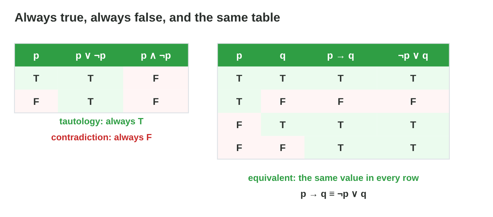
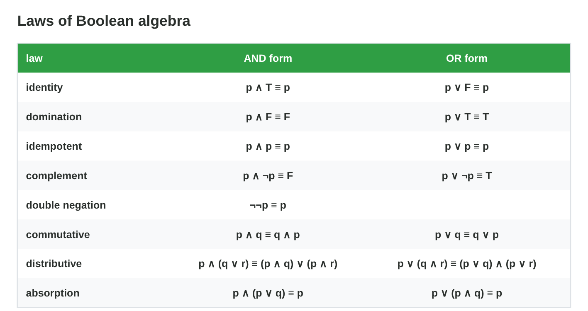
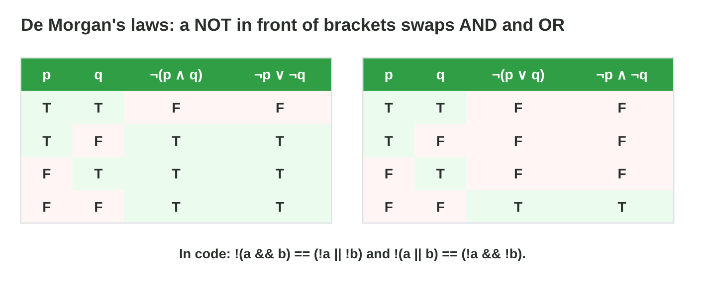
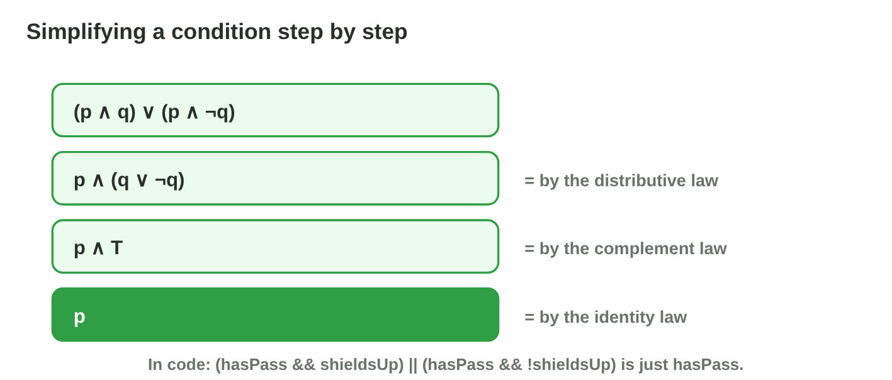
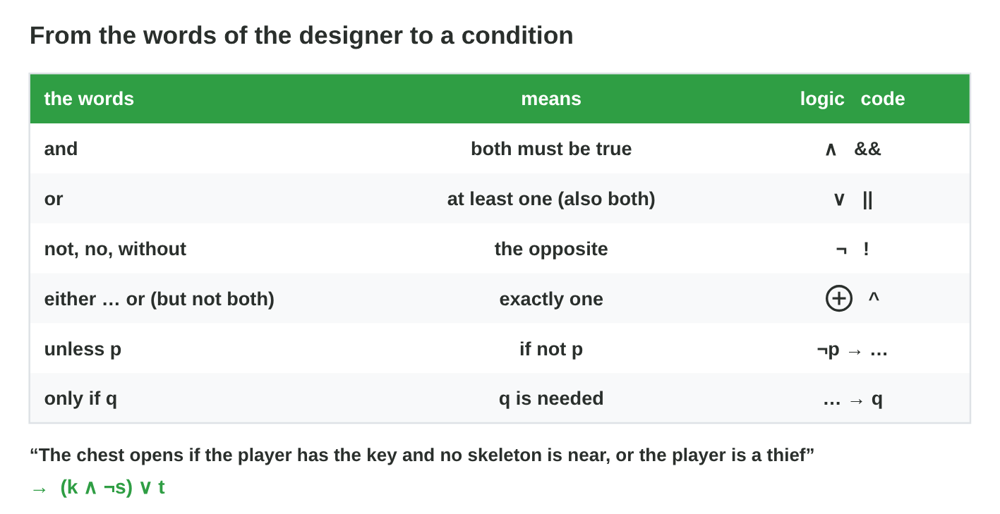
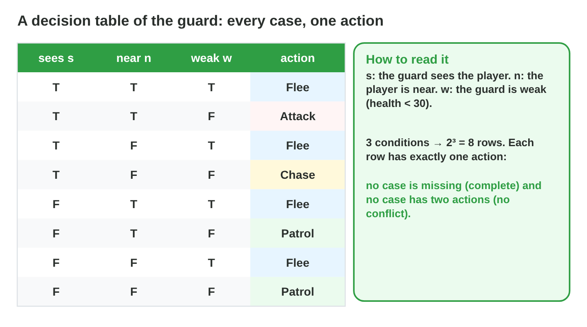
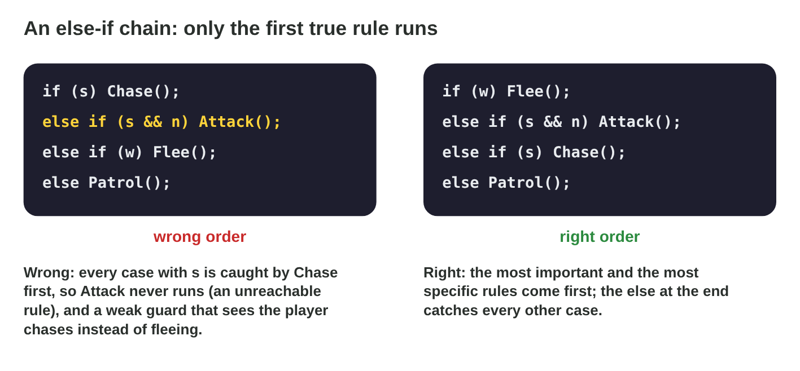

This page is the interactive version of the lesson notes (PDF). Each section
starts with a problem in a game. Then it explains the idea behind it. It
ends with a **Do it** task and one set of questions. Tap, sort or type your
answer: the page checks it at once and tells you why.

## Key terms



## 9.1 Always, never or the same: tautologies and equivalence

- **Tautology:** T in every row (p ∨ ¬p). **Contradiction:** F in every row
  (p ∧ ¬p).
- **Equivalent (≡):** the same last column in every row; one can replace
  the other.
- p → q ≡ ¬p ∨ q ≡ ¬(p ∧ ¬q).
- "Open when the alarm is on and off" is a contradiction: the door never
  opens.

{width=90%}

::: {.callout-warning title="Watch out!"}
Equivalent means equal in **every** row, not in most rows.
:::

::: {.callout-note title="Do it · Same or not?"}
Build the tables of p → q and q → p. p → q is T, F, T, T; compute q → p in
the same order of rows: (T, T), (T, F), (F, T), (F, F).

::: {.choice}
Are p → q and q → p equivalent?

- [x] No: the rows (T, F) and (F, T) differ.

  Why: q → p is T, T, F, T: two rows are not the same as T, F, T, T.

- [ ] Yes: both have three true rows.

  Why: Equivalent means the same value in every row, not the same count.

- [ ] Yes: they use the same letters.

  Why: Turning a rule round makes a different rule.
:::
:::

::: {.callout-tip title="Try it 1 · Always, never, same"}
Choose the right answer.

::: {.match extra="neither, it depends|a test case"}
p ∨ ¬p is …
:   a tautology

    Why: one of p and ¬p is always true.

alarm ∧ ¬alarm is …
:   a contradiction

    Why: the alarm cannot be on and off at once: always false.

p → q and ¬p ∨ q are …
:   equivalent

    Why: both are false only in the row p = T, q = F.

p → q and q → p are …
:   not equivalent

    Why: they differ in the rows (T, F) and (F, T).
:::
:::

## 9.2 The laws of Boolean algebra

- Identity, domination, idempotent, complement, double negation.
- Commutative and associative: order and brackets of one operator do not
  matter.
- **Distributive:** p ∧ (q ∨ r) ≡ (p ∧ q) ∨ (p ∧ r), and p ∨ (q ∧ r) ≡
  (p ∨ q) ∧ (p ∨ r).
- **Absorption:** p ∨ (p ∧ q) ≡ p.

{width=90%}



::: {.callout-warning title="Watch out!"}
Not every law of numbers is a law of logic, and the other way round.
:::

::: {.callout-note title="Do it · Check two laws"}
In **Equivalence Lab**, check the distributive and absorption laws. Then
compare p ∨ (q ∧ r) with (p ∨ q) ∧ (p ∨ r), and ¬(p ∧ q) with ¬p ∧ ¬q.

::: {.sort}
Which pairs are equivalent? Sort them.

Equivalent
:   p ∧ (q ∨ r) and (p ∧ q) ∨ (p ∧ r)

    Why: The distributive law: the same column on both sides.

:   p ∨ (p ∧ q) and p

    Why: The absorption law.

:   p ∨ (q ∧ r) and (p ∨ q) ∧ (p ∨ r)

    Why: The second distributive law: OR over AND works too.

Not equivalent
:   ¬(p ∧ q) and ¬p ∧ ¬q

    Why: In the row (T, F) the left side is T and the right side is F.
:::
:::

::: {.callout-tip title="Try it 2 · Laws"}
Simplify. You can use an answer more than once.

::: {.match extra="q|¬p"}
p ∧ T
:   p

    Why: identity: AND with true changes nothing.

p ∨ T
:   T

    Why: domination: OR with true is always true.

p ∧ ¬p
:   F

    Why: complement: never both.

p ∨ (p ∧ q)
:   p

    Why: absorption: if p is false, p ∧ q is false too.
:::
:::

## 9.3 De Morgan's laws

- **¬(p ∧ q) ≡ ¬p ∨ ¬q** and **¬(p ∨ q) ≡ ¬p ∧ ¬q**.
- The NOT goes into the brackets and AND and OR swap.
- Cannot dock: `!(hasPass && shieldsUp)` = `!hasPass || !shieldsUp`.

{width=90%}

::: {.callout-warning title="Watch out!"}
¬(p ∧ q) is not ¬p ∧ ¬q: the row (T, F) differs.
:::

::: {.callout-note title="Do it · Remove the NOT"}
Rewrite `!(isDay || isLit)` and `!(hasKey && !doorLocked)` without a NOT in
front of brackets.

::: {.choice}
What is `!(isDay || isLit)`?

- [x] `!isDay && !isLit`

  Why: De Morgan: the NOT goes into the brackets, and OR becomes AND.

- [ ] `!isDay || !isLit`

  Why: AND and OR must swap: || becomes &&.

- [ ] `isDay && isLit`

  Why: The NOT does not disappear; it goes onto each part.
:::

::: {.choice}
What is `!(hasKey && !doorLocked)`?

- [x] `!hasKey || doorLocked`

  Why: De Morgan, then NOT NOT doorLocked = doorLocked.

- [ ] `!hasKey && doorLocked`

  Why: AND must become OR.

- [ ] `!hasKey || !doorLocked`

  Why: The NOT of !doorLocked is doorLocked: two NOTs cancel.
:::
:::

::: {.callout-tip title="Try it 3 · De Morgan"}
Choose the equivalent condition.

::: {.match extra="!isDay || !isLit|hasKey && doorLocked"}
!(hasPass && shieldsUp)
:   !hasPass || !shieldsUp

    Why: De Morgan: NOT each part, && becomes ||.

!(isDay || isLit)
:   !isDay && !isLit

    Why: De Morgan: NOT each part, || becomes &&.

!(hasKey && !doorLocked)
:   !hasKey || doorLocked

    Why: De Morgan, then !!doorLocked is doorLocked.

!(!a || !b)
:   a && b

    Why: De Morgan, then double negation: !!a is a.
:::
:::

## 9.4 Simplifying a condition

- One law per step, with its name; check the end with a truth table.
- (p ∧ q) ∨ (p ∧ ¬q) → p ∧ (q ∨ ¬q) → p ∧ T → **p**.
- ¬(¬p ∨ q) → ¬¬p ∧ ¬q → **p ∧ ¬q**.

{width=90%}

::: {.callout-warning title="Watch out!"}
Do not jump two laws at once without a check.
:::

::: {.callout-note title="Do it · Simplify"}
Simplify with the name of each law: p ∧ (p ∨ q); ¬(¬p ∧ ¬q);
(p ∨ q) ∧ (p ∨ ¬q).

::: {.sort}
What does each condition simplify to? Sort them.

p
:   p ∧ (p ∨ q)

    Why: The absorption law.

:   p ∨ (p ∧ q)

    Why: The other absorption law.

:   (p ∨ q) ∧ (p ∨ ¬q)

    Why: Distributive, complement, identity: p ∨ (q ∧ ¬q) = p ∨ F = p.

p ∨ q
:   ¬(¬p ∧ ¬q)

    Why: De Morgan gives ¬¬p ∨ ¬¬q, and the double negations cancel.
:::

::: {.order}
Put the steps of (p ∨ q) ∧ (p ∨ ¬q) in order.

1. Distributive: (p ∨ q) ∧ (p ∨ ¬q) = p ∨ (q ∧ ¬q)
2. Complement: q ∧ ¬q = F, so p ∨ F
3. Identity: p ∨ F = p

Why: One law per step, with its name: the bracket first, then the complement, then the identity.
:::
:::

::: {.callout-tip title="Try it 4 · Simplify"}
Choose the simplest equivalent. You can use an answer more than once.

::: {.match extra="p ∧ q|¬p ∨ q"}
p ∧ (p ∨ q)
:   p

    Why: absorption.

¬(¬p ∧ ¬q)
:   p ∨ q

    Why: De Morgan: ¬¬p ∨ ¬¬q, then double negation.

(p ∨ q) ∧ (p ∨ ¬q)
:   p

    Why: distributive: p ∨ (q ∧ ¬q) = p ∨ F = p.

¬(¬p ∨ q)
:   p ∧ ¬q

    Why: De Morgan: ¬¬p ∧ ¬q, then double negation.

p ∨ (q ∧ ¬q)
:   p

    Why: q ∧ ¬q is F, and p ∨ F = p.
:::
:::

## 9.5 From words to conditions

- **and** → `&&` · **or** → `||` (also both) · **not, no** → `!`
- **either … or, not both** → `^` · **unless p** → if not p
- Give each fact a letter, then find the word that joins the two big parts.
- "Code and no alarm, **or** owner" → `(c && !a) || o`.

{width=94%}

::: {.callout-warning title="Watch out!"}
`c && (!a || o)` looks similar, but then an owner needs the code.
:::

::: {.callout-note title="Do it · Translate"}
Write as conditions: "The trap fires when the player steps on the plate and
is not flying"; "the red key or the blue key, but not both"; "the alarm
rings unless the guard is asleep".

::: {.sort}
Which word joins the facts in each rule? Sort the rules.

AND NOT: `&&`, `!`
:   The trap fires when the player steps on the plate and is not flying.

    Why: `p && !f`: "and" with "not".

XOR: `^`
:   The red key or the blue key, but not both.

    Why: `r ^ b`: "not both" is exactly one.

:   A sword or a bow, one at a time.

    Why: "One at a time" is exactly one: XOR.

NOT: `!`
:   The alarm rings unless the guard is asleep.

    Why: `alarm = !a`: "unless a" means "if not a".

:   The shop opens unless it is night.

    Why: `open = !night`.
:::
:::

::: {.callout-tip title="Try it 5 · Words to logic"}
Choose the condition.

::: {.match extra="p -> !q|!(p || q)"}
plate pressed and not flying
:   p && !f

    Why: "and" is &&, "not" is !.

the red key or the blue key, but not both
:   r ^ b

    Why: "but not both" is XOR.

the alarm rings unless the guard is asleep
:   alarm = !a

    Why: "unless" means "if not".

code and no alarm, or owner
:   (c && !a) || o

    Why: the comma before "or" splits the sentence into two parts.
:::
:::

## 9.6 Decision tables and else-if chains

- A **decision table**: one column per condition, **2^n rows**, and the
  **action** in each row. **Complete:** every row has an action. **No
  conflict:** never two actions.
- The guard: s = sees, n = near, w = weak. "A weak guard flees; otherwise it
  attacks a player it sees near, or chases a player it sees; otherwise it
  patrols."
- In an **else-if chain** the first true rule wins. A rule whose cases are
  all caught above it is **unreachable**. Most important and most specific
  rules first; `else` last.

{width=90%}

{width=90%}



::: {.callout-warning title="Watch out!"}
`if (s)` before `else if (s && n)`: Attack never runs.
:::

::: {.callout-note title="Do it · A trap table and the rule order"}
The spike trap fires when the plate is pressed (p) and the trap is armed
(a), unless the player is flying (f). Make the 8-row table. Then, in
**Guard Brain**, change the order of the rules until the chain agrees with
the designer in all 8 rows.

::: {.fill answer="1" hint="The trap needs p = T, a = T and f = F."}
In how many of the 8 rows does the trap fire?

Why: p ∧ a ∧ ¬f is true only in the row p = T, a = T, f = F.
:::

::: {.order}
Put the rules of Guard Brain in the right order.

1. Flee: `if (w)`
2. Attack: `else if (s && n)`
3. Chase: `else if (s)`
4. Patrol: `else`

Why: The first true rule wins: the most important rule first, then the more specific rule before the general one, and else last.
:::
:::

::: {.callout-tip title="Try it 6 · Tables and chains"}
Use the table of the guard. Choose the right answer.

::: {.match extra="Sleep|the last rule"}
s = T, n = T, w = F. The action?
:   Attack

    Why: not weak, sees and near: attack.

s = T, n = T, w = T. The action?
:   Flee

    Why: a weak guard always flees.

s = F, n = F, w = F. The action?
:   Patrol

    Why: sees nothing: patrol.

The chain `if (s) Chase(); else if (s && n) Attack(); …`. Which rule never runs?
:   Attack()

    Why: every case with s is caught by Chase first.

Which rule runs when two conditions are true?
:   the first true rule from the top

    Why: an else-if chain stops at the first true rule.
:::
:::

## Game challenge: Rule Smith {.challenge}

Work alone. Use every section of today.

The designer of *Torch Hall* gives six rules: the chest opens if the player
has the key (k) and no skeleton (s) is near, or the player is a thief (t);
the bridge stays up **unless** the lever (l) is pulled; a door opens with
the red key (r) or the blue key (b), **but not both**; a guard cannot see
the player when **not** (light on and player in view); a shop chain with a
rule that never runs; and a condition with a part that never matters.



::: {.callout-tip title="Try it 7 · The rules of Torch Hall"}
Torch Hall: chest (k and no s) or t; bridge up unless l; door r or b, but not
both; guard blind when not (l and v). Choose the right answer.

::: {.match extra="bridgeUp = l|r || b"}
The chest rule in code?
:   (k && !s) || t

    Why: (key and no skeleton) or thief.

The bridge stays up unless the lever is pulled.
:   bridgeUp = !l

    Why: "unless l" means "if not l".

The red key or the blue key, but not both?
:   r ^ b

    Why: exactly one: XOR.

The same as !(l && v)?
:   !l || !v

    Why: De Morgan.
:::
:::

::: {.callout-tip title="Try it 8 · Count and clean (harder)"}
The chest opens with (k ∧ ¬s) ∨ t. Choose the right answer.

::: {.match extra="6|lit && windy"}
In how many of 8 rows does (k ∧ ¬s) ∨ t open the chest?
:   5

    Why: the 4 rows with t, and (T, F, F).

`if (gold > 0) Sell(); else if (gold > 50) Discount();` Which rule never runs?
:   Discount()

    Why: gold > 50 is always caught by gold > 0 first.

A shorter condition for `lit || (lit && windy)`?
:   lit

    Why: absorption: p ∨ (p ∧ q) ≡ p.

How many rows has a table with 4 conditions?
:   16

    Why: 2^4.
:::
:::

## Summary {.summary}

- A tautology is always true, a contradiction always false; equivalent conditions have the same table.
- The laws of Boolean algebra make a condition shorter, one step at a time.
- De Morgan: the NOT goes into the brackets, and AND and OR swap.
- Rule words: and, or, not, but not both (XOR), unless (if not).
- A decision table lists every case; in an else-if chain the first true rule wins.
