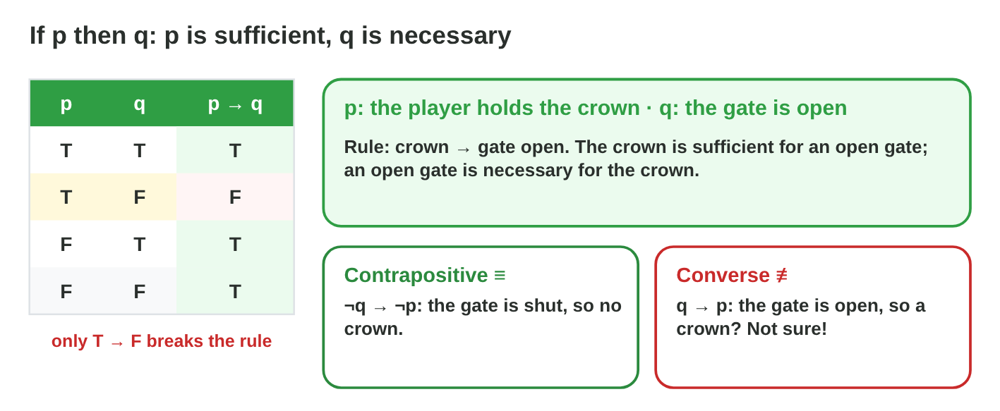
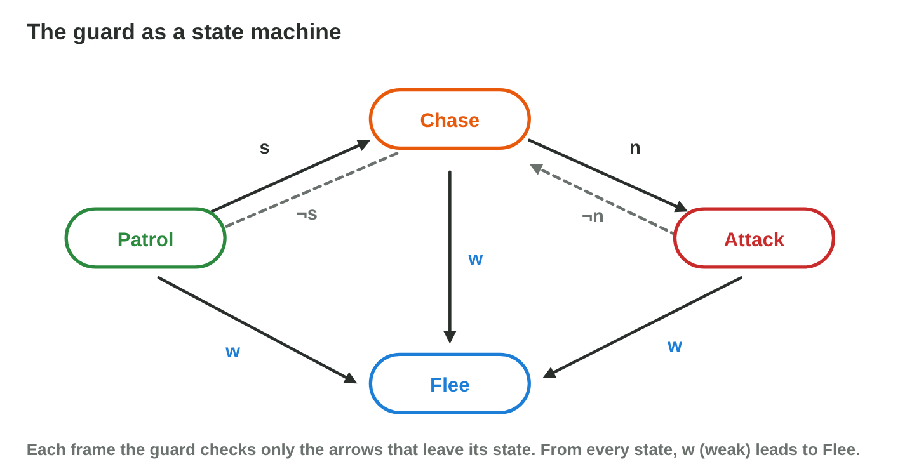
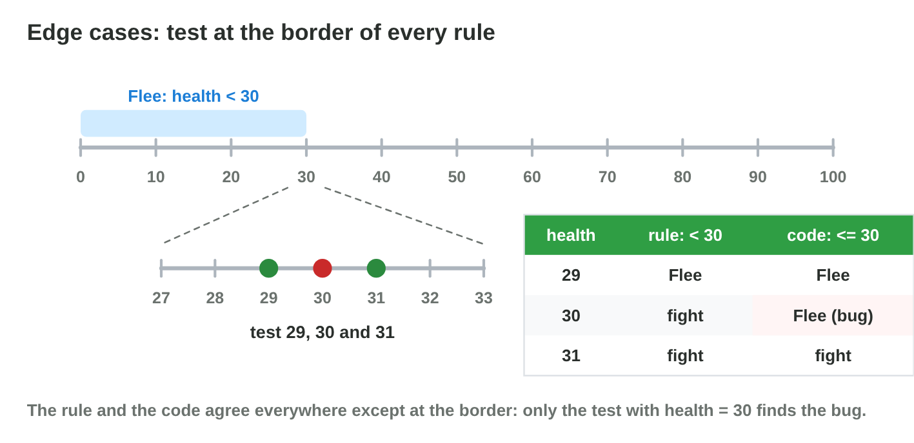

## Keywords



## 19.1 From words to conditions

:::: {.columns}
::: {.column width="50%"}
- We give each fact a letter first.
- And, or and not become &&, || and !.
- "Unless p" means "if not p", and "only if q" means that q is needed.
- **Do it:** Translate "the alarm rings unless the guard is asleep". What do you get?
:::
::: {.column width="50%"}

:::
::::

## Example · The chest of Torch Hall

The chest opens if the player has the key and no skeleton is near, or the player is a thief.
**Which condition is this rule?**

::: {.reveal}
1. The letters are k (key), s (skeleton near) and t (thief).
2. The comma before "or" splits it: **(key and no skeleton) or thief**.
3. The condition is **(k ∧ ¬s) ∨ t**, and a thief opens it even with a skeleton near.
:::

## Try it 1 · Words to logic

a) Which condition is "plate pressed and not flying"?
b) Which condition is "the red key or the blue key, but not both"?
c) Which condition is "the bridge stays up unless the lever is pulled"?

::: {.answer}
a) p && !f
b) r ^ b
c) bridgeUp = !l
:::

## 19.2 Sufficient and necessary

:::: {.columns}
::: {.column width="50%"}
- In p → q, p is sufficient for q.
- In p → q, q is necessary for p.
- The contrapositive ¬q → ¬p is the same rule, but the converse is not.
- **Do it:** The music did not change. What follows from "boss defeated → music changes"?
:::
::: {.column width="50%"}

:::
::::

## Example · The crown and the gate

The rule says that if the player holds the crown, the gate is open.
**What do we know when the gate is shut, and when it is open?**

::: {.reveal}
1. The gate is shut, so by the contrapositive the player has **no crown**.
2. The gate is open, so we know **nothing** about the crown.
3. Only crown = T and open = F **breaks** the rule.
:::

## Try it 2 · If-then

a) Which condition is necessary in "crown → gate open"?
b) What is the contrapositive of p → q?
c) Which implication is "enter only if the torches are lit"?

::: {.answer}
a) the open gate
b) ¬q → ¬p
c) enter → lit
:::

## 19.3 Decision tables

:::: {.columns}
::: {.column width="50%"}
- A decision table has one column for each condition.
- It has 2^n rows and one action in each row.
- A complete table has no missing case and no conflict.
- **Do it:** Make the 8-row table of the spike trap. In how many rows does it fire?
:::
::: {.column width="50%"}

:::
::::

## Example · The guard of Torch Hall

The guard has three conditions: s (sees), n (near) and w (weak).
**Which action does each row of the table get?**

::: {.reveal}
1. Every row with w = T gets **Flee**, which makes 4 rows.
2. With w = F, s = T and n = T, the guard **attacks**, and with n = F it **chases**.
3. With w = F and s = F, the guard **patrols** in 2 rows.
:::

## Try it 3 · The table

a) How many rows does a table with 3 conditions have?
b) Which action does the row s = T, n = T, w = T get?
c) How many rows does a table with 4 conditions have?

::: {.answer}
a) 8
b) Flee
c) 16
:::

## 19.4 Else-if chains

:::: {.columns}
::: {.column width="50%"}
- An else-if chain is read from the top.
- Only the first true rule runs.
- A rule is unreachable when the rules above it catch all its cases.
- **Do it:** Fix the chain in Guard Brain. Which rule comes first?
:::
::: {.column width="50%"}

:::
::::

## Example · The guard in code

The code is if (s) Chase(); else if (s && n) Attack(); else if (w) Flee(); else Patrol();
**What is wrong, and how do we fix it?**

::: {.reveal}
1. Every case with s is caught by Chase, so **Attack never runs**.
2. A weak guard that sees the player **chases** instead of fleeing.
3. The fix is **Flee if w, then Attack if s && n, then Chase if s, then Patrol**.
:::

## Live demo · Guard Brain



## Try it 4 · The chain

a) Which rule runs when two conditions are true?
b) Which rule never runs in the first chain?
c) Where does the else go in the chain?

::: {.answer}
a) the first true rule from the top
b) Attack()
c) at the end
:::

## 19.5 State machines

:::: {.columns}
::: {.column width="50%"}
- A state machine has states and arrows with conditions.
- Each frame, the guard checks only the arrows of its state.
- From every state, w leads to Flee.
- **Do it:** Start in Patrol with s, then s and n. Which state is the guard in?
:::
::: {.column width="50%"}

:::
::::

## Example · One step of the guard

The guard is in Chase, and the arrows n, ¬s and w leave this state.
**Where does the guard go in each frame?**

::: {.reveal}
1. The player comes near, so n = T and the guard goes to **Attack**.
2. The player runs away, so ¬n = T and the guard goes back to **Chase**.
3. Its health falls to 25, so w = T and the guard goes to **Flee**.
:::

## Try it 5 · Next state

a) Which state follows Patrol when the guard sees the player?
b) Which state follows Attack when the player walks away?
c) Which state follows Chase when the guard loses the player?

::: {.answer}
a) Chase
b) Chase
c) Patrol
:::

## 19.6 Edge cases

:::: {.columns}
::: {.column width="50%"}
- Every row of a decision table is a test case.
- Number rules need tests at the border.
- For "health < 30", we test 29, 30 and 31.
- **Do it:** Write four edge-case tests for the bonus life. Which values did you choose?
:::
::: {.column width="50%"}

:::
::::

## Example · The bug at 30

The rule says that the guard flees when health < 30, but the code says health <= 30.
**Which test finds the bug?**

::: {.reveal}
1. The tests with **10** and **80** agree with the rule and find nothing.
2. The test with **30** shows the bug: the rule says fight, the code says flee.
3. The fix is **health < 30**, and we keep the test with 30.
:::

## Try it 6 · Edge cases

a) Which test finds the bug when the rule is speed > 5 and the code is speed >= 5?
b) Which test finds the bug when the rule is coins >= 100 and the code is coins > 100?
c) Which three values do we test for lives < 3?

::: {.answer}
a) speed = 5
b) coins = 100
c) 2, 3 and 4
:::

## Game challenge · Rule Smith



## Try it 7 · Count the cases (harder)

a) In how many of 8 rows does (k ∧ ¬s) ∨ t open the chest?
b) In how many of 8 rows does the guard flee?
c) In how many of 8 rows does the guard attack?

::: {.answer}
a) 5
b) 4
c) 1
:::

## Summary

- We give each fact a letter and translate the rule words exactly.
- In p → q, p is sufficient and q is necessary.
- A decision table lists every case with one action.
- In an else-if chain, the first true rule wins.
- A state machine checks only the arrows of its state.
- We test every row, and numbers at their borders.
