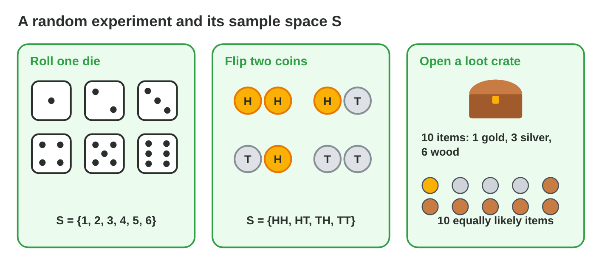
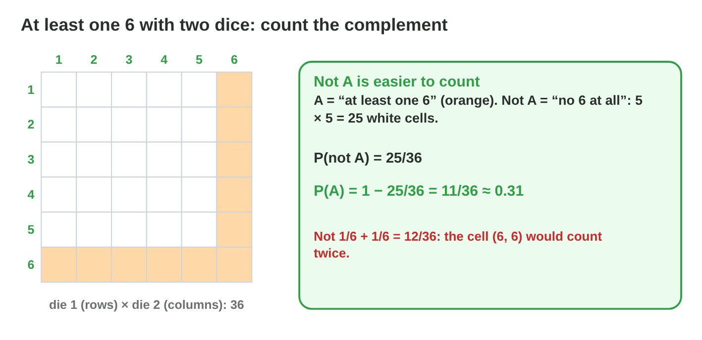

## Keywords



## 20.1 Sample spaces

:::: {.columns}
::: {.column width="50%"}
- A random experiment has a result that we cannot know in advance.
- The sample space S is the set of all outcomes.
- We list outcomes so that each one is equally likely.
- **Do it:** Write the sample space of three coins. How many outcomes has it?
:::
::: {.column width="50%"}

:::
::::

## Example · The experiments of Lucky Raft

The board game Lucky Raft uses a die, two coins and loot crates.
**What is the sample space of each experiment?**

::: {.reveal}
1. One die gives **S = {1, 2, 3, 4, 5, 6}** with 6 outcomes.
2. Two coins give **{HH, HT, TH, TT}**, because HT and TH are different.
3. A crate with 10 items gives **10 equally likely outcomes**.
:::

## Try it 1 · Sample spaces

a) How many outcomes does one die have?
b) How many outcomes do three coins have?
c) How many outcomes do two dice have?

::: {.answer}
a) 6
b) 8
c) 36
:::

## 20.2 The probability of an event

:::: {.columns}
::: {.column width="50%"}
- An event is a set of outcomes.
- With equally likely outcomes, P(A) = |A| ÷ |S|.
- A probability is between 0 (impossible) and 1 (certain).
- **Do it:** Find P(odd) and P(a 7) with one die. What are they?
:::
::: {.column width="50%"}

:::
::::

## Example · Reaching the island

The raft reaches the island with a 5 or a 6.
**What is the probability?**

::: {.reveal}
1. The event is **A = {5, 6}**, so |A| = 2 and |S| = 6.
2. P(A) = 2/6 = **1/3**, which is about 33 %.
3. So about **one turn in three** reaches the island.
:::

## Live demo · Sample Space Lab



## Try it 2 · One die and a crate

a) What is P(an even number) with one die?
b) What is P(gold) for 1 gold item of 10?
c) What is P(a 7) with one die?

::: {.answer}
a) 1/2
b) 1/10
c) 0
:::

## 20.3 The complement

:::: {.columns}
::: {.column width="50%"}
- Not A has all the outcomes that are not in A.
- P(not A) = 1 − P(A).
- "At least one" is often easier with the complement.
- **Do it:** Find P(at least one head) with two coins. Which complement did you use?
:::
::: {.column width="50%"}

:::
::::

## Example · At least one 6

Two dice give a bonus when at least one die shows a 6.
**What is the probability of the bonus?**

::: {.reveal}
1. The complement is **no 6 at all**: 5 × 5 = 25 of 36 cells.
2. P(bonus) = 1 − 25/36 = **11/36**, about 0.31.
3. 1/6 + 1/6 = 12/36 is **wrong**, because (6, 6) counts twice.
:::

## Try it 3 · Not A

a) What is P(not a 6) with one die?
b) What is P(not wood) when 6 of 10 items are wood?
c) What is P(at least one head) with two coins?

::: {.answer}
a) 5/6
b) 4/10
c) 3/4
:::

## 20.4 Grids and trees

:::: {.columns}
::: {.column width="50%"}
- Two steps with m and k outcomes give m × k pairs.
- A grid shows the 36 pairs of two dice.
- In a tree diagram, we multiply along a branch.
- **Do it:** Find P(a double) in the grid. How many cells are doubles?
:::
::: {.column width="50%"}

:::
::::

## Example · The sum 7

A sum of 7 calls the sea eagle in Lucky Raft.
**What is P(sum 7)?**

::: {.reveal}
1. Two dice give **36** equally likely pairs.
2. Six pairs make 7: **(1,6), (2,5), (3,4), (4,3), (5,2), (6,1)**.
3. P(sum 7) = 6/36 = **1/6**, but P(sum 12) is only 1/36.
:::

## Try it 4 · Two dice

a) What is P(sum 12) with two dice?
b) What is P(a double) with two dice?
c) Why is P(sum 7) not 1/11?

::: {.answer}
a) 1/36
b) 1/6
c) The 11 sums are not equally likely.
:::

## 20.5 OR and AND

:::: {.columns}
::: {.column width="50%"}
- P(A or B) = P(A) + P(B) − P(A and B).
- Mutually exclusive events have no overlap, so we just add.
- For independent events, P(A and B) = P(A) × P(B).
- **Do it:** Find P(heads and a 6). Which rule did you use?
:::
::: {.column width="50%"}

:::
::::

## Example · Two storms in a row

There are 12 event cards with 3 storms, and the first card goes back before the second draw.
**What is P(two storms)?**

::: {.reveal}
1. The draws are **independent**, because the card goes back.
2. P(storm) = 3/12 = **1/4** each time.
3. P(two storms) = 1/4 × 1/4 = **1/16**.
:::

## Try it 5 · OR and AND

a) What is P(even or more than 4) with one die?
b) What is P(a 1 or a 6) with one die?
c) What is P(heads and a 6)?

::: {.answer}
a) 4/6
b) 2/6
c) 1/12
:::

## 20.6 Theory and experiment

:::: {.columns}
::: {.column width="50%"}
- The relative frequency is hits divided by trials.
- With many trials, it comes close to the probability.
- With few trials, big differences are normal.
- **Do it:** Roll 1000 times in Roll Lab. How close is the share of 6s to 1/6?
:::
::: {.column width="50%"}

:::
::::

## Live demo · Roll Lab



## Try it 6 · Experiments

a) What is the relative frequency of 312 bonus rolls in 1000?
b) About how many 6s do we expect in 600 rolls?
c) What may a share of 0.333 for "at least one 6" after 1000 rolls show?

::: {.answer}
a) 0.312
b) about 100
c) a bug in the code
:::

## Game challenge · Raft Odds



## Try it 7 · Three dice (harder)

a) How many outcomes do three dice have?
b) What is P(no 6) with three dice?
c) What is P(at least one 6) with three dice?

::: {.answer}
a) 216
b) 125/216
c) 91/216
:::

## Summary

- A random experiment has a sample space of outcomes.
- With equally likely outcomes, P(A) = |A| ÷ |S|.
- P(not A) = 1 − P(A).
- Grids and trees list the pairs of two steps.
- OR adds and takes away the overlap, and AND multiplies.
- Many trials bring the relative frequency close to the probability.
