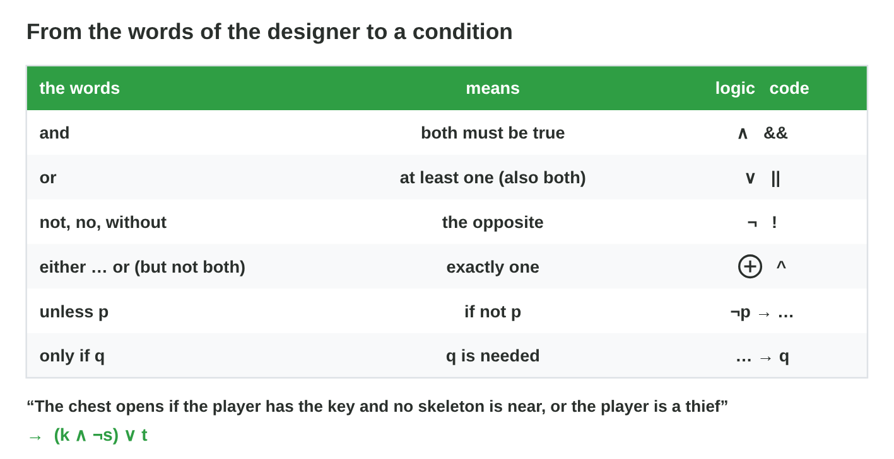
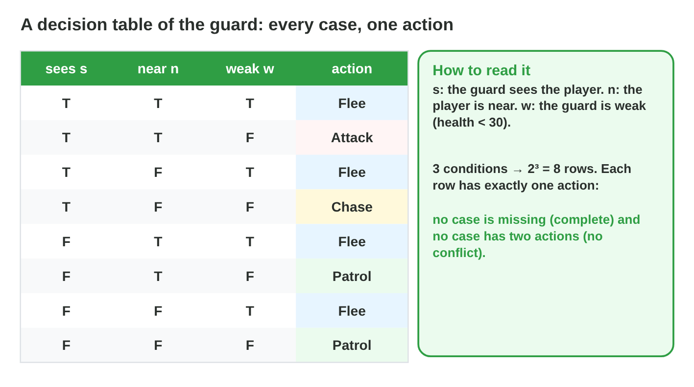

No new ideas today: three short problems on Lecture 9. Do each one alone.
Tap, sort or type your answer at every step: the page checks it at once and
tells you why.

## Recall

- De Morgan: `!(p && q)` = `!p || !q`, and `!(p || q)` = `!p && !q`.
- "But not both" is `^`; "unless p" means "if not p".
- A decision table has 2^n rows and one action in each row. In an else-if
  chain the first true rule wins.

::: {.callout-tip title="Try it 1 · Recall"}
Choose the right answer.

::: {.match extra="!p && !q|8"}
Which condition is the same as `!(p && q)`?
:   !p || !q

    Why: De Morgan: NOT each part, and && becomes ||.

How many rows has a decision table with 4 conditions?
:   16

    Why: 2^4 = 16.

Two rules of an else-if chain are true. Which one runs?
:   the first one from the top

    Why: The chain stops at the first true rule.
:::
:::

## Activity 1 · The rules in words become conditions

*Harvest Bot* is a small farm game: a robot works in a field. The designer
writes its rules in words. The facts are b (the battery is low), f (the
basket is full), p (a ripe crop is near), d (the soil is dry), r (it is
raining) and n (it is night).

{width=90%}

::: {.callout-note title="Activity 1 · Words to conditions · 15 min"}
Write each rule as a C# condition with the letters.

1. The bot waters when the soil is dry and it is not raining.
2. The bot goes home when the battery is low or the basket is full.
3. The bot picks a crop when one is ripe, unless it is night.
4. "The bot does not water" is `!(d && !r)`. Write it without a NOT in
   front of the brackets.

*Your product:* four conditions.

::: {.choice}
Rule 1: the bot waters when the soil is dry and it is not raining.

- [x] `d && !r`

  Why: Dry AND NOT raining.

- [ ] `d || !r`

  Why: OR would water in the rain when the soil is dry.

- [ ] `!d && r`

  Why: That is wet soil in the rain: the opposite.
:::

::: {.choice}
Rule 2: the bot goes home when the battery is low or the basket is full.

- [x] `b || f`

  Why: Either fact sends it home: OR (also both).

- [ ] `b && f`

  Why: AND would need a low battery and a full basket at the same time.

- [ ] `b ^ f`

  Why: XOR would keep the bot out when both are true.
:::

::: {.choice}
Rule 3: the bot picks a crop when one is ripe, unless it is night.

- [x] `p && !n`

  Why: "Unless n" means "if not n".

- [ ] `p || !n`

  Why: OR would pick in the day without a ripe crop.

- [ ] `p && n`

  Why: That picks only at night: the opposite of "unless".
:::

::: {.choice}
Rule 4: what is `!(d && !r)` without a NOT in front of the brackets?

- [x] `!d || r`

  Why: De Morgan: `!d || !!r`, and the two NOTs cancel.

- [ ] `!d && r`

  Why: AND must become OR.

- [ ] `!d || !r`

  Why: NOT NOT r is r.
:::
:::

::: {.callout-tip title="Try it 2 · Rules to conditions"}
Harvest Bot: b battery low, f basket full, p ripe crop, d dry soil, r rain,
n night. Choose the condition.

::: {.match extra="p && n|d || !r"}
The bot waters when the soil is dry and it is not raining.
:   d && !r

    Why: "And" is &&, "not" is !.

The bot picks a crop when one is ripe, unless it is night.
:   p && !n

    Why: "Unless n" means "if not n".

The bot does not water: !(d && !r).
:   !d || r

    Why: De Morgan, then !!r is r.
:::
:::

## Activity 2 · The decision table and the order of the rules

The designer gives the order of the rules: "The bot goes home when the
battery is low (b). Otherwise it picks when a ripe crop is near (p).
Otherwise it waters when the soil is dry (d). Otherwise it waits." A
programmer writes:

```csharp
if (p) Pick();
else if (b) Home();
else if (d) Water();
else Wait();
```

{width=86%}

::: {.callout-note title="Activity 2 · Table and chain · 18 min"}
1. Make the table of b, p and d with all 8 rows and the designer's action
   in each row. Count the rows of each action.
2. Test the row b = T, p = T, d = F in the programmer's chain. What does
   it do? Write the chain in the right order.

*Your product:* an 8-row table with four counts, and one chain.

::: {.fill answer="4" hint="The battery rule comes first for the designer."}
Step 1: in how many of the 8 rows does the bot go home?

Why: Every row with b = T: 4 rows. With b = F: Pick 2, Water 1, Wait 1 (4 + 2 + 1 + 1 = 8).
:::

::: {.choice}
Step 2: row b = T, p = T, d = F. What does the programmer's chain do?

- [x] It picks.

  Why: The chain checks p first, and the first true rule wins; the designer wants Home.

- [ ] It goes home.

  Why: `else if (b)` is never reached when p is true.

- [ ] It waits.

  Why: Wait is the else: it runs only when no rule is true.
:::

::: {.order}
Step 2: put the chain in the right order.

1. `if (b) Home();`
2. `else if (p) Pick();`
3. `else if (d) Water();`
4. `else Wait();`

Why: The designer's rules in their order: the battery first, else last.
:::
:::

::: {.callout-tip title="Try it 3 · The table and the chain"}
Harvest Bot: home if b; otherwise pick if p; otherwise water if d;
otherwise wait. Choose the right answer.

::: {.match extra="Water|8"}
b = F, p = T, d = T. What does the bot do?
:   Pick

    Why: The battery is fine, and a ripe crop comes before the dry soil.

b = F, p = F, d = F. What does the bot do?
:   Wait

    Why: No rule is true, so the last action runs.

In how many of the 8 rows does the bot go home?
:   4

    Why: Half of the rows have b = T.

Which rule must come first in the bot's chain?
:   if (b) Home();

    Why: The designer says a low battery beats every other rule.
:::
:::

## Activity 3 · Test the rule at its border

The designer says: "The battery is low when it is **under 20 %**." The
code says `bool b = battery <= 20;`. A border test uses the value where the
rule changes.

::: {.callout-note title="Activity 3 · Edge cases · 12 min"}
1. Test battery = 10, 80 and 20. Which test finds the bug? Write the fix.
2. A new rule: "The bot sells when it has **at least 50** apples." Write
   the condition and two border tests with the expected result.

*Your product:* one bug with its fix, one condition and two tests.

::: {.choice}
Step 1: the rule says "under 20 %"; the code says `battery <= 20`. Which test
finds the bug?

- [x] battery = 20

  Why: The rule says "not low", but the code says "low": the border value.

- [ ] battery = 10

  Why: 10 is under 20 for the rule and for the code: no difference.

- [ ] battery = 80

  Why: 80 is "not low" for both.
:::

::: {.choice}
Step 1: which condition is the fix?

- [x] `battery < 20`

  Why: "Under 20" does not include 20.

- [ ] `battery > 20`

  Why: That is "high", the opposite of "low".

- [ ] `battery >= 20`

  Why: That includes 20 and every high value: the opposite.
:::

::: {.choice}
Step 2: "at least 50 apples". Which condition and border tests?

- [x] `apples >= 50`: 50 → sell, 49 → do not sell

  Why: "At least 50" includes 50; the tests are the values on each side of the border.

- [ ] `apples > 50`: 50 → do not sell

  Why: "At least 50" must sell with exactly 50.

- [ ] `apples >= 50`: 60 → sell, 40 → do not sell

  Why: The condition is right, but 60 and 40 are far from the border.
:::
:::

::: {.callout-tip title="Try it 4 · Edge cases"}
Choose the right answer.

::: {.match extra="10|apples > 50"}
The rule is battery < 20, the code is battery <= 20. Which test finds the bug?
:   battery = 20

    Why: Only at the border do < and <= give different results.

"At least 50 apples". Which condition?
:   apples >= 50

    Why: "At least 50" includes 50.

Sell when apples >= 50 and trips < 3. What happens in the test (50, 3)?
:   do not sell

    Why: 3 trips is not fewer than 3.
:::
:::

## At home · Task with AI

::: {.callout-note .ai-task title="Task with AI · The rule set of a boss in colours"}
An extra for the curious: let an AI assistant make the table. Copy the
prompt into an AI assistant that the university allows (for example
Microsoft Copilot with your university account), and look at the result.

::: {.prompt}
A game boss has four conditions: h (its health is under 25), q (it has a
potion), c (the player charges) and n (the player is near). The rules, in
this order: if h and q, the boss heals; otherwise, if c, it raises its
shield; otherwise, if n, it attacks; otherwise, it walks. Make the decision
table with all 16 rows of h, q, c and n (true or false; h first: 8 true,
then 8 false) and the action in each row. Colour each action in its own
colour, and count the rows of each action.
:::

::: {.choice}
Which counts should the table show? The AI can be wrong: compare.

- [x] Heal 4, Shield 6, Attack 3, Walk 3

  Why: Heal takes the 4 rows with h and q; the shield takes the rows with c of the other 12: 6.

- [ ] Heal 4, Shield 8, Attack 2, Walk 2

  Why: The shield is checked only when the boss does not heal: 6 rows, not 8.
:::

::: {.try-change}
**Change:** put the shield rule first (shield, then heal, then attack, then
walk), and ask again.

::: {.choice}
What changes?

- [x] Shield 8, Heal 2, Attack 3, Walk 3

  Why: The shield now wins every row where the player charges: the order changes the boss.

- [ ] Nothing: the same counts

  Why: In an else-if chain the first true rule wins, so the order matters.
:::
:::

::: {.try-change}
**Change:** remove the attack rule, and ask again.

::: {.choice}
What changes?

- [x] Heal 4, Shield 6, Walk 6: the boss never attacks.

  Why: The 3 rows of Attack now go to the else: Walk.

- [ ] Heal 4, Shield 9, Walk 3

  Why: The shield rule did not change: it still needs c.
:::
:::

**Your own idea:** change one more number or word, and look again. The AI
can be wrong: compare its result with the answers.
:::

## Wrap-up {.summary}

- You can write the rules of a game in words as conditions, also with De
  Morgan.
- You can make the decision table of a rule set and put its else-if chain
  in the right order.
- You can test a number rule at its border.
