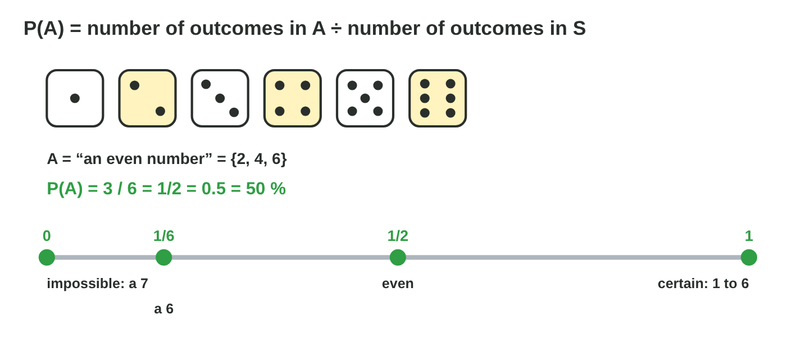
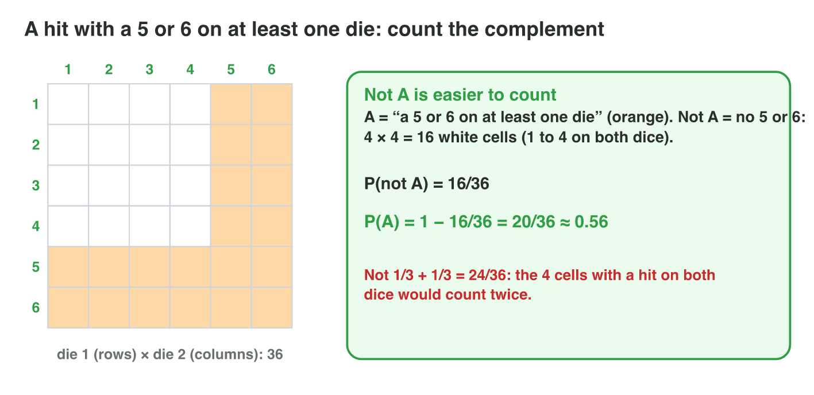
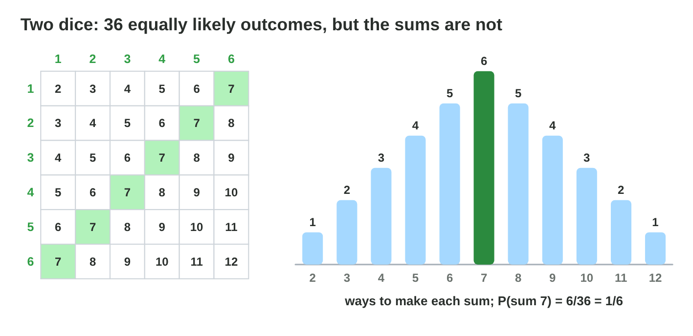
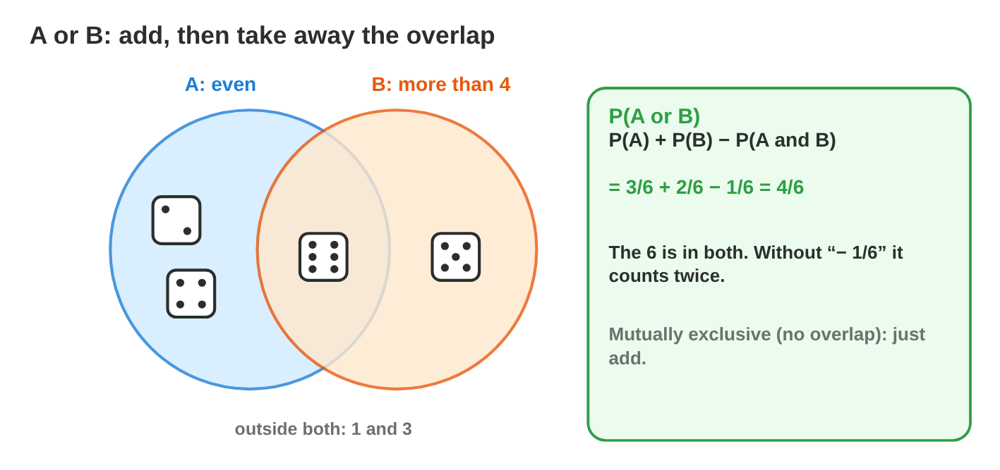

::: {.lead}
The dungeon of *Lucky Raft* has doors with dice, loot drops and critical
hits. What is the chance that a door opens? If the first die already shows a
6, are the chances still the same? A loot crate gives 100, 20 or 5 coins:
what is it worth "on average", and is its price fair? In this lesson you
compute probabilities by counting the outcomes of a **sample space**, with
the complement, grids, trees, OR and AND. Then you use what you **already
know** (conditional probability), and you compute the **expected value**,
the most important number for the balance of a game with chance. Every
section ends with a short task. Seminar 10 practises all of it with loot
drops and critical hits.
:::

## Key terms



## 10.1 Random experiments and sample spaces

A game uses chance whenever the result of an action is not known in
advance (@fig-spaces).

::: {.callout-important title="Definition 10.1 — Experiment, outcome, sample space"}
A **random experiment** is an action whose result we cannot know in
advance. Each possible result is an **outcome**. The set of all outcomes is
the **sample space** S, and |S| is the number of outcomes in it.
:::

{#fig-spaces width=94%}

::: {.callout-note title="Example 10.1 — The experiments of Lucky Raft"}
1. Roll one die: S = {1, 2, 3, 4, 5, 6}, |S| = 6.
2. Flip two coins: S = {HH, HT, TH, TT}, |S| = 4. HT and TH are different
   outcomes: the first coin is heads in one, tails in the other.
3. Open a crate with 10 items (1 gold, 3 silver, 6 wood): |S| = 10, one
   outcome for each item.
:::

::: {.callout-warning title="Common mistake"}
Writing S = {two heads, one head, no head} for two coins. These three
results are not equally likely: "one head" happens in two ways, HT and TH.
List the outcomes so that each one is equally likely.
:::

::: {.callout-note title="Do it · Sample spaces"}
Write the sample space and |S|: (a) flip three coins; (b) spin a spinner
with the colours red, blue, green and yellow; (c) draw one card from 12
event cards.

*Your result:* three sample spaces.

::: {.check}
Three coins: {HHH, HHT, HTH, HTT, THH, THT, TTH, TTT}, |S| = 8. Spinner:
{red, blue, green, yellow}, |S| = 4. Cards: one outcome per card, |S| = 12.
:::
:::

## 10.2 The probability of an event

An **event** is a question about the result, such as "the raft reaches the
island" (@fig-prob).

::: {.callout-important title="Definition 10.2 — Event and probability"}
An **event** A is a set of outcomes, a part of S. When all outcomes are
**equally likely**,
$$P(A) = \frac{|A|}{|S|} = \frac{\text{number of outcomes in } A}{\text{number of outcomes in } S}.$$
Always 0 ≤ P(A) ≤ 1: P = 0 is **impossible**, P = 1 is **certain**. A
probability can be written as a fraction, a decimal or a percentage.
:::

{#fig-prob width=94%}

::: {.callout-note title="Example 10.2 — The knight hits"}
In a fight, the knight hits with a 3 or more on one die.

1. A = {3, 4, 5, 6}, |A| = 4, |S| = 6.
2. P(A) = 4/6 = 2/3 ≈ 0.67 ≈ 67 %.
3. So the knight hits in about two attacks of three.
:::

::: {.callout-note title="Example 10.3 — The items of a crate"}
A crate has 2 gold, 3 silver and 5 wood items. P(gold) = 2/10 = 20 %,
P(silver) = 3/10, P(wood) = 5/10. Together: 2/10 + 3/10 + 5/10 = 1, because
some item always comes out.
:::



::: {.callout-warning title="Common mistake"}
A probability greater than 1, such as 7/6. Check that the event is part of
S and that you divide by |S|.
:::

::: {.callout-note title="Do it · Count"}
One die. Find P(an odd number), P(less than 3) and P(a 7). Check one of
them in **Sample Space Lab**.

*Your result:* three probabilities.

::: {.check}
P(odd) = 3/6 = 1/2; P(less than 3) = 2/6 = 1/3; P(a 7) = 0: impossible.
:::
:::

## 10.3 The complement: "not A"

Sometimes it is easier to count the outcomes that are **not** in the event
(@fig-comp).

::: {.callout-important title="Definition 10.3 — Complement"}
The **complement** of A, written "not A" (or A′), has all outcomes of S
that are not in A. Since A and not A together fill S,
$$P(\text{not } A) = 1 - P(A).$$
:::

{#fig-comp width=94%}

::: {.callout-note title="Example 10.4 — Not wood"}
In the crate of Example 10.5, P(not wood) = 1 − P(wood) = 1 − 5/10 = 5/10.
Check: the gold and the silver items, 2 + 3 = 5 of 10.
:::

::: {.callout-note title="Example 10.6 — A hit on at least one die"}
An archer rolls two dice and hits with a 5 or a 6 on either die.

1. A = "a 5 or 6 on at least one die" is hard to count. Not A = "only 1 to
   4 on both dice".
2. Not A: 4 choices for the first die, 4 for the second: 16 of 36.
3. P(A) = 1 − 16/36 = **20/36** ≈ 0.56.
:::

::: {.callout-warning title="Common mistake"}
1/3 + 1/3 = 24/36 for "a 5 or 6 on at least one die". The 4 cells with a
hit on both dice are then counted twice. The complement avoids the problem.
:::

::: {.callout-note title="Do it · The complement"}
Use the complement: (a) P(not a 6) with one die; (b) P(at least one head)
with two coins; (c) P(not a trap) when 4 of 12 cards are traps.

*Your result:* three probabilities.

::: {.check}
(a) 1 − 1/6 = 5/6. (b) 1 − P(TT) = 1 − 1/4 = 3/4. (c) 1 − 4/12 = 8/12 = 2/3.
:::
:::

## 10.4 Two-step experiments: grids and trees

When an experiment has two steps, we list the pairs of outcomes in a
**grid** or a **tree diagram** (@fig-sums, @fig-tree).

::: {.callout-important title="Definition 10.4 — Grids and tree diagrams"}
For two steps with m and k equally likely outcomes, there are **m × k**
equally likely pairs. A **grid** shows them as a table; a **tree diagram**
shows one branch for each outcome of each step. Along a branch, the
probabilities are **multiplied**.
:::

{#fig-sums width=94%}

::: {.callout-note title="Example 10.7 — The sum 9"}
In a cave game, a sum of 9 on two dice calls the goblin.

1. Two dice: 6 × 6 = 36 equally likely pairs.
2. Sum 9: (3,6), (4,5), (5,4), (6,3): 4 pairs.
3. P(sum 9) = 4/36 = 1/9. The sums 2 and 12 have only 1/36 each.
:::

{#fig-tree width=94%}

::: {.callout-note title="Example 10.8 — A coin and a spinner"}
A player flips a coin, then spins a spinner with three equal colours.

1. 2 × 3 = 6 leaves: H-red, H-blue, H-green, T-red, T-blue, T-green.
2. P(H and red) = 1/2 × 1/3 = 1/6.
3. The six leaves add up to 6 × 1/6 = 1.
:::

::: {.callout-warning title="Common mistake"}
Saying P(sum 9) = 1/11 because there are 11 sums (2 to 12). The sums are not
equally likely; the 36 pairs are.
:::

::: {.callout-note title="Do it · Two dice"}
Use the grid of @fig-sums: P(sum 2), P(sum 6) and P(sum more than 9).

*Your result:* three probabilities.

::: {.check}
Sum 2: only (1, 1), 1/36. Sum 6: 5 pairs, 5/36. More than 9: sums 10 (3
pairs), 11 (2) and 12 (1): 6/36 = 1/6.
:::
:::

## 10.5 Combining events: OR and AND

Game rules often combine events: "a 6 **or** an even number", "a storm
**and** another storm" (@fig-or).

::: {.callout-important title="Definition 10.5 — The rules for OR and AND"}
- **OR (addition rule):** P(A or B) = P(A) + P(B) − P(A and B). When A and
  B are **mutually exclusive** (no common outcome), P(A or B) = P(A) + P(B).
- **AND for independent events:** A and B are **independent** when one does
  not change the chance of the other; then P(A and B) = P(A) × P(B).
:::

{#fig-or width=94%}

::: {.callout-note title="Example 10.9 — Less than 4 or even"}
One die. A = less than 4 = {1, 2, 3}, B = even = {2, 4, 6}.

1. A and B = {2}: one common outcome.
2. P(A or B) = 3/6 + 3/6 − 1/6 = 5/6. Check: {1, 2, 3, 4, 6}.
3. A = {1} and B = {6} are mutually exclusive: P = 1/6 + 1/6 = 2/6.
:::

::: {.callout-note title="Example 10.10 — Two treasures in a row"}
10 cards, 2 treasures. A player draws a card, puts it back, shuffles and
draws again.

1. The two draws are independent: the first card is back in the deck.
2. P(treasure) = 2/10 = 1/5 each time.
3. P(treasure and treasure) = 1/5 × 1/5 = 1/25.
:::

::: {.callout-caution title="In game code"}
```csharp
int a = Random.Range(1, 7);   // first die, 1..6
int b = Random.Range(1, 7);   // second die, independent of the first
bool hit = (a >= 5) || (b >= 5);    // P = 20/36
bool goblin = (a + b == 9);          // P = 4/36
```
:::

::: {.callout-warning title="Common mistake"}
Adding the probabilities when both events must happen: 1/5 + 1/5 = 2/5 for
two treasures. "And" needs multiplication; two treasures are rarer than one.
:::

Two events are **independent** when knowing one does not change the
other. Two dice are independent, so the past of a die never changes its next
roll. Section 10.6 shows what happens when the chances change.

::: {.callout-note title="Do it · OR and AND"}
(a) One die: P(less than 3 or a 6). (b) One die: P(odd or less than 3).
(c) A coin and a die: P(heads and a 6).

*Your result:* three probabilities.

::: {.check}
(a) 2/6 + 1/6 = 3/6 (mutually exclusive). (b) 3/6 + 2/6 − 1/6 = 4/6 (the 1
is in both). (c) 1/2 × 1/6 = 1/12.
:::
:::

## 10.6 Conditional probability

Sometimes part of the result is already known. Then the sample space gets
smaller (@fig-cond).

::: {.callout-important title="Definition 10.6 — Conditional probability"}
The probability of A when we know that B happened is
$$P(A \mid B) = \frac{P(A \text{ and } B)}{P(B)}.$$
With equally likely outcomes: count the outcomes of A **only inside B**,
and divide by the number of outcomes of B.
:::

{#fig-cond width=94%}

::: {.callout-note title="Example 10.11 — The first die is a 6"}
The door opens with a sum of 10 or more (A). Before the roll, P(A) = 6/36 =
1/6.

1. The first die shows 6 (B): only (6,1), …, (6,6) are left, 6 outcomes.
2. Sums of 10 or more among them: (6,4), (6,5), (6,6): 3 outcomes.
3. P(A | B) = 3/6 = **1/2**. Knowing B made A three times more likely.
:::

::: {.callout-note title="Example 10.12 — At least one 6, and a double"}
B = at least one 6: 11 outcomes. A = a double: inside B only (6,6).
P(A | B) = 1/11, while P(A) = 6/36 = 1/6.
:::



::: {.callout-warning title="Common mistake"}
Dividing by all 36 outcomes after the condition. The condition removes the
outcomes outside B: divide by the number of outcomes in B.
:::

### Draws that change the chances: the multiplication rule

In section 10.5 two draws were independent because the card went back. When
it stays out, the second branch changes (@fig-tree).

::: {.callout-important title="Definition 10.7 — The multiplication rule"}
For any two events,
$$P(A \text{ and } B) = P(A) \times P(B \mid A).$$
Events are **dependent** when the first result changes the chances of the
second (drawing without putting back). In a tree diagram, each branch after
the first step has a **conditional** probability.
:::

{#fig-tree width=94%}

::: {.callout-note title="Example 10.13 — Two storms in a row"}
12 event cards, 3 storms. A player draws two cards and keeps the first.

1. P(first storm) = 3/12.
2. After a storm, 11 cards are left with 2 storms: P(second storm | first
   storm) = 2/11.
3. P(two storms) = 3/12 × 2/11 = 6/132 = **1/22**, rarer than 1/16 with the
   card put back.
:::

::: {.callout-warning title="Common mistake"}
Using 3/12 again for the second card. Without putting back, both the number
of storms and the number of cards change.
:::

::: {.callout-note title="Do it · Count inside B"}
Two dice. Find (a) P(sum 7 | first die is 1); (b) P(a double | the sum is
even); (c) P(sum 10 or more | at least one 6). Check one in **Conditional
Lab**.

*Your result:* three probabilities.

::: {.check}
(a) Inside B (6 outcomes) only (1, 6): 1/6. (b) An even sum has 18
outcomes; 6 of them are doubles: 6/18 = 1/3. (c) At least one 6: 11
outcomes; sums of 10 or more among them: (4,6), (5,6), (6,4), (6,5), (6,6):
5/11.
:::
:::

## 10.7 Random variables and the expected value

Games give rewards: coins, damage, points. A number that depends on chance
is a **random variable**, and its long-run average is the **expected value**
(@fig-ev).

::: {.callout-important title="Definition 10.8 — Expected value"}
A **random variable** X takes the values x₁, x₂, … with the probabilities
p₁, p₂, … Its **expected value** is
$$E(X) = x_1 p_1 + x_2 p_2 + \dots$$
E is the average per try over many tries; a single try usually gives a
different value.
:::

{#fig-ev width=94%}

::: {.callout-note title="Example 10.14 — The loot crate"}
Gold 100 coins (1/10), silver 20 coins (3/10), wood 5 coins (6/10):

1. E = 100 · 0.1 + 20 · 0.3 + 5 · 0.6 = 10 + 6 + 3 = **19 coins**.
2. The plain average (100 + 20 + 5) / 3 ≈ 41.7 is wrong: wood comes far more
   often than gold.
3. A player who opens 100 crates gets about 1900 coins.
:::

::: {.callout-note title="Example 10.15 — Damage of a sword"}
A hit does 10 damage; with probability 0.2 it is a critical hit of 25.
E = 10 · 0.8 + 25 · 0.2 = 8 + 5 = 13 damage per hit.
:::

::: {.callout-caution title="In game code"}
```csharp
float ExpectedCoins(int[] coins, float[] p) {
    float e = 0f;
    for (int i = 0; i < coins.Length; i++) e += coins[i] * p[i];
    return e;   // 100, 20, 5 with 0.1, 0.3, 0.6 → 19
}
```
:::

::: {.callout-warning title="Common mistake"}
Forgetting to check that the probabilities add up to 1. If they do not, an
outcome is missing or counted twice.
:::

### Fair games and the number of tries

The expected value tells a designer whether a game of chance takes or
gives coins, and how long players wait for a rare item (@fig-fair).

::: {.callout-important title="Definition 10.9 — Fair game and expected tries"}
The **expected gain** of a game is E(win) − price. A game is **fair** when
the expected gain is 0. If one try succeeds with probability p, the
**average number of tries** until the first success is **1/p**.
:::

{#fig-fair width=94%}

::: {.callout-note title="Example 10.16 — The dice stand"}
Pay 2 coins, roll a die, a 6 wins 10 coins.

1. E(win) = 10 · 1/6 ≈ 1.67 coins.
2. Expected gain = 1.67 − 2 ≈ **−0.33** coins per game: the stand wins in
   the long run.
3. A fair price would be 10/6 ≈ 1.67 coins.
:::

::: {.callout-note title="Example 10.17 — Waiting for gold"}
Gold comes with p = 1/10: on average 10 crates. With p = 1/50 it is 50
crates; many players will need 100 or more, and some will give up. This is
why designers check both E and 1/p.
:::

::: {.callout-warning title="Common mistake"}
"With p = 1/10, the 10th crate surely has gold." 1/p is an average: after 10
crates, about 35 % of the players still have no gold (0.9¹⁰ ≈ 0.35).
:::

::: {.callout-note title="Do it · Fair or not?"}
A spinner has 8 equal parts; one part wins 20 coins. A spin costs 3 coins.
(a) Is it fair? (b) Which price is fair? (c) How many spins on average until
a win?

*Your result:* three answers.

::: {.check}
(a) E(win) = 20 × 1/8 = 2.5 coins; gain = 2.5 − 3 = −0.5: not fair.
(b) 2.5 coins. (c) 1/p = 8 spins on average.
:::
:::

## Case study: Treasure Odds

The designer of *Lucky Raft* tunes the loot drops and the critical hits of
its dungeon. A critical hit needs a sum of 11 or more on two dice, and the
first die already shows a 5. A chest holds 8 items, 2 of them rare, and the
hero takes two. An enemy drops 50 coins (1/10), 10 coins (4/10) or nothing
(5/10). A normal hit does 10 damage, and a critical hit (probability 1/4)
does 30. A lucky wheel costs 3 coins and one of its 10 equal parts wins 20
coins. A rare pet drops with probability 1/25. The Game challenge of the
interactive page uses these rooms. In the mini-game below you choose the
right probability or expected value in each room.



## Further reading

Rosen, *Discrete Mathematics and Its Applications*, 8th ed., Sections 7.1
(an introduction to discrete probability), 7.2 (conditional probability,
independence) and 7.4 (expected value). Schell, *The Art of Game Design*,
3rd ed., Chapter 12 (expected value in game design).

## Exercises

1. Write the sample space of flipping one coin and rolling one die. What is |S|?
2. One die: P(more than 2)?
3. A crate has 3 gold and 7 wood items. P(gold)?
4. P(A) = 0.35. What is P(not A)?
5. Three coins: P(at least one tail), with the complement.
6. Two dice: P(sum 4)?
7. One die: P(even or a 3)? Are the events mutually exclusive?
8. One die: P(even or more than 3)?
9. A spinner has 4 equal colours. Spin twice: P(red both times)?
10. Two dice, the first is 3. P(sum 7)?
11. Two dice, the sum is 8. P(a double)?
12. Draw two cards from 10 cards with 2 jokers, without putting back. P(two jokers)?
13. X is 4 with p = 0.5, 0 with p = 0.3 and 10 with p = 0.2. E(X)?
14. A crate: 200 coins (1/20), 10 coins (19/20). E?
15. Pay 5 coins; win 30 coins with p = 1/8. Expected gain? Which price is fair?
16. A rare mount drops with p = 1/40. How many tries on average?

## Answers to the exercises

::: {.answers}
1. {H1, H2, …, H6, T1, …, T6}; |S| = 12.
2. 4/6 = 2/3.
3. 3/10.
4. 0.65.
5. 1 − 1/8 = 7/8.
6. 3/36 = 1/12.
7. 3/6 + 1/6 = 4/6; yes, they have no common outcome.
8. 3/6 + 3/6 − 2/6 = 4/6 (the outcomes 2, 4, 5, 6).
9. 1/4 × 1/4 = 1/16.
10. 1/6 (only (3,4)).
11. 1/5 ((2,6), (3,5), (4,4), (5,3), (6,2): one double).
12. 2/10 × 1/9 = 1/45.
13. 4 · 0.5 + 0 + 10 · 0.2 = 4.
14. 200/20 + 10 · 19/20 = 10 + 9.5 = 19.5.
15. 30/8 − 5 = 3.75 − 5 = −1.25 coins; a fair price is 3.75 coins.
16. 40.
:::
