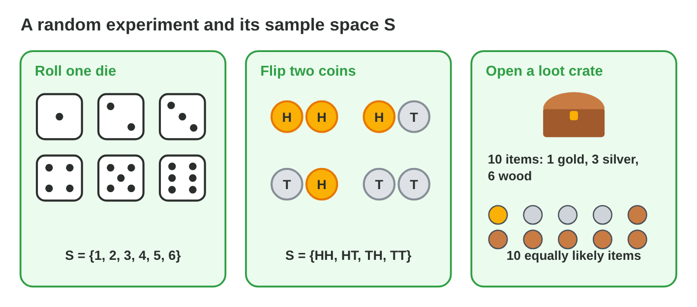
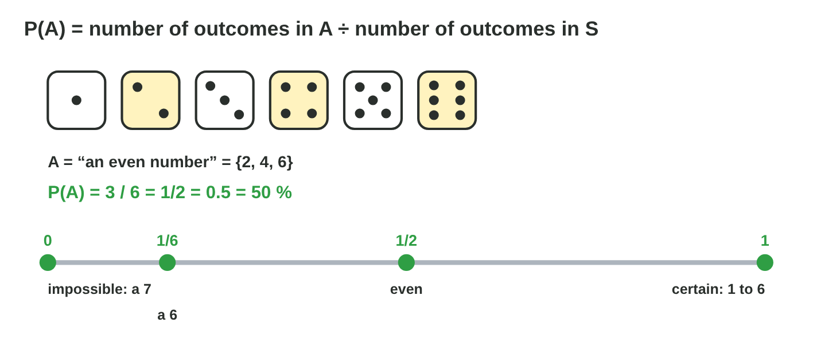
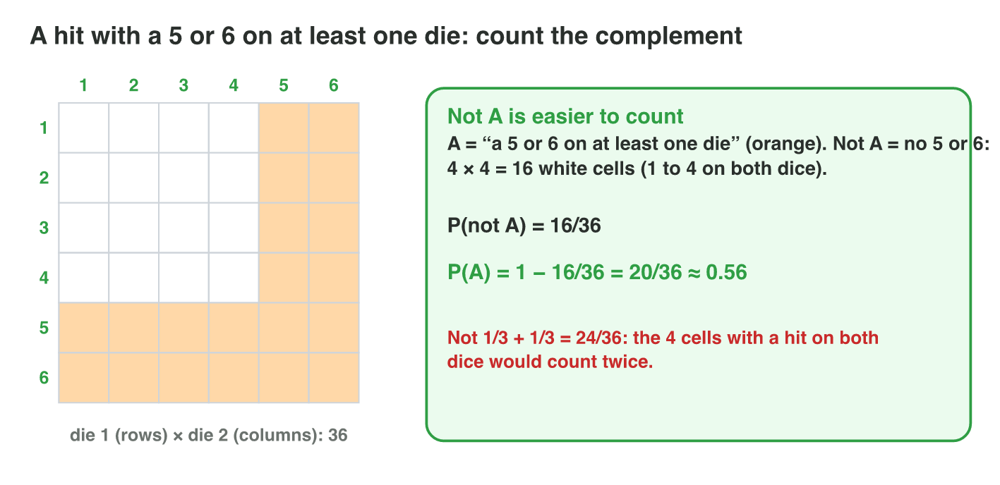
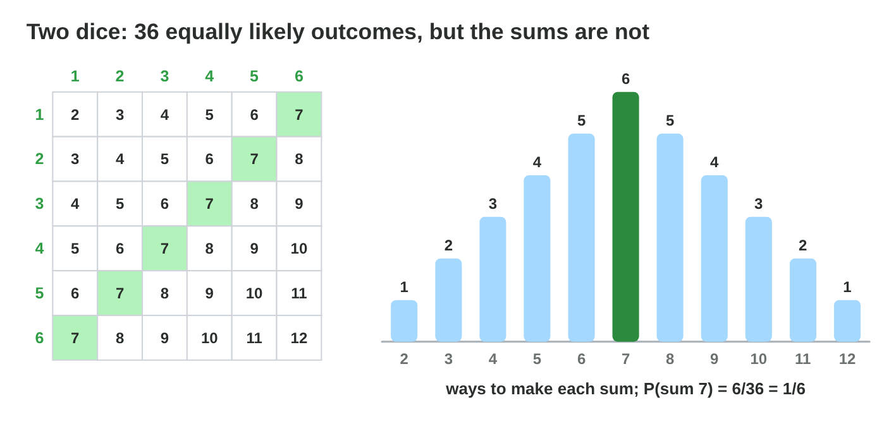
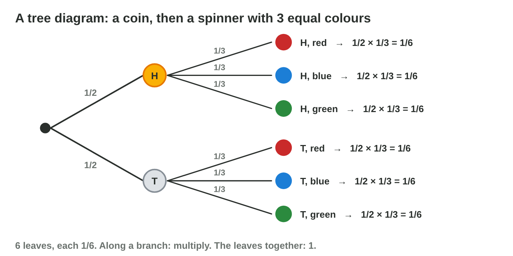
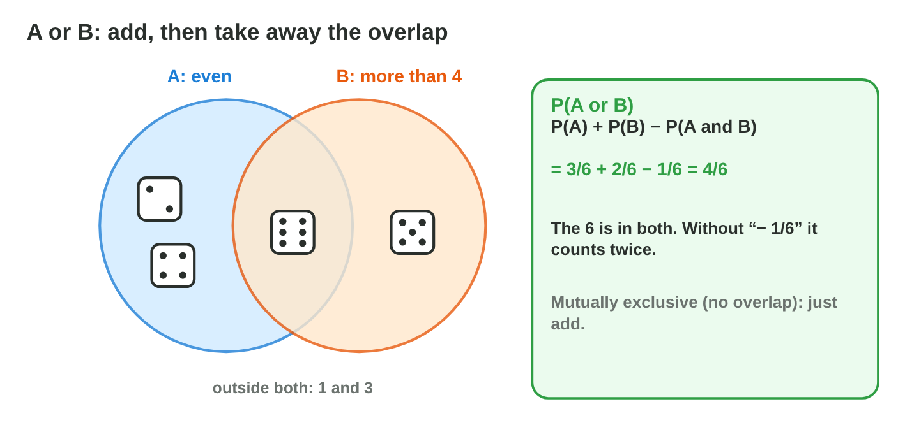
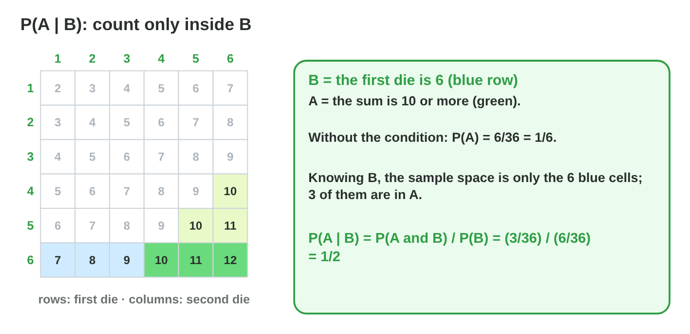
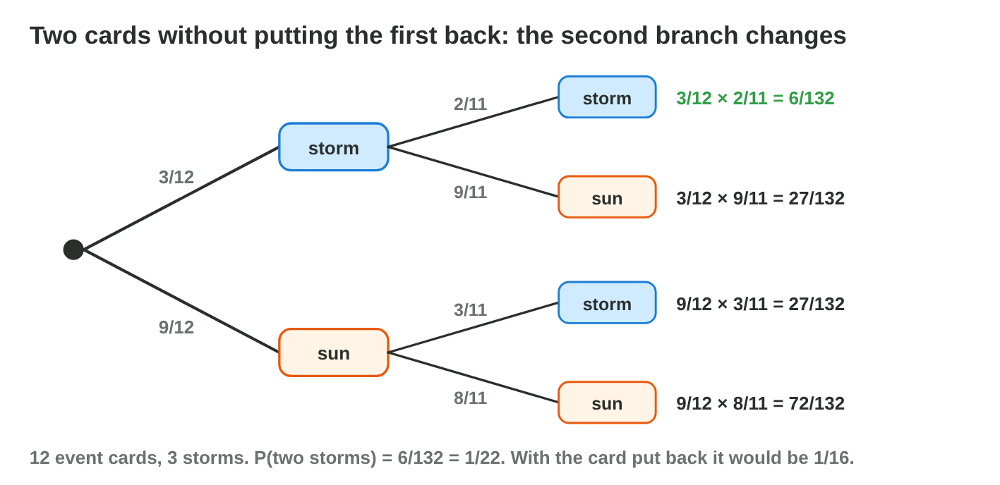
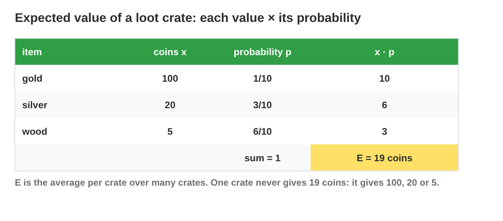
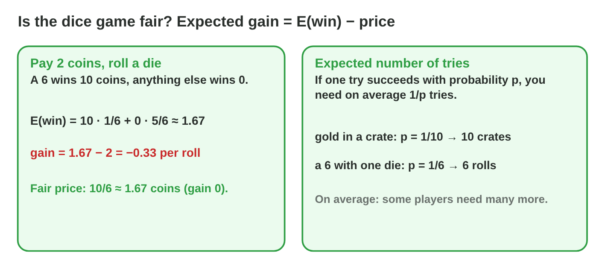

Each section: a problem in a game, the idea, a **Do it** task and a short **Try it**.
The page checks every answer at once and tells you why. More examples
and exercises are in the lesson notes (PDF).

## Key terms



## 10.1 Random experiments and sample spaces

- A **random experiment**: a die, a coin, a loot crate.
- An **outcome** is one result; the **sample space** S is the set of all
  outcomes.
- One die: S = {1, …, 6}. Two coins: S = {HH, HT, TH, TT}.
- List the outcomes so that each one is equally likely.

{width=94%}

::: {.callout-warning title="Watch out!"}
HT and TH are two different outcomes.
:::

::: {.callout-note title="Do it · Sample spaces"}
Write S and |S| for three coins, a spinner with four colours, and 12 event
cards. List the outcomes so that each one is equally likely.

::: {.sort}
How many outcomes |S| does each experiment have? Sort them.

|S| = 4
:   a spinner with four colours

    Why: {red, blue, green, yellow}.

:   two coins

    Why: {HH, HT, TH, TT}: HT and TH are two outcomes.

|S| = 8
:   three coins

    Why: {HHH, HHT, HTH, HTT, THH, THT, TTH, TTT}: 2 × 2 × 2.

|S| = 12
:   12 event cards

    Why: One outcome for each card.

:   a die and a coin

    Why: 6 × 2 = 12 pairs, from (1, H) to (6, T).
:::
:::

::: {.callout-tip title="Try it 1 · Sample spaces"}
Choose |S|, the number of outcomes.

::: {.match extra="3|7"}
How many outcomes has one die?
:   6

    Why: the faces 1, 2, 3, 4, 5 and 6.

How many outcomes have three coins?
:   8

    Why: 2 × 2 × 2.

How many outcomes have two dice?
:   36

    Why: 6 × 6 pairs.
:::
:::

## 10.2 The probability of an event

- An **event** A is a set of outcomes.
- Equally likely outcomes: **P(A) = |A| / |S|**.
- 0 = impossible, 1 = certain; fraction, decimal or %.
- The knight hits with a 3 or more: A = {3, 4, 5, 6}, so P = 4/6 = 2/3.

{width=94%}



::: {.callout-warning title="Watch out!"}
A probability is never more than 1.
:::

::: {.callout-note title="Do it · Count"}
One die: find P(odd), P(even), P(less than 3), P(more than 4) and P(a 7).
Check one in **Sample Space Lab**.

::: {.sort}
What is the probability of each event with one die? Sort them.

1/2
:   an odd number

    Why: {1, 3, 5}: 3/6 = 1/2.

:   an even number

    Why: {2, 4, 6}: 3/6 = 1/2.

1/3
:   less than 3

    Why: {1, 2}: 2/6 = 1/3.

:   more than 4

    Why: {5, 6}: 2/6 = 1/3.

0
:   a 7

    Why: No face shows 7: impossible.
:::
:::

::: {.callout-tip title="Try it 2 · One die and a crate"}
Choose the probability.

::: {.match extra="8/10|1/3"}
One die. What is P(a 3 or more)?
:   2/3

    Why: {3, 4, 5, 6}: 4 of 6.

A crate has 2 gold items of 10. What is P(gold)?
:   1/5

    Why: 2/10 = 1/5.

One die. What is P(a 7)?
:   0

    Why: a 7 is not in S: impossible.
:::
:::

## 10.3 The complement: "not A"

- **not A**: all outcomes that are not in A.
- **P(not A) = 1 − P(A)**.
- A hit with a 5 or 6 on at least one of two dice: no hit = 4 × 4 = 16
  cells, so P = 1 − 16/36 = 20/36.

{width=94%}

::: {.callout-warning title="Watch out!"}
1/3 + 1/3 counts the 4 cells with a hit on both dice twice.
:::

::: {.callout-note title="Do it · The complement"}
Two coins: find P(at least one head). Use P(not A) = 1 − P(A).

::: {.fill answer="3/4|0.75|75%" hint="At least one head is the complement of TT."}
What is P(at least one head) with two coins?

Why: 1 − P(TT) = 1 − 1/4 = 3/4.
:::
:::

::: {.callout-tip title="Try it 3 · Not A"}
Use Sample Space Lab. Choose the probability.

::: {.match extra="2/6|16/36"}
One die. What is P(not a 1)?
:   5/6

    Why: 1 − 1/6.

A crate has 3 silver items of 10. What is P(not silver)?
:   7/10

    Why: 1 − 3/10.

Two dice. What is P(a 5 or 6 on at least one die)?
:   20/36

    Why: 1 − 16/36: the 16 cells with only 1 to 4.
:::
:::

## 10.4 Two-step experiments: grids and trees

- m and k outcomes → **m × k** equally likely pairs.
- A **grid** for two dice: 36 cells. A **tree diagram**: one branch per
  outcome.
- Along a branch: **multiply**. All leaves add up to 1.
- A sum of 9 calls the goblin: (3, 6), (4, 5), (5, 4), (6, 3), so
  P = 4/36 = 1/9.

{width=94%}

{width=94%}

::: {.callout-warning title="Watch out!"}
There are 11 sums, but they are not equally likely.
:::

::: {.callout-note title="Do it · Two dice"}
Use the grid of two dice (36 cells) to find P(sum 6).

::: {.fill answer="5" hint="List the pairs (first die, second die) with the sum 6."}
How many cells of the grid make the sum 6?

Why: (1, 5), (2, 4), (3, 3), (4, 2), (5, 1): 5 cells, so P = 5/36.
:::
:::

::: {.callout-tip title="Try it 4 · Two dice"}
Choose the probability.

::: {.match extra="1/11|2/36"}
Two dice. What is P(sum 8)?
:   5/36

    Why: (2, 6), (3, 5), (4, 4), (5, 3), (6, 2).

Two dice. What is P(a double)?
:   1/6

    Why: 6 doubles of 36 pairs.

A coin, then a spinner with 3 equal colours. What is P(heads and red)?
:   1/2 × 1/3

    Why: multiply along the branch.
:::
:::

## 10.5 Combining events: OR and AND

- **OR:** P(A) + P(B) − P(A and B). Mutually exclusive: just add.
- **AND, independent:** P(A) × P(B).
- Less than 4 or even: 3/6 + 3/6 − 1/6 = 5/6 (the 2 is in both).
- Two treasure cards in a row (2 of 10, card put back): 1/5 × 1/5 = 1/25.
- **Independent:** knowing one event does not change the other. Two dice are
  independent: the past of a die never changes its next roll.

{width=94%}

::: {.callout-warning title="Watch out!"}
"And" multiplies: two treasures are rarer than one.
:::

::: {.callout-note title="Do it · OR and AND"}
Find P(less than 3 or a 6), P(odd or less than 3) and P(heads and a 6).

::: {.sort}
Which rule do you use for each event? Sort them.

Add
:   less than 3 or a 6

    Why: No outcome is in both: 2/6 + 1/6 = 3/6.

Add, then take away the overlap
:   odd or less than 3

    Why: The 1 is in both: 3/6 + 2/6 − 1/6 = 4/6.

:   even or less than 4

    Why: The 2 is in both: 3/6 + 3/6 − 1/6 = 5/6.

Multiply
:   heads and a 6

    Why: Independent events: 1/2 × 1/6.

:   two treasure cards in a row, the first put back

    Why: The second draw does not depend on the first: multiply.
:::
:::

::: {.callout-tip title="Try it 5 · OR and AND"}
Choose the probability.

::: {.match extra="5/6|1/2 + 1/6"}
One die. What is P(odd or more than 4)?
:   4/6

    Why: 3/6 + 2/6 − 1/6: the 5 is in both.

4 traps in 12 cards, card put back. What is P(two traps)?
:   1/9

    Why: 1/3 × 1/3.

A coin and a die. What is P(tails and an even number)?
:   1/4

    Why: independent: 1/2 × 1/2.
:::
:::

## 10.6 Conditional probability

- **P(A | B) = P(A and B) / P(B)**: the probability of A when B is known.
- Count A **only inside B**, divide by the outcomes of B.
- A door opens with a sum ≥ 10, and the first die is a 6: 3 of 6 → 1/2
  (without the condition: 1/6).

{width=94%}

- **Draws that change the chances** (no putting back): P(A and B) = P(A) ×
  P(B | A). 12 cards with 3 storms, two storms in a row: 3/12 × 2/11 = **1/22**.
  Such events are **dependent**.

{width=90%}



::: {.callout-warning title="Watch out!"}
After a condition, divide by the outcomes of B, not by 36.
:::

::: {.callout-note title="Do it · Count inside B"}
Find P(sum 7 | first die is 1). After the condition, count only inside B.

::: {.choice}
What is P(sum 7 | the first die is 1)?

- [x] 1/6

  Why: B has 6 outcomes, (1, 1) to (1, 6); only (1, 6) gives 7.

- [ ] 1/36

  Why: After the condition, divide by the 6 outcomes of B, not by 36.

- [ ] 6/36

  Why: 6/36 is P(sum 7) without a condition.
:::
:::

::: {.callout-tip title="Try it 6 · Conditions"}
Use Conditional Lab. Choose the probability.

::: {.match extra="1/36|5/36"}
Two dice, the first die is 6. What is P(sum ≥ 9)?
:   2/3

    Why: (6,3), (6,4), (6,5), (6,6): 4 of 6.

Two dice, at least one 6. What is P(a double)?
:   1/11

    Why: inside the 11 outcomes with a 6, only (6, 6).

Two dice, the sum is 4. What is P(a double)?
:   1/3

    Why: (1,3), (2,2), (3,1): one double of 3.
:::
:::

## 10.7 Random variables and the expected value

- A **random variable**: a number that depends on chance (coins, damage).
- **E = x₁p₁ + x₂p₂ + …**: the long-run average.
- Crate: 100·0.1 + 20·0.3 + 5·0.6 = **19 coins**.

{width=94%}

::: {.callout-warning title="Watch out!"}
(100 + 20 + 5) / 3 is not E: the probabilities are missing.
:::

- **Expected gain = E(win) − price.** Fair: gain 0.
- Pay 2, win 10 on a 6: 1.67 − 2 ≈ −0.33. Fair price 1.67.
- Success with probability p: on average **1/p** tries.

{width=94%}

::: {.callout-warning title="Watch out!"}
1/p is an average: after 10 crates with p = 1/10, about 35 % still have no
gold.
:::

::: {.callout-note title="Do it · Fair or not?"}
A spinner has 8 equal parts; one part wins 20 coins. A spin costs 3 coins.

::: {.fill answer="2.5" hint="E(win) = the prize × its probability."}
What is E(win) of one spin?

Why: 20 × 1/8 = 2.5 coins.
:::

::: {.choice}
Is the spin fair at the price 3?

- [x] No: the gain is 2.5 − 3 = −0.5 coins a spin.

  Why: Fair means a gain of 0; a fair price is 2.5 coins. On average a win takes 8 spins.

- [ ] Yes: you can win 20 coins.

  Why: On average a spin wins only 2.5 coins.

- [ ] No: the fair price is 20 coins.

  Why: 20 is the prize; the fair price is E(win) = 2.5.
:::
:::

::: {.callout-tip title="Try it 7 · Expected values and fair prices"}
Choose the right answer.

::: {.match extra="41.7|125|100"}
30 coins (0.5) or 10 coins (0.5). What is E?
:   20

    Why: 30 × 0.5 + 10 × 0.5 = 15 + 5.

A crate has E = 12 coins. Which price is fair?
:   12 coins

    Why: fair means the price equals E(win).

A drop chance of 1/20. How many crates on average?
:   20

    Why: on average 1/p tries.
:::
:::

## Game challenge: Treasure Odds {.challenge}

Work alone. Use every section of today.

The designer of *Lucky Raft* tunes the loot drops and the critical hits of
its dungeon. A **critical hit** needs a sum of 11 or more on two dice, and
the first die already shows a 5. A **chest** holds 8 items, 2 of them rare,
and the hero takes two. An **enemy** drops 50 coins (1/10), 10 coins (4/10)
or nothing (5/10). A normal hit does 10 damage, and a **critical hit**
(probability 1/4) does 30. A **lucky wheel** costs 3 coins and one of its 10
parts wins 20 coins. A **rare pet** drops with probability 1/25.



::: {.callout-tip title="Try it 8 · Loot and hits"}
The dungeon: critical hit sum ≥ 11, first die 5; chest 8 items, 2 rare;
enemy 50 (1/10), 10 (4/10), 0 (5/10); wheel 3 coins, 1 of 10 parts wins 20;
pet 1/25. Choose the right answer.

::: {.match extra="1/12|1/16"}
P(critical hit), knowing the first die is 5?
:   1/6

    Why: only (5, 6) of the 6 cases reaches 11.

Expected coins per enemy?
:   9

    Why: 5 + 4 + 0.
:::
:::

::: {.callout-tip title="Try it 9 · Tune the hits (harder)"}
A normal hit does 10 damage; a critical hit has probability 1/4. Choose the
right answer.

::: {.match extra="40|always 4 hits"}
The designer wants E(damage) = 20. How much must a critical hit do?
:   50

    Why: 7.5 + x/4 = 20, so x/4 = 12.5.

On average, how many hits until the first critical hit?
:   4

    Why: 1/p = 1 ÷ 1/4.
:::
:::

## Summary {.summary}

- P(A) = (outcomes of A) ÷ (all outcomes), when all outcomes are equally likely.
- P(not A) = 1 − P(A). Grids and trees list two-step experiments.
- OR: add (minus the overlap). AND for independent events: multiply.
- P(A | B): count A only inside B. P(A and B) = P(A) × P(B | A).
- E = x₁p₁ + x₂p₂ + …: the long-run average. Fair: the price equals E(win); on average 1/p tries.
