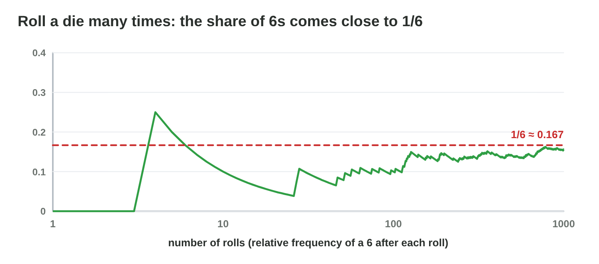

This page is the interactive version of the lesson notes (PDF). Each section
starts with a problem in a game. Then it explains the idea behind it. It ends
with a **Do it** task and one set of questions. Every question on this page
has its answer: try first, then check.

## Key terms



## 13.1 Random experiments and sample spaces

- A **random experiment**: a die, a coin, a loot crate.
- An **outcome** is one result; the **sample space** S is the set of all
  outcomes.
- One die: S = {1, …, 6}. Two coins: S = {HH, HT, TH, TT}.
- List the outcomes so that each one is equally likely.

{width=94%}

::: {.callout-warning title="Watch out!"}
HT and TH are two different outcomes.
:::

::: {.callout-note title="Do it · Sample spaces"}
Write S and |S| for three coins, a spinner with four colours, and 12 event
cards.

::: {.check}
Three coins: {HHH, HHT, HTH, HTT, THH, THT, TTH, TTT}, |S| = 8. Spinner:
{red, blue, green, yellow}, |S| = 4. Cards: one outcome per card, |S| = 12.
:::
:::

::: {.callout-tip title="Try it 1 · Sample spaces"}
Choose |S|, the number of outcomes.

::: {.match extra="3|7"}
How many outcomes has one die?
:   6

    Why: the faces 1, 2, 3, 4, 5 and 6.

How many outcomes have two coins?
:   4

    Why: HH, HT, TH and TT: 2 × 2.

How many outcomes have three coins?
:   8

    Why: 2 × 2 × 2.

How many outcomes have two dice?
:   36

    Why: 6 × 6 pairs.
:::
:::

## 13.2 The probability of an event

- An **event** A is a set of outcomes.
- Equally likely outcomes: **P(A) = |A| / |S|**.
- 0 = impossible, 1 = certain; fraction, decimal or %.
- The knight hits with a 3 or more: A = {3, 4, 5, 6}, so P = 4/6 = 2/3.

{width=94%}



::: {.callout-warning title="Watch out!"}
A probability is never more than 1.
:::

::: {.callout-note title="Do it · Count"}
One die: P(odd), P(less than 3), P(a 7). Check one in **Sample Space
Lab**.

::: {.check}
P(odd) = 3/6 = 1/2; P(less than 3) = 2/6 = 1/3; P(a 7) = 0: impossible.
:::
:::

::: {.callout-tip title="Try it 2 · One die and a crate"}
Choose the probability.

::: {.match extra="8/10|1/3"}
One die. What is P(an even number)?
:   1/2

    Why: {2, 4, 6}: 3 of 6.

One die. What is P(a 3 or more)?
:   2/3

    Why: {3, 4, 5, 6}: 4 of 6.

A crate has 2 gold items of 10. What is P(gold)?
:   1/5

    Why: 2/10 = 1/5.

One die. What is P(a 7)?
:   0

    Why: a 7 is not in S: impossible.
:::
:::

## 13.3 The complement: "not A"

- **not A**: all outcomes that are not in A.
- **P(not A) = 1 − P(A)**.
- A hit with a 5 or 6 on at least one of two dice: no hit = 4 × 4 = 16
  cells, so P = 1 − 16/36 = 20/36.

{width=94%}

::: {.callout-warning title="Watch out!"}
1/3 + 1/3 counts the 4 cells with a hit on both dice twice.
:::

::: {.callout-note title="Do it · The complement"}
P(not a 6) with one die; P(at least one head) with two coins; P(not a trap)
with 4 traps in 12 cards.

::: {.check}
1 − 1/6 = 5/6; 1 − P(TT) = 1 − 1/4 = 3/4; 1 − 4/12 = 8/12 = 2/3.
:::
:::

::: {.callout-tip title="Try it 3 · Not A"}
Use Sample Space Lab. Choose the probability.

::: {.match extra="2/6|16/36"}
One die. What is P(not a 1)?
:   5/6

    Why: 1 − 1/6.

A crate has 3 silver items of 10. What is P(not silver)?
:   7/10

    Why: 1 − 3/10.

Two dice. What is P(a 5 or 6 on at least one die)?
:   20/36

    Why: 1 − 16/36: the 16 cells with only 1 to 4.

Two coins. What is P(at least one tail)?
:   3/4

    Why: 1 − P(HH) = 1 − 1/4.
:::
:::

## 13.4 Two-step experiments: grids and trees

- m and k outcomes → **m × k** equally likely pairs.
- A **grid** for two dice: 36 cells. A **tree diagram**: one branch per
  outcome.
- Along a branch: **multiply**. All leaves add up to 1.
- A sum of 9 calls the goblin: (3, 6), (4, 5), (5, 4), (6, 3), so
  P = 4/36 = 1/9.

{width=94%}

{width=94%}

::: {.callout-warning title="Watch out!"}
There are 11 sums, but they are not equally likely.
:::

::: {.callout-note title="Do it · Two dice"}
From the grid: P(sum 2), P(sum 6), P(sum more than 9).

::: {.check}
Sum 2: only (1, 1), 1/36. Sum 6: 5 pairs, 5/36. More than 9: sum 10 (3
pairs), 11 (2), 12 (1) = 6/36 = 1/6.
:::
:::

::: {.callout-tip title="Try it 4 · Two dice"}
Choose the probability.

::: {.match extra="1/11|2/36"}
Two dice. What is P(sum 8)?
:   5/36

    Why: (2, 6), (3, 5), (4, 4), (5, 3), (6, 2).

Two dice. What is P(sum 12)?
:   1/36

    Why: only (6, 6).

Two dice. What is P(a double)?
:   1/6

    Why: 6 doubles of 36 pairs.

A coin, then a spinner with 3 equal colours. What is P(heads and red)?
:   1/2 × 1/3

    Why: multiply along the branch.
:::
:::

## 13.5 Combining events: OR and AND

- **OR:** P(A) + P(B) − P(A and B). Mutually exclusive: just add.
- **AND, independent:** P(A) × P(B).
- Less than 4 or even: 3/6 + 3/6 − 1/6 = 5/6 (the 2 is in both).
- Two treasure cards in a row (2 of 10, card put back): 1/5 × 1/5 = 1/25.

{width=94%}

::: {.callout-warning title="Watch out!"}
"And" multiplies: two treasures are rarer than one.
:::

::: {.callout-note title="Do it · OR and AND"}
P(less than 3 or a 6); P(odd or less than 3); P(heads and a 6).

::: {.check}
2/6 + 1/6 = 3/6 (mutually exclusive); 3/6 + 2/6 − 1/6 = 4/6 (the 1 is in
both); 1/2 × 1/6 = 1/12.
:::
:::

::: {.callout-tip title="Try it 5 · OR and AND"}
Choose the probability.

::: {.match extra="5/6|1/2 + 1/6"}
One die. What is P(odd or more than 4)?
:   4/6

    Why: 3/6 + 2/6 − 1/6: the 5 is in both.

One die. What is P(a 1 or a 6)?
:   2/6

    Why: mutually exclusive: 1/6 + 1/6.

4 traps in 12 cards, card put back. What is P(two traps)?
:   1/9

    Why: 1/3 × 1/3.

A coin and a die. What is P(tails and an even number)?
:   1/4

    Why: independent: 1/2 × 1/2.
:::
:::

## 13.6 Theory and experiment

- **Relative frequency** = hits ÷ trials.
- **Law of large numbers:** with many trials it comes close to P.
- With few trials, big differences are normal; a far result after 1000
  trials can show a bug.

{width=94%}



::: {.callout-note title="Do it · Roll"}
In **Roll Lab**, roll 10 times, then 1000 times. Write both relative
frequencies of a 6.

::: {.check}
After 10 rolls the value can be far from 1/6 ≈ 0.167 (0, 0.1, 0.3 …). After
1000 rolls it is close to 0.167, for example between 0.14 and 0.19.
:::
:::

::: {.callout-tip title="Try it 6 · Experiments"}
Use Roll Lab. Choose the right answer.

::: {.match extra="exactly 1/6 every time|always 0"}
142 sums of 8 in 1000 rolls of two dice. The relative frequency?
:   0.142

    Why: 142 ÷ 1000; theory 5/36 ≈ 0.139: close.

Rolls of a die: about how many 6s in 600?
:   about 100

    Why: 600 × 1/6.

After 10 rolls, the frequency of a 6 is 0.4. Is that strange?
:   no, few trials jump a lot

    Why: the law of large numbers needs many trials.

After 1000 rolls of two dice, the sum 8 has 0.25. What does it show?
:   probably a bug in the code

    Why: 0.25 is far from 0.139 after so many trials.
:::
:::

## Game challenge: Raft Odds {.challenge}

Work alone. Use every section of today.

A turn of *Lucky Raft*: the raft reaches the island with a **5 or a 6**; a
crate of 10 items (1 gold, 3 silver, 6 wood) gives an item that is **not
wood**; the sea eagle comes with a **sum of 7**; a bonus comes with **at
least one 6** on two dice; a move rule says **even or more than 4**; and
**two storms** can come in a row (3 storms in 12 cards, put back).



::: {.callout-tip title="Try it 7 · The turn"}
Lucky Raft: island 5 or 6; crate 6 wood of 10; eagle sum 7; bonus at least
one 6 on two dice; storms 3 of 12, put back. Choose the probability.

::: {.match extra="7/36|1/8"}
The raft reaches the island.
:   1/3

    Why: {5, 6}: 2 of 6.

The crate item is not wood.
:   4/10

    Why: 1 − 6/10: the gold and the silver items.

The sea eagle comes (sum 7).
:   1/6

    Why: 6 pairs of 36.

The bonus (at least one 6).
:   11/36

    Why: 1 − 25/36: no 6 on both dice is 5 × 5.

Two storms in a row.
:   1/16

    Why: 3/12 = 1/4, and 1/4 × 1/4.
:::
:::

::: {.callout-tip title="Try it 8 · Three dice (harder)"}
The Lucky Raft finale rolls three dice. Choose the right answer.

::: {.match extra="18|1/18"}
How many outcomes have three dice?
:   216

    Why: 6 × 6 × 6.

What is P(three 6s)?
:   1/216

    Why: one outcome of 216.

What is P(no 6 with three dice)?
:   125/216

    Why: 5 × 5 × 5 outcomes without a 6.

What is P(at least one 6 with three dice)?
:   91/216

    Why: the complement: 1 − 125/216.
:::
:::

## Summary {.summary}

- A random experiment has a sample space S of outcomes.
- With equally likely outcomes, P(A) = |A| / |S|, from 0 to 1.
- P(not A) = 1 − P(A) is often easier to count.
- Two steps: a grid or a tree; multiply along a branch.
- OR: add and take away the overlap. AND (independent): multiply.
- Many trials bring the relative frequency close to the probability.
