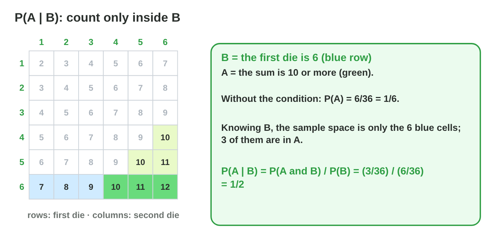
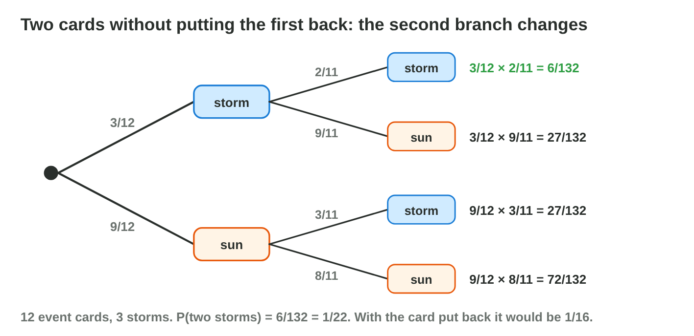
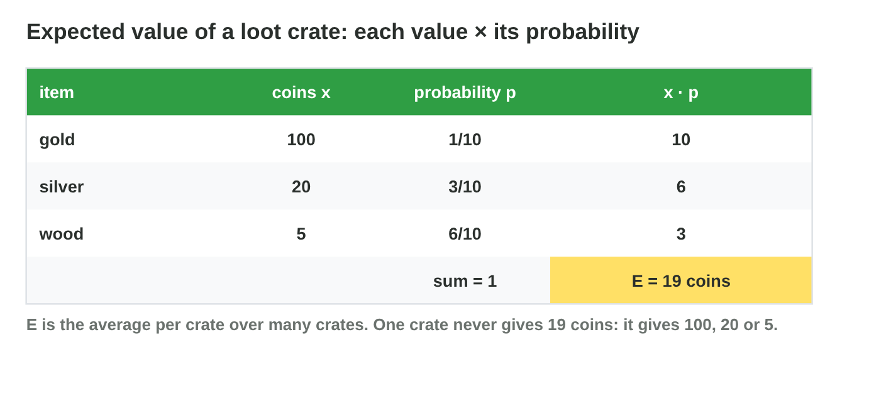
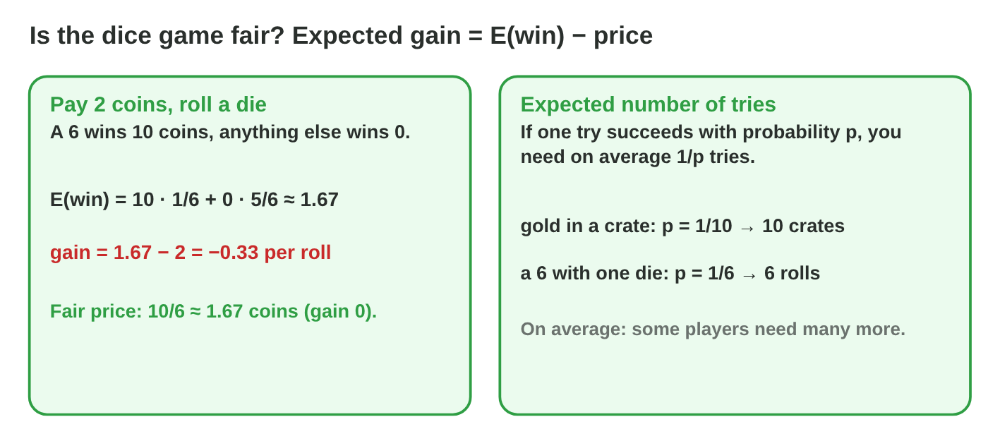
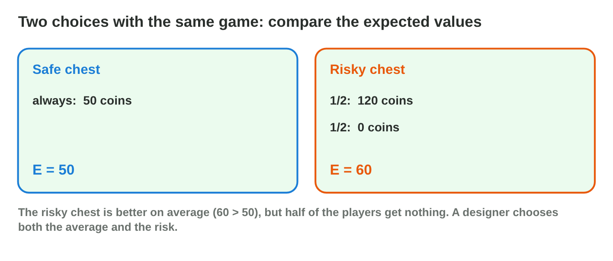

This page is the interactive version of the lesson notes (PDF). Each section
has a short summary, a picture, a **Do it** task and one set of questions.
The full explanations, examples and exercises are in the notes.

## Key terms



## 21.1 Conditional probability

- **P(A | B) = P(A and B) / P(B)**: the probability of A when B is known.
- Count A **only inside B**, divide by the outcomes of B.
- First die 6, sum ≥ 10: 3 of 6 → 1/2 (without the condition: 1/6).

{width=94%}



::: {.callout-warning title="Watch out!"}
After a condition, divide by the outcomes of B, not by 36.
:::

::: {.callout-note title="Do it · Count inside B"}
Find P(sum 7 | first die is 1), P(a double | the sum is even), and P(sum ≥
10 | at least one 6).
:::

::: {.callout-tip title="Try it 1 · Conditions"}
Use Conditional Lab. Choose the probability.

::: {.match extra="1/36|5/36"}
P(sum ≥ 10 | first die is 6)
:   1/2

P(a double | at least one 6)
:   1/11

P(sum 7 | first die is 1)
:   1/6

P(a double | the sum is even)
:   1/3
:::
:::

## 21.2 Dependent events and the multiplication rule

- **P(A and B) = P(A) × P(B | A)**.
- **Dependent:** the first result changes the second (no putting back).
- Two storms of 12 cards with 3 storms: 3/12 × 2/11 = **1/22**.

{width=94%}

::: {.callout-warning title="Watch out!"}
Without putting back, the second fraction changes: 2/11, not 3/12.
:::

::: {.callout-note title="Do it · A deck of quests"}
10 quest cards, 4 easy. Two draws without putting back: P(two easy), P(easy
then hard).
:::

::: {.callout-tip title="Try it 2 · Two draws"}
Choose the probability.

::: {.match extra="1/4|3/12"}
two storms, 3 of 12, no putting back
:   1/22

two storms, 3 of 12, put back
:   1/16

two easy quests, 4 of 10, no putting back
:   2/15

easy then hard, 4 easy of 10, no putting back
:   4/15
:::
:::

## 21.3 Independent or not?

- **Independent:** P(A | B) = P(A). Knowing B changes nothing.
- Two dice: independent. Cards without putting back: dependent.
- The past of a die does not change its next roll.

::: {.callout-warning title="Watch out!"}
"After three misses a hit must come" is wrong for independent rolls.
:::

::: {.callout-note title="Do it · Test"}
Independent? A double and first die 1; sum 7 and first die 6; sum 12 and
first die 6.
:::

::: {.callout-tip title="Try it 3 · Independence"}
Use Conditional Lab. Independent or dependent?

::: {.match extra="impossible|certain"}
second die 6, first die 6
:   independent

sum ≥ 10, first die 6
:   dependent

sum 7, first die 6
:   independent

two storm cards, no putting back
:   dependent
:::
:::

## 21.4 Random variables and the expected value

- A **random variable**: a number that depends on chance (coins, damage).
- **E = x₁p₁ + x₂p₂ + …**: the long-run average.
- Crate: 100·0.1 + 20·0.3 + 5·0.6 = **19 coins**.

{width=94%}



::: {.callout-warning title="Watch out!"}
(100 + 20 + 5) / 3 is not E: the probabilities are missing.
:::

::: {.callout-note title="Do it · Two crates"}
Open 1000 crates in **Crate Lab**. Then compute E for gold 50 (2/10), silver
20 (3/10), wood 0 (5/10).
:::

::: {.callout-tip title="Try it 4 · Expected values"}
Choose E.

::: {.match extra="41.7|125"}
100 (0.1), 20 (0.3), 5 (0.6)
:   19

10 (0.8), 25 (0.2)
:   13

50 (0.2), 20 (0.3), 0 (0.5)
:   16

4 (0.5), 0 (0.3), 10 (0.2)
:   4
:::
:::

## 21.5 Fair games and the number of tries

- **Expected gain = E(win) − price.** Fair: gain 0.
- Pay 2, win 10 on a 6: 1.67 − 2 ≈ −0.33. Fair price 1.67.
- Success with probability p: on average **1/p** tries.

{width=94%}

::: {.callout-warning title="Watch out!"}
1/p is an average: after 10 crates with p = 1/10, about 35 % still have no
gold.
:::

::: {.callout-note title="Do it · Fair or not?"}
A spinner with 8 parts; one wins 20 coins; a spin costs 3. Fair? Fair price?
Average spins to win?
:::

::: {.callout-tip title="Try it 5 · Fair games"}
Use Crate Lab. Choose the right answer.

::: {.match extra="+3 coins|100"}
gain: pay 2, win 10 on a 6
:   about −0.33

fair price for E = 19
:   19 coins

average crates with p = 1/20
:   20

fair price: 8 parts, one wins 20
:   2.5 coins
:::
:::

## 21.6 Decisions with expected value

- Compare choices by **E**; then think about the **risk**.
- Safe 50 (E = 50) or risky 120 with p = 1/2 (E = 60).
- A small prize instead of 0 lowers the risk for players.

{width=94%}

::: {.callout-warning title="Watch out!"}
The best single result ("120!") is not the best choice.
:::

::: {.callout-note title="Do it · Choose"}
A: 30 for sure. B: 100 with p = 0.25, else 10. Compute both E and choose one
for new players.
:::

::: {.callout-tip title="Try it 6 · Choices"}
Choose E.

::: {.match extra="120|0"}
safe chest
:   50

risky chest: 120 (1/2), 0 (1/2)
:   60

risky chest with a 20-coin prize instead of 0
:   70

B: 100 (0.25), 10 (0.75)
:   32.5
:::
:::

## Game challenge: Treasure Odds {.challenge}

Work alone. Use every section of today.

The treasure rooms of *Lucky Raft*: the **first die is a 6**, **two storms**
without putting back, a **crate**, a **dice game** for 2 coins, a **golden
key** with p = 1/20, and a **safe or risky** chest.



::: {.callout-tip title="Try it 7 · The rooms"}
Choose the right answer.

::: {.match extra="1/6|3/36"}
the door, knowing the first die is 6
:   1/2

two storm cards, no putting back
:   1/22

the golden key, average crates
:   20

the dice game, expected gain
:   about −0.33 coins
:::
:::

::: {.callout-tip title="Try it 8 · Design (harder)"}
Choose the right answer.

::: {.match extra="0 crates|always 10"}
P(no gold in 10 crates, p = 1/10)
:   about 0.35

E of 200 (1/20) and 10 (19/20)
:   19.5

gain: pay 5, win 30 with p = 1/8
:   −1.25

safe 40 or risky 100 (0.3) / 10 (0.7)
:   safe, 40 > 37
:::
:::

## Summary {.summary}

- P(A | B): count A only inside B.
- P(A and B) = P(A) × P(B | A); without putting back, the branches change.
- Independent: P(A | B) = P(A).
- E = Σ value × probability: the long-run average.
- Fair: expected gain 0. Average tries: 1/p.
- Compare choices by E, then think about the risk.
