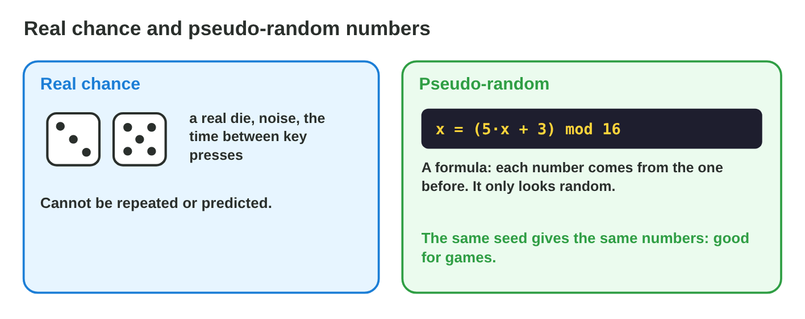
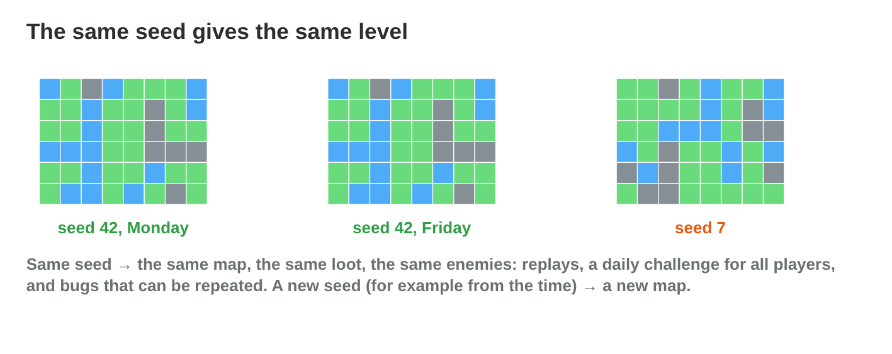
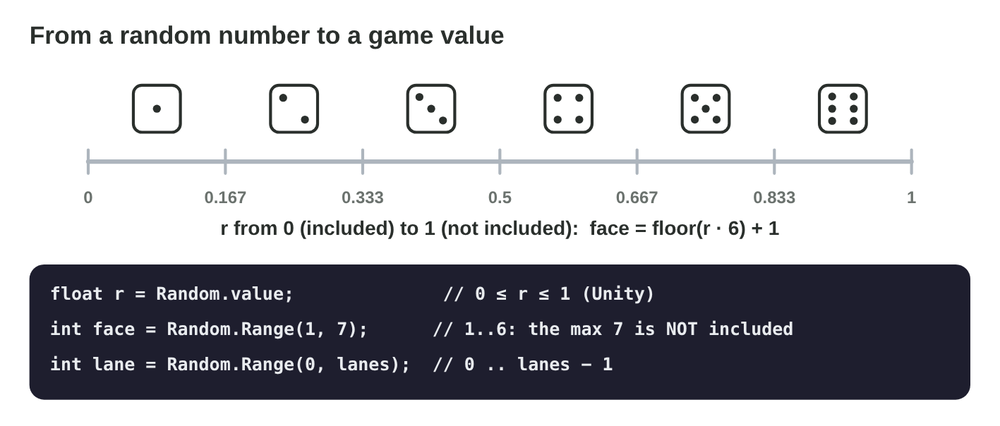

## Keywords



## 22.1 Why games need random numbers

:::: {.columns}
::: {.column width="50%"}
- Chance makes levels, loot and behaviour surprising.
- A computer makes pseudo-random numbers with a formula.
- The same start always gives the same numbers.
- **Do it:** List four random things in a game you play. Which is the most important?
:::
::: {.column width="50%"}

:::
::::

## Try it 1 · Real or pseudo?

a) Is a physical die real chance or pseudo-random?
b) Is x = (5x + 3) mod 16 real chance or pseudo-random?
c) What do we call making caves with random numbers?

::: {.answer}
a) real chance
b) pseudo-random
c) procedural generation
:::

## 22.2 The LCG

:::: {.columns}
::: {.column width="50%"}
- An LCG computes x(n+1) = (a·x(n) + c) mod m.
- Mod is the remainder of a division.
- The sequence repeats after at most m numbers.
- **Do it:** Compute 8 numbers with a = 3, c = 1, m = 8 and seed 2. What is the period?
:::
::: {.column width="50%"}

:::
::::

## Example · Seed 7

The LCG has a = 5, c = 3, m = 16 and the seed 7.
**Which numbers does it make?**

::: {.reveal}
1. x₁ = (5·7 + 3) mod 16 = 38 mod 16 = **6**.
2. x₂ = 33 mod 16 = **1**, and x₃ = 8 mod 16 = **8**.
3. All 16 values come once, then 7 again: the **period is 16**.
:::

## Live demo · LCG Lab



## Try it 2 · The LCG

a) What is 38 mod 16?
b) What is the period of a = 5, c = 3, m = 16?
c) What is the period with c = 4 and seed 7?

::: {.answer}
a) 6
b) 16
c) 1
:::

## 22.3 Seeds

:::: {.columns}
::: {.column width="50%"}
- The seed is the start value of the generator.
- The same seed gives the same sequence and the same level.
- The date as the seed gives a daily challenge.
- **Do it:** Build seed 42 twice in Seed Lab. Is the cave the same?
:::
::: {.column width="50%"}

:::
::::

## Example · The daily cave

Torch Hall has a daily cave that is the same for every player.
**How does the game do it?**

::: {.reveal}
1. The seed is today's date as a number: **20261025**.
2. Every player builds the cave with this seed, so the cave is **the same**.
3. Tomorrow the seed is **20261026**, and everybody gets a new cave.
:::

## Live demo · Seed Lab



## Try it 3 · Seeds

a) Which seed gives a new cave in every game?
b) Which seed gives the same cave to all players today?
c) What must a replay save with the inputs?

::: {.answer}
a) the time
b) the date
c) the seed
:::

## 22.4 From numbers to game values

:::: {.columns}
::: {.column width="50%"}
- Random.Range(min, max) with integers gives min to max − 1.
- Random.value < p gives a yes with probability p.
- a + r·(b − a) gives a value between a and b.
- **Do it:** Write the call for a lane 1, 2 or 3. What is the max?
:::
::: {.column width="50%"}

:::
::::

## Example · Dice, lanes and hits

The dice room, the lanes and the sword of Torch Hall all need random numbers.
**Which calls do they use?**

::: {.reveal}
1. A die uses **Random.Range(1, 7)**, because 7 is not included.
2. Three lanes 0, 1, 2 use **Random.Range(0, 3)**.
3. A critical hit with p = 0.2 uses **Random.value < 0.2f**.
:::

## Try it 4 · Calls

a) Which numbers does Random.Range(0, 10) give?
b) Which call gives a card from 0 to 51?
c) Which call gives a die with 8 faces?

::: {.answer}
a) 0 to 9
b) Random.Range(0, 52)
c) Random.Range(1, 9)
:::

## 22.5 Common bugs

:::: {.columns}
::: {.column width="50%"}
- We seed the generator once, at the start.
- We remember that the integer max is excluded.
- We use a good generator with a long period.
- **Do it:** Find the item that never drops with Range(0, Length − 1). Which is it?
:::
::: {.column width="50%"}

:::
::::

## Example · The five bats

Every bat calls Random.InitState((int)Time.time) in Update().
**Why do all bats fly the same way?**

::: {.reveal}
1. In one frame, **Time.time is the same** for all bats.
2. The same seed gives **the same first number** to every bat.
3. The fix is to **seed once** when the level starts.
:::

## Try it 5 · Bugs

a) What happens when every bat seeds a generator with the same time?
b) Why does Random.Range(1, 6) never give a 6?
c) Which item never drops with Random.Range(0, items.Length − 1)?

::: {.answer}
a) All bats get the same numbers.
b) The integer max is not included.
c) the last item
:::

## Game challenge · Seed Detective



## Try it 6 · Compute (harder)

a) What follows 12 with a = 5, c = 3, m = 16?
b) What is the period with a = 3, c = 1, m = 8 and seed 2?
c) What is the sequence with a = 1, c = 0, m = 10 and seed 4?

::: {.answer}
a) 15
b) 4
c) 4, 4, 4, …
:::

## Summary

- Games use pseudo-random numbers from a formula.
- An LCG has a period of at most m.
- The same seed gives the same sequence and the same level.
- Random.Range with integers excludes the max.
- We seed once, mind the range and use a good generator.
