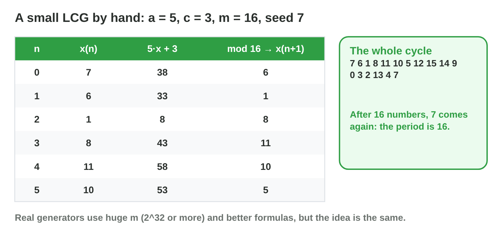

This page is the interactive version of the lesson notes (PDF). Each section
starts with a problem in a game. Then it explains the idea behind it. It ends
with a **Do it** task and one set of questions. Every question on this page
has its answer: try first, then check.

## Key terms



## 15.1 Why games need random numbers

- Chance gives levels, loot, behaviour and critical hits.
- A computer makes **pseudo-random numbers** with a formula (a **PRNG**).
- They look random; the same start gives the same numbers.

{width=94%}

::: {.callout-warning title="Watch out!"}
Good PRNGs are right for games; passwords and payments need secure ones.
:::

::: {.callout-note title="Do it · Find the chance"}
Write four things in a game you play that come from random numbers.

::: {.check}
A good list names four different things, for example the map of a level,
the item in a chest, where an enemy moves next, and a critical hit. Each one
changes from game to game without the player choosing it.
:::
:::

::: {.callout-tip title="Try it 1 · Real or pseudo?"}
Choose the right answer. You can use an answer more than once.

::: {.match extra="a picture|the frame rate"}
Where does the chance of a physical die come from?
:   real chance

    Why: the die is in the physical world; nobody computes it.

What kind of number does x = (5x + 3) mod 16 give?
:   pseudo-random

    Why: a formula computes each number from the one before.

Which numbers repeat when they start the same way?
:   pseudo-random

    Why: the same start always gives the same numbers.

What builds the walls of each new cave from random numbers?
:   procedural generation

    Why: the game builds the level from random numbers and rules.
:::
:::

## 15.2 A generator by hand: one LCG step

- **x(n+1) = (a·x(n) + c) mod m**; mod = the remainder of a division.
- Values 0 … m − 1; the first value is the **seed**.
- a = 5, c = 3, m = 16, seed 7: (5·7 + 3) mod 16 = 38 mod 16 = 6.
- The sequence repeats after at most m numbers: the **period**.

{width=94%}

::: {.callout-warning title="Watch out!"}
Use the generator of the engine; a home-made one with a small m repeats soon.
:::

::: {.callout-note title="Do it · By hand"}
a = 3, c = 1, m = 8, seed 2: compute the next two numbers.

::: {.check}
(3·2 + 1) mod 8 = **7**; (3·7 + 1) mod 8 = 22 mod 8 = **6**.
:::
:::

::: {.callout-tip title="Try it 2 · One step"}
Choose the right answer.

::: {.match extra="5|8"}
What is 27 mod 8?
:   3

    Why: 27 = 3 × 8 + 3: the remainder is 3.

What is 20 mod 5?
:   0

    Why: 20 = 4 × 5: no remainder.

a = 5, c = 3, m = 16. Which number follows 3?
:   2

    Why: 5·3 + 3 = 18, and 18 mod 16 = 2.

What is the longest period with m = 16?
:   16

    Why: there are only 16 values, 0 … 15.
:::
:::

## 15.3 Seeds: the same start, the same numbers

- **Same seed → same sequence → same level.**
- Seed from the **time**: a new game. From a **shared number**: the same
  world for friends. From the **date**: a daily challenge.
- **Seed once**, when the level starts. Seeding again in every frame gives
  the same numbers again and again.

{width=94%}



::: {.callout-warning title="Watch out!"}
Seeding from the time gives friends different worlds.
:::

::: {.callout-note title="Do it · Seeds"}
In **Seed Lab**, build seed 42 twice, then 43, then the daily challenge.
Write what stays the same.

::: {.check}
Seed 42 twice gives exactly the same level; 43 gives another level. The
daily challenge uses today's date: the same level for everyone today.
:::
:::

::: {.callout-tip title="Try it 3 · Seeds"}
Use Seed Lab. Choose the right answer.

::: {.match extra="the player's name|a bigger font"}
Which seed gives a new cave in every game?
:   the time

    Why: the time is different at every start.

Which seed gives the same cave to all players today?
:   the date

    Why: everyone has the same date today.

Which seed gives two friends the same world?
:   a number they share

    Why: the same seed gives the same world.

Five bats seed with the time in every frame. What happens?
:   they all fly the same way

    Why: in one frame the time, and so the seed, is the same for all.
:::
:::

## 15.4 From random numbers to game values

- Integer: **Random.Range(min, max)** gives min … max − 1.
- Yes with probability p: **Random.value < p**.
- Between a and b: **a + r·(b − a)**.
- A die: Random.Range(1, 7). A critical hit with p = 0.2:
  Random.value < 0.2f.

{width=94%}

::: {.callout-warning title="Watch out!"}
Random.Range(1, 6) never gives a 6.
:::

::: {.callout-note title="Do it · Write the call"}
Write calls for a card 0 … 51, a lane 1, 2 or 3, and a miss with p = 0.15.

::: {.check}
`Random.Range(0, 52)`; `Random.Range(1, 4)`; `Random.value < 0.15f`. The
integer max is not included.
:::
:::

::: {.callout-tip title="Try it 4 · Calls"}
Choose the call.

::: {.match extra="Random.Range(1, 8)|Random.value > 1"}
Which call gives a die with 8 faces, 1 … 8?
:   Random.Range(1, 9)

    Why: the max 9 is not included.

Which call gives a month, 1 … 12?
:   Random.Range(1, 13)

    Why: the max 13 is not included.

Which call gives a spawn point 0 … 9?
:   Random.Range(0, 10)

    Why: 10 values, from 0 up to 10 − 1.

Which condition gives a dodge with p = 0.3?
:   Random.value < 0.3f

    Why: Random.value is below 0.3 in 30 % of the cases.
:::
:::

## 15.5 Distributions: is every value equally likely?

- A **distribution**: every value with its probability; the sum is 1.
- A **histogram**: how often each value came in many tries.
- **Uniform:** every value equally likely, 1/n each. In a range, the chance
  of a part = its length ÷ the whole length.
- A bat appears after 2 … 6 s: P(from 2 to 3 s) = 1/4.

{width=94%}

::: {.callout-warning title="Watch out!"}
Uniform rarities make legendary items common (25 % with four rarities).
:::

::: {.callout-note title="Do it · Uniform chances"}
Random.Range(0, 8): P(5)? Random.Range(0f, 10f): P(from 7 to 10)?

::: {.check}
1/8 (8 values). 3/10 (3 units of 10).
:::
:::

::: {.callout-tip title="Try it 5 · Distributions"}
Choose the probability. You can use an answer more than once.

::: {.match extra="1/3|2/3"}
Two coins. What is P(exactly one head)?
:   1/2

    Why: HT and TH: 2 of 4.

What do all probabilities of a distribution add up to?
:   1

    Why: one of the values always comes.

Random.Range(0, 5) gives 3. The probability?
:   1/5

    Why: 5 equally likely values, 0 … 4.

Random.Range(0f, 20f) gives 15 … 20. The probability?
:   1/4

    Why: 5 units of 20.

Four rarities, uniform. What is P(legendary)?
:   1/4

    Why: uniform: 1/n with n = 4.
:::
:::

## 15.6 Weighted random choice

- **P(i) = wᵢ ÷ sum of the weights.**
- Pick: cumulative weights, r from 0 to the sum, the first cumulative value
  above r.
- A **loot table** is a list of items with weights. Weight 0 = never.
- Chest 60, 30, 9, 1: cumulative 60, 90, 99, 100; r = 72 → rare.

{width=94%}



::: {.callout-warning title="Watch out!"}
Use r < cumulative, so that weight 0 never drops.
:::

::: {.callout-note title="Do it · A loot table"}
In **Loot Table Lab**, open 1000 chests; then make epic 5 % and write the
weights.

::: {.check}
1000 chests give about 600, 300, 90 and 10. For epic 5 %, for example
60, 34, 5, 1: 5 of 100.
:::
:::

::: {.callout-tip title="Try it 6 · Weights"}
Use Loot Table Lab. Choose the right answer.

::: {.match extra="8/70|0 %"}
Weights 70, 20, 8, 2. What is P(epic, the 8)?
:   8 %

    Why: 8 ÷ 100.

Weights sword 1, axe 4. What is P(axe)?
:   4/5

    Why: 4 ÷ (1 + 4).

Cumulative 70, 90, 98, 100 and r = 75. Which item?
:   rare

    Why: 75 is from 70 to 90.

Cumulative 70, 90, 98, 100 and r = 98.5. Which item?
:   legendary

    Why: 98.5 is from 98 to 100.
:::
:::

## Game challenge: Loot Forge {.challenge}

Work alone. Use every section of today.

The loot designer of *Torch Hall* has six questions. A chest has the loot
table **common 50, rare 35, epic 12, legendary 3**. A rack holds a **bow with
weight 2** and an **axe with weight 3**. The cumulative weights of the chest
are **50, 85, 97, 100**, and the random number is r = 90. A critical hit
should come with **15 %**. The daily cave must be **the same for all
players**. And one item has the **weight 0**.



::: {.callout-tip title="Try it 7 · The forge"}
Chest 50, 35, 12, 3 (cumulative 50, 85, 97, 100); bow 2, axe 3; critical
hit 15 %. Choose the right answer.

::: {.match extra="12/50|3 %"}
What is P(epic) in the chest?
:   12 %

    Why: 12 ÷ 100.

What is P(axe) on the rack?
:   3/5

    Why: 3 ÷ (2 + 3).

r = 90. Which item drops?
:   epic

    Why: 90 is from 85 to 97.

Which condition gives the critical hit?
:   Random.value < 0.15f

    Why: below 0.15 in 15 % of the cases.
:::
:::

::: {.callout-tip title="Try it 8 · Tune the forge (harder)"}
The same chest: 50, 35, 12, 3, cumulative 50, 85, 97, 100. Choose the right
answer.

::: {.match extra="rare|item 0"}
r = 85 exactly. Which item drops?
:   epic

    Why: r < 85 is false, r < 97 is true.

Only the common weight changes, so that legendary (3) is 1 %. The new common weight?
:   250

    Why: the sum must be 300, so common = 300 − 35 − 12 − 3.

About how many epic items come from 1000 chests?
:   about 120

    Why: 12 % of 1000.

Items 0 … 4 use Random.Range(0, 4). Which item never drops?
:   item 4

    Why: the max 4 is not included.
:::
:::

## Summary {.summary}

- A PRNG computes numbers with a formula; the same seed gives the same numbers.
- An LCG step is (a·x + c) mod m; the sequence repeats after its period.
- Seed once: with the time, a shared number or the date.
- Random.Range(min, max) with integers never gives max; Random.value < p is a yes with probability p.
- Uniform: every value equally likely. Weighted: P(i) = wᵢ ÷ the sum of the weights.
